# State Machines

Eighteen machines. For each: the diagram, then a transition table giving the **trigger**, the
**actor allowed to fire it**, the **guard** that must hold, and the **event emitted**.

Rules that apply to every machine on this page:

- A transition not listed is **forbidden**, and the aggregate must reject it — not the controller.
- Terminal states are marked. Nothing leaves them; a correction creates a new document.
- Every transition that other services care about emits an event. If no event is listed, the
  transition is private to the owning service.
- Guards are business rules and carry a `BR-` id from `05-business-rules.md`.

---

## 1. Product — `product-service`

WBS 3.1.1.3 (Draft → Pending → Approved), 3.1.8.1 (discontinuation), SCRUM-461 (suspension, brand, reason, history).

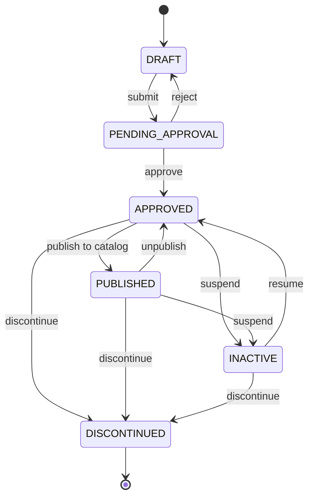

| From | To | Trigger | Actor | Guard | Event |
|---|---|---|---|---|---|
| — | DRAFT | create | E-commerce admin | SKU unique (BR-PRD-002) | — |
| DRAFT | PENDING_APPROVAL | submit | E-commerce admin | all mandatory fields present, brand included (BR-PRD-001) | — |
| PENDING_APPROVAL | APPROVED | approve | E-commerce admin (approver) | approver ≠ submitter (BR-PRD-003) | `ProductApproved` |
| PENDING_APPROVAL | DRAFT | reject | E-commerce admin (approver) | rejection reason given | — |
| APPROVED | PUBLISHED | publish | E-commerce admin | has price, image, category (BR-PRD-004) | `ProductPublished` |
| PUBLISHED | APPROVED | unpublish | E-commerce admin | — | `ProductUnpublished` |
| APPROVED / PUBLISHED | INACTIVE | suspend | `product-lifecycle:APPROVE` (System Admin only, kltn-docs 01 §5.1) | reason given (BR-PRD-007) | `CatalogListingChanged` |
| INACTIVE | APPROVED | resume | `product-lifecycle:APPROVE` (System Admin only, kltn-docs 01 §5.1) | — (publish again to show it) | `CatalogListingChanged` |
| APPROVED / PUBLISHED / INACTIVE | DISCONTINUED | discontinue | `product-lifecycle:APPROVE` (System Admin only, kltn-docs 01 §5.1) | reason given (BR-PRD-007). Open POs and unshipped orders are **warned about, not blocked** (BR-PRD-005) | `ProductDiscontinued` (with the reason) |

**INACTIVE** (kltn-docs 01 §5.1): not shown on the storefront, no new purchase order lines; orders and
receipts already running continue. Its variants and images are still maintained.

**DISCONTINUED is terminal.** Every variant becomes `OBSOLETE` (kltn-docs 01 §5.2: shipped and adjusted
only to clear the stock). Existing stock stays sellable-through, goods on open purchase orders are received
as usual, but no new purchase order line takes the SKU. Only a DRAFT product is deleted (BR-PRD-008).
Every move is written to `product.product_change_log` with its from/to status, reason and actor.

---

## 2. Purchase Order — `procurement-service`

WBS 3.2.4.3 names `Draft → Confirmed → Received → Closed`; approval (3.2.2) and amendment
(3.2.5) add the states between.

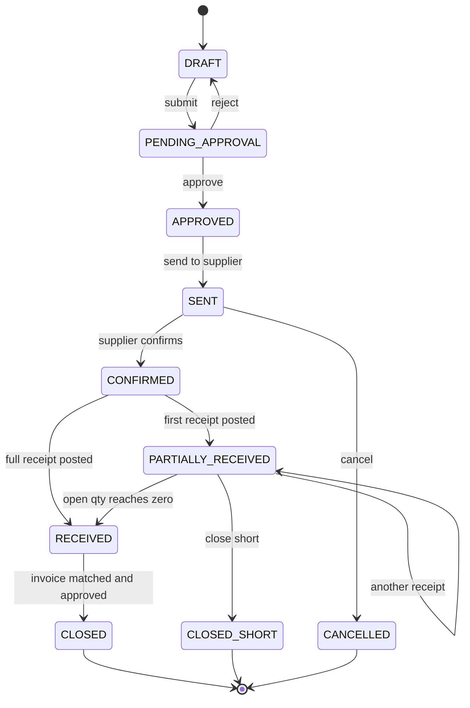

| From | To | Trigger | Actor | Guard | Event |
|---|---|---|---|---|---|
| — | DRAFT | create | Procurement staff | supplier active, ≥1 line | — |
| DRAFT | PENDING_APPROVAL | submit | Procurement staff | total ≥ 0, MOQ respected (BR-PO-001) | — |
| PENDING_APPROVAL | APPROVED | approve | approver per threshold | approver's limit ≥ PO total (BR-PO-002) | `PurchaseOrderApproved` |
| PENDING_APPROVAL | DRAFT | reject | approver | reason given | — |
| APPROVED | SENT | send | Procurement staff | supplier has email or API endpoint | `PurchaseOrderSent` |
| SENT | CONFIRMED | supplier confirms | Procurement staff (records it) | — | `PurchaseOrderConfirmed` |
| SENT | CANCELLED | cancel | Procurement staff | nothing received yet | `PurchaseOrderCancelled` |
| CONFIRMED / PARTIALLY_RECEIVED | PARTIALLY_RECEIVED | receipt posted | system | receipt total < ordered | — |
| CONFIRMED / PARTIALLY_RECEIVED | RECEIVED | receipt posted | system | open qty = 0, within over-receipt tolerance (BR-RCP-001) | `PurchaseOrderFullyReceived` |
| PARTIALLY_RECEIVED | CLOSED_SHORT | close short | Procurement staff | reason given; remaining qty written off | `PurchaseOrderClosedShort` |
| RECEIVED | CLOSED | invoice approved | Accountant | three-way match passed or override approved (BR-INV-003) | `PurchaseOrderClosed` |

**Amendment (WBS 3.2.5)** is not a state. Amending a PO in `SENT` or later creates
**revision n+1** of the same PO number and emits `PurchaseOrderAmended`; the previous revision is
retained for the audit trail. Amendment is forbidden once any receipt exists (BR-PO-004).

---

## 3. Goods Receipt — `procurement-service`

**Changed 2026-10-09** to the receiving docs (KLTN-FA26/docs 03 Receipt, 05 Putaway, commit
`084365d`) and migration `V20260929000250`. Receiving is a 2-step or 3-step flow, chosen per SKU by
the inventory item's **QC required** flag (snapshotted on the receipt line):

| Flow | SKU | Path |
|---|---|---|
| 3 steps | `qc_required` | supplier → Area `RECEIVING` → Area `QUALITY_CONTROL` → bin |
| 2 steps | not QC-required | supplier → Area `RECEIVING` → bin |

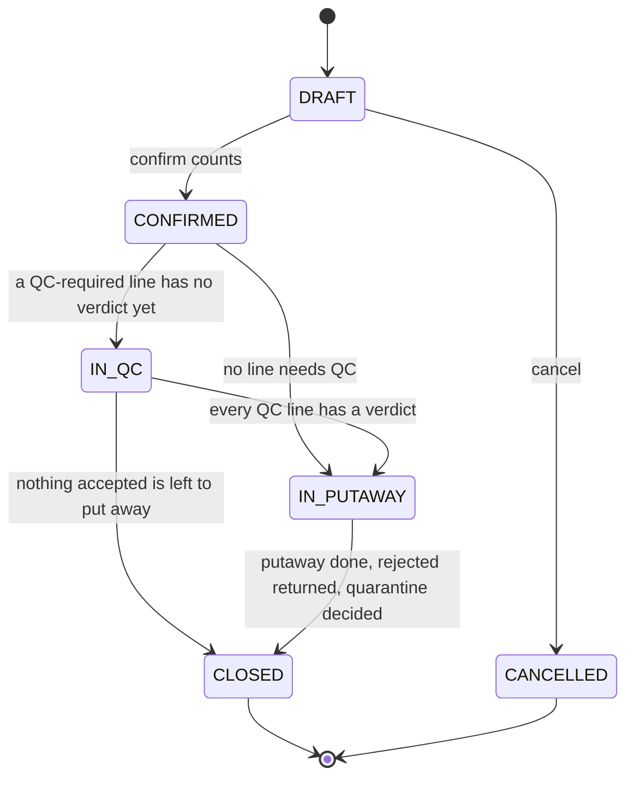

| From | To | Trigger | Actor | Guard | Event |
|---|---|---|---|---|---|
| — | DRAFT | create from PO | Warehouse staff | PO `CONFIRMED` / `PARTIALLY_RECEIVED` (BR-RCP-001) | — |
| DRAFT | CONFIRMED | confirm | Warehouse staff | lot / expiry where required (BR-RCP-003); over-receipt within tolerance, else manager approval | `GoodsReceived` |
| DRAFT | CANCELLED | cancel | Warehouse staff | never confirmed (`ck_goods_receipts_cancelled`) | — |
| CONFIRMED | IN_QC | — | system | ≥1 line with `qc_required`; a **move-to-QC task** (`move_task.origin = RECEIPT_QC`) is created per such line | — |
| CONFIRMED | IN_PUTAWAY | — | system | no line needs QC; putaway tasks from `RECEIVING` | — |
| IN_QC | IN_PUTAWAY | last QC verdict | QC staff | QC only on goods already in the QC area (BR-08); accepted + quarantined + rejected = moved quantity | `QcCompleted` |
| IN_PUTAWAY / IN_QC | CLOSED | — | system | every line handled | — |

**What confirming does to inventory.** Stock rows appear in the `RECEIVING` area in condition
**INBOUND** (machine 5). A QC-required line then moves `RECEIVING → QUALITY_CONTROL` (still INBOUND);
QC splits it: **accepted** → putaway task from the QC area; **quarantine** → Area `QUARANTINE`,
condition QUARANTINE; **rejected** → Area `QUARANTINE`, condition BLOCKED, return to vendor. A
confirmed receipt is never deleted; mistakes are reversals or adjustments with a reason (BR-05).

---

## 4. Supplier Invoice — `procurement-service`

WBS 3.4.3 (three-way match), 3.4.4 (exceptions), 3.4.5.2 (Pending/Paid).

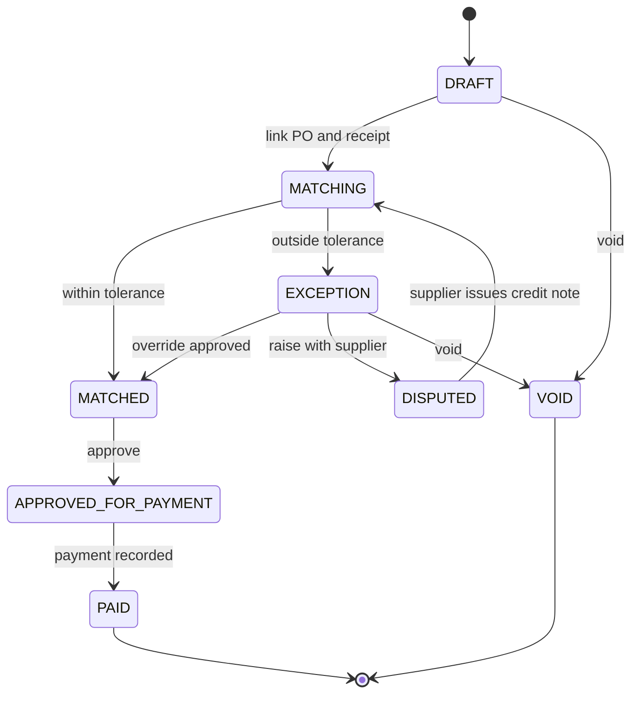

| From | To | Trigger | Actor | Guard | Event |
|---|---|---|---|---|---|
| — | DRAFT | enter invoice | Accountant | supplier invoice number unique per supplier (BR-INV-001) | — |
| DRAFT | MATCHING | link | Accountant | at least one PO and one receipt linked | — |
| MATCHING | MATCHED | auto | system | qty and price within tolerance (BR-INV-002) | `InvoiceMatched` |
| MATCHING | EXCEPTION | auto | system | outside tolerance | `InvoiceMatchException` |
| EXCEPTION | MATCHED | override | Accountant with approval limit | approver's limit ≥ variance (BR-INV-003) | `InvoiceOverrideApproved` |
| EXCEPTION | DISPUTED | dispute | Accountant | reason recorded | — |
| DISPUTED | MATCHING | credit note posted | Accountant | credit note linked | — |
| MATCHED | APPROVED_FOR_PAYMENT | approve | Accountant | within payment approval limit | `InvoiceApprovedForPayment` |
| APPROVED_FOR_PAYMENT | PAID | record payment | Accountant | — | `SupplierInvoicePaid` |

---

## 5. Stock condition — `inventory-service`

This machine governs the **condition** dimension only. Quantities (on hand / reserved /
allocated) are numbers on the same record, not states — see `01-ubiquitous-language.md`.
Stored as `inventory.stock_item.status`; `GOOD` in older text is `AVAILABLE`.

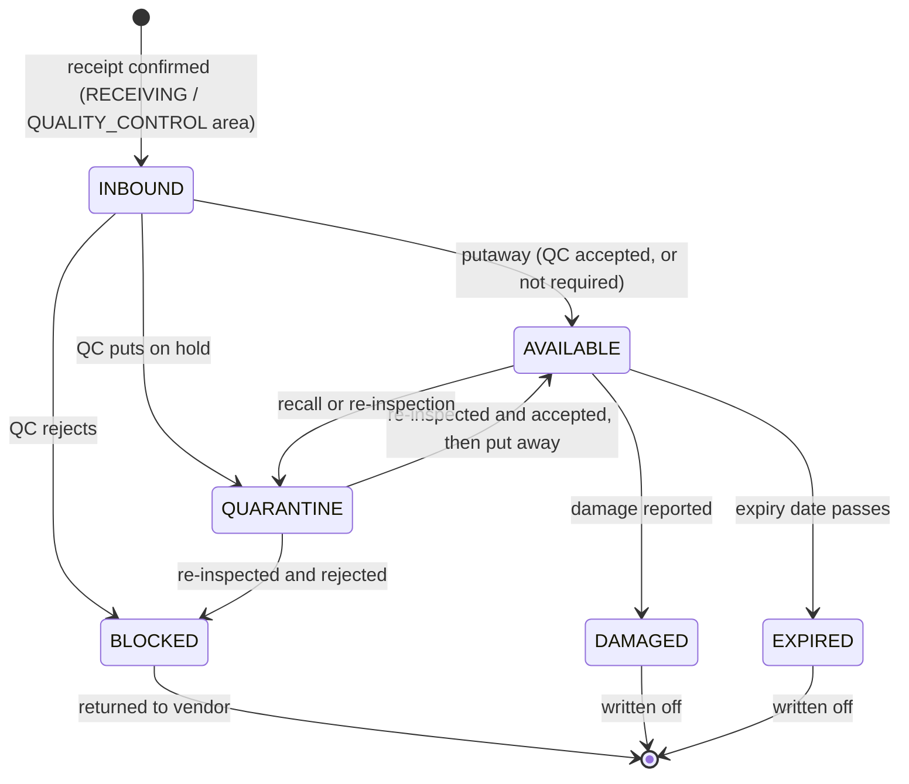

| From | To | Trigger | Actor | Guard | Event |
|---|---|---|---|---|---|
| — | INBOUND | receipt confirmed | system | — | `StockReceived` |
| INBOUND | AVAILABLE | putaway completed | Warehouse staff | QC accepted or not required (docs 05 BR-01) | `StockPutAway` |
| INBOUND | QUARANTINE / BLOCKED | QC verdict | QC staff | reason given | `QcCompleted` |
| QUARANTINE | AVAILABLE | re-inspection accepts | QC staff | then putaway from the `QUARANTINE` area | `StockReleasedFromQuarantine` |
| QUARANTINE | BLOCKED | re-inspection rejects | QC staff | reason given | `StockBlocked(BLOCKED)` |
| BLOCKED | left stock | return to vendor | Procurement staff | movement out of the warehouse | `ReturnToVendorRaised` |
| AVAILABLE | DAMAGED | report damage | Warehouse staff | reason and photo (BR-STK-003) | `StockBlocked(DAMAGED)` |
| AVAILABLE | EXPIRED | nightly sweep | system | `expiry_date < today` (BR-STK-004) | `StockBlocked(EXPIRED)` |
| AVAILABLE | QUARANTINE | recall | Warehouse manager | reason given | `StockBlocked(QUARANTINE)` |
| DAMAGED / EXPIRED | written off | write-off | Warehouse manager | approved adjustment (BR-STK-005) | `StockWrittenOff` |

**Only AVAILABLE counts towards ATP.** That single sentence is the reason this dimension is separate
from the quantity buckets: inbound, quarantined and blocked stock is on hand, occupies its location, appears in a
physical count, and is invisible to the storefront.

**Reserved stock whose condition turns bad.** If AVAILABLE stock with an outstanding reservation moves
to DAMAGED or EXPIRED, the reservation is *not* silently dropped — `inventory-service` emits
`ReservationImpaired`, and `order-service` puts the order on hold with reason
`INVENTORY_ISSUE` (WBS 3.17.6.1). Dropping it quietly is how a paid order never ships.

---

## 6. Stock reservation — `inventory-service`

WBS 3.14.5.1 (time-limited) and 3.14.5.2 (expiry and auto-release).

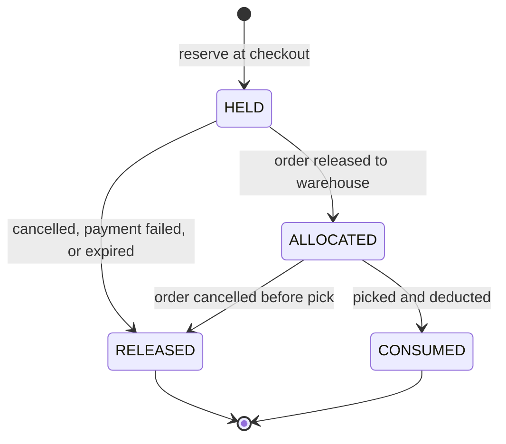

| From | To | Trigger | Actor | Guard | Event |
|---|---|---|---|---|---|
| — | HELD | reserve | system, at checkout | ATP ≥ requested (BR-STK-001) | `StockReserved` |
| HELD | RELEASED | expiry sweep | system | `expires_at < now` (BR-STK-002) | `StockReservationReleased(RESERVATION_EXPIRED)` |
| HELD | RELEASED | payment failed | system | — | `StockReservationReleased(PAYMENT_FAILED)` |
| HELD | RELEASED | customer cancels | Customer / Sales staff | order not yet released | `StockReservationReleased(ORDER_CANCELLED)` |
| HELD | ALLOCATED | order released | Order coordinator | a location and lot chosen by FEFO (BR-STK-006) | `StockAllocated` |
| ALLOCATED | CONSUMED | pick confirmed | Warehouse staff | picked qty = allocated qty | `StockDeducted` |
| ALLOCATED | RELEASED | cancel after allocation | Order coordinator | not yet picked; put-back task raised (WBS 3.7.7.2) | `StockReservationReleased(ORDER_CANCELLED)` |

**As built (SCRUM-152, 2026-10-17).** Both kinds live in `inventory.stock_reservation`. A SKU reservation
(`stock_item_id` NULL) is the HELD row above: checkout, payment pin/re-arm, expiry sweep, cancellation. Release
to a warehouse turns it ALLOCATED and writes one allocation per bin and lot (`stock_item_id` set,
`allocated_from_id` = the reservation, `expires_at` NULL); each allocation then goes HELD → CONSUMED (pick) or
RELEASED (cancel, or `SHORT_PICKED` when X-SHORT reallocates it elsewhere). The order line swaps the reservation id
for the allocation ids. Production holds and checkout holds placed before this change are stock-item rows that
were never SKU reservations; they keep their old lifecycle.

**The reservation clock is the most under-specified part of the BRD.** WBS 3.14.5.1 says
"time-limited" without saying how long. See `06-open-questions.md`, OQ-03.

---

## 7. Putaway task — `warehouse-service`

WBS 3.3.6 (generation), 3.5.4 (management).

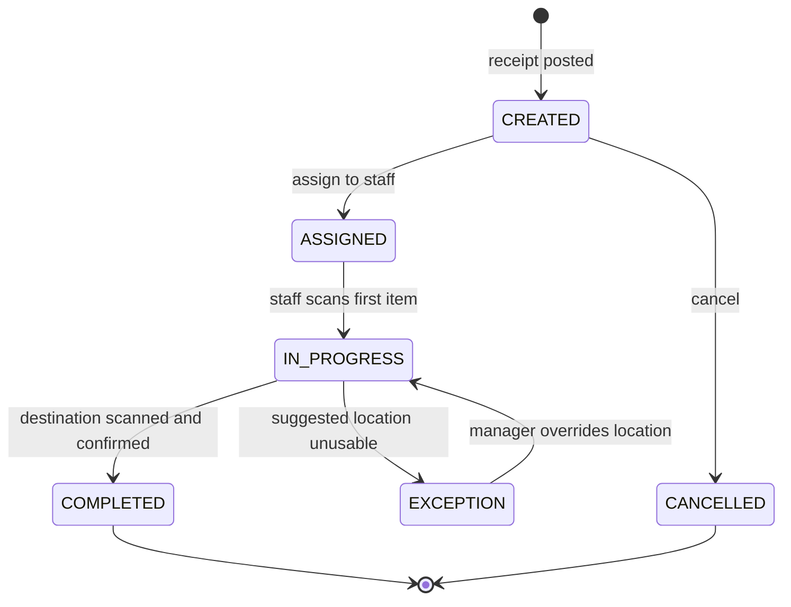

| From | To | Trigger | Actor | Guard | Event |
|---|---|---|---|---|---|
| — | CREATED | receipt posted | system | slotting engine returns ≥1 suggestion (BR-SLT-001) | `PutawayTaskCreated` |
| CREATED | ASSIGNED | assign | Warehouse manager, or auto | staff assigned to that warehouse | — |
| ASSIGNED | IN_PROGRESS | scan item | Warehouse staff | scanned SKU matches the task | — |
| IN_PROGRESS | COMPLETED | confirm location | Warehouse staff | scanned location = suggested, or override approved (BR-SLT-002) | `PutawayCompleted` |
| IN_PROGRESS | EXCEPTION | report blocked | Warehouse staff | reason given | — |
| EXCEPTION | IN_PROGRESS | override | Warehouse manager | new location passes hard constraints (BR-SLT-003) | — |

`PutawayCompleted` is what moves stock from the receiving area to a real bin. Until then, the
stock exists with the location code of a `RECEIVING` area (e.g. `HCM-RCV01`) and is **not**
pickable.

---

## 8. Design snapshot — `design-service`

WBS 3.12.5 (immutable artifact), 3.12.4 (preflight), 3.8.3 (verification at packing).

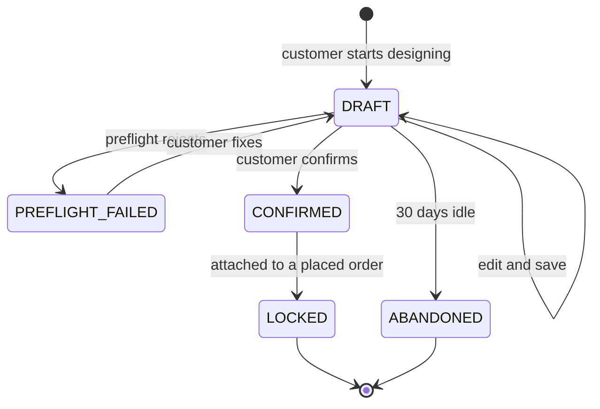

| From | To | Trigger | Actor | Guard | Event |
|---|---|---|---|---|---|
| — | DRAFT | open the studio | Customer / Sales staff | SKU has a print configuration | — |
| DRAFT | PREFLIGHT_FAILED | confirm attempted | system | DPI, bleed, safe area or colour mode fails (BR-DSG-001) | — |
| DRAFT | CONFIRMED | confirm | Customer / Sales staff | preflight passed | `DesignConfirmed` |
| CONFIRMED | LOCKED | order placed | system | order line references this snapshot | — |
| DRAFT | ABANDONED | idle sweep | system | untouched 30 days and not on an order | — |

**A CONFIRMED snapshot is never edited.** "Changing the design" creates a **new snapshot** and
re-points the order line, which is allowed only while the order is in `PENDING_PAYMENT` or
`CONFIRMED` (BR-DSG-002). After that the print file may already be at the press.

The checksum stored on the order line is compared again at packing (WBS 3.8.3). A mismatch is not
a warning — it stops the pack and raises an exception, because it means the parcel does not
contain what the customer approved.

---

## 9. Order — `order-service`

The central machine. WBS 3.17.1.1 spells it out:
`Pending Payment → Confirmed → Ready to Fulfill → In Production → Picking → Packed → Shipped →
Delivered → Completed/Cancelled`. Hold (3.17.6) and RMA (3.17.5) attach to it.

**Changed 2026-10-06** (B2B only, production module): an order is a wholesale order created from
an accepted quote or on the customer portal. A **credit** order skips `PENDING_PAYMENT` — it is
`CONFIRMED` within the customer's credit limit, `ON_HOLD` (reason `CREDIT`) above it. Release
sends print lines to production **before** the order is ready to fulfil: `CONFIRMED →
IN_PRODUCTION → READY_TO_FULFILL`, and the order leaves `IN_PRODUCTION` only when every production
order of the order is completed (machine 16).

**Implemented 2026-10-19 (G3-2, SCRUM-239/246/247).** The statuses of kltn-docs 17 §5, written twice: the
exhaustive switch `OrderStatus.canTransitionTo` and the table `ordering.order_status_transition`, which the trigger
`tg_order_status_transition` enforces on every `UPDATE` of a status (the two are compared by
`OrderStatusTest`, `OrderLifecycleIntegrationTest` and `OrderLifecycleMigrationUpgradeTest`). `IN_FULFILMENT` is gone
(rows became `PICKING`, or `PACKED` when a package was completed); there is no `PAYMENT_FAILED` (G3-Q2: a bank
transfer that never comes is a cancellation when the hold runs out). Every change writes a history row with who made
it and why (`order_status_history.actor_id`, `reason`).

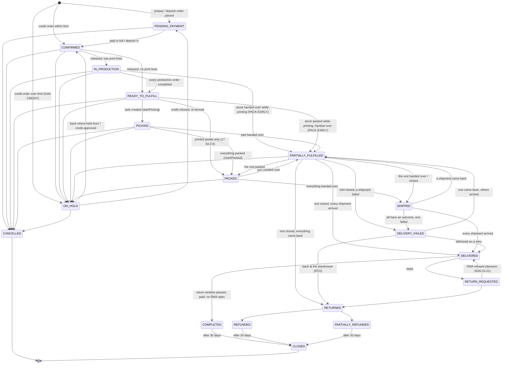

| From | To | Called by | Guard |
|---|---|---|---|
| READY_TO_FULFILL | PICKING | fulfillment `createTask` → `OrderService.startPicking` (same transaction, A1) | released; IN_PRODUCTION with stock lines is a no-op (stock lines picked in parallel, 17 §4.2.5); IN_PRODUCTION with print lines only is refused |
| READY_TO_FULFILL / PICKING / PARTIALLY_FULFILLED | PACKED | fulfillment `completePacking` → `markPacked` | not ON_HOLD (resolve first); records `packed_at`; a completion leaving goods behind needs `allow_partial_shipment` (`PACK_PARTIAL_NOT_ALLOWED`) |
| PICKING / PACKED / PARTIALLY_FULFILLED, and IN_PRODUCTION / READY_TO_FULFILL (PACK-EARLY) | PARTIALLY_FULFILLED / SHIPPED | G4-2a handover → `recordHandover(shipment, lines, leavingWith)` | `ORDER_BALANCE_NOT_PAID` when money is due before the goods leave (G3-Q4); units ≤ what is left; everything at once from PICKING / IN_PRODUCTION / READY_TO_FULFILL is refused (pack first); goods left behind (not in this shipment nor in the order's others signed with it) need `allow_partial_shipment` (`ORDER_PARTIAL_SHIPMENT_NOT_ALLOWED`) |
| PACKED | SHIPPED | `markShipped` (whole order, no shipment recorded) | as above |
| SHIPPED … | DELIVERED / DELIVERY_FAILED / RETURNED / PARTIALLY_FULFILLED | `recordShipmentDelivered / …DeliveryFailed / …Returned` per shipment; `POST /orders/{id}/delivery`, `/delivery-failure` for an order without shipments (`ORDER_DELIVERY_VIA_SHIPMENT` otherwise, G4-Q5) | failure needs a reason (09 BR-02) |
| PARTIALLY_FULFILLED | the shipments' status | `POST /orders/{id}/remainder-closure` (Sales / coordinator) | the unshipped units are closed (`order_line.cancelled_quantity`), their holds released, `OrderRemainderClosed` asks payment to refund what was received above the order's new worth |
| CONFIRMED … PACKED, PARTIALLY_FULFILLED | ON_HOLD | `POST /orders/{id}/hold` (coordinator), design mismatch at packing (system), credit check (system) | reasons PAYMENT, ADDRESS, INVENTORY, CUSTOMER, FRAUD, OTHER (with note) by hand; CREDIT, DESIGN_MISMATCH by the system |
| ON_HOLD | `status_before_hold` | `POST /orders/{id}/hold/resolution` | note required; a CREDIT hold → `ORDER_CREDIT_HOLD_USE_APPROVAL`; the trigger refuses leaving a hold anywhere else |
| DELIVERED | COMPLETED | `OrderSettlementJob` nightly | `delivered_at` + `stockflow.order.return-window-days` (7, BR-ORD-005) passed, nothing owed, no return request open |
| COMPLETED / REFUNDED / PARTIALLY_REFUNDED | CLOSED | `OrderSettlementJob` | `stockflow.order.close-after-days` (30, G3-Q1) passed |

**Split shipments (decision G4-Q3, 2026-10-19).** The order records each shipment it is told of
(`ordering.order_shipment`, `_line`): the units, their value, the outcome. A credit order bills each delivered
shipment (`OrderDelivered.shipmentId`, `billedAmount` → one `payment.receivable` per shipment); the credit exposure
counts, per order, what is still unbilled - total less closed units less billed less money paid outside receivables -
for the statuses `OrderStatus.countsTowardCreditExposure` names, plus the open receivables, so a split order is counted
once and a new status cannot leak out of the limit. A deposit order's balance policy (before / on delivery / credit)
comes with G2-3; until then nothing is billed per shipment for it and nothing blocks its handover.

**Partial shipments are Sales' decision (PACK-PARTIAL, lead 2026-10-21).** `customer_order.allow_partial_shipment`,
false by default, set by `PUT /orders/{id}/partial-shipment` (`sales-order-partial-shipments:UPDATE`, SALES_STAFF)
until the order is SHIPPED or later (`ORDER_PARTIAL_SHIPMENT_LOCKED`); each decision is a row of
`ordering.order_partial_shipment_decision`, shown to staff in `GET /orders/{id}/history` as an entry of
`type = PARTIAL_SHIPMENT_DECISION` (`partialShipmentAllowed`, the note as `reason`; status changes are
`type = STATUS_CHANGE`). Without it the packer cannot complete part of the order and the dispatcher cannot put part of
it on a load (refused when the shipment is added, 409 `ORDER_PARTIAL_SHIPMENT_NOT_ALLOWED`) or hand it over; the packer
still says why when completing a part. It cannot be stopped while the order waits for production after its stock left
(409 `ORDER_PARTIAL_SHIPMENT_LOCKED`).

**Delivery mode is the coordinator's, until packing starts (LP-1 / LP-2, lead 2026-10-22; 09 §3, 17 §4.2 step 4).**
`customer_order.delivery_mode` is `PARCEL` (default; every order before V20261022000800) or `FULL_TRUCKLOAD`. The Order
Coordinator sets it with the release (`POST /orders/{id}/release {warehouseId, deliveryMode?}`; a mode other than the
order's needs `sales-order-delivery-modes:UPDATE` besides `sales-orders:APPROVE`) or with
`PUT /orders/{id}/delivery-mode {deliveryMode, note?}` (`sales-order-delivery-modes:UPDATE`: ORDER_COORDINATOR,
SYSTEM_ADMIN). Open while the order is DRAFT..PICKING (or on hold from there) and no package of it was opened yet:
fulfillment records `packing_started_at` (`OrderService.recordPackingStarted`, under the order's row lock) when it opens
the first package; from then on, and from PARTIALLY_FULFILLED on, 409 `DELIVERY_MODE_LOCKED`. A full truckload is never
collected on delivery: `FULL_TRUCKLOAD` on a DEPOSIT / ON_DELIVERY order, and ON_DELIVERY terms on a full-truckload
order (a draft's terms, a switch after a credit refusal), are 409 `DELIVERY_MODE_FTL_NO_COD` (DB: `ck_order_ftl_no_cod`,
twin of `ck_shipment_ftl_no_cod`). Each change is a row of `ordering.order_delivery_mode_change`, shown to staff as
`type = DELIVERY_MODE_CHANGE` (`deliveryMode`, `previousDeliveryMode`, note as `reason`). Packing copies the mode onto
every shipment; a FULL_TRUCKLOAD shipment is refused on a parcel load (409 `PACKAGE_REQUIRES_LOAD_PLAN`, and a load
opened without ids picks PARCEL shipments only), so it waits at READY_TO_DISPATCH until load-plan dispatch (PR E).

**Stock first, prints later (PACK-EARLY, lead 2026-10-21; 17 BR-06 "trừ khi chính sách split-ship", D9).** A mixed
order IN_PRODUCTION gets its fulfillment task for the stock lines (the order stays IN_PRODUCTION). With partial
shipments allowed, the stock is packed as a partial shipment (the print lines are not at packing:
`OrderSummary.Lifecycle.printLinesReady` is false) and handed over: IN_PRODUCTION → PARTIALLY_FULFILLED with
`awaiting_production`. When production completes the flag clears (the status stays), the printed goods are at packing,
and the rest follows the split-order path: PARTIALLY_FULFILLED → PACKED → SHIPPED. Staff may instead close the print
lines (`remainder-closure`): production stops their jobs as on a cancellation (`OrderRemainderClosed`), printed goods
not shipped are scrapped, and after printing started Sales may keep an agreed fee (at most the value of the print units
closed; the money above the order's new worth pays it first - a deposit included - the rest is refunded, a shortfall is a
receivable, decisions 2026-10-17 / 2026-10-19). Stock packed while printing but not handed over does not stop a
cancellation (with the printing fee rules): its shipment is cancelled, parcels voided, the picked stock put back
(17 §4.5 step 15); once a shipment left, the order is returned. Production
completing before the stock left takes the order to READY_TO_FULFILL as usual; its packed stock may still leave first
(READY_TO_FULFILL → PARTIALLY_FULFILLED). Money per shipment as for any split order: a credit (or ON_CREDIT) delivery
bills its shipment, the carrier collects each ON_DELIVERY shipment's COD, money paid ahead goes to the earliest
shipments first.

**Deposit balance on credit (BALCREDIT, lead 2026-10-21; 15 §4.2 step 3).** `balance_policy = ON_CREDIT`, for a
customer allowed CREDIT: placement checks the remaining balance (total − deposit) plus what the customer owes on credit
against the limit, and an overdue customer, and refuses with 409 (`BALANCE_CREDIT_LIMIT_EXCEEDED`,
`CUSTOMER_CREDIT_OVERDUE`) rather than holding the order - when Sales asked for ON_CREDIT; when it came from the
customer's terms (a portal checkout cannot choose), the order falls back to BEFORE_DELIVERY. An overdue customer's
ON_CREDIT order is not released, as a credit order is not. Only the deposit is wanted before the handover; each delivery
bills its goods less the deposit not yet used as a DEPOSIT_BALANCE receivable of the customer, due after
`credit_term_days`. The exposure counts such an order from PENDING_PAYMENT, its deposit as paid ahead, so the balance is
counted once: here until delivered, then as the receivable.

### Who may cancel, and until when

WBS 3.17.4.1 says the customer may cancel "before shipment". That is too loose to implement —
cancelling during `IN_PRODUCTION` means a cup has already been printed with the customer's
artwork and cannot be resold.

| Order state | Customer may cancel | Sales/coordinator may cancel | Consequence |
|---|---|---|---|
| PENDING_PAYMENT | yes | yes | release reservations |
| CONFIRMED | yes | yes | release reservations, refund in full |
| READY_TO_FULFILL | no — must request | yes | release allocations, raise put-back task |
| IN_PRODUCTION | no — must request | yes, with reason | production orders not yet printing are cancelled and blanks returned; printed items are **not refunded** (BR-ORD-004, BR-PRD-10) |
| PICKING | no | yes, with reason | put-back task (WBS 3.7.7.2) |
| PACKED and later | no | no — must go through RMA | — |

**Refund and fee (decision 2026-10-17, audit of #109).**
- **Before printing** - no production order of the order has printed or been sent to a subcontractor
  (`customer_order.printing_started_at` is empty) - a cancellation is **refunded in full** and keeps nothing:
  neither an agreed amount nor a share (`CANCELLATION_FEE_BEFORE_PRINTING`). A stock-only order is never printed,
  so it is always refunded in full.
- **From the first print run** (or work sent out) Sales enters the amount **agreed with the customer**, with its
  reason and detail. It may be **above what was paid** (a deposit): the money received pays it first and the rest
  is owed as one `CANCELLATION_FEE` receivable; a payment of that receivable counts as kept (retained = the fee,
  at most what was paid). It is **never above the order total**. Below what was paid the rest is refunded through
  the refund process. `ck_order_fee_after_printing`, `ck_order_fee_within_total` say it again in the table.
- **No cancellation by the system once printing started** (decision 2026-10-17): a failed payment or an unpaid
  hold running out does not cancel such an order; it stays as it is and Sales and the order coordinators are told
  (`OrderCancellationReferred`, in-app) to settle the fee, the blanks and the printed goods and to cancel by hand
  if they must (`CANCELLATION_NEEDS_STAFF` for any cancellation without a person).
- **PACKED and later** is enforced on every path, including an approved request and a payment failure: once a
  package of the order is completed (`customer_order.packed_at`) the order goes through a return (RMA). Printing
  started and package completed are recorded by production and fulfillment under the order's row lock, so a
  cancellation either comes before them (and the print or the package is refused) or after them.

**Implemented 2026-10-10 (SCRUM-460).**
- **One state for "may go ahead":** the code has `CONFIRMED` (kltn-docs 17 §5); `PAID` became `CONFIRMED`.
  The money is the order's `paid_amount`, from which the payment status of kltn-docs 15 §5.2 (UNPAID /
  PARTIALLY_PAID / ON_CREDIT / PAID) is derived. A prepaid order is confirmed when paid in full, a
  deposit order when its deposit is in (15 BR-02). Money arriving later never moves the order.
- **Every cancellation names a reason code** — CUSTOMER_REQUEST, PAYMENT_NOT_RECEIVED, PAYMENT_FAILED,
  OUT_OF_STOCK, SUSPECTED_FRAUD, CREDIT_REJECTED, DUPLICATE_ORDER, PRODUCTION_ISSUE, or OTHER with a note.
- **When the customer cancels directly:** in DRAFT / PENDING_PAYMENT / CONFIRMED, at once. From
  IN_PRODUCTION / READY_TO_FULFILL / PICKING / ON_HOLD (no package completed) the customer opens a **cancellation
  request**, one pending at a time, with one of their own reasons (CUSTOMER_REQUEST, DUPLICATE_ORDER, OTHER; G3-2).
  The portal shows the latest request and its decision.
- **Who decides a request:** Sales or the coordinator approve or reject it with
  `sales-order-cancellations:UPDATE` (kltn-docs 17 §2), the permission that also cancels from the back
  office.
- **Fee kept:** approving or cancelling from the back office may keep a percentage of what was paid
  (17 §4.4, 15 §4.4, never more than paid — 15 BR-05) - since 2026-10-17 only once printing started; see
  "Refund and fee" above for the agreed amount.
- **`OrderCancelled` is published on every path.**
  - Payment cancels awaited payments and asks back the refundable amount as PENDING refunds.
  - Fulfillment cancels the pick and pack, flagging picked goods for put-back.
  - Production (SCRUM-393) cancels the production orders not yet printing and holds the others; the
    contract is `contracts.OrderCancelled`.

### Order-line status

Order lines carry their own status, because a partially shortable order is normal.

`PENDING → ALLOCATED → PICKED → SHORT → PACKED → SHIPPED → RETURNED`

A line goes `SHORT` when the picker cannot find the allocated quantity (WBS 3.7.5). The order
does **not** fail — it goes `ON_HOLD` with reason `INVENTORY_ISSUE`, and the coordinator either
re-allocates from another location or splits the order.

---

## 10. Payment — `payment-service`

WBS 3.15. Covers gateway, bank transfer, COD, deposit, refund.

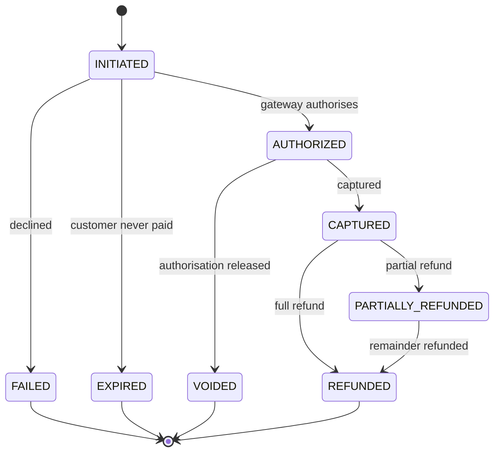

| From | To | Trigger | Actor | Guard | Event |
|---|---|---|---|---|---|
| — | INITIATED | checkout | system | order in PENDING_PAYMENT | `PaymentInitiated` |
| INITIATED | AUTHORIZED | gateway callback | system | signature valid (BR-PAY-001) | — |
| INITIATED | FAILED | gateway callback | system | — | `PaymentFailed` |
| INITIATED | EXPIRED | timeout sweep | system | unpaid past the window | `PaymentFailed` |
| AUTHORIZED | CAPTURED | capture | system, or Accountant for bank transfer | amount ≤ authorised | `PaymentCaptured` |
| CAPTURED | PARTIALLY_REFUNDED / REFUNDED | refund | Accountant | within refund approval limit (BR-PAY-003) | `RefundCompleted` |

**COD is not a payment until the carrier remits.** A COD order is `CONFIRMED` with a payment in
`INITIATED`; it becomes `CAPTURED` only at reconciliation, after the carrier hands the cash over
(WBS 3.15.4). Treating COD as paid at checkout is how the books stop balancing.

**A deposit is a payment for part of the total.** The order moves to `CONFIRMED` when
`sum(captured) ≥ deposit_required` (BR-PAY-002), not when it equals the order total.

### Receivable (credit orders) — implemented 2026-10-10 (SCRUM-431)

kltn-docs 15 §4.3 and §5.3. One receivable per delivered credit order, for what the order still owes.

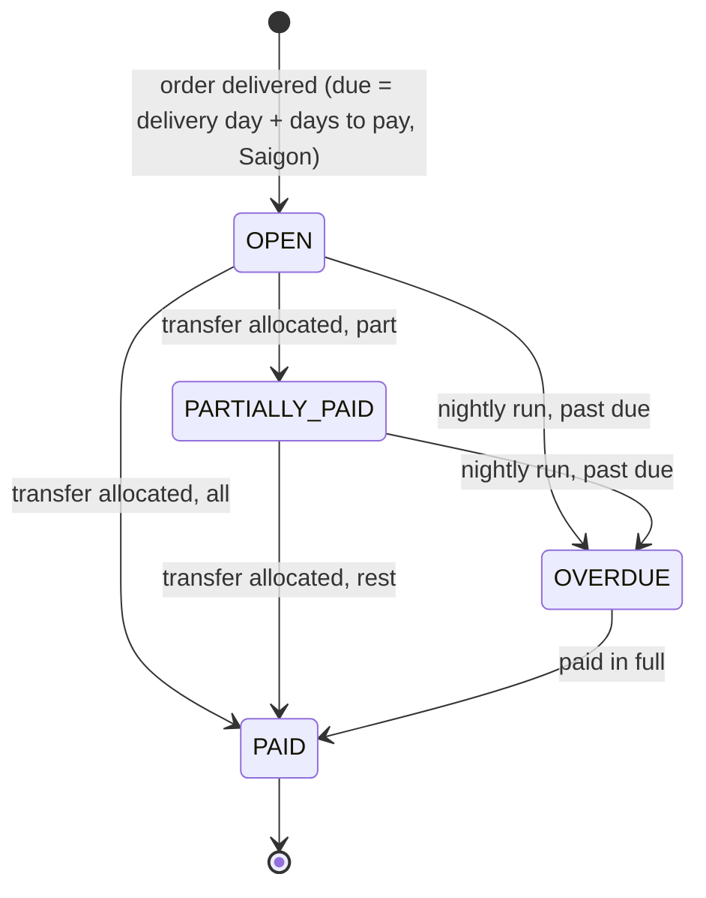

- **Overdue stays overdue.** A part payment keeps the receivable `OVERDUE` until it is paid in full. Being overdue is what blocks new credit and release (15 §4.3 step 4).
- **Transfers.** The accountant records each transfer from the bank statement, once per reference (BR-04, BR-07). It pays the receivables the customer named, otherwise the earliest due first (BR-09). Whatever is left stays as the customer's credit and pays their next receivable as it opens.
- **The order learns of every payment.** Each allocation is published as `PaymentCaptured` (source `RECEIVABLE_ALLOCATION`), so the order's `paidAmount` follows.
- **Allocations are append-only** (BR-06).

---

## 11. Shipment and load — `fulfillment-service`

WBS 3.9. **The carrier is a third party outside the system** (decided 2026-10-06, docs 09): no carrier
API, no carrier waybill, no tracking. The system records the handover and the outcome the carrier
reports back; nothing in between.

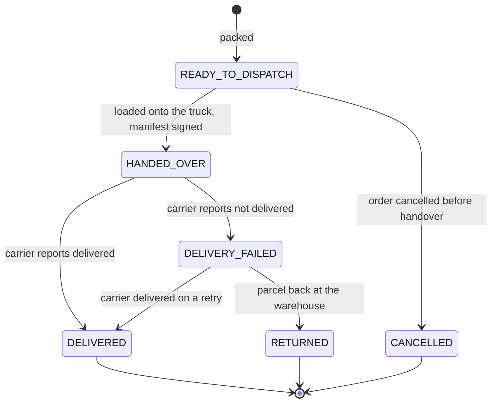

| From | To | Trigger | Actor | Guard |
|---|---|---|---|---|
| READY_TO_DISPATCH | HANDED_OVER | handover | Warehouse staff | parcel is on a load that is being dispatched; scanned onto that vehicle |
| HANDED_OVER | DELIVERED / DELIVERY_FAILED | outcome reported | Order coordinator | failure carries a reason (absent, refused, wrong address, lost) |
| DELIVERY_FAILED | RETURNED | parcel received back | Warehouse staff | through the returns receipt, never straight into stock |

A **load** is one vehicle (truck or container) and the parcels placed on it:

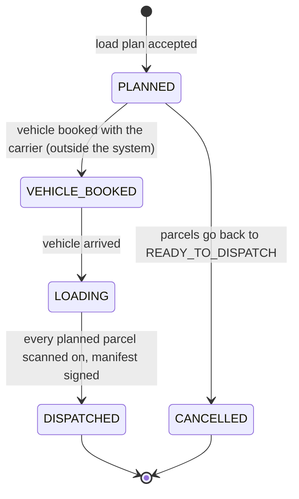

The load plan respects the vehicle's internal volume and payload, and never puts a `FRAGILE`
parcel under a heavier one (docs 09 BR-02).

`RETURNED` triggers a **re-putaway** (WBS 3.9.7.2): the goods return to stock through the
same putaway machine, in condition GOOD if the parcel is intact and QUARANTINE otherwise.

> **Implemented (G4-5, `V20261021000300`):** `fulfillment.shipment` carries the six statuses above
> (old `PENDING` → `READY_TO_DISPATCH`, `DISPATCHED` → `HANDED_OVER`), a number per order
> (`<order>-S<n>`), its warehouse, delivery mode, package count, COD amount (09 BR-04) and the
> handover / outcome / cancellation facts, each step also a `MANUAL` `shipment_event` row naming who
> recorded it (09 BR-02). The domain is `fulfillment.internal.domain.Shipment`; G4-5 creates shipments
> (READY_TO_DISPATCH) and cancels them with their order, G4-2a hands them over, SCRUM-294/295 record
> outcomes. Still to come (G4-1/G4-2a): the vehicle-type catalogue, the load plan and the load.
> `tracking_number` and carrier-sourced events are unused (no carrier API).

**Packing session (G4-5, kltn-docs 08 §5).** One per task (`fulfillment.pack`):
`PENDING → PACKING` (a packer takes the order; another packer is refused, a manager is not) `→ PACKED`
(nothing the order wants is left unshipped), `PACKING ⇄ ON_HOLD` (a printed design does not match its
snapshot, BR-DSG-003; QC or a manager re-verifies and packing is back in progress — docs 08
"Verification Failed → In Progress"), `→ CANCELLED` with the order. Its parcels (`fulfillment.package`)
go `OPEN → SEALED` (weight and size required, 08 BR-03) `→` in a shipment; before that a parcel may be
re-opened or `VOIDED`. Every scan is kept (`fulfillment.package_scan`, append-only). Completing ships
every sealed parcel not yet shipped as one shipment; part of the order may ship first (split shipments,
G4-Q3; a mixed order's stock lines first, decision 2026-10-21) with a reason, the rest later.

---

## 12. RMA — `order-service`

WBS 3.17.5.

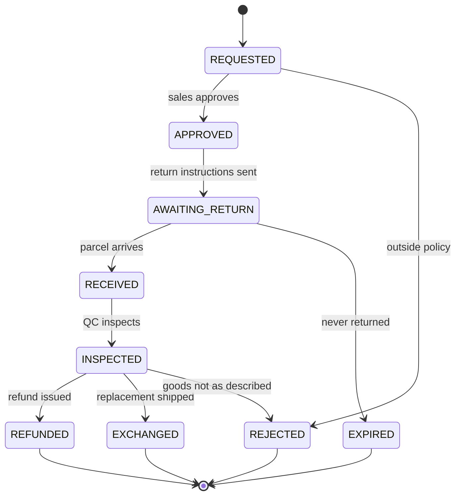

| From | To | Trigger | Actor | Guard | Event |
|---|---|---|---|---|---|
| — | REQUESTED | open RMA | Customer / Sales staff | order DELIVERED, within window (BR-RMA-001) | `RmaRequested` |
| REQUESTED | APPROVED | approve | Sales staff | reason in policy; **custom-printed items are not returnable unless defective** (BR-RMA-002) | `RmaApproved` |
| APPROVED | AWAITING_RETURN | send return instructions | system | customer told to write the RMA number on the parcel; no return label (carriers are outside the system) | — |
| AWAITING_RETURN | RECEIVED | parcel arrives | Warehouse staff | RMA number on parcel | `RmaGoodsReceived` |
| RECEIVED | INSPECTED | inspect | QC staff | condition recorded | `RmaInspected` |
| INSPECTED | REFUNDED | refund | Accountant | within refund limit | `RefundCompleted` |
| INSPECTED | EXCHANGED | ship replacement | Order coordinator | replacement stock available | `ExchangeShipped` |

Returned goods re-enter stock in condition **QUARANTINE**, never GOOD. Whether they become
sellable again is a QC decision, not an automatic one.

---

## 13. Transfer order — `inventory-service`

WBS 3.10.

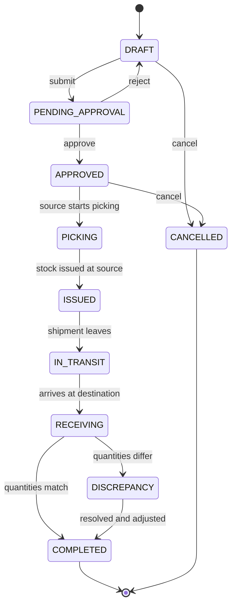

| From | To | Trigger | Actor | Guard | Event |
|---|---|---|---|---|---|
| — | DRAFT | create | Inventory planner | source ≠ destination | — |
| DRAFT | PENDING_APPROVAL | submit | Inventory planner | source ATP ≥ requested | — |
| PENDING_APPROVAL | APPROVED | approve | Warehouse manager | value within approval threshold (BR-TRF-001) | `TransferApproved` |
| APPROVED | PICKING | start | Warehouse staff | stock reserved at source, FEFO (WBS 3.10.3.2) | `TransferPickStarted` |
| PICKING | ISSUED | issue | Warehouse staff | picked = approved qty | `TransferIssued` |
| ISSUED | IN_TRANSIT | dispatch | Warehouse staff | — | `TransferInTransit` |
| IN_TRANSIT | RECEIVING | arrival | Warehouse staff (destination) | — | — |
| RECEIVING | COMPLETED | confirm | Warehouse staff | received = issued | `TransferCompleted` |
| RECEIVING | DISCREPANCY | confirm with variance | Warehouse staff | variance logged (WBS 3.10.6.1) | `TransferDiscrepancyRaised` |
| DISCREPANCY | COMPLETED | resolve | Warehouse manager | write-off approved (WBS 3.10.6.3) | `TransferCompleted` |

**In-transit stock belongs to neither warehouse's on-hand.** Between `ISSUED` and `COMPLETED` the
units sit in a dedicated in-transit bucket. Leaving them on the source's on-hand lets the source
oversell them; adding them to the destination early lets the destination sell goods that are on a
truck. This is the single most common transfer bug.

---

## 14. Cycle count — `inventory-service`

WBS 3.6.6. Implemented 2026-10-23 (SCRUM-146, SCRUM-162, SCRUM-164). Stored as
`inventory.cycle_count.status`.

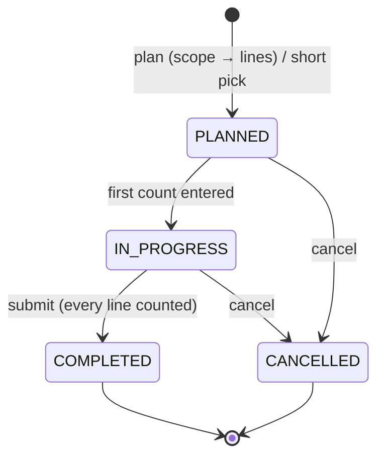

| From | To | Trigger | Actor | Guard | Event |
|---|---|---|---|---|---|
| — | PLANNED | plan a count over zones, shelves, bins and/or SKUs (`MANUAL`) | Warehouse manager / Inventory planner | scope not empty, at most `max-lines` lines; a busy slot is skipped and listed | — |
| — | PLANNED | short pick reported (`SHORT_PICK`) | system | the slot (bin, SKU and lot, or one carton) is not busy; a busy slot's count is reused, whatever its trigger | — |
| PLANNED | IN_PROGRESS | first count entered on a line | assignee, or a holder of `APPROVE` | the book quantity is re-read at that moment | — |
| IN_PROGRESS | COMPLETED | submit | assignee, or a holder of `APPROVE` | every line counted; no shortage larger than what the slot holds now (`CYCLE_COUNT_STALE`) | — |
| PLANNED / IN_PROGRESS | CANCELLED | cancel | Warehouse manager (`APPROVE`) | — | — |

**The count is a thin document; review and posting belong to the adjustment.** Submitting a count
turns every line whose count differs from the book into `COUNT_VARIANCE` stock adjustment(s) in the
same transaction, and the count is `COMPLETED`. "Variance review" is the adjustment's
`PENDING_APPROVAL`; approval posts the stock and the ledger (`POSTED`), or the manager rejects it
(`REJECTED`) and may send the line for a recount, which opens a new blind count — nothing reopens a
completed one. A count with no variance raises no adjustment at all. Every variance still needs
manager approval (BR-STK-005, four-eyes) before it touches stock: a cycle count is the one place where
an unapproved number could otherwise silently rewrite inventory.

- **A slot is busy** while it is on an open count, or on a `COMPLETED` one whose `COUNT_VARIANCE`
  adjustment of that line is still `PENDING_APPROVAL`. A busy slot is skipped by a new plan, refused to
  a found line or a recount (`CYCLE_COUNT_SLOT_BUSY`), and a short pick on it reuses the count holding
  it instead of opening a second one: two counts of the same stock would correct the books twice.
  Once the adjustment is decided the slot is free again (which is what lets a rejected line be
  recounted).
- A loose shortage is split over the slot's rows taking free units (`on_hand − reserved`) first, in
  FEFO order, then held units, again in FEFO order — one adjustment per row; `CYCLE_COUNT_STALE` only
  beyond what the rows hold in all. A surplus goes on the most recently received row — for a FIFO SKU,
  whose layers are never raised, into a new layer received at approval.
- A carton raises one adjustment for the whole carton; approval decides its state once — found again,
  opened, consumed, or `LOST` when the count found nothing. A write-up refills the carton's own row
  (after `found()` for a `LOST` one), never a new layer, FIFO or not: the carton is the identity of
  those units. A carton line follows its carton moved whole to another bin of the warehouse; one emptied
  (`CONSUMED`) after it was counted makes its line `CYCLE_COUNT_STALE` at submission.
- The free units of a `SHORT_PICK` slot stay out of ATP and FEFO while the count is open and until
  every `COUNT_VARIANCE` adjustment of its line is decided, not just until the count closes. A pending
  **shortage** freezes its slot's free units whatever the count's trigger. A short pick that reuses an
  *open* `MANUAL` count leaves the slot sellable until that count is submitted — an accepted window.
- A `COUNT_VARIANCE` adjustment is approved or rejected, never withdrawn
  (`COUNT_VARIANCE_NOT_WITHDRAWABLE`).
- Submitting a `COMPLETED` count again returns it unchanged; cancelling a `COMPLETED` one is refused
  (`CYCLE_COUNT_NOT_OPEN`).

---

## 15. Chat conversation — `chat-service`

WBS 3.16.2.2 names the states: `OPEN → RESOLVED`, with `ESCALATED` in between.

`OPEN → ASSIGNED → RESOLVED`, `ASSIGNED → ESCALATED → ASSIGNED`, `RESOLVED → OPEN` on a customer
reply within 24 hours. SLA timers (WBS 3.16.6) run on `OPEN` and `ESCALATED` only.

---

## 16. Production order — `production`

New 2026-10-06. One per custom order line (`ORDER`) or per sample request (`SAMPLE`). Both kinds
run the same workshop steps; only the source and the end differ. Business doc:
`kltn-docs/docs/warehouse/19-production`.

**Subcontracting** (added 2026-10-06, §4.4 of the business doc): when the in-house shop cannot meet
the due date, the warehouse manager splits part of an `ORDER` production order into a **child**
production order with `execution = SUBCONTRACTED`, linked to its parent and to a `SUBCONTRACT`
purchase order. The child skips `MATERIAL_ISSUED` / `PRINTING` and goes
`READY → SUBCONTRACTED → QC`. Splitting does not change the parent's state, only its quantity.
Two modes, chosen per split: `SUPPLIED_BLANKS` (we send the blanks; they stay our stock at a
virtual subcontractor location, outside ATP) and `FULL_SERVICE` (the subcontractor sources the
blanks; we buy finished goods).

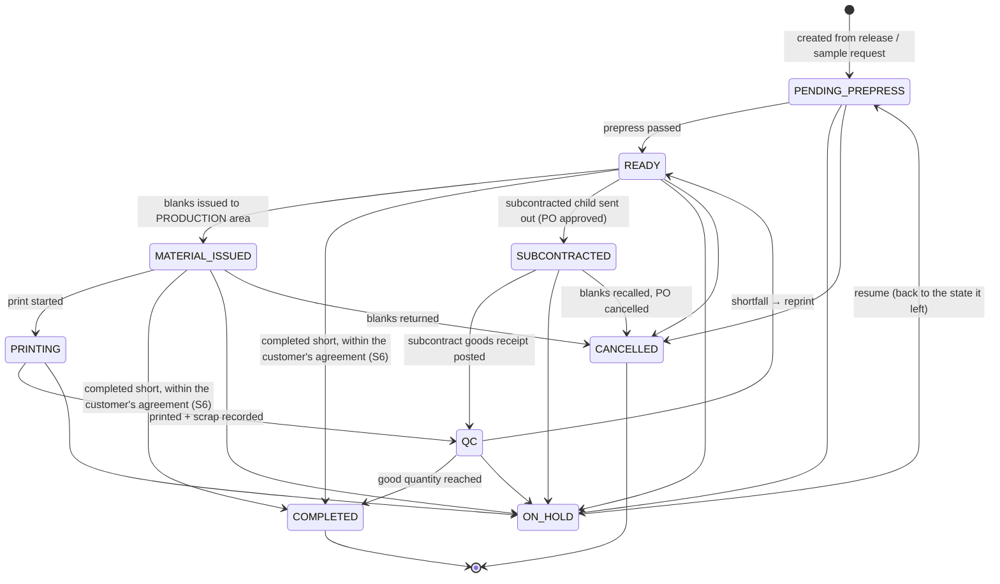

| From | To | Trigger | Actor | Guard | Event |
|---|---|---|---|---|---|
| — | PENDING_PREPRESS | release / sample submitted | system | one per source line (BR-PRD-01) | — |
| PENDING_PREPRESS | READY | prepress pass | Production staff | file checksum = locked snapshot (BR-PRD-02) | — |
| READY | MATERIAL_ISSUED | blanks scanned out | Warehouse staff | issued ≤ remaining need (BR-PRD-03) | — |
| MATERIAL_ISSUED | PRINTING | start | Production staff | — | — |
| PRINTING | QC | record output | Production staff | good + scrap = printed; scrap has a reason (BR-PRD-04) | — |
| QC | COMPLETED | QC pass | QC staff | good quantity = required; ORDER compared with the approved sample (BR-PRD-05) | `ProductionCompleted` (ORDER) |
| QC | READY | shortfall | QC staff | more blanks reserved; none → ON_HOLD | — |
| READY / MATERIAL_ISSUED (or ON_HOLD from one) | COMPLETED (short) | `POST /production/orders/{id}/short-completion` | Warehouse manager (`production-orders:APPROVE`) | an order's in-house job with good units, fewer than planned, every printed unit through QC, and **Sales recorded on the order line that the customer goes without at least that many** (`POST /orders/{id}/lines/{lineId}/production-shortfall-agreement`, `sales-order-cancellations:UPDATE`: how many at most, how the customer agreed, who, when; 0 withdraws it while nothing was closed under it - `PRODUCTION_SHORTFALL_NOT_AGREED` otherwise, and nothing changes), recorded by someone else than the manager closing it (`PRODUCTION_SHORTFALL_SELF_APPROVAL`). Closing all of a line is a cancellation, refused here. In one transaction: the sales order line gives up the units not made (`OrderService.closeProductionShortfall` → `OrderRemainderClosed` reason `PRODUCTION_SHORTFALL`: the order is worth less, payment refunds what was paid above that), the goods go to packing as on any completion, unprinted blanks go back and the line's blanks never issued are let go. `short_completion_reason`, `ck_production_order_completed_quantity`, `ck_order_line_shortfall_agreement` / `_closed` (review 2026-10-25, S6) | `ProductionCompleted` with the good quantity |
| PENDING_PREPRESS / READY / MATERIAL_ISSUED (or ON_HOLD from one), **no good unit** | CANCELLED (closed short) | the same endpoint | Warehouse manager | as above, within the agreement: nothing to deliver, so the job is cancelled and its whole plan leaves the line - a subcontract's shortfall job the blanks never came for, its siblings having made the rest. Its blanks go back free. The closure's own announcement moves the order on when what the others made now covers the line (BR-PRD-06) | `OrderRemainderClosed` |
| PENDING_PREPRESS / READY / ON_HOLD | *(unchanged)* + child PENDING_PREPRESS or READY | split for subcontracting | Warehouse manager | ORDER only (BR-PRD-11); 0 < split < quantity not yet issued (BR-PRD-12); active subcontractor; child inherits the parent's prepress result | — |
| READY | SUBCONTRACTED | send to subcontractor (child only) | Warehouse staff | `SUBCONTRACT` PO approved (BR-PRD-13); SUPPLIED_BLANKS: blanks scanned to the subcontractor location (BR-PRD-15) | — |
| SUBCONTRACTED | QC | subcontract goods receipt posted | system | SUPPLIED_BLANKS: blank reconciliation done, excess loss approved (BR-PRD-16, 17) | — |
| any before COMPLETED | ON_HOLD | hold | Production staff / Warehouse manager | reason: bad file, out of blanks, machine down, waiting for customer, subcontractor late | — |
| PENDING_PREPRESS / READY / MATERIAL_ISSUED | CANCELLED | cancel | Warehouse manager | issued blanks returned to stock | — |
| SUBCONTRACTED | CANCELLED | cancel | Warehouse manager | blanks recalled from the subcontractor, PO cancelled (or fee paid per BR-PRD-10) | — |

Once `PRINTING` or `SUBCONTRACTED`, the design cannot change (BR-PRD-07, BR-PRD-14) and
cancellation follows BR-PRD-10.

**Short of the plan** (review 2026-10-25, S6): a stop scraps the good units because they are sold to nobody else -
right when the customer cancels, wrong when the customer still wants what was printed. Completing short is the way
for the second case: the 9,940 good cups of 10,000 go to the customer, the order is billed for 9,940. Lowering what
an order is worth is a sale's decision, so it takes two people: Sales records the customer's agreement on the line
(at most how many units, how it was given - the line keeps who and when), the warehouse manager completes the job
within it. A cancellation of the order afterwards keeps and refunds out of the money still the order's: the refund
the shortfall asked for is not paid out twice (`Order.cancel`, `ck_order_cancellation_fee`). Delivering part of a
print run *before* the job completes (5,000 now for an event, the rest later) is not built: it needs the order and
packing to take print goods in parts - a decision for the team (open question). Known limits, shared with closing a
remainder: the sales rollups still count the order as placed (a closure does not lower them); an order paid in full
for what it is now worth still reads PARTIALLY_PAID, as "paid in full" compares with the original total
(`ck_order_paid_in_full`) - its amount due is 0; a new agreement replaces the last on the line, the audit trail keeps
who recorded each.

Decided 2026-10-13: a subcontractor's goods get **one** inspection, the production QC against the approved sample.
The warehouse counts the receipt and reconciles the blanks; receiving runs no QC of its own on a `SUBCONTRACT` PO and
puts nothing away; the goods stay held for their production order, outside ATP, in the QUALITY_CONTROL area until
QC. A subcontracted order cancelled while its sales order still wants the goods is replaced by an in-house child
(origin `REPLACEMENT`); a shortfall taken back to the print shop is an in-house child with origin `SHORTFALL`. A shortfall on a subcontracted child goes back to `READY`, from
where the manager either sends more to the same subcontractor (PO supplement) or splits the gap
into a new in-house child.

---

## 17. Sample request — `production`

New 2026-10-06. Mandatory for a new design (design + blank pair without an approved sample).

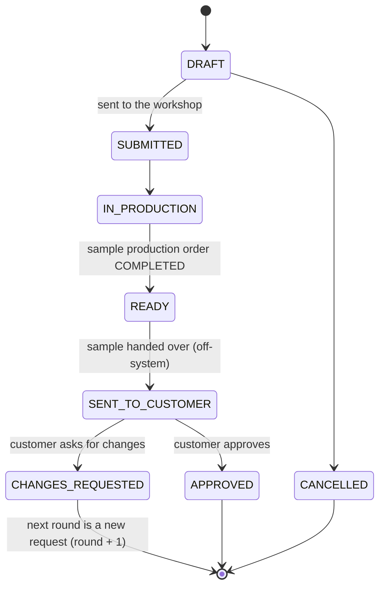

| From | To | Trigger | Actor | Guard | Event |
|---|---|---|---|---|---|
| DRAFT | SUBMITTED | submit | Sales staff | confirmed design snapshot; blanks reservable | — |
| READY | SENT_TO_CUSTOMER | mark sent | Sales staff | — | — |
| SENT_TO_CUSTOMER | APPROVED | approve | Customer (portal) / Sales staff on their behalf | — | `SampleApproved` |
| SENT_TO_CUSTOMER | CHANGES_REQUESTED | request changes | Customer / Sales staff | feedback recorded | — |

`APPROVED` locks the design for the design + blank pair and becomes the QC reference for order
production (BR-PRD-05, BR-PRD-08).

---

## 18. Quote — `order`

New 2026-10-06 (B2B only). Partly built in PR #38 (`DesignQuote`).

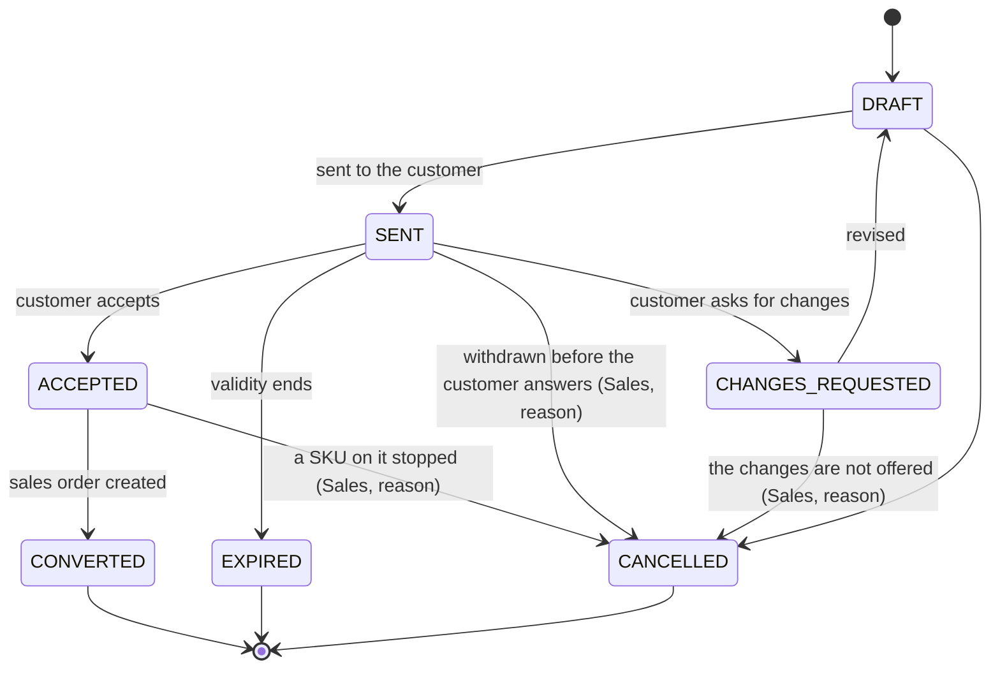

| From | To | Trigger | Actor | Guard | Event |
|---|---|---|---|---|---|
| DRAFT | SENT | send | Sales staff | discount within the sales staff's limit, or approved | — |
| SENT | ACCEPTED | accept | Customer (portal) | within validity; every new design has an APPROVED sample (BR-PRD-08) | — |
| ACCEPTED | CONVERTED | create order | Sales staff or order coordinator (`sales-quote-conversions:CREATE`; editing a quote is Sales' - `sales-quotes:UPDATE`, which the coordinator does not hold, decision 2026-10-17) | lines reserved (BR-ORD-001) | `OrderPlaced` |
| ACCEPTED | CANCELLED | cancel | Sales staff | a SKU on the quote is INACTIVE/DISCONTINUED, so it can never be converted; reason required and kept in the history; the customer still sees it; a new quote follows if the goods are still wanted (decision 2026-10-17) | — |
| SENT | CANCELLED | withdraw | Sales staff (`sales-quotes:UPDATE`) | reason required - the customer reads it with the quote, which stays visible to them as withdrawn and can no longer be accepted (a price typed wrong, a design the customer dropped; a corrected offer is a new quote). A customer's acceptance and Sales' withdrawal of the same version are taken one after the other: whichever is first wins, the other is refused - the customer told it was withdrawn and why, not that the quote changed (review 2026-10-25, S8) | — |
| CHANGES_REQUESTED | CANCELLED | decline the changes | Sales staff | reason required, shown to the customer | — |
| DRAFT (revision 2 or later) | CANCELLED | drop the revision | Sales staff | reason required; the customer, who saw the earlier revision, sees the quote ended with its lines but without the dropped draft's prices - they were never offered (review 2026-10-25, S8) | — |
| SENT | EXPIRED | validity ends | system | — | — |

