# Bản đồ toàn bộ luồng dữ liệu

28 luồng của StockFlowCommerce: chính, phụ, ngoại lệ và nền tảng. Mỗi luồng gồm sơ đồ
service–database và bảng liệt kê từng bước ghi vào bảng nào.

Ký hiệu trong bảng: `+` tạo dòng · `~` sửa dòng · `−` trừ hoặc xoá.
Trong sơ đồ: nét đứt = event qua Kafka, nét liền = gọi REST đồng bộ.

**Mọi mũi tên event đều đi qua transactional outbox** — không luồng nào gửi thẳng message ra
Kafka. Xem ADR-0003.

## Mục lục


**Nhập hàng** — 5 luồng

- `F-PRD` Tạo sản phẩm, duyệt, đưa lên sàn (WBS 3.1)
- `F-PO` Đơn mua hàng gửi nhà cung cấp (WBS 3.2)
- `F-RCP` Nhận hàng, đếm, quét lô, kiểm QC (WBS 3.3)
- `F-PUT` Slotting và putaway — hàng vào đúng kệ (WBS 3.5)
- `F-MTC` Đối chiếu ba chiều và trả tiền nhà cung cấp (WBS 3.4)

**Bán hàng sỉ (B2B)** — 6 luồng

- `F-DSG` Thiết kế 2D, xem 3D, chốt snapshot (WBS 3.12)
- `F-CAT` Đồng bộ catalog và số tồn hiển thị (WBS 3.13)
- `F-CART` Báo giá, đặt hàng sỉ và giữ chỗ tồn (WBS 3.14)
- `F-PAY` Thanh toán sỉ — trả trước, đặt cọc, công nợ (WBS 3.15)
- `F-FUL` Phát lệnh, nhặt hàng, đóng gói (WBS 3.7 · 3.8)
- `F-SHP` Xếp xe, bàn giao hãng và ghi nhận kết quả giao (WBS 3.9)

**Sản xuất in** — 2 luồng

- `F-SAMPLE` Làm mẫu và khách duyệt mẫu (WBS 3.25.1)
- `F-PROD` Sản xuất đơn hàng — từ release tới khu đóng gói (WBS 3.25)

**Vận hành kho** — 4 luồng

- `F-TRF` Điều chuyển giữa hai kho (WBS 3.10)
- `F-REP` Bổ sung nội bộ kho — từ khu dự trữ ra khu nhặt (WBS 3.11)
- `F-CNT` Kiểm kê và điều chỉnh tồn (WBS 3.6.6)
- `F-EXP` Quét hết hạn hằng đêm (WBS 3.6.7)

**Sau bán hàng** — 3 luồng

- `F-RMA` Trả hàng và đổi hàng (WBS 3.17.5)
- `F-RTO` Hàng hoàn về vì giao không thành công (WBS 3.9.7)
- `F-REF` Hoàn tiền và đối soát với cổng thanh toán (WBS 3.15.6 · 3.20.4)

**Ngoại lệ** — 4 luồng

- `X-SHORT` Nhặt thiếu — đơn không hỏng, đơn dừng lại (WBS 3.7.5)
- `X-DMG` Hàng hỏng — báo hỏng có ảnh, cách ly, quản lý kho quyết định xử lý (WBS 3.6.5.1)
- `X-RESV` Giữ chỗ hết hạn — tồn tự phục hồi (WBS 3.14.5.2)
- `X-CHK` Lệch checksum thiết kế — dừng đóng gói (WBS 3.8.3)

**Nền tảng** — 4 luồng

- `P-PERM` 14 service tự đăng ký catalog phân quyền (WBS 3.19.1)
- `P-NOTI` Thông báo — một event, nhiều kênh (WBS 3.19.2)
- `P-RPT` Read model báo cáo dựng từ event stream (WBS 3.20)
- `P-CHAT` Chat tư vấn dẫn tới đơn hàng đặt hộ (WBS 3.16)

---


# Nhập hàng

## `F-PRD` Tạo sản phẩm, duyệt, đưa lên sàn

*WBS 3.1*

Luồng ngắn nhất nhưng là gốc của mọi thứ khác: không có SKU thì không mua được, không nhập được, không bán được.

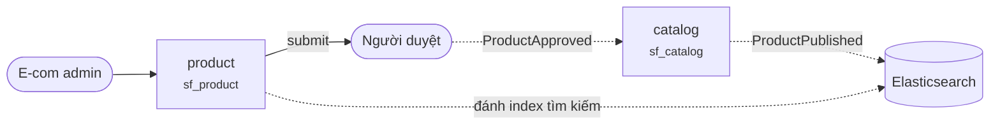

| # | Service | Ghi vào | Kết quả |
|---|---|---|---|
| 01 | `product` | `+ product, + product_attributes, + product_attribute_options, + variant × N, + variant_attribute_values` | status = DRAFT · một transaction |
| 02 | `product` | `+ sku (unique toàn hệ thống)` · `+ inventory_item × N` (trigger) | BR-PRD-002 |
| 03 | `product` | `~ product.status` | → PENDING_APPROVAL |
| 04 | `product` | `~ product, + product_approval, + outbox_event` | → APPROVED · ProductApproved |
| 05 | `product` | `~ product, + outbox_event` | → PUBLISHED · ProductPublished |
| 06 | `catalog` | `+ processed_event, + catalog_product, + catalog_price` | bản sao đọc |
| 07 | `catalog` | `→ Elasticsearch index` | tài liệu tìm kiếm |

> · DRAFT → PENDING_APPROVAL → APPROVED → PUBLISHED. Người duyệt phải khác người gửi — BR-PRD-003.
> · catalog-service giữ BẢN SAO chỉ gồm sản phẩm đã publish, không phải toàn bộ product master.
> · Bước 01–02 (`POST /products`): không gửi `axes` thì sản phẩm có đúng một variant mặc định, SKU = mã sản phẩm. Gửi `axes` thì tạo luôn trục, option và mọi tổ hợp của các option còn hoạt động; SKU theo quy tắc `MÃ-GIÁ_TRỊ-GIÁ_TRỊ`, tổ hợp đầu tiên là variant mặc định, không có SKU tạm. Một SKU bị trùng hay ma trận quá 100 tổ hợp thì cả sản phẩm không được tạo.

---

## `F-PO` Đơn mua hàng gửi nhà cung cấp

*WBS 3.2*

Từ nháp tới lúc nhà cung cấp xác nhận. Ngưỡng duyệt là chỗ dễ làm sai nhất.

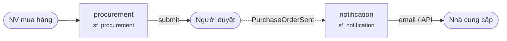

| # | Service | Ghi vào | Kết quả |
|---|---|---|---|
| 01 | `procurement` | `+ purchase_order, + po_line × N` | status = DRAFT |
| 02 | `procurement` | `~ purchase_order.status` | → PENDING_APPROVAL |
| 03 | `procurement` | `~ purchase_order, + po_approval, + outbox_event` | → APPROVED |
| 04 | `procurement` | `~ purchase_order.sent_at, + outbox_event` | → SENT · PurchaseOrderSent |
| 05 | `notification` | `+ processed_event, + notification` | gửi PO cho NCC |
| 06 | `procurement` | `~ purchase_order.confirmed_at` | → CONFIRMED |
| 07 | `procurement` | `+ po_revision (nếu sửa)` | PurchaseOrderAmended |

> · Hạn mức người duyệt phải ≥ giá trị PO — BR-PO-002, kiểm trong aggregate chứ không ở controller.
> ⚠ Sửa PO sau khi đã có phiếu nhập là CẤM. Phải tạo revision mới — BR-PO-004.

---

## `F-RCP` Nhận hàng, đếm, quét lô, kiểm QC

*WBS 3.3*

Nơi hàng thật gặp hệ thống lần đầu. Kết quả QC quyết định hàng vào kho ở trạng thái nào.

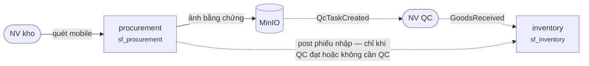

| # | Service | Ghi vào | Kết quả |
|---|---|---|---|
| 01 | `procurement` | `+ goods_receipt, + receipt_line × N` | status = DRAFT, chép qty từ PO |
| 02 | `procurement` | `~ receipt_line.quantity_received, .lot_number, .expiry_date` | BR-RCP-003 |
| 03 | `MinIO` | `+ receipts/{id}/photo-*.jpg` | ảnh bằng chứng |
| 04 | `procurement` | `+ qc_task` | status = PENDING, cho SKU có cờ QC |
| 05 | `procurement` | `+ qc_result, ~ goods_receipt` | → QC_PASSED | QC_QUARANTINED | QC_REJECTED |
| 06 | `procurement` | `~ goods_receipt, ~ purchase_order.open_qty, + outbox_event` | → POSTED · GoodsReceived |
| 07 | `inventory` | `+ processed_event, + stock_item, + stock_movement` | condition = GOOD | QUARANTINE |

> ⚠ QC REJECTED thì đi nhánh RTV và KHÔNG dòng tồn kho nào được tạo — WBS 3.3.4.4.
> · QC QUARANTINED thì stock_item vẫn được tạo, nhưng condition = QUARANTINE: có mặt, không bán được.
> · Nhận vượt quá dung sai 5% thì không post được nếu chưa có duyệt quản lý kho — BR-RCP-001.

---

## `F-PUT` Slotting và putaway — hàng vào đúng kệ

*WBS 3.5*

Giữa bước này và bước trước, hàng đã tồn tại trong hệ thống nhưng chưa nhặt được. Đây là bước làm cho nó bán được.

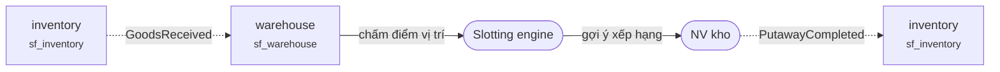

| # | Service | Ghi vào | Kết quả |
|---|---|---|---|
| 01 | `warehouse` | `+ processed_event, + putaway_task` | status = CREATED |
| 02 | `warehouse` | `+ putaway_suggestion × N` | vị trí xếp hạng + lý do từng gợi ý |
| 03 | `warehouse` | `~ putaway_task.assigned_to` | → ASSIGNED |
| 04 | `warehouse` | `~ putaway_task (quét item)` | → IN_PROGRESS |
| 05 | `warehouse` | `~ putaway_task.target_location_id, + outbox_event` | → COMPLETED |
| 06 | `inventory` | `~ stock_item.location_code, + stock_movement, + outbox_event` | StockLevelChanged |
| 07 | `catalog` | `~ atp_cache` | hàng bắt đầu bán được |

> · Vị trí vi phạm ràng buộc cứng (hazmat, nhiệt độ, single-SKU) bị LOẠI HẲN trước khi chấm điểm — BR-SLT-001.
> · Mỗi gợi ý phải kèm LÝ DO và lý do đó được lưu cùng task — BR-SLT-004.
> · Không cập nhật `storage_location`: mức đầy suy ra từ tồn so với sức chứa, không lưu (module 06 §5).
> ★ Chỉ sau PutawayCompleted thì location_code mới là mã một bin (`HCM-A01-2-B`) và ATP mới tính hàng này.

---

## `F-MTC` Đối chiếu ba chiều và trả tiền nhà cung cấp

*WBS 3.4*

PO ↔ Phiếu nhập ↔ Hoá đơn. Lệch ngoài dung sai thì phải người có hạn mức đủ lớn mới override được.

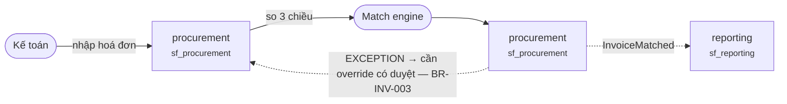

| # | Service | Ghi vào | Kết quả |
|---|---|---|---|
| 01 | `procurement` | `+ supplier_invoice, + invoice_line × N` | status = DRAFT |
| 02 | `procurement` | `+ invoice_po_link, + invoice_receipt_link` | → MATCHING |
| 03 | `procurement` | `+ match_result` | MATCHED | EXCEPTION theo dung sai |
| 04 | `procurement` | `+ invoice_override (nếu lệch)` | cần hạn mức ≥ chênh lệch |
| 05 | `procurement` | `~ supplier_invoice, + outbox_event` | → APPROVED_FOR_PAYMENT |
| 06 | `procurement` | `~ supplier_invoice, ~ purchase_order` | → PAID · PO → CLOSED |
| 07 | `reporting` | `+ processed_event, ~ ap_aging` | read model công nợ |

> · Số hoá đơn phải duy nhất theo từng nhà cung cấp — BR-INV-001.
> · PO chỉ chuyển sang CLOSED khi hoá đơn đã được duyệt chi.

---


# Bán hàng sỉ (B2B)

## `F-DSG` Thiết kế 2D, xem 3D, chốt snapshot

*WBS 3.12*

Điểm khác biệt của cả nền tảng. Snapshot đã chốt là bất biến — sửa thiết kế nghĩa là tạo snapshot mới.

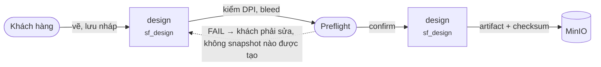

| # | Service | Ghi vào | Kết quả |
|---|---|---|---|
| 01 | `design` | `+ design_draft` | status = DRAFT, canvas JSON |
| 02 | `MinIO` | `+ design-assets/{id}/*` | ảnh khách upload |
| 03 | `design` | `~ design_draft.preflight_result` | PASS | FAIL + danh sách lỗi |
| 04 | `design` | `+ design_snapshot` | status = CONFIRMED, checksum SHA-256 |
| 05 | `MinIO` | `+ design-snapshots/{id}.json` | artifact BẤT BIẾN |
| 06 | `design` | `+ outbox_event` | DesignConfirmed |
| 07 | `design` | `~ design_snapshot.status` | → LOCKED khi đơn được đặt |

> · Preflight kiểm: DPI ảnh, vùng an toàn, bleed, chế độ màu RGB/CMYK, font đã nhúng — BR-DSG-001.
> ★ Checksum SHA-256 của snapshot được chép sang order_line và so lại lúc đóng gói — BR-DSG-003.

---

## `F-CAT` Đồng bộ catalog và số tồn hiển thị

*WBS 3.13*

Hai nguồn dữ liệu chảy vào cùng một bản sao đọc: thông tin sản phẩm từ product, con số ATP từ inventory.

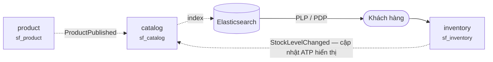

| # | Service | Ghi vào | Kết quả |
|---|---|---|---|
| 01 | `catalog` | `+ processed_event, + catalog_product` | từ ProductPublished |
| 02 | `catalog` | `+ catalog_price, + catalog_media, + seo_metadata` |  |
| 03 | `Elasticsearch` | `+ document` | đánh index tìm kiếm |
| 04 | `catalog` | `~ atp_cache` | từ StockLevelChanged |
| 05 | `catalog` | `→ trả PLP/PDP cho khách` | dải tồn, không phải số chính xác |

> · Khách chỉ thấy DẢI tồn (còn hàng / sắp hết / hết), không thấy con số chính xác — OQ-10.
> · Con số ATP chính xác chỉ trả về ở giỏ hàng, và lúc checkout thì gọi thẳng inventory-service.
> ⚠ catalog-service KHÔNG được dùng để quyết định giữ chỗ — bản sao có thể trễ vài giây.

---

## `F-CART` Báo giá, đặt hàng sỉ và giữ chỗ tồn

*WBS 3.14 · đổi 2026-10-06: chỉ bán sỉ (B2B), không còn giỏ hàng bán lẻ / guest / voucher*

Đơn sỉ sinh ra từ **báo giá đã chấp nhận** hoặc từ **khách tự đặt trên cổng** (đặt nhanh / đặt lại). Giữ chỗ tồn vẫn là bước đồng bộ duy nhất — vì người đặt đang chờ kết quả.

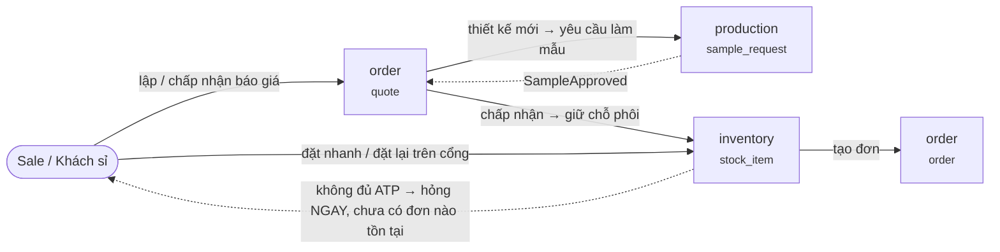

| # | Module | Ghi vào | Kết quả |
|---|---|---|---|
| 01 | `order` | `+ quote, + quote_line` | DRAFT → SENT; giá mặc định từ bảng giá riêng của khách |
| 02 | `production` | `+ sample_request` | chỉ khi cặp (thiết kế, phôi) chưa có mẫu APPROVED — xem `F-SAMPLE` |
| 03 | `order` | `~ quote.status` | → ACCEPTED; bị chặn nếu thiết kế mới chưa có mẫu APPROVED |
| 04 | `order` | `→ customer: phương thức thanh toán được phép, hạn mức, dư nợ` | kiểm MOQ, phương thức, hạn mức |
| 05 | `inventory` | `+ stock_reservation, ~ stock_item.reserved` | giữ chỗ **phôi** |
| 06 | `order` | `+ order, + order_line × N, + order_status_history` | trả trước / cọc → PENDING_PAYMENT; công nợ trong hạn mức → CONFIRMED; vượt hạn mức → ON_HOLD |
| 07 | `order` | `~ quote.status, + outbox_event` | → CONVERTED · OrderPlaced |

> ★ Đơn chỉ được tạo sau khi MỌI dòng đã giữ chỗ xong. Đơn giữ chỗ một phần không bao giờ được lưu — BR-ORD-001.
> ★ order_line CHÉP tên sản phẩm, đơn giá (theo báo giá / bảng giá riêng) và địa chỉ tại thời điểm này.
> ★ Không có guest checkout: chỉ khách sỉ ACTIVE mới tạo được đơn.
> · Reservation có expires_at với đơn chờ trả trước / chờ cọc (thời hạn chuyển khoản); đơn công nợ không hết hạn — OQ-03.

---

## `F-PAY` Thanh toán sỉ — trả trước, đặt cọc, công nợ

*WBS 3.15 · đổi 2026-10-06: cổng thẻ/ví và COD bán lẻ tạm gác*

Cùng một máy trạng thái giao dịch; khác nhau ở **điều kiện để đơn CONFIRMED** và lúc phát sinh **công nợ phải thu**.

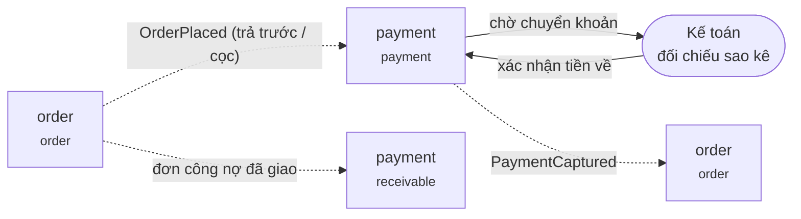

| # | Module | Ghi vào | Kết quả |
|---|---|---|---|
| 01 | `payment` | `+ processed_event, + payment` | status = AWAITING_CONFIRMATION (trả trước: tổng đơn; cọc: % cọc) |
| 02 | `payment` | `~ payment.status, + payment_transaction, + outbox_event` | → CAPTURED khi kế toán khớp sao kê · PaymentCaptured |
| 03 | `order` | `+ processed_event, ~ order, + order_status_history` | → CONFIRMED khi đủ tiền (trả trước) hoặc đủ cọc (đặt cọc) |
| 04 | `payment` | `+ deposit_record (nếu đặt cọc)` | theo dõi phần còn lại |
| 05 | `payment` | `+ receivable (đơn công nợ, khi DELIVERED)` | due_date = ngày giao + kỳ hạn của khách |
| 06 | `payment` | `~ receivable` | phân bổ tiền khách trả vào khoản đến hạn sớm nhất; quá hạn → OVERDUE |

> · Trả trước / cọc: CAPTURED **chỉ** khi kế toán đối chiếu sao kê — không theo lời khách báo.
> ★ Đặt cọc: đơn → CONFIRMED khi tổng đã thu ≥ mức cọc yêu cầu, và chỉ khi đó mới được release sang sản xuất — BR-PAY-002, BR-PRD-09.
> ★ Công nợ: không qua PENDING_PAYMENT; kiểm `dư nợ + giá trị đơn ≤ hạn mức` lúc tạo đơn — vượt → ON_HOLD chờ người có quyền duyệt.

---

## `F-FUL` Phát lệnh, nhặt hàng, đóng gói

*WBS 3.7 · 3.8*

Reservation mềm chuyển thành allocation cứng, rồi mới trừ kho thật. Ba mức, không gộp được.

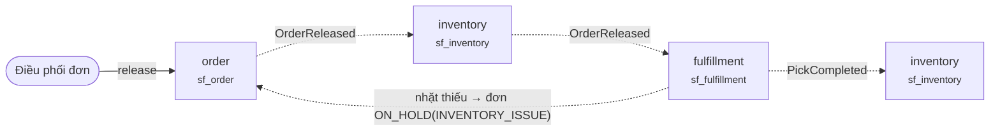

| # | Service | Ghi vào | Kết quả |
|---|---|---|---|
| 01 | `order` | `~ order.warehouse_code, + outbox_event` | → READY_TO_FULFILL · OrderReleased |
| 02 | `inventory` | `+ stock_allocation, ~ stock_reservation, ~ stock_item.allocated` | HELD → ALLOCATED, chọn FEFO |
| 03 | `fulfillment` | `+ pick_list, + pick_line × N` | location_code, lot_number từ allocation |
| 04 | `fulfillment` | `~ pick_line.picked_qty, + outbox_event` | PickCompleted |
| 05 | `inventory` | `~ stock_item.on_hand −, .allocated −, + stock_movement` | StockDeducted |
| 06 | `fulfillment` | `+ design_verification` | so checksum với artifact trong MinIO |
| 07 | `fulfillment` | `+ package, + outbox_event` | → PACKED · OrderPacked |

> · Bước phân bổ chọn vị trí và lô cụ thể theo FEFO — BR-STK-006. Trước đó reservation không gắn vị trí nào.
> · Đã cài (SCRUM-152): bước 02 chạy trong cùng transaction với `release` (hoặc khi tạo task cho đơn CONFIRMED chưa release — chọn kho duy nhất đủ hàng và có người được giao). Chỉ lấy bin `is_pickable` đang dùng được của đúng kho; thiếu hàng ở kho đó thì từ chối release (`INSUFFICIENT_STOCK`), không phân bổ một phần. Không có cột `stock_item.allocated` riêng: `stock_item.reserved` gồm cả allocation; bảng "stock_allocation" là các dòng `stock_reservation` có `allocated_from_id`.
> ★ Tồn kho THẬT SỰ giảm ở bước PickCompleted, không phải lúc đặt hàng.
> ⚠ Lệch checksum thiết kế lúc đóng gói thì DỪNG, không đóng — BR-DSG-003.

---

## `F-SHP` Xếp xe, bàn giao hãng và ghi nhận kết quả giao

*WBS 3.9*

Hãng vận chuyển là bên thứ ba **ngoài hệ thống**: không gọi API hãng, không lấy vận đơn, không theo dõi hành trình (chốt 06/10/2026, docs 09). Hệ thống chỉ lo phần của kho — chọn xe, xếp kiện, bàn giao — rồi ghi nhận kết quả giao khi hãng báo lại.

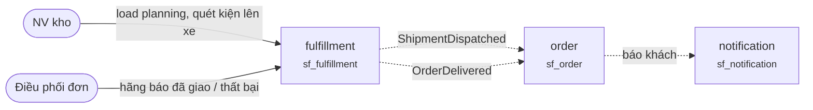

| # | Service | Ghi vào | Kết quả |
|---|---|---|---|
| 01 | `fulfillment` | `+ shipment` | status = READY_TO_DISPATCH (kiện đã đóng gói, ở khu `DISPATCH`) |
| 02 | `fulfillment` | `+ load_plan, + load, + load_line` | phương án xếp: loại xe, số xe, kiện nào lên xe nào → load PLANNED |
| 03 | `fulfillment` | `~ load.status` | → VEHICLE_BOOKED (đặt xe với hãng ngoài hệ thống) |
| 04 | `fulfillment` | `~ load_line.loaded_at` (mỗi lần quét kiện) | → LOADING; chặn kiện không thuộc chuyến |
| 05 | `fulfillment` | `+ manifest, ~ shipment, ~ load, + outbox_event` | shipment → HANDED_OVER, load → DISPATCHED · ShipmentDispatched |
| 06 | `order` | `~ order.status, + order_status_history` | → SHIPPED |
| 07 | `fulfillment` | `~ shipment.status, + outbox_event` | Điều phối cập nhật → DELIVERED / DELIVERY_FAILED · OrderDelivered |

> · Phương án xếp không vượt thể tích lòng thùng và tải trọng xe; hàng `FRAGILE` không bị đè — docs 09 BR-02.
> · DELIVERED / DELIVERY_FAILED chỉ do nhân viên có quyền cập nhật, ghi người và thời điểm — docs 09 BR-05.
> · Sau DELIVERED 7 ngày không có RMA thì đơn tự động → COMPLETED — BR-ORD-005.
> · Schema: bảng `load_plan`, `load`, `load_line` và trạng thái `DELIVERY_FAILED` chưa có trong DB — xem ghi chú ở `03-state-machines.md` §11.

---


# Sản xuất in

## `F-SAMPLE` Làm mẫu và khách duyệt mẫu

*WBS 3.25.1 · module `production` (mới, 2026-10-06)*

Thiết kế mới phải có mẫu được khách duyệt trước khi sản xuất đơn hàng. Mẫu dùng chung xưởng với đơn hàng, chỉ khác nguồn và kết thúc.

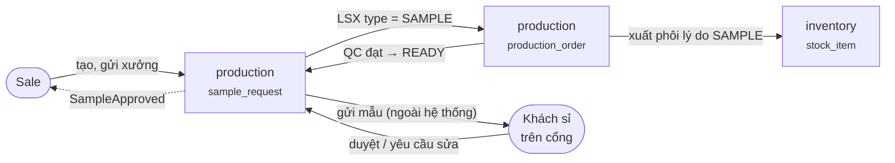

| # | Module | Ghi vào | Kết quả |
|---|---|---|---|
| 01 | `production` | `+ sample_request` | DRAFT → SUBMITTED |
| 02 | `inventory` | `+ stock_reservation` | giữ chỗ phôi cho mẫu |
| 03 | `production` | `+ production_order (type = SAMPLE)` | PENDING_PREPRESS — các bước tại xưởng như `F-PROD` 02–07 |
| 04 | `production` | `~ sample_request` | → READY → SENT_TO_CUSTOMER |
| 05 | `production` | `~ sample_request, + outbox_event` | → APPROVED · SampleApproved (khoá thiết kế cho cặp thiết kế + phôi) |
| 06 | `production` | `~ sample_request` | hoặc → CHANGES_REQUESTED; lần mẫu tiếp theo là bản ghi mới, round + 1 |

> ★ Mẫu APPROVED là **chuẩn QC** cho mọi LSX ORDER sau này của cùng thiết kế + phôi — BR-PRD-05.
> · Phôi làm mẫu ra khỏi tồn bằng điều chỉnh có lý do `SAMPLE`, không trừ âm thầm.

---

## `F-PROD` Sản xuất đơn hàng — từ release tới khu đóng gói

*WBS 3.25 · module `production` (mới, 2026-10-06)*

Order Coordinator release đơn; mỗi dòng in sinh một lệnh sản xuất (LSX). `order` và `production` chỉ nói chuyện qua event.

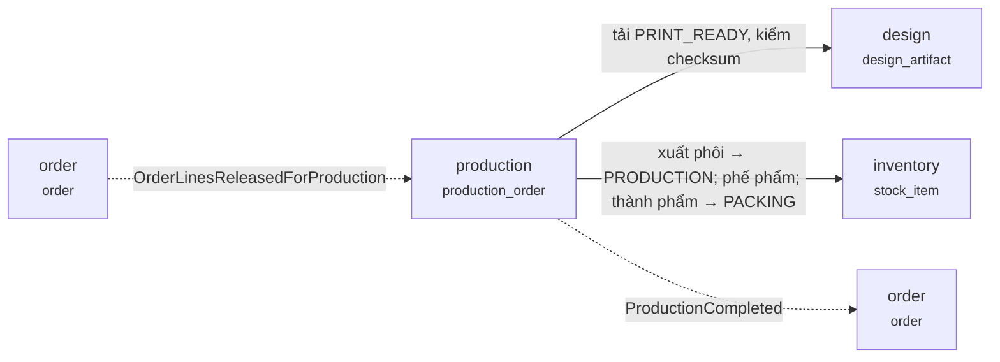

| # | Module | Ghi vào | Kết quả |
|---|---|---|---|
| 01 | `production` | `+ processed_event, + production_order (type = ORDER)` | một LSX cho mỗi dòng in · PENDING_PREPRESS — BR-PRD-01 |
| 02 | `production` | `~ production_order` | prepress đạt → READY; lỗi → ON_HOLD (lý do) |
| 03 | `inventory` | `~ stock_item (chuyển sang khu PRODUCTION)` | → MATERIAL_ISSUED; không vượt số còn thiếu — BR-PRD-03 |
| 04 | `production` | `~ production_order` | → PRINTING; ghi số in, số phế phẩm + lý do |
| 05 | `inventory` | `+ adjustment (reason = SCRAP)` | phôi hỏng ra khỏi tồn — BR-PRD-04 |
| 06 | `production` | `+ qc_result, ~ production_order` | QC theo mẫu đã duyệt; thiếu → READY (in bù) |
| 07 | `inventory` | `~ stock_item (chuyển sang khu PACKING)` | thành phẩm sẵn đóng gói |
| 08 | `production` | `~ production_order, + outbox_event` | → COMPLETED · ProductionCompleted |
| 09 | `order` | `+ processed_event, ~ order, + order_status_history` | → IN_FULFILMENT khi **mọi** LSX của đơn xong — BR-PRD-06 |

> ★ `order` từ chối release dòng có thiết kế mới chưa có mẫu APPROVED, và đơn đặt cọc chưa nhận đủ cọc — BR-PRD-08, BR-PRD-09.
> ★ Không in khi checksum file lệch thiết kế đã khoá — BR-PRD-02 (cùng nguyên tắc với `X-CHK`).
> · Bảng `production.*` chưa có trong migration — chờ task T2 (SCRUM-422) của DB owner.

### Nhánh gia công ngoài (bổ sung 2026-10-06)

Khi xưởng nội bộ không kịp hạn, Quản lý kho tách một phần LSX `ORDER` thành **LSX con gia công**. Hai cách: `SUPPLIED_BLANKS` (mình cấp phôi) và `FULL_SERVICE` (nhà gia công lo phôi). LSX `SAMPLE` không được gia công.

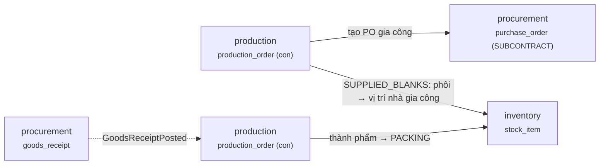

| # | Module | Ghi vào | Kết quả |
|---|---|---|---|
| G1 | `production` | `~ production_order (gốc), + production_order (con, execution = SUBCONTRACTED)` | gốc giảm số lượng, giữ nguyên trạng thái; con PENDING_PREPRESS hoặc READY — BR-PRD-11, 12 |
| G2 | `procurement` | `+ purchase_order (type = SUBCONTRACT, DRAFT)` | một dòng = thành phẩm của LSX con × số lượng × đơn giá |
| G3 | `inventory` | `~ reservation` | SUPPLIED_BLANKS: giữ chỗ phôi chuyển sang LSX con; FULL_SERVICE: nhả giữ chỗ |
| G4 | `procurement` | `~ purchase_order` | duyệt theo hạn mức như PO thường |
| G5 | `inventory` | `~ stock_item (chuyển sang vị trí nhà gia công)` | chỉ SUPPLIED_BLANKS; không tính ATP — BR-PRD-15 |
| G6 | `production` | `~ production_order (con)` | → SUBCONTRACTED; chỉ khi PO đã duyệt — BR-PRD-13, 14 |
| G7 | `procurement` | `+ goods_receipt, + goods_receipt_line, + outbox_event` | đếm thành phẩm; SUPPLIED_BLANKS đếm thêm phế phẩm, phôi trả về; đối soát hao hụt · GoodsReceiptPosted |
| G8 | `inventory` | `+ adjustment (reason = SUBCONTRACT_LOSS)` | hao hụt ra khỏi vị trí nhà gia công; vượt mức cần Quản lý kho duyệt — BR-PRD-17 |
| G9 | `production` | `+ processed_event, + qc_result, ~ production_order (con)` | → QC → COMPLETED (như `F-PROD` 06–08); thiếu → READY, gửi bù hoặc in bù nội bộ — BR-PRD-16 |
| G10 | `procurement` | `+ supplier_invoice, ~ match` | đối chiếu ba chiều theo **số đạt QC**, trừ hao hụt đã duyệt |

> ★ `order` vẫn chỉ chờ `ProductionCompleted` của **mọi** LSX của đơn (gốc và con) — BR-PRD-06 không đổi.
> · Cần thêm: loại PO `SUBCONTRACT`, cờ "gia công in" trên NCC, vị trí ảo cho nhà gia công, cột `parent_id` / `execution` / `subcontract_mode` / `purchase_order_id` trên `production_order` — thuộc task T2 (SCRUM-422) và T6.

---

# Vận hành kho

## `F-TRF` Điều chuyển giữa hai kho

*WBS 3.10*

Sáu bước, một database. Ngắn nhất nhưng dễ làm hỏng số liệu tồn kho nhất, vì có lúc hàng không thuộc kho nào.


| # | Service | Ghi vào | Kết quả |
|---|---|---|---|
| 01 | `inventory` | `+ transfer_order, + transfer_line × N` | status = DRAFT |
| 02 | `inventory` | `~ transfer_order, + transfer_approval` | → APPROVED, theo ngưỡng giá trị |
| 03 | `inventory` | `+ stock_reservation tại kho nguồn` | chọn theo FEFO |
| 04 | `inventory` | `~ stock_item(nguồn).on_hand −, + in_transit_stock, + stock_movement` | → IN_TRANSIT |
| 05 | `inventory` | `− in_transit_stock, + stock_item(đích), + stock_movement` | → COMPLETED |
| 06 | `inventory` | `+ stock_adjustment (nếu lệch)` | cần duyệt hao hụt |

> ★ Bất biến phải đúng ở MỌI thời điểm: on_hand(nguồn) + in_transit + on_hand(đích) = hằng số — BR-TRF-002.
> ⚠ Để hàng lại ở on_hand kho nguồn → kho nguồn bán vượt. Cộng sớm vào kho đích → bán hàng đang trên xe tải.
> · Nên viết hẳn một integration test khẳng định bất biến trên, thay vì phát hiện lúc kiểm kê cuối năm.

---

## `F-REP` Bổ sung nội bộ kho — từ khu dự trữ ra khu nhặt

*WBS 3.11*

Chạy tự động theo ngưỡng. Nếu không có luồng này thì khu nhặt hàng cạn và picker phải đi tận khu dự trữ.

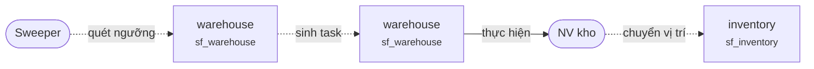

| # | Service | Ghi vào | Kết quả |
|---|---|---|---|
| 01 | `warehouse` | `đọc replenishment_rule` | ngưỡng min/max mỗi vị trí nhặt |
| 02 | `warehouse` | `+ replenishment_task` | status = CREATED, chọn vị trí nguồn |
| 03 | `warehouse` | `~ replenishment_task.priority` | theo mức cạn |
| 04 | `warehouse` | `~ replenishment_task, + outbox_event` | → COMPLETED |
| 05 | `inventory` | `~ stock_item.location_code, + stock_movement` | chuyển vị trí trong cùng kho |

> · Nguồn lấy từ khu dự trữ, đích là vị trí nhặt hàng. Cùng một kho nên KHÔNG qua in_transit.
> · Task được ưu tiên theo mức cạn của vị trí nhặt — WBS 3.11.4.

---

## `F-CNT` Kiểm kê và điều chỉnh tồn

*WBS 3.6.6*

Chỗ duy nhất trong hệ thống mà một con số có thể ghi đè tồn kho. Vì vậy nó bắt buộc phải qua duyệt.

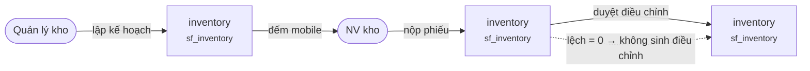

| # | Service | Ghi vào | Kết quả |
|---|---|---|---|
| 01 | `inventory` | `+ cycle_count, + cycle_count_line × N` | status = PLANNED. QL kho / Điều phối lập phiếu theo phạm vi (khu, kệ, bin, SKU); mỗi (bin, SKU, lô) có tồn rời → một dòng rời, mỗi thùng IN_STOCK → một dòng thùng. Ô đang bận thì bỏ qua và trả về `skipped`: ô nằm trên phiếu khác còn mở, hoặc trên phiếu đã nộp mà điều chỉnh `COUNT_VARIANCE` của dòng đó còn chờ duyệt (thêm dòng / đếm lại trên ô bận → `409 CYCLE_COUNT_SLOT_BUSY`). Báo thiếu khi lấy hàng trên ô bận cũng dùng lại chính phiếu đang giữ ô, không mở phiếu thứ hai |
| 02 | `inventory` | `~ cycle_count.assigned_user_id` | giao cho NV kho hoặc QL kho của kho đó (chỉ khi còn PLANNED) |
| 03 | `inventory` | `~ cycle_count_line.counted_qty / counted_by / counted_at / expected_qty` | đếm bằng mobile; lần đếm đầu → IN_PROGRESS. Số sổ sách đọc lại ngay lúc đếm (không đóng băng bin). Thùng chưa mở chỉ cần quét xác nhận còn/mất; thùng đã mở thì đếm từng đơn vị |
| 04 | `inventory` | `+ cycle_count_line` (dòng phát sinh) | hàng thấy trên kệ mà phiếu chưa có: bin phải có sẵn dòng tồn của SKU/lô đó (không có → `422 CYCLE_COUNT_UNKNOWN_LAYER`: hàng để nhầm chỗ thì chuyển, không điều chỉnh); thùng (LPN) phải kèm bin đã quét (`locationCode`) |
| 05 | `inventory` | `~ cycle_count → COMPLETED, + stock_adjustment(COUNT_VARIANCE) × M` | nộp phiếu, một transaction: mỗi dòng lệch thành điều chỉnh PENDING_APPROVAL (= "xem xét chênh lệch") |
| 06 | `inventory` | `~ stock_item.on_hand, ~ stock_package, + stock_movement` | QL kho duyệt từng điều chỉnh trên màn hình điều chỉnh → POSTED; hoặc từ chối → REJECTED, rồi có thể yêu cầu đếm lại |

> ★ Mọi chênh lệch đều cần duyệt của quản lý kho trước khi chạm vào tồn — BR-STK-005. Phiếu kiểm kê
> chỉ là chứng từ mỏng: việc xem xét, duyệt và hạch toán là các trạng thái của `stock_adjustment`
> (SCRUM-145), không có cơ chế điều chỉnh thứ hai.
> · Đã cài (SCRUM-146, 162, 164): `/api/v1/inventory/cycle-counts` — `POST` (lập phiếu), `GET /{id}`,
> `GET /assignees`, `PUT /{id}/assignment`, `PUT /{id}/lines/{lineId}/count`, `POST /{id}/lines`,
> `POST /{id}/submission`, `POST /{id}/recounts`, `POST /{id}/cancellation`. `GET` danh sách chỉ trả phần
> đầu phiếu kèm `lineCount`, `countedCount` (và `varianceCount` — số dòng lệch — chỉ cho người có `APPROVE`);
> các dòng chỉ có ở `GET /{id}`.
> · Phiếu mù: màn hình kiểm kê không bao giờ cho người không có quyền `APPROVE` thấy số sổ sách, ghi chú hay
> điều chỉnh của phiếu mù. **Giới hạn:** quyền READ của tồn kho (`stock-items`), điều chỉnh và sổ cái
> (`stock_movement`) vẫn hiện số liệu — người đếm có các quyền đó vẫn tra được số sổ sách ở màn khác. Hạn chế
> các màn đó trong lúc có phiếu mù là quyết định của chủ sản phẩm, chưa làm.
> · Thiếu (lệch âm) của dòng rời: lấy phần chưa giữ (on_hand − reserved) trước, theo thứ tự FEFO, rồi mới tới
> phần đã giữ cho đơn, cũng theo FEFO; mỗi dòng tồn một điều chỉnh, không quá on_hand của dòng đó. Nếu lúc nộp
> ô đang giữ ít hơn phần thiếu (hàng đã rời đi sau khi đếm) → `409 CYCLE_COUNT_STALE`, đếm lại dòng đó; thùng
> đã đếm mà sau đó bị lấy hết (CONSUMED) cũng → `CYCLE_COUNT_STALE`, nêu đúng dòng. Thừa (lệch dương) ghi vào dòng tồn nhận gần nhất; SKU FIFO thì khi duyệt thành một lớp
> tồn mới nhận vào ngày duyệt (không nâng lớp cũ, để FIFO giữ đúng tuổi hàng).
> · Thùng (LPN): một điều chỉnh cho cả thùng, để trạng thái thùng chỉ đổi một lần khi duyệt — tìm thấy lại
> (LOST → IN_STOCK), mở thùng, tiêu hết, hoặc LOST khi kiểm kê không thấy. Thừa của thùng ghi lại vào chính
> dòng tồn của thùng (thùng LOST thì `found()` trước), không bao giờ thành lớp mới. Dòng thùng đi theo thùng:
> thùng được chuyển nguyên thùng sang bin khác trong cùng kho thì dòng đổi theo bin mới.
> · Ô có điều chỉnh thiếu (`COUNT_VARIANCE` âm) đang chờ duyệt: phần tồn chưa giữ của ô bị khoá (không tính
> ATP, không phân bổ) cho tới khi duyệt/từ chối, dù phiếu là MANUAL hay SHORT_PICK. Báo thiếu trên ô mà phiếu
> MANUAL còn mở đang giữ thì dùng lại phiếu đó và ô chưa bị khoá cho tới khi phiếu được nộp — khoảng hở này
> được chấp nhận.
> · Điều chỉnh `COUNT_VARIANCE` chỉ được duyệt hoặc từ chối, người nộp không rút lại được
> (`409 COUNT_VARIANCE_NOT_WITHDRAWABLE`); không tạo tay được ở màn điều chỉnh (`400 VALIDATION_FAILED`).
> · Thiếu mà phải cắt vào phần đã giữ cho đơn → duyệt bị từ chối (`InsufficientStockException`); QL kho
> phân bổ lại hoặc nhả giữ trước rồi mới duyệt. Kiểm kê không bao giờ âm thầm huỷ hàng giữ của khách.
> · Đếm lại: `POST /{id}/recounts` (QL kho) cho các dòng có điều chỉnh bị từ chối → đánh dấu
> `recount_required` và mở phiếu mù mới chỉ gồm các ô đó — SHORT_PICK nếu phiếu gốc là SHORT_PICK (ô vẫn bị
> đóng băng trong lúc đếm lại), còn lại là MANUAL. Mỗi dòng chỉ được đếm lại một lần; muốn đếm nữa thì lập phiếu
> mới. Phiếu đã COMPLETED không bao giờ mở lại.
> · Chưa làm: lịch kiểm kê định kỳ, tần suất theo ABC, ngưỡng giá trị cho cấp duyệt cao hơn. NV kho chưa
> có quyền `inventory-cycle-counts:UPDATE` (chờ migration của Tú) — tới lúc đó chỉ QL kho và Điều phối
> nhập được số đếm.

---

## `F-EXP` Quét hết hạn hằng đêm

*WBS 3.6.7*

Job chạy 1 lần mỗi đêm. Không có nó thì hàng quá hạn vẫn nằm trong ATP và vẫn bán được.

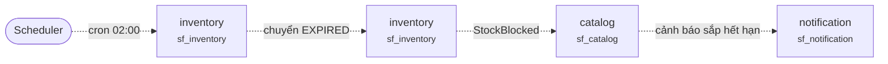

| # | Service | Ghi vào | Kết quả |
|---|---|---|---|
| 01 | `inventory` | `quét stock_item WHERE expiry_date < today` | điều kiện BR-STK-004 |
| 02 | `inventory` | `~ stock_item.condition = EXPIRED` | rơi khỏi ATP |
| 03 | `inventory` | `+ stock_movement, + outbox_event` | StockBlocked(EXPIRED) |
| 04 | `catalog` | `~ atp_cache` | số hiển thị giảm |
| 05 | `notification` | `+ notification` | báo quản lý kho danh sách lô hết hạn |

> · expiry_date < hôm nay → condition = EXPIRED, rơi khỏi ATP ngay lập tức — BR-STK-004.
> · Hàng sắp hết hạn (trong N ngày) thì chỉ cảnh báo, chưa chặn bán.

---


# Sau bán hàng

## `F-RMA` Trả hàng và đổi hàng

*WBS 3.17.5*

Hàng trả về LUÔN vào trạng thái cách ly, không bao giờ thẳng vào GOOD. Bán lại được hay không là quyết định của QC.

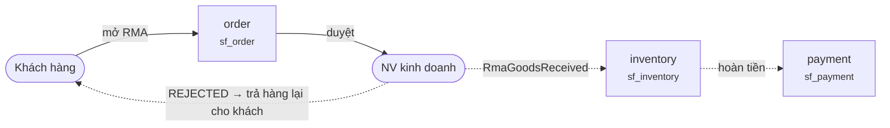

| # | Service | Ghi vào | Kết quả |
|---|---|---|---|
| 01 | `order` | `+ rma, + rma_line × N, ~ order.status` | → REQUESTED · RETURN_REQUESTED |
| 02 | `order` | `~ rma.approved_by` | → APPROVED, kiểm BR-RMA-002 |
| 03 | `fulfillment` | `+ return_shipment, MinIO + labels/return-*.pdf` | nhãn chiều về |
| 04 | `procurement` | `+ return_receipt, + qc_task` | đối chiếu số RMA trên kiện |
| 05 | `inventory` | `+ stock_item condition = QUARANTINE, + stock_movement` | KHÔNG BAO GIỜ là GOOD |
| 06 | `procurement` | `+ qc_result` | ACCEPTED → GOOD · REJECTED → DAMAGED |
| 07 | `payment` | `+ refund, ~ payment.status, + outbox_event` | → REFUNDED · RefundCompleted |
| 08 | `order` | `~ rma, ~ order.status` | → RETURNED |

> ⚠ Hàng in theo yêu cầu KHÔNG được trả trừ khi lỗi — BR-RMA-002. Cốc in ảnh của khách không bán lại cho ai được.
> · Hàng in bị lỗi trả về thì vào thẳng DAMAGED, không phải QUARANTINE — không có gì để kiểm lại.

> **Đã triển khai 2026-10-25 (SCRUM-243 / SCRUM-260), sửa lại sau rà soát cùng ngày (R1–R14)** — luồng thực tế nằm ở
> `03-state-machines.md` §12 và khác bảng trên ở mấy điểm: mọi hàng trả về (kể cả hàng in lỗi) đều nhập vào QUARANTINE
> (`stock_movement` RETURN_IN), rồi QC quyết định từng đơn vị — nhập lại để bán (chỉ hàng QC xác nhận là hàng phôi
> thường, lên ô kệ bán được của đúng kho nhận), huỷ (phiếu điều chỉnh SCRAP chờ duyệt) hoặc gửi trả khách; không có
> `return_shipment`/`qc_task` riêng, kho ghi nhận và QC kiểm ngay trên yêu cầu đổi trả. Hàng thay thế là một đơn thay
> thế giá 0 đi qua sản xuất và giao hàng như đơn thường; tiền được cấn trừ công nợ của đơn, hoàn tiền (tối đa số đã
> thu) hoặc giữ làm số dư của khách. **Mọi** phương án (kể cả chỉ giao bù) đều do Sales đề xuất và người khác duyệt.
>
> Những điểm nghiệp vụ đã chốt khi sửa:
> - Hạn đổi trả và hạn gửi hàng về tính theo **ngày lịch giờ Việt Nam** (hết ngày thứ N), không phải N × 24 giờ. Quá
>   hạn thì cổng khách từ chối; Sales vẫn mở được khi có lý do (`lateClaimReason`, ghi `LATE_CLAIM_ACCEPTED`).
> - Phiếu do Sales mở phải do **người khác** duyệt; mọi lý do đều cần ít nhất một ảnh (giao thiếu: ảnh biên bản giao
>   nhận có ký). Giới hạn ảnh tính riêng cho từng bước (khách, kho, QC).
> - Hàng về **nhiều kiện** được ghi từng kiện (mỗi kiện một email, gửi kèm `version` để bấm hai lần không thành hai
>   kiện); QC chỉ kiểm khi đủ hàng, hoặc khi xác nhận khách không gửi thêm (`noMoreParcels`) - lúc đó mới ghi thiếu.
>   Hàng về **sau hạn** hoặc **sau khi khách huỷ** phiếu đã duyệt vẫn được nhận vào kho, phiếu mở lại (không để hàng
>   nằm kho mà không có sổ).
> - Chỉ hàng QC chấm GOOD/UNOPENED mới được nhập lại kho bán. Hạn mức "không cần gửi hàng về" (2 triệu) tính theo cả
>   đơn, không theo từng phiếu.
> - Hàng QC **từ chối** vẫn là của khách: gửi trả khách, hoặc huỷ khi có ghi nhận khách đồng ý; không bao giờ nhập kho
>   bán. Khách chỉ thấy lý do `NO_DEFECT_FOUND`, ghi chú của QC là nội bộ.
> - **Đơn thay thế** không được khách huỷ trên portal, cũng không được "đóng phần còn lại" theo cách thường; muốn huỷ thì
>   "rút đơn thay thế" trên phiếu đổi trả (Sales đề xuất, kế toán duyệt): chưa đóng gói thì huỷ cả đơn, đã giao một
>   phần thì đóng phần chưa giao. Giá trị hàng rút được ghi có cho khách (cấn trừ công nợ trước, phần còn lại là số
>   dư) và đánh dấu cần hoá đơn điều chỉnh.
> - Cổng khách chỉ thấy ảnh khách gửi (không thấy ảnh của kho, QC), và chỉ thấy số tiền/số hàng bù khi đã được người
>   thứ hai duyệt.
> - Giới hạn còn lại: một dòng trả hàng chỉ ghi được một lô qua mọi kiện (dòng nhặt từ hai lô trả về đủ thì chưa ghi
>   đúng lô) - cần làm tiếp.
> - Hàng thay thế lại lỗi: phiếu mới trên đơn thay thế được tính theo **giá của đơn gốc**, tiền ghi vào đơn gốc.
> - Sales mở được phiếu tiếp theo trên đơn đã COMPLETED / REFUNDED / PARTIALLY_REFUNDED; đơn còn nợ thì không CLOSED.
> - Báo cáo doanh thu trừ phần đã ghi có cho khách vào ngày đặt của đơn đã thanh toán; đơn thay thế không tính là
>   doanh số.

---

## `F-RTO` Hàng hoàn về vì giao không thành công

*WBS 3.9.7*

Khác RMA ở chỗ khách chưa từng nhận hàng. Nhưng hàng vẫn phải qua kiểm mới bán lại được.

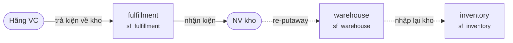

| # | Service | Ghi vào | Kết quả |
|---|---|---|---|
| 01 | `fulfillment` | `~ shipment.status` (Điều phối, khi hãng báo không giao được) | → DELIVERY_FAILED |
| 02 | `fulfillment` | `~ shipment.status` (NV kho nhận kiện hoàn qua phiếu nhận hàng hoàn) | → RETURNED |
| 03 | `order` | `~ order.status, + order_status_history` | → RTO |
| 04 | `warehouse` | `+ putaway_task` | tái xếp kho |
| 05 | `inventory` | `+ stock_item, + stock_movement` | GOOD nếu kiện nguyên, QUARANTINE nếu không |

> · Kiện còn nguyên → condition = GOOD. Kiện rách hoặc mở → QUARANTINE — OQ-12.
> · Đơn → RTO là trạng thái kết thúc; hoàn tiền cho khách xử lý riêng qua luồng refund.

---

## `F-REF` Hoàn tiền và đối soát với cổng thanh toán

*WBS 3.15.6 · 3.20.4*

Tiền ra khỏi hệ thống. Hạn mức duyệt là thứ chặn duy nhất, nên nó phải kiểm trong domain chứ không ở controller.

```mermaid
flowchart LR
    N0(["Kế toán"])
    N1["payment<br><small>sf_payment</small>"]
    N2(["Cổng TT"])
    N3["payment<br><small>sf_payment</small>"]
    N4["reporting<br><small>sf_reporting</small>"]
    N0 -->|"yêu cầu hoàn"| N1
    N1 -->|"gọi API hoàn"| N2
    N2 -->|"file đối soát"| N3
    N3 -.->|"RefundCompleted"| N4
```

| # | Service | Ghi vào | Kết quả |
|---|---|---|---|
| 01 | `payment` | `+ refund` | status = REQUESTED |
| 02 | `payment` | `~ refund.approved_by` | kiểm hạn mức duyệt |
| 03 | `payment` | `+ payment_transaction` | payload gọi API hoàn tiền |
| 04 | `payment` | `~ payment.status` | → PARTIALLY_REFUNDED | REFUNDED |
| 05 | `payment` | `+ settlement_line` | import file đối soát của cổng |
| 06 | `payment` | `+ reconciliation_match` | khớp hoặc gắn cờ lệch |
| 07 | `reporting` | `~ revenue_report` | read model doanh thu |

> ⚠ Vượt hạn mức người duyệt thì KHÔNG hoàn được, phải chuyển lên cấp trên — BR-PAY-003.
> · Đối soát so ba nguồn: payment của mình, settlement của cổng, và remittance của hãng VC cho COD.

---


# Ngoại lệ

## `X-SHORT` Nhặt thiếu — đơn không hỏng, đơn dừng lại

*WBS 3.7.5*

Tình huống xảy ra hằng ngày ở kho thật. Điều quan trọng là đơn KHÔNG tự huỷ và tồn KHÔNG tự trừ.

```mermaid
flowchart LR
    N0(["NV kho"])
    N1["fulfillment<br><small>sf_fulfillment</small>"]
    N2["order<br><small>sf_order</small>"]
    N3(["Điều phối đơn"])
    N4["inventory<br><small>sf_inventory</small>"]
    N0 -->|"báo thiếu"| N1
    N1 -.->|"PickShortReported"| N2
    N2 -->|"xử lý"| N3
    N3 -.->|"tái phân bổ"| N4
```

| # | Service | Ghi vào | Kết quả |
|---|---|---|---|
| 01 | `fulfillment` | `~ pick_line.status = SHORT, .short_qty` | + outbox_event |
| 02 | `order` | `~ order.status, + order_hold` | → ON_HOLD(INVENTORY_ISSUE) |
| 03 | `inventory` | `+ cycle_count (tự sinh)` | kiểm lại vị trí bị thiếu |
| 04 | `inventory` | `~ stock_allocation (nếu tái phân bổ)` | chọn vị trí khác |
| 05 | `order` | `~ order.status, + order_status_history` | → CONFIRMED, chạy lại luồng nhặt |

> ★ Dòng đơn → SHORT, đơn → ON_HOLD(INVENTORY_ISSUE). Không dòng stock_movement nào được ghi.
> · Điều phối chọn một trong ba: phân bổ lại từ vị trí khác, tách đơn, hoặc huỷ dòng đó.
> · Chênh lệch giữa allocated và thực tế nhặt được luôn kèm một cycle_count tự động cho vị trí đó.
> · Đã cài (SCRUM-152): `POST /fulfillment/tasks/{id}/pick-lines/{lineId}/short` (dòng → SHORT, đơn → ON_HOLD lý do `INVENTORY` — tên trong code của `INVENTORY_ISSUE`, enum `HoldReason` từ G3-2 — không ghi stock_movement) và `.../reallocation` (Điều phối/QL kho: nhả allocation cũ `SHORT_PICKED`, phân bổ lại FEFO ở bin khác cùng kho, dòng cũ → CANCELLED giữ `short_qty`, thêm dòng mới; hết dòng SHORT thì đơn quay lại IN_FULFILMENT). Báo thiếu còn tự mở phiếu kiểm kê mù `SHORT_PICK` cho đúng bin/SKU/lô (hoặc đúng thùng) — trừ khi ô đã bận: nằm trên phiếu khác còn mở, hoặc trên phiếu đã nộp mà chênh lệch còn chờ duyệt (kể cả phiếu MANUAL), thì dùng lại phiếu đó; xem ở `GET /api/v1/inventory/cycle-counts`, NV kho xem được, màn hình kiểm kê không hiện số sổ sách cho họ. Khi phiếu còn mở, phần tồn chưa giữ của bin/SKU/lô đó bị khoá: không tính vào ATP, không phân bổ FEFO (quyết định 19/10/2026); QL kho huỷ phiếu bằng `POST /api/v1/inventory/cycle-counts/{id}/cancellation` để mở khoá. Đếm và hạch toán chênh lệch theo `F-CNT` (SCRUM-146): sau khi phiếu được nộp, khoá vẫn giữ cho tới khi mọi điều chỉnh `COUNT_VARIANCE` của dòng đó được duyệt hoặc từ chối — nếu không, giữa lúc nộp và lúc duyệt hệ thống lại hứa bán đúng những đơn vị picker không tìm thấy. Tách đơn và huỷ dòng chưa làm (để story sau).
> · Hàng **hỏng** (không phải thiếu) phát hiện lúc nhặt đi theo `X-DMG` bên dưới: dòng không thành SHORT cho toàn bộ, chỉ phần hỏng, và hệ thống tự phân bổ lại ngay trong cùng giao dịch; chỉ khi không còn hàng thì mới rơi vào nhánh SHORT + ON_HOLD của X-SHORT.

---

## `X-DMG` Hàng hỏng — báo hỏng có ảnh, cách ly, quyết định xử lý

*WBS 3.6.5.1 · BR-STK-003 · SCRUM-475 (báo hỏng trên kệ), SCRUM-277 (báo hỏng lúc nhặt)*

Hàng vỡ/nứt, móp méo, ẩm mốc/ướt, bẩn/in lỗi được phát hiện trên kệ, ngay lúc nhặt, hoặc ở bàn đóng gói (hàng đã nhặt, vỡ trong thùng). Hàng hỏng phải rời ATP ngay, được tách khỏi hàng tốt cả trên sổ lẫn ngoài sàn, và chỉ quản lý kho (không phải người báo) mới được quyết định hủy, trả nhà cung cấp hay phục hồi.

```mermaid
flowchart LR
    N0(["NV kho / QC / người nhặt"])
    N1["inventory<br><small>sf_inventory</small>"]
    N2["fulfillment<br><small>sf_fulfillment</small>"]
    N3["order<br><small>sf_order</small>"]
    N4(["Quản lý kho"])
    N0 -->|"báo hỏng + ảnh (trên kệ)"| N1
    N0 -->|"báo hỏng + ảnh (dòng nhặt)"| N2
    N2 -->|"cùng giao dịch"| N1
    N2 -->|"giữ chỗ mới / ON_HOLD(INVENTORY)"| N3
    N4 -->|"hủy / trả NCC / phục hồi"| N1
    N1 -.->|"StockDamageReported, StockDamageDisposed"| N3
```

| # | Service | Ghi vào | Kết quả |
|---|---|---|---|
| 01 | `inventory` | `+ stock_damage_report, + stock_damage_photo × 1..5` | biên bản hàng hỏng `DMG-yyyyMMdd-nnnn`, ảnh lưu trong MinIO (`qc-evidence`) |
| 02 | `inventory` | `~ stock_item.on_hand −` (dòng nguồn), `+/~ stock_item` DAMAGED ở khu `QUARANTINE`, `+ stock_movement` MOVE | AVAILABLE → DAMAGED, rời ATP ngay |
| 03 | `fulfillment` | `~ pick_line` (CANCELLED, `damaged_qty`), `+ pick_line × N` | chỉ khi báo lúc nhặt: dòng phần tốt + dòng thay thế, hoặc dòng SHORT |
| 04 | `inventory` | `~ stock_reservation` (giảm/đóng DAMAGED), `+ stock_reservation` | phân bổ lại FEFO, hoặc giữ chỗ "bị ảnh hưởng" trên hàng hỏng |
| 05 | `order` | `~ order_line_reservation`, `~ order.status` | dòng đơn nhận giữ chỗ mới; không còn hàng → ON_HOLD(INVENTORY) |
| 06 | `inventory` | `+ stock_damage_disposition`, `+ stock_adjustment` (POSTED), `+ stock_movement` ADJUSTMENT | hủy: biên bản hủy `WO-yyyyMMdd-nnnn`, tồn giảm |
| 07 | `inventory` | `+ stock_damage_disposition`, `~ stock_item`, `+ stock_movement` MOVE | phục hồi: DAMAGED → AVAILABLE lên một ô kệ |
| 08 | `inventory` | `+ stock_damage_supplier_shipment`, `~ stock_item.on_hand −`, `+ stock_movement` SUPPLIER_RETURN | trả NCC: giao hàng cho NCC/nhà xe theo số phiếu xuất trả, hàng rời khu cách ly và rời sổ |
| 09 | `notification` | `+ user_notification` (in-app), email | quản lý kho (cần quyết định), điều phối (đơn bị ON_HOLD), kế hoạch tồn kho (giữ chỗ vượt tồn tự do) |

> ★ Ít nhất một ảnh và một lý do (OTHER phải có ghi chú) — BR-STK-003, kiểm ở aggregate và ở DB (`tg_stock_damage_report_photo`). Lỗi lưu ảnh → không đổi tồn, ảnh đã lưu bị xoá khi rollback.
> ★ Báo hỏng trên kệ chỉ lấy hàng **chưa được giữ chỗ** (`DAMAGE_EXCEEDS_FREE_STOCK`); hàng đã phân bổ cho đơn do người nhặt báo ở bước nhặt, để đơn biết ngay trong cùng giao dịch. Giữ chỗ của sản xuất/điều chuyển không bao giờ bị lấy; phôi hỏng trong xưởng in vẫn theo luồng ghi hủy của sản xuất.
> ★ Hàng hỏng luôn chuyển sang một khu `QUARANTINE` của cùng kho (người báo chọn, hoặc khu đầu tiên theo mã còn nhận được lớp hàng này): một lớp nhận hàng chỉ có một dòng tồn mỗi vị trí, và hàng hỏng phải tách khỏi hàng tốt. Hàng trong thùng (LPN) ra khỏi thùng: thùng mở, hoặc CONSUMED khi hết.
> · Lúc nhặt (`POST /fulfillment/tasks/{id}/pick-lines/{lineId}/damage`, chỉ người được giao, đúng kho, đúng ô): khoá pick → đơn → tồn. Dòng cũ CANCELLED với `damaged_qty`; phần tốt thành dòng OPEN mới cùng ô cùng allocation; phần hỏng được phân bổ lại FEFO trong kho (kể cả chính ô đó — số đếm ở đó không bị nghi ngờ như nhặt thiếu) thành các dòng OPEN mới, đơn tiếp tục PICKING. Không còn hàng → dòng SHORT mang giữ chỗ "bị ảnh hưởng" nằm trên hàng hỏng (không ai nhặt được), đơn ON_HOLD(INVENTORY); Điều phối gọi `.../reallocation` như X-SHORT khi có hàng, đơn tự quay lại.
> · Ở bàn đóng gói (`POST /fulfillment/tasks/{id}/pick-lines/{lineId}/damage-after-pick`, người đang đóng gói phiên đó hoặc quản lý, quyền `fulfillment-packing:UPDATE`): hàng đã nhặt (đã trừ tồn lúc nhặt) quay lại sổ dưới dạng DAMAGED ở khu cách ly bằng một dòng `PUT_BACK` (tham chiếu `DAMAGE_REPORT`), không bao giờ nhiều hơn số dòng nhặt đã lấy. Hàng đang nằm trong kiện phải lấy ra trước (`PACK_DAMAGED_UNITS_PACKED`). Đơn được bù như lúc nhặt (phân bổ lại FEFO, hoặc giữ chỗ "bị ảnh hưởng" + dòng SHORT, đơn ON_HOLD); nhiệm vụ nhặt quay về PICKING để nhặt dòng mới, đóng gói chờ đến khi nhặt xong lại. Dòng nhặt cũ giữ `packing_damaged_qty`: đóng gói không tính các đơn vị đó nữa, huỷ đơn thì chỉ cất lại phần còn lại.
> · Quyết định (`POST /api/v1/inventory/damage-reports/{id}/dispositions`, quyền `inventory-damage-reports:APPROVE`, không phải người báo): có thể chia nhiều lần theo số lượng. Hủy = phiếu điều chỉnh DAMAGED do người báo đề nghị, quản lý duyệt và ghi sổ ngay. Trả NCC = ghi nhận ý định (NCC lấy từ lô), hàng vẫn DAMAGED ở khu cách ly cho đến khi quản lý ghi nhận đã giao cho NCC (`.../dispositions/{dispositionId}/supplier-shipment`, kèm số phiếu xuất trả): giao một lần hoặc nhiều đợt, mỗi đợt rời sổ bằng một dòng `SUPPLIER_RETURN`; NCC từ chối (`.../supplier-refusal`, ghi câu trả lời) thì số đó quay về chờ quyết định lại. Biên bản đã quyết hết nhưng còn hàng chờ giao NCC có trạng thái AWAITING_SUPPLIER. Phiếu ghi nợ NCC là việc của procurement (chưa làm). Phục hồi = lên ô kệ AVAILABLE, phải có ghi chú. Phần hàng đang giữ chỗ cho một đơn (giữ chỗ "bị ảnh hưởng") được bảo vệ theo từng biên bản: không hủy, không trả NCC được (`DAMAGED_STOCK_HELD`); nếu kiểm lại thấy hàng vẫn tốt thì "phục hồi toàn bộ phần còn lại" sẽ trả hàng lại cho đơn - giữ chỗ đi theo hàng lên ô kệ và lần phân bổ lại dòng thiếu của Điều phối giữ nguyên nó.
> · Báo hỏng hàng đã nhặt được cả khi nhiệm vụ còn đang nhặt (vỡ trong thùng nhặt) lẫn ở bàn đóng gói, kể cả khi đơn đang tạm giữ (không được khi đơn đã huỷ). Nhiệm vụ nhặt quay lại PICKING có thể giao cho người khác (`PUT /fulfillment/tasks/{id}/assignment`).
> · Giữ chỗ mềm lúc checkout (SKU reservation) không gắn hàng cụ thể: nếu hàng hỏng làm tổng giữ chỗ vượt hàng tự do, `StockDamageReported.skuReservationShortfall` báo số thiếu; lúc release đơn sẽ báo `INSUFFICIENT_STOCK` như mọi trường hợp thiếu hàng.

---

## `X-RESV` Giữ chỗ hết hạn — tồn tự phục hồi

*WBS 3.14.5.2*

Không có job này thì mỗi khách bỏ giỏ hàng là một ít tồn bị khoá vĩnh viễn, và hệ thống dần tự bán hết hàng của chính mình.

```mermaid
flowchart LR
    N0(["Scheduler"])
    N1["inventory<br><small>sf_inventory</small>"]
    N2["inventory<br><small>sf_inventory</small>"]
    N3["order<br><small>sf_order</small>"]
    N4["catalog<br><small>sf_catalog</small>"]
    N0 -.->|"mỗi phút"| N1
    N1 -.->|"giải phóng"| N2
    N2 -.->|"StockReservationReleased"| N3
    N3 -.->|"ATP phục hồi"| N4
```

| # | Service | Ghi vào | Kết quả |
|---|---|---|---|
| 01 | `inventory` | `quét stock_reservation WHERE expires_at < now AND status = HELD` |  |
| 02 | `inventory` | `~ stock_reservation.status = RELEASED` | reason = RESERVATION_EXPIRED |
| 03 | `inventory` | `~ stock_item.reserved −, + outbox_event` | StockReservationReleased |
| 04 | `order` | `~ order.status` | → PAYMENT_FAILED |
| 05 | `catalog` | `~ atp_cache` | ATP phục hồi tự động |

> · expires_at < now → status = RELEASED, reason = RESERVATION_EXPIRED — BR-STK-002.
> · Đơn tương ứng → PAYMENT_FAILED. Giỏ hàng của khách được giữ lại để họ thử lại.
> ★ Allocation KHÔNG có expires_at — đã phân bổ rồi thì không tự hết hạn nữa.

---

## `X-CHK` Lệch checksum thiết kế — dừng đóng gói

*WBS 3.8.3*

Nghĩa là kiện hàng sắp chứa thứ khác với thứ khách đã duyệt. Đây là lỗi phải chặn, không phải cảnh báo.

```mermaid
flowchart LR
    N0(["NV kho"])
    N1["fulfillment<br><small>sf_fulfillment</small>"]
    N2["design<br><small>sf_design</small>"]
    N3["order<br><small>sf_order</small>"]
    N4(["NV kinh doanh"])
    N0 -->|"quét kiện"| N1
    N1 -->|"verify checksum"| N2
    N2 -.->|"MISMATCH"| N3
    N3 -.->|"xử lý"| N4
```

| # | Service | Ghi vào | Kết quả |
|---|---|---|---|
| 01 | `fulfillment` | `+ design_verification` | expected_checksum vs actual |
| 02 | `design` | `đọc design-snapshots/{id}.json` | tính lại SHA-256 |
| 03 | `fulfillment` | `~ design_verification.result = MISMATCH` | + outbox_event |
| 04 | `order` | `~ order.status, + order_hold` | → ON_HOLD, reason = DESIGN_MISMATCH |
| 05 | `order` | `~ order_line.design_snapshot_id (nếu cần in lại)` | BR-DSG-002 |

> · So checksum lưu trên order_line với artifact thật trong MinIO — BR-DSG-003.
> ⚠ Lệch thì đơn → ON_HOLD, và phải người có quyền mới giải quyết được. Không có nút bỏ qua.

---


# Nền tảng

## `P-PERM` 14 service tự đăng ký catalog phân quyền

*WBS 3.19.1*

Cơ chế làm cho con số 387 quyền là số ĐƯỢC TÍNH RA, không phải danh sách ai đó phải nhớ cập nhật.

```mermaid
flowchart LR
    N0(["mỗi service"])
    N1(["@PermissionResource"])
    N2["identity<br><small>sf_identity</small>"]
    N3["identity<br><small>sf_identity</small>"]
    N4(["Màn hình admin"])
    N0 -.->|"khi khởi động"| N1
    N1 -->|"POST register"| N2
    N2 -.->|"upsert"| N3
    N3 -->|"ma trận"| N4
```

| # | Service | Ghi vào | Kết quả |
|---|---|---|---|
| 01 | `service` | `quét @PermissionResource bằng reflection` | dựng PermissionCatalog |
| 02 | `service` | `đối chiếu @RequiresPermission` | lệch → chặn khởi động |
| 03 | `identity` | `+ permission_resource (upsert)` | code, group, route, api_path |
| 04 | `identity` | `+ permission (upsert)` | một dòng cho mỗi (resource, action) |
| 05 | `identity` | `~ permission_version` | tăng counter, token cũ bị từ chối |
| 06 | `identity` | `→ trả RoleMatrixView cho màn hình` | đã gom nhóm và tính counter |

> ⚠ Endpoint đòi quyền mà không resource nào khai báo thì service KHÔNG KHỞI ĐỘNG ĐƯỢC — BR-SEC-001.
> · Service chưa chạy thì quyền của nó tạm chưa hiện trên màn hình. Tự chữa lành, không cần seed script.

---

## `P-NOTI` Thông báo — một event, nhiều kênh

*WBS 3.19.2*

notification-service nghe gần như mọi topic. Đây là lý do nó không được phép có logic nghiệp vụ nào.

```mermaid
flowchart LR
    N0(["mọi service"])
    N1[("Kafka")]
    N2["notification<br><small>sf_notification</small>"]
    N3(["Template engine"])
    N4(["Email / SMS / In-app"])
    N0 -.->|"outbox"| N1
    N1 -.->|"consumer"| N2
    N2 -->|"render"| N3
    N3 -->|"gửi"| N4
```

| # | Service | Ghi vào | Kết quả |
|---|---|---|---|
| 01 | `notification` | `+ processed_event` | chống trùng |
| 02 | `notification` | `+ notification` | channel, recipient, template_code |
| 03 | `notification` | `render template + biến` | Thymeleaf |
| 04 | `notification` | `~ notification.status` | SENT | FAILED |
| 05 | `notification` | `+ notification_attempt` | nhật ký từng lần gửi |

> · Consumer phải idempotent: cùng một event giao hai lần không được gửi hai email — BR-SEC-001 áp dụng chung.
> · Gửi thất bại thì lưu lại và cho phép gửi lại thủ công, không im lặng bỏ qua.

---

## `P-RPT` Read model báo cáo dựng từ event stream

*WBS 3.20*

reporting-service không gọi API của ai cả. Nó chỉ nghe event và tự dựng bảng của mình — vì thế nó không làm chậm hệ thống chính.

```mermaid
flowchart LR
    N0(["mọi service"])
    N1[("Kafka")]
    N2["reporting<br><small>sf_reporting</small>"]
    N3["reporting<br><small>sf_reporting</small>"]
    N4(["Dashboard"])
    N0 -.->|"outbox"| N1
    N1 -.->|"projector"| N2
    N2 -.->|"tổng hợp đêm"| N3
    N3 -->|"truy vấn"| N4
```

| # | Service | Ghi vào | Kết quả |
|---|---|---|---|
| 01 | `reporting` | `+ processed_event` | chống trùng |
| 02 | `reporting` | `+ projection (một bảng phẳng mỗi loại báo cáo)` | denormalise sẵn |
| 03 | `reporting` | `+ kpi_daily` | job tổng hợp chạy đêm |
| 04 | `reporting` | `→ trả dashboard` | truy vấn một bảng, không JOIN |

> ★ Không có JOIN xuyên database — đây chính là câu trả lời cho 'vậy báo cáo lấy dữ liệu ở đâu' — ADR-0002.
> · Read model có thể dựng lại từ đầu bằng cách replay event, nên sai sót projector là sửa được.

---

## `P-CHAT` Chat tư vấn dẫn tới đơn hàng đặt hộ

*WBS 3.16*

Luồng duy nhất mà nhân viên thao tác thay mặt khách. Quyền và dấu vết ai làm gì phải rõ.

```mermaid
flowchart LR
    N0(["Khách hàng"])
    N1["chat<br><small>sf_chat</small>"]
    N2(["NV kinh doanh"])
    N3["design<br><small>sf_design</small>"]
    N4["order<br><small>sf_order</small>"]
    N0 -->|"WebSocket"| N1
    N1 -->|"định tuyến"| N2
    N2 -->|"sửa thiết kế hộ"| N3
    N3 -->|"đặt đơn hộ"| N4
```

| # | Service | Ghi vào | Kết quả |
|---|---|---|---|
| 01 | `chat` | `+ conversation, + message` | status = OPEN |
| 02 | `chat` | `~ conversation.assigned_to` | theo routing rule |
| 03 | `chat` | `+ message (rich: ảnh, link sản phẩm)` |  |
| 04 | `design` | `+ design_draft (nhân viên tạo hộ)` | khách vẫn phải confirm |
| 05 | `order` | `+ order, created_by = nhân viên` | customer_id vẫn là khách |
| 06 | `chat` | `~ conversation.status` | → RESOLVED |

> ★ Đơn đặt hộ vẫn ghi customer_id của khách, nhưng created_by là nhân viên — audit phải phân biệt được.
> · Nhân viên sửa thiết kế hộ khách thì khách vẫn phải confirm lại snapshot mới.

---


# Quy ước lưu trữ

**Chỉ ghi thêm — không bao giờ UPDATE hay DELETE**
`stock_movement`, `order_status_history`, `payment_transaction`, `tracking_event`, `qc_result`,
`outbox_event`, `audit_log`. Sai thì ghi một dòng đảo ngược.

**Bất biến sau khi tạo**
`design_snapshot` và artifact JSON của nó, `order_line` sau khi đơn rời CONFIRMED, mọi chứng từ
đã post.

**Sửa thoải mái**
`stock_item`, `cart_item`, `design_draft` khi còn DRAFT, các bảng cấu hình. Nhưng mọi thay đổi
số lượng tồn đều phải kèm một dòng `stock_movement`.

**Job đối chiếu nên có**
Tổng các dòng `stock_movement` của một SKU tại một vị trí phải bằng đúng `stock_item.on_hand`.
Chạy hằng đêm.
