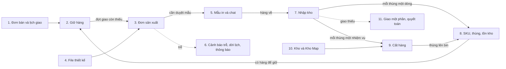

# WF3 — Giải thích các bảng và cột

Luồng **WF3: Thiếu tồn → Đơn sản xuất → Duyệt mẫu in → Nhập kho → Cất hàng** (người demo: Nguyễn Hoài Phương).
Gồm 53 bảng, lấy từ [`wf3-don-san-xuat-nhap-kho-cat-hang.dbml`](wf3-don-san-xuat-nhap-kho-cat-hang.dbml).
Đây là **thiết kế đề xuất**: nền là `schema.dbml` trên `origin/develop` (`df34c338`, ngày 2026-11-11), sửa theo docs.
Lý do của từng thay đổi nằm ở [bản phân tích docs ↔ database](wf3-phan-tich-docs-vs-db.md).

Cách đọc:

- **🟡 đề xuất**: cột khác với database hiện tại. **🟡 Bảng mới**: bảng chưa có trong database.
- **→ bảng.cột**: khoá ngoại có vẽ trong DBML.
- Cột chung (`id`, `version`, `created_at`, `created_by`, `last_modified_at`, `last_modified_by`) giải thích một lần ở mục 0.
- Các cột `*_id` trỏ tới `identity.app_user` (người lập, duyệt, thực hiện) không vẽ khoá ngoại cho đỡ rối.

## Đọc nhanh theo cụm

53 bảng chia thành 11 cụm, xếp theo thứ tự hàng đi qua luồng. Đọc từ cụm 1 xuống; trong mỗi cụm đọc
bảng có dấu ★ trước (23 bảng ★ là phần lõi, nắm được chúng là hiểu cả luồng). Bấm tên bảng để tới phần chi tiết từng cột.

### Cụm 1. Đơn bán và lịch giao: đầu vào của luồng (bước 1)

Đơn bán của khách và lịch giao của nó. Đây là điểm xuất phát: đơn cần bao nhiêu thùng của SKU nào, giao làm mấy đợt, mỗi đợt trong khoảng ngày nào. Sale chọn kho xuất ở cụm này.

- ★ [`customer_order`](#1-orderingcustomer_order) — Đơn bán: của khách nào, trạng thái gì, giao tới đâu, xuất từ kho nào.
- ★ [`order_line`](#2-orderingorder_line) — Dòng đơn: SKU nào, bao nhiêu thùng, giá bao nhiêu một cái.
- ★ [`delivery_batch`](#3-orderingdelivery_batch) — Đợt giao: đợt thứ mấy, hẹn giao trong khoảng ngày nào.
- ★ [`delivery_batch_line`](#4-orderingdelivery_batch_line) — Mỗi đợt giao gồm bao nhiêu thùng của từng dòng đơn.
- [`sales_contract`](#5-orderingsales_contract) — Hợp đồng của đơn. WF3 chỉ đọc số lần in mẫu miễn phí.
- [`customer`](#6-customercustomer) — Khách sỉ.
- [`order_status_history`](#7-orderingorder_status_history) — Nhật ký đổi trạng thái của đơn bán.
- [`order_line_sku_change`](#8-orderingorder_line_sku_change) — Nhật ký đổi SKU của dòng đơn khi khách sửa thiết kế (X02). 🟡 bảng mới

**Nối sang cụm khác:** Từ số thùng của từng đợt giao, hệ thống sang cụm 2 để giữ hàng.

### Cụm 2. Giữ hàng cho đơn (bước 2)

Giữ những thùng đang có sẵn cho đơn. Mỗi khoản giữ ghi: giữ bao nhiêu thùng, cho dòng đơn nào, tính cho đợt giao nào.

- ★ [`stock_reservation`](#9-inventorystock_reservation) — Khoản giữ hàng: giữ bao nhiêu thùng của SKU nào cho đơn nào, tại kho nào.
- ★ [`delivery_batch_hold`](#10-orderingdelivery_batch_hold) — Khoản giữ đó thuộc dòng đơn nào, tính cho đợt giao nào.

**Nối sang cụm khác:** Đợt giao nào giữ chưa đủ thùng thì là đợt còn thiếu: sang cụm 3 để lập Đơn SX.

### Cụm 3. Đơn sản xuất (bước 3–5, X05)

Đơn sản xuất gửi xưởng in cho phần còn thiếu. Bảng trung tâm của cả luồng là production_order: ai lập, ai duyệt, gửi xưởng nào, cần hàng ngày nào, đang ở trạng thái nào.

- ★ [`production_order`](#11-orderingproduction_order) — Đơn SX: gửi xưởng nào, cho đợt giao nào, cần hàng ngày nào, ai lập, ai duyệt, trạng thái.
- ★ [`production_order_line`](#12-orderingproduction_order_line) — Dòng Đơn SX: SKU nào, đặt bao nhiêu thùng, đã nhận bao nhiêu thùng.
- ★ [`producer`](#13-orderingproducer) — Danh mục xưởng in (đơn vị sản xuất).
- [`production_order_slip`](#14-orderingproduction_order_slip) — File PDF phiếu Đơn SX gửi cho xưởng.
- [`production_order_status_history`](#15-orderingproduction_order_status_history) — Nhật ký đổi trạng thái của Đơn SX, kèm lý do.
- [`production_order_status_transition`](#16-orderingproduction_order_status_transition) — Danh sách bước chuyển trạng thái hợp lệ của Đơn SX (bảng phụ trợ).
- [`production_order_damage_adjustment`](#17-orderingproduction_order_damage_adjustment) — Đơn SX bù làm lại cho những thùng lỗi nào (X05). 🟡 bảng mới

**Nối sang cụm khác:** Đơn SX được duyệt thì gửi kèm file in (cụm 4); cần duyệt mẫu thì sang cụm 5; hàng về thì sang cụm 7.

### Cụm 4. File thiết kế gửi kèm Đơn SX (bước 4, X02)

Bản thiết kế đã duyệt của khách và file in PDF/X xuất ra từ nó. Xưởng in theo đúng file này.

- [`design_snapshot`](#18-designdesign_snapshot) — Bản thiết kế đã duyệt, chốt cứng.
- [`design_artifact`](#19-designdesign_artifact) — File xuất từ bản thiết kế, trong đó có file in PDF/X.
- [`design_draft`](#20-designdesign_draft) — Bản nháp / bản sửa thiết kế của khách (X02).

**Nối sang cụm khác:** Dòng Đơn SX trỏ tới bản thiết kế ở đây. X02: khách sửa thiết kế thì sinh bản mới và SKU mới.

### Cụm 5. Mẫu in và chat (bước 6–7, X01)

Trước khi in hàng loạt, xưởng in thử vài mẫu. Mỗi lần in thử là một vòng mẫu, có ảnh / video để khách xem và bấm Duyệt hoặc Yêu cầu in lại. Sale gửi thẻ duyệt mẫu cho khách trong chat.

- ★ [`production_order_sample_round`](#21-orderingproduction_order_sample_round) — Một vòng mẫu in: vòng thứ mấy, khách duyệt hay yêu cầu in lại, vì sao in lại.
- ★ [`production_order_sample_media`](#22-orderingproduction_order_sample_media) — Ảnh / video mẫu in của một vòng.
- [`conversation`](#23-chatconversation) — Cuộc trò chuyện giữa Sale và khách.
- [`message`](#24-chatmessage) — Tin nhắn; thẻ duyệt mẫu in là một loại tin nhắn.

**Nối sang cụm khác:** Khách duyệt mẫu thì Đơn SX sang In Production; hàng làm xong về kho ở cụm 7.

### Cụm 6. Cảnh báo trễ, dời lịch, thông báo (X04)

Phần theo dõi và báo tin: cảnh báo khi sản xuất có nguy cơ trễ, lịch sử dời lịch giao khi khách đồng ý lùi, hộp thông báo trong app và nhật ký gửi email cho xưởng.

- [`delay_alert`](#25-orderingdelay_alert) — Cảnh báo trễ đang mở của một Đơn SX hoặc một đợt giao.
- [`delivery_batch_window_change`](#26-orderingdelivery_batch_window_change) — Nhật ký dời lịch giao, kèm lý do và bằng chứng khách đồng ý.
- [`user_notification`](#27-notificationuser_notification) — Thông báo trong app gửi cho từng người.
- [`delivery_log`](#28-notificationdelivery_log) — Nhật ký gửi email ra ngoài (Đơn SX gửi xưởng).

**Nối sang cụm khác:** Không nằm trên đường chính; các cụm khác ghi vào đây khi có việc cần báo.

### Cụm 7. Nhập kho theo Đơn SX (bước 8–9)

Hàng xưởng giao về kho. NV kho lập phiếu nhập theo đúng một Đơn SX, đếm theo thùng, dán nhãn cho từng thùng.

- ★ [`goods_receipts`](#29-procurementgoods_receipts) — Phiếu nhập kho: nhập cho Đơn SX nào, ở kho nào, trạng thái.
- ★ [`goods_receipt_lines`](#30-procurementgoods_receipt_lines) — Dòng phiếu nhập: SKU nào, nhận bao nhiêu thùng.
- [`production_order_receipt`](#31-orderingproduction_order_receipt) — Phía Đơn SX ghi nhớ nó có những phiếu nhập nào.
- [`document_sequence`](#32-platformdocument_sequence) — Bộ đếm sinh số chứng từ và mã LPN (bảng phụ trợ).

**Nối sang cụm khác:** Mỗi thùng nhận vào thành một dòng ở cụm 8 (stock_package), và có một nhiệm vụ cất ở cụm 9.

### Cụm 8. SKU, thùng và tồn kho (bước 2, 8–12, X05–X06)

Tồn kho. Đơn vị duy nhất là thùng: mỗi thùng một dòng, biết nó là SKU nào, lô nào, đang nằm ở đâu, tình trạng ra sao. Mọi thay đổi của thùng ghi vào sổ cái.

- ★ [`inventory_items`](#33-inventoryinventory_items) — Hồ sơ kho của SKU, có quy cách thùng: số cái / thùng, kích thước, khối lượng.
- ★ [`stock_package`](#34-inventorystock_package) — Một thùng có nhãn LPN: SKU, lô, đang ở vị trí nào, tình trạng gì.
- ★ [`stock_lot`](#35-inventorystock_lot) — Lô hàng. Số lô chính là mã Đơn SX.
- ★ [`stock_movement`](#36-inventorystock_movement) — Sổ cái: mỗi lần thùng được nhập, chuyển, cách ly hay ghi giảm là một dòng.
- [`stock_adjustment`](#37-inventorystock_adjustment) — Phiếu xin ghi giảm / nạp lại một thùng, cần người khác duyệt (X05, X06).
- [`variants`](#38-productvariants) — SKU của sản phẩm; SKU riêng của khách sinh ra khi thiết kế được duyệt.

**Nối sang cụm khác:** Thùng cất xong thành tồn khả dụng, cụm 2 giữ được cho đơn. Thùng lỗi thì ghi giảm bằng phiếu điều chỉnh.

### Cụm 9. Cất hàng (bước 10–12, X07)

Đưa thùng từ khu nhận lên bin. Mỗi thùng một nhiệm vụ cất. Lượt cất gom nhiều thùng lên một xe: hệ thống gán bin cho cả xe, giữ chỗ và sắp lộ trình.

- ★ [`putaway_task`](#39-warehouseputaway_task) — Nhiệm vụ cất một thùng: chưa cất hay đã cất, cất vào đâu.
- ★ [`putaway_trip`](#40-warehouseputaway_trip) — Lượt cất: ai đi, kho nào, đang chất xe hay đang đi cất. 🟡 bảng mới
- ★ [`putaway_trip_item`](#41-warehouseputaway_trip_item) — Thùng trên xe của lượt: được gán bin nào, điểm dừng thứ mấy, còn giữ chỗ không. 🟡 bảng mới

**Nối sang cụm khác:** Cất xong, thùng ở cụm 8 đổi vị trí và thành khả dụng; phiếu nhập ở cụm 7 đóng; đơn bán ở cụm 1 sang Ready to Fulfill.

### Cụm 10. Kho và Kho Map (bước 1, 11, X08)

Kho và bản đồ kho: kho có những khu nào, kệ nào, mỗi kệ mấy tầng, mỗi tầng những bin nào. Mọi chỗ chứa được hàng (bin hoặc khu) đều là một vị trí lưu trữ.

- ★ [`warehouse`](#42-warehousewarehouse) — Kho.
- ★ [`storage_location`](#43-warehousestorage_location) — Vị trí lưu trữ: mọi bin và khu chứa hàng, có mã vị trí.
- ★ [`bin`](#44-warehousebin) — Ô chứa hàng trên một tầng kệ.
- [`shelf_level`](#45-warehouseshelf_level) — Tầng của kệ, có chiều cao lọt.
- [`shelf`](#46-warehouseshelf) — Kệ trên mặt bằng kho.
- [`zone`](#47-warehousezone) — Nhóm kệ để hiển thị.
- [`area`](#48-warehousearea) — Khu trên sàn: khu nhận hàng, khu cách ly, khu tạm OVERFLOW…
- [`boundary`](#49-warehouseboundary) — Tường và cửa trên bản đồ kho.

**Nối sang cụm khác:** Cụm 9 dùng kích thước bin để chọn chỗ cất và dùng toạ độ kệ để vẽ lộ trình.

### Cụm 11. Giao một phần và quyết toán (X03)

Chỉ dùng ở X03: xưởng giao thiếu và không giao nốt. Sale cho giao phần đã có rồi đóng phần còn lại; tiền khách phải trả giảm theo.

- [`order_partial_shipment_decision`](#50-orderingorder_partial_shipment_decision) — Nhật ký Sale cho / không cho giao một phần.
- [`installment`](#51-paymentinstallment) — Đợt thanh toán của hợp đồng.
- [`order_settlement`](#52-paymentorder_settlement) — Phiếu quyết toán tiền khi huỷ đơn hoặc đóng phần còn lại.
- [`installment_reduction`](#53-paymentinstallment_reduction) — Một lần quyết toán đã trừ bao nhiêu trên từng đợt thanh toán.

**Nối sang cụm khác:** Thuộc phần thanh toán của WF5; có mặt ở đây vì X03 chạm tới.

## 0. Cột chung

| Cột | Ý nghĩa |
|---|---|
| `id` | Khoá chính (UUIDv7 sinh bởi ứng dụng, tăng dần theo thời gian). |
| `version` | Số phiên bản cho khoá lạc quan: tăng mỗi lần sửa; hai người sửa cùng lúc thì người lưu sau bị từ chối. |
| `created_at` | Thời điểm tạo dòng. |
| `created_by` | Người tạo dòng (ghi tự động khi lưu). |
| `last_modified_at` | Thời điểm sửa gần nhất. |
| `last_modified_by` | Người sửa gần nhất. |

## Chi tiết cụm 1. Đơn bán và lịch giao: đầu vào của luồng (bước 1)

### 1. ordering.customer_order

Đơn bán của khách sỉ, tạo từ báo giá được chấp nhận và đi theo một hợp đồng. Trong WF3 đây là đơn đang Confirmed nhưng thiếu tồn: Sale chọn kho xuất, đơn chuyển Awaiting Stock khi Đơn SX được gửi và Ready to Fulfill khi hàng đã cất xong. Đề xuất: bảng chỉ giữ dữ liệu của riêng đơn (định danh, trạng thái, địa chỉ giao, kho xuất, vài mốc do kho báo về); phần còn lại đã có ở bảng khác.

| Cột | Kiểu | Ràng buộc | Ý nghĩa |
|---|---|---|---|
| `id` | `uuid` | PK | Khoá chính (UUIDv7 sinh bởi ứng dụng, tăng dần theo thời gian). |
| `order_number` | `varchar(32)` | bắt buộc, duy nhất | Mã đơn hiển thị cho người dùng (duy nhất). |
| `customer_id` | `uuid` | bắt buộc | 🟡 **đề xuất** — Khách sỉ đặt đơn. Bắt buộc: hệ thống chỉ bán cho khách có hồ sơ. → `customer.customer.id` |
| `request_id` | `uuid` | bắt buộc, duy nhất | Khoá chống tạo trùng: chuyển cùng một báo giá thành đơn hai lần chỉ ra một đơn. |
| `status` | `ordering.customer_order_status` | bắt buộc | Trạng thái đơn (17 §5.1). WF3 dùng CONFIRMED → AWAITING_STOCK → READY_TO_FULFILL. Giá trị: `DRAFT`, `PENDING_CONTRACT`, `PENDING_PAYMENT`, `CONFIRMED`, `AWAITING_STOCK`, `READY_TO_FULFILL`, `PICKING`, `PARTIALLY_FULFILLED`, `PACKED`, `ON_HOLD`, `SHIPPED`, `DELIVERY_FAILED`, `DELIVERED`, `RETURN_REQUESTED`, `RETURNED`, `REFUNDED`, `PARTIALLY_REFUNDED`, `COMPLETED`, `CANCELLED`, `CLOSED`. |
| `currency` | `varchar(3)` | bắt buộc | Mã tiền tệ (VND). |
| `placed_at` | `timestamptz` | bắt buộc | Ngày tính đơn: lúc tạo đơn nháp, rồi được ghi lại bằng thời điểm ký hợp đồng (dashboard đếm đơn từ ngày này). |
| `shipping_recipient_name` | `varchar(200)` | bắt buộc | 🟡 **đề xuất** — Địa chỉ giao: tên người nhận. Chụp từ sổ địa chỉ của khách lúc tạo đơn; đổi được tới khi dán nhãn thùng đầu tiên. |
| `shipping_phone` | `varchar(32)` | bắt buộc | 🟡 **đề xuất** — Địa chỉ giao: số điện thoại người nhận. |
| `shipping_line1` | `varchar(255)` | bắt buộc | 🟡 **đề xuất** — Địa chỉ giao: số nhà, đường. |
| `shipping_line2` | `varchar(255)` |  | Địa chỉ giao: dòng bổ sung. |
| `shipping_ward_code` | `varchar(20)` |  | Địa chỉ giao: mã phường / xã. |
| `shipping_ward_name` | `varchar(120)` |  | Địa chỉ giao: tên phường / xã. |
| `shipping_province_code` | `varchar(20)` |  | Địa chỉ giao: mã tỉnh / thành. |
| `shipping_province_name` | `varchar(120)` |  | Địa chỉ giao: tên tỉnh / thành. |
| `shipping_country_code` | `varchar(2)` |  | Địa chỉ giao: mã quốc gia. |
| `shipping_postal_code` | `varchar(20)` |  | Địa chỉ giao: mã bưu chính. |
| `cancellation_reason_code` | `ordering.customer_order_cancellation_reason_code` |  | Mã lý do huỷ đơn. Ghi chú kèm theo nằm ở lịch sử trạng thái. Giá trị: `CUSTOMER_REQUEST`, `DUPLICATE_ORDER`, `OTHER`, `PAYMENT_NOT_RECEIVED`, `OUT_OF_STOCK`, `SUSPECTED_FRAUD`, `CREDIT_REJECTED`, `PRODUCTION_ISSUE`. |
| `status_before_hold` | `varchar(32)` |  | Trạng thái đơn sẽ quay về khi gỡ treo. Được cập nhật cả trong lúc đang treo (ví dụ hàng về đủ), nên không lấy lại được từ lịch sử. |
| `fulfilment_started_at` | `timestamptz` |  | Thời điểm kho mở tác vụ lấy hàng của đơn (do module kho báo về). |
| `goods_left_at` | `timestamptz` |  | Thời điểm hàng đầu tiên rời kho trên xe (do module kho báo về): từ đây không huỷ, chỉ đóng phần còn lại hoặc trả hàng. |
| `shipping_warehouse_id` | `uuid` |  | B1: kho xuất Sale chọn khi đơn Confirmed. Đơn chỉ giữ tồn ở kho này; chỉ đổi được khi chưa giữ gì. → `warehouse.warehouse.id` |
| `shipping_warehouse_chosen_at` | `timestamptz` |  | B1: thời điểm chọn kho xuất. |
| `shipping_warehouse_chosen_by` | `uuid` |  | B1: người chọn kho xuất. |
| `first_labeled_at` | `timestamptz` |  | Thời điểm thùng đầu tiên được dán nhãn giao hàng (do module kho báo về): mốc khoá huỷ và khoá đổi địa chỉ (17 BR-12, BR-16). |

Cột chung có trong bảng: `version`, `created_at`, `created_by`, `last_modified_at`, `last_modified_by`.

🟡 **Đề xuất bỏ 37 cột khỏi bảng.** Mỗi cột bỏ đều lấy lại được từ một chỗ khác:

| Cột bỏ | Vì sao | Lấy từ đâu |
|---|---|---|
| `total_amount`, `tax_amount`, `net_amount`, `closed_amount` | Aggregate tự tính lại từ dòng đơn mỗi lần lưu | `order_line` + `order_fee_line` (số thùng × số cái / thùng × đơn giá, thuế suất, số thùng đã đóng) |
| `contact_name`, `contact_email`, `contact_phone` | Ảnh chụp của thời khách vãng lai đặt hàng; docs 14 chỉ có "địa chỉ giao & người nhận" | `shipping_recipient_name`, `shipping_phone`; hồ sơ khách |
| `billing_*` (10 cột) | Docs không có địa chỉ xuất hoá đơn trên đơn | Bên mua trên `sales_contract` (`buyer_name`, `buyer_tax_code`, `buyer_address`) |
| `warehouse_id`, `released_at`, `released_by` | Đơn chỉ có một kho xuất (17 BR-22); release ghi theo từng đợt giao | `shipping_warehouse_id`; `ordering.delivery_batch_release` |
| `cancellation_reason` | Là mã lý do ghép với ghi chú | `cancellation_reason_code`; `order_status_history.reason` của lần chuyển sang CANCELLED |
| `cancellation_retained_amount` | Code luôn ghi 0 từ khi tiền nằm trên đợt thanh toán | — |
| `cancellation_fee_amount`, `_reason`, `_detail` | Phí huỷ được quyết toán ngay trong cùng giao dịch | `payment.order_settlement` (`fee_amount`, `fee_percent`, `fee_reason`, `fee_detail`) |
| `hold_reason`, `hold_note` | Mỗi lần treo đã ghi một dòng | Dòng `ordering.order_hold` đang mở (`resolved_at` trống) |
| `shipped_at`, `delivered_at`, `completed_at`, `refunded_at`, `closed_at` | "Lần gần nhất đơn sang trạng thái X" | `order_status_history.occurred_at` theo `to_status` |
| `delivery_failure_reason` | Kết quả giao ghi theo từng shipment | `ordering.order_shipment.failure_reason` |
| `contract_signed_at` | Trùng hai nơi | `sales_contract.signed_at`; `placed_at` cũng bằng thời điểm ký |
| `printing_started_at` | Lần đầu một Đơn SX của đơn vào In Production | `min(production_order.production_started_at)` |
| `packed_at` | Mốc khoá huỷ cũ của trạm đóng gói; mốc hiện tại là thùng đầu tiên dán nhãn (17 BR-12) | `first_labeled_at` |
| `allow_partial_shipment` | Mỗi lần quyết định đã ghi một dòng | Dòng mới nhất của `ordering.order_partial_shipment_decision` |

### 2. ordering.order_line

Dòng đơn bán: một SKU riêng của khách, đặt theo số thùng, giá theo cái. B3 điền sẵn dòng thiếu vào Đơn SX; X02 đổi SKU của dòng.

| Cột | Kiểu | Ràng buộc | Ý nghĩa |
|---|---|---|---|
| `id` | `uuid` | PK | Khoá chính (UUIDv7 sinh bởi ứng dụng, tăng dần theo thời gian). |
| `order_id` | `uuid` | bắt buộc | Đơn bán chứa dòng → customer_order. → `ordering.customer_order.id` |
| `sku` | `varchar(64)` | bắt buộc | SKU riêng của khách (product.variants.sku). → `product.variants.sku` |
| `unit_price` | `decimal(19,4)` | bắt buộc | Đơn giá theo cái. |
| `currency` | `varchar(3)` | bắt buộc | Mã tiền tệ. |
| `design_snapshot_id` | `uuid` |  | Bản thiết kế đã duyệt của SKU → design.design_snapshot. → `design.design_snapshot.id` |
| `design_checksum` | `varchar(64)` |  | Mã kiểm tra file thiết kế, để biết file in không bị đổi. |
| `cancelled_cartons` | `int` | bắt buộc, mặc định 0 | 🟡 **đề xuất** — Số thùng đã huỷ khỏi dòng. |
| `requested_delivery_date` | `date` |  | Ngày khách muốn nhận. |
| `cartons` | `int` | bắt buộc | 🟡 **đề xuất** — Số thùng đặt. |
| `units_per_carton` | `int` | bắt buộc | 🟡 **đề xuất** — Số cái / thùng, chốt từ SKU khi lập báo giá. Thành tiền = cartons × units_per_carton × unit_price. |
| `tax_rate` | `decimal(5,2)` |  | Thuế suất VAT (%). |

🟡 **Đề xuất bỏ khỏi bảng:** `tax_amount`, `quantity`, `uom_conversion_id`. Số lượng theo cái = cartons × units_per_carton. Chỉ có một đơn vị là thùng. Tiền thuế của dòng = thành tiền × thuế suất, làm tròn tới đồng.

### 3. ordering.delivery_batch

Đợt giao của hợp đồng (lịch giao nhiều đợt). Lịch sản xuất liệt kê các đợt giao còn thiếu; ngày cần hàng của Đơn SX = ngày bắt đầu cửa sổ giao hiệu lực. Trạng thái đợt (Chờ hàng, Sẵn sàng, Đang giao…) là giá trị tính ra, không lưu (17 §5.5).

| Cột | Kiểu | Ràng buộc | Ý nghĩa |
|---|---|---|---|
| `id` | `uuid` | PK | Khoá chính (UUIDv7 sinh bởi ứng dụng, tăng dần theo thời gian). |
| `contract_id` | `uuid` | bắt buộc | Hợp đồng → sales_contract. → `ordering.sales_contract.id` |
| `seq` | `smallint` | bắt buộc | Số thứ tự đợt trong hợp đồng (1, 2, …). |
| `window_start` | `date` |  | Ngày bắt đầu cửa sổ giao ĐÃ KÝ trên hợp đồng. Không đổi khi dời lịch: bản hợp đồng đã ký giữ nguyên (14 BR-14). Cửa sổ hiệu lực là lần dời gần nhất ở delivery_batch_window_change; chưa dời thì chính là cột này. |
| `window_end` | `date` |  | Ngày kết thúc cửa sổ giao đã ký. |

### 4. ordering.delivery_batch_line

Số thùng mỗi dòng đơn trong từng đợt giao. Trừ đi số đã giữ là ra phần còn thiếu cần sản xuất.

| Cột | Kiểu | Ràng buộc | Ý nghĩa |
|---|---|---|---|
| `id` | `uuid` | PK | Khoá chính (UUIDv7 sinh bởi ứng dụng, tăng dần theo thời gian). |
| `delivery_batch_id` | `uuid` | bắt buộc | Đợt giao → delivery_batch. → `ordering.delivery_batch.id` |
| `order_line_id` | `uuid` | bắt buộc | Dòng đơn → order_line. → `ordering.order_line.id` |
| `cartons` | `int` | bắt buộc | Số thùng của dòng giao trong đợt này. |

### 5. ordering.sales_contract

Hợp đồng bán của đơn (WF2). WF3 chỉ đọc free_sample_rounds để biết số lần in mẫu miễn phí.

| Cột | Kiểu | Ràng buộc | Ý nghĩa |
|---|---|---|---|
| `id` | `uuid` | PK | Khoá chính (UUIDv7 sinh bởi ứng dụng, tăng dần theo thời gian). |
| `contract_number` | `varchar(40)` | bắt buộc, duy nhất | Số hợp đồng (duy nhất). |
| `order_id` | `uuid` | bắt buộc | Đơn bán → customer_order. → `ordering.customer_order.id` |
| `status` | `ordering.sales_contract_status` | bắt buộc | Trạng thái hợp đồng. Giá trị: `DRAFT`, `SENT`, `SIGNED`, `COMPLETED`, `CANCELLED`. |
| `seller_name` | `varchar(200)` | bắt buộc | Bên bán: tên công ty. |
| `seller_tax_code` | `varchar(14)` | bắt buộc | Bên bán: mã số thuế. |
| `seller_address` | `varchar(500)` | bắt buộc | Bên bán: địa chỉ. |
| `seller_representative` | `varchar(200)` | bắt buộc | Bên bán: người đại diện. |
| `seller_representative_title` | `varchar(100)` | bắt buộc | Bên bán: chức vụ người đại diện. |
| `buyer_name` | `varchar(200)` | bắt buộc | Bên mua: tên công ty. |
| `buyer_tax_code` | `varchar(14)` |  | Bên mua: mã số thuế. |
| `buyer_address` | `varchar(500)` | bắt buộc | Bên mua: địa chỉ. |
| `buyer_representative` | `varchar(200)` | bắt buộc | Bên mua: người đại diện. |
| `buyer_representative_title` | `varchar(100)` | bắt buộc | Bên mua: chức vụ người đại diện. |
| `free_sample_rounds` | `int` | bắt buộc | Số lần in mẫu miễn phí theo hợp đồng (X01, R04: vượt thì cảnh báo, không chặn). |
| `sent_at` | `timestamptz` |  | Thời điểm gửi hợp đồng cho khách. |
| `sent_by` | `uuid` |  | Người gửi. |
| `sent_document_key` | `varchar(512)` |  | Khoá file hợp đồng đã gửi trên kho lưu trữ (MinIO). |
| `signed_on` | `date` |  | Ngày ký ghi trên hợp đồng. |
| `signed_file_key` | `varchar(512)` |  | Khoá file hợp đồng đã ký. |
| `signed_file_name` | `varchar(255)` |  | Tên file hợp đồng đã ký. |
| `signed_at` | `timestamptz` |  | Thời điểm ghi nhận đã ký. |
| `signed_by` | `uuid` |  | Người ghi nhận đã ký. |
| `cancelled_at` | `timestamptz` |  | Thời điểm huỷ hợp đồng. |
| `cancelled_by` | `uuid` |  | Người huỷ. |
| `cancellation_reason` | `varchar(500)` |  | Lý do huỷ. |
| `completed_at` | `timestamptz` |  | Thời điểm hợp đồng hoàn tất. |

Cột chung có trong bảng: `version`, `created_at`, `created_by`, `last_modified_at`, `last_modified_by`.

### 6. customer.customer

Khách sỉ (doanh nghiệp). Đơn bán và Đơn SX đều trỏ về đây.

| Cột | Kiểu | Ràng buộc | Ý nghĩa |
|---|---|---|---|
| `id` | `uuid` | PK | Khoá chính (UUIDv7 sinh bởi ứng dụng, tăng dần theo thời gian). |
| `full_name` | `varchar(200)` | bắt buộc | Tên khách / doanh nghiệp. |
| `email` | `varchar(320)` | bắt buộc, duy nhất | Email liên hệ. |
| `phone` | `varchar(32)` |  | Số điện thoại. |
| `segment_id` | `uuid` |  | Nhóm khách → customer.segment. |
| `status` | `customer.customer_status` | bắt buộc | Trạng thái tài khoản khách. Giá trị: `PENDING_ACTIVATION`, `ACTIVE`, `INACTIVE`, `BLOCKED`. |
| `user_id` | `uuid` |  | Tài khoản đăng nhập cổng khách → identity.app_user. |
| `tax_code` | `varchar(14)` |  | Mã số thuế. |

Cột chung có trong bảng: `version`, `created_at`, `created_by`, `last_modified_at`, `last_modified_by`.

### 7. ordering.order_status_history

Lịch sử chuyển trạng thái của đơn bán: mỗi lần đổi trạng thái là một dòng.

| Cột | Kiểu | Ràng buộc | Ý nghĩa |
|---|---|---|---|
| `id` | `uuid` | PK | Khoá chính (UUIDv7 sinh bởi ứng dụng, tăng dần theo thời gian). |
| `order_id` | `uuid` | bắt buộc | Đơn bán → customer_order. → `ordering.customer_order.id` |
| `from_status` | `varchar(32)` |  | Trạng thái trước. |
| `to_status` | `varchar(32)` | bắt buộc | Trạng thái sau. |
| `reason` | `varchar(500)` |  | Lý do chuyển. |
| `actor_id` | `uuid` |  | Người (hoặc hệ thống) thực hiện. |
| `occurred_at` | `timestamptz` | bắt buộc | Thời điểm chuyển. |

Cột chung có trong bảng: `version`, `created_at`, `created_by`, `last_modified_at`, `last_modified_by`.

### 8. ordering.order_line_sku_change

🟡 **Bảng mới (đề xuất).** X02: lịch sử đổi SKU của một dòng đơn khi khách sửa thiết kế. Giữ nguyên số thùng, số cái / thùng và đơn giá; chỉ đổi được khi Đơn SX liên quan chưa In Production (17 §4.7 bước 25).

| Cột | Kiểu | Ràng buộc | Ý nghĩa |
|---|---|---|---|
| `id` | `uuid` | PK | Khoá chính (UUIDv7 sinh bởi ứng dụng, tăng dần theo thời gian). |
| `order_id` | `uuid` | bắt buộc | Đơn bán. → `ordering.customer_order.id` |
| `order_line_id` | `uuid` | bắt buộc | Dòng đơn được đổi SKU. → `ordering.order_line.id` |
| `old_sku` | `varchar(64)` | bắt buộc | SKU cũ. |
| `new_sku` | `varchar(64)` | bắt buộc | SKU mới (sinh từ bản sửa thiết kế đã duyệt), cùng số cái / thùng với SKU cũ. |
| `old_design_snapshot_id` | `uuid` |  | Bản thiết kế cũ của dòng. |
| `new_design_snapshot_id` | `uuid` |  | Bản thiết kế mới của dòng. |
| `note` | `varchar(500)` |  | Ghi chú. |
| `changed_by` | `uuid` | bắt buộc | Sale đổi SKU. |
| `changed_at` | `timestamptz` | bắt buộc | Thời điểm đổi. |

## Chi tiết cụm 2. Giữ hàng cho đơn (bước 2)

### 9. inventory.stock_reservation

Khoản giữ hàng cho đơn, hai tầng (20 §5.6). Giữ theo SKU: chưa gắn thùng, đếm bằng số thùng, tạo khi đơn Confirmed tại kho xuất (B2). Phân bổ: gắn một thùng LPN cụ thể, sinh khi Quản lý kho release (WF4). Không có hạn.

| Cột | Kiểu | Ràng buộc | Ý nghĩa |
|---|---|---|---|
| `id` | `uuid` | PK | Khoá chính (UUIDv7 sinh bởi ứng dụng, tăng dần theo thời gian). |
| `stock_package_id` | `uuid` |  | 🟡 **đề xuất** — Thùng được phân bổ; null với khoản giữ theo SKU. → `inventory.stock_package.id` |
| `order_id` | `uuid` | bắt buộc | Đơn bán giữ hàng. → `ordering.customer_order.id` |
| `root_request_id` | `uuid` | bắt buộc | Request gốc của lần giữ, để gom các lần giữ sinh ra từ cùng một thao tác. |
| `request_id` | `uuid` | bắt buộc, duy nhất | Khoá chống giữ trùng (duy nhất): gửi lại cùng request thì không giữ thêm. |
| `cartons` | `int` | bắt buộc | 🟡 **đề xuất** — Số thùng giữ. Khoản phân bổ luôn là 1. |
| `reserved_at` | `timestamptz` | bắt buộc | Thời điểm giữ. |
| `status` | `inventory.stock_reservation_status` | bắt buộc | HELD đang giữ, ALLOCATED khoản giữ theo SKU đã được thay bằng các khoản phân bổ, CONSUMED thùng đã lấy sang khu xuất, RELEASED đã nhả. |
| `release_reason` | `varchar(32)` |  | Lý do nhả: ORDER_CANCELLED, MANUAL_OVERRIDE (nhả tay, X05), SHORT_PICKED. |
| `closed_at` | `timestamptz` |  | Thời điểm kết thúc lần giữ. |
| `sku` | `varchar(64)` | bắt buộc | SKU được giữ. → `inventory.inventory_items.sku` |
| `allocated_from_id` | `uuid` |  | Khoản giữ theo SKU mà khoản phân bổ này được tách ra khi release. → `inventory.stock_reservation.id` |
| `order_number` | `varchar(32)` |  | Mã đơn (chụp lại để truy xuất lô). |
| `warehouse_code` | `varchar(64)` |  | Kho đang giữ hàng = kho xuất của đơn (B1). → `warehouse.warehouse.prefix` |

🟡 **Đề xuất bỏ khỏi bảng:** `expires_at`. Khoản giữ không có hạn (20 §5.6).

### 10. ordering.delivery_batch_hold

Bảng nối duy nhất giữa khoản giữ hàng, dòng đơn và đợt giao. B2: thùng giữ cho dòng được tính cho đợt giao sớm nhất trước. X05 nhả giữ 2 thùng lỗi thì đợt giao thiếu trở lại. Đề xuất thay luôn ordering.order_line_reservation: hiện mọi khoản giữ đều được ghi vào cả hai bảng cùng lúc.

| Cột | Kiểu | Ràng buộc | Ý nghĩa |
|---|---|---|---|
| `reservation_id` | `uuid` | PK | Khoản giữ hàng (cũng là khoá chính: một khoản giữ thuộc đúng một đợt, một dòng). Khi release, các khoản phân bổ thay thế kế thừa đợt và dòng của khoản giữ gốc. → `inventory.stock_reservation.id` |
| `delivery_batch_id` | `uuid` | bắt buộc | Đợt giao được giữ cho → delivery_batch. → `ordering.delivery_batch.id` |
| `order_line_id` | `uuid` | bắt buộc | Dòng đơn được giữ hàng. Đơn bán lấy qua dòng đơn. → `ordering.order_line.id` |

Cột chung có trong bảng: `created_at`.

🟡 **Đề xuất bỏ khỏi bảng:** `order_id`. Đơn bán lấy từ dòng đơn.

## Chi tiết cụm 3. Đơn sản xuất (bước 3–5, X05)

### 11. ordering.production_order

Đơn sản xuất (Đơn SX) gửi đơn vị SX cho phần còn thiếu của một đợt giao. Bảng trung tâm của WF3: B3 lập, B4 duyệt và gửi, B5 nhận đơn, B6–7 duyệt mẫu, B9 nhận hàng. Đơn SX bù (X05) là cùng bảng với kind = REPLACEMENT.

| Cột | Kiểu | Ràng buộc | Ý nghĩa |
|---|---|---|---|
| `id` | `uuid` | PK | Khoá chính (UUIDv7 sinh bởi ứng dụng, tăng dần theo thời gian). |
| `code` | `varchar(32)` | bắt buộc, duy nhất | Mã Đơn SX (duy nhất), cũng là số lô của hàng nhập. |
| `kind` | `ordering.production_order_kind` | bắt buộc, mặc định 'STANDARD' | 🟡 **đề xuất** — Loại: STANDARD (thường) hoặc REPLACEMENT (bù hàng lỗi sau nhập kho). Đơn bù mặc định giá gia công 0, cờ duyệt mẫu tắt. |
| `origin_production_order_id` | `uuid` |  | 🟡 **đề xuất** — Đơn SX gốc mà đơn bù làm lại hàng; truy xuất lô đi theo liên kết này. → `ordering.production_order.id` |
| `sales_order_id` | `uuid` | bắt buộc | Đơn bán cần hàng → customer_order. → `ordering.customer_order.id` |
| `delivery_batch_id` | `uuid` | bắt buộc | Đợt giao còn thiếu mà Đơn SX bù vào → delivery_batch. → `ordering.delivery_batch.id` |
| `customer_id` | `uuid` | bắt buộc | Khách sỉ. → `customer.customer.id` |
| `producer_id` | `uuid` | bắt buộc | Đơn vị sản xuất → producer. → `ordering.producer.id` |
| `receiving_warehouse_id` | `uuid` | bắt buộc | Kho nhận hàng (R14: kho khác không tạo được phiếu nhập). → `warehouse.warehouse.id` |
| `need_by_date` | `date` | bắt buộc | Ngày cần hàng = ngày bắt đầu cửa sổ giao của đợt. |
| `status` | `ordering.production_order_status` | bắt buộc | Trạng thái Đơn SX (xem enum). Giá trị: `DRAFT`, `PENDING_APPROVAL`, `SENT`, `ACCEPTED`, `SAMPLE_PENDING`, `IN_PRODUCTION`, `PARTIALLY_RECEIVED`, `RECEIVED`, `CANCELLED`, `CLOSED`. |
| `sample_approval_required` | `boolean` | bắt buộc | Cờ cần duyệt mẫu in; bật thì hàng chưa được nhập khi mẫu chưa duyệt (R05). |
| `sample_required_by_default` | `boolean` | bắt buộc | Giá trị mặc định hệ thống đề xuất cho cờ trên (bật khi SKU sản xuất lần đầu). |
| `sample_waiver_reason` | `varchar(500)` |  | Lý do tắt cờ duyệt mẫu khi mặc định là bật. |
| `unit_price` | `decimal(19,4)` |  | Đơn giá gia công. |
| `currency` | `varchar(3)` | bắt buộc, mặc định 'VND' | Mã tiền tệ. |
| `note` | `varchar(500)` |  | Ghi chú. |
| `drawn_up_by` | `uuid` | bắt buộc | Người lập (Điều phối sản xuất). |
| `submitted_at` | `timestamptz` |  | Thời điểm gửi duyệt. |
| `approved_by` | `uuid` |  | Người duyệt (Sales Manager), phải khác người lập (R01). |
| `approved_at` | `timestamptz` |  | Thời điểm duyệt. |
| `returned_reason` | `varchar(500)` |  | Lý do trả lại về Draft (R03). |
| `sent_at` | `timestamptz` |  | Thời điểm gửi cho đơn vị SX (B4). |
| `production_started_at` | `timestamptz` |  | Thời điểm vào In Production (B7). |
| `cancelled_by` | `uuid` |  | Người huỷ (X02). |
| `cancelled_at` | `timestamptz` |  | Thời điểm huỷ. |
| `cancellation_reason` | `varchar(500)` |  | Lý do huỷ. |
| `closed_by` | `uuid` |  | Người đóng thiếu (X03). |
| `closed_at` | `timestamptz` |  | Thời điểm đóng. |
| `closing_reason` | `varchar(500)` |  | Lý do đóng thiếu. |
| `expected_completion_date` | `date` |  | Ngày đơn vị SX dự kiến xong (B5); muộn hơn need_by_date thì cảnh báo AT_RISK (X04). |

Cột chung có trong bảng: `version`, `created_at`, `created_by`, `last_modified_at`, `last_modified_by`.

### 12. ordering.production_order_line

Dòng Đơn SX: một SKU riêng, số thùng cần làm, file in đã chốt.

| Cột | Kiểu | Ràng buộc | Ý nghĩa |
|---|---|---|---|
| `id` | `uuid` | PK | Khoá chính (UUIDv7 sinh bởi ứng dụng, tăng dần theo thời gian). |
| `production_order_id` | `uuid` | bắt buộc | Đơn SX → production_order. → `ordering.production_order.id` |
| `order_line_id` | `uuid` | bắt buộc | Dòng đơn bán được sản xuất bù → order_line. → `ordering.order_line.id` |
| `sku` | `varchar(64)` | bắt buộc | SKU riêng. |
| `cartons` | `int` | bắt buộc | Số thùng đặt sản xuất. |
| `units_per_carton` | `int` | bắt buộc | Số cái / thùng (chốt từ SKU). |
| `design_snapshot_id` | `uuid` | bắt buộc | Bản thiết kế đã duyệt dùng để in. → `design.design_snapshot.id` |
| `print_file_checksum` | `varchar(128)` | bắt buộc | Mã kiểm tra file in PDF/X gửi kèm, để chắc đơn vị SX in đúng file. |
| `packing_requirements` | `varchar(500)` |  | Yêu cầu đóng gói gửi đơn vị SX. |
| `received_cartons` | `int` | bắt buộc, mặc định 0 | Số thùng đã nhận (R07: không nhận vượt số còn mở; X03: biết số còn thiếu). |

🟡 **Đề xuất bỏ khỏi bảng:** `total_units`. Tổng số cái = cartons × units_per_carton, tính khi in phiếu.

### 13. ordering.producer

Danh mục đơn vị sản xuất (xưởng hoặc đối tác ngoài, không dùng hệ thống). Điều phối sản xuất khai báo (D09).

| Cột | Kiểu | Ràng buộc | Ý nghĩa |
|---|---|---|---|
| `id` | `uuid` | PK | Khoá chính (UUIDv7 sinh bởi ứng dụng, tăng dần theo thời gian). |
| `code` | `varchar(32)` | bắt buộc, duy nhất | Mã đơn vị SX (duy nhất). |
| `name` | `varchar(200)` | bắt buộc | Tên đơn vị SX. |
| `contact_name` | `varchar(200)` |  | Người liên hệ. |
| `contact_phone` | `varchar(32)` |  | Số điện thoại liên hệ. |
| `email` | `varchar(254)` |  | Email nhận Đơn SX. |
| `channel` | `ordering.producer_channel` | bắt buộc | Kênh gửi Đơn SX: EMAIL (hệ thống gửi mail) hoặc PDF (tải phiếu tự gửi). |
| `standard_lead_days` | `int` | bắt buộc, mặc định 14 | Thời gian sản xuất chuẩn (ngày), để gợi ý ngày hoàn thành. |
| `status` | `ordering.producer_status` | bắt buộc, mặc định 'ACTIVE' | ACTIVE / INACTIVE. |
| `note` | `varchar(500)` |  | Ghi chú. |

Cột chung có trong bảng: `version`, `created_at`, `created_by`, `last_modified_at`, `last_modified_by`.

### 14. ordering.production_order_slip

B4: phiếu PDF Đơn SX đã sinh ra để gửi đơn vị SX (một phiếu / Đơn SX).

| Cột | Kiểu | Ràng buộc | Ý nghĩa |
|---|---|---|---|
| `production_order_id` | `uuid` | PK | Đơn SX (khoá chính). → `ordering.production_order.id` |
| `storage_key` | `varchar(512)` | bắt buộc, duy nhất | Khoá file PDF trên kho lưu trữ. |
| `sha256` | `character(64)` | bắt buộc | Mã băm file, để chứng minh phiếu không bị sửa. |
| `size_bytes` | `bigint` | bắt buộc | Dung lượng file. |

Cột chung có trong bảng: `created_at`.

### 15. ordering.production_order_status_history

Lịch sử chuyển trạng thái Đơn SX (trả lại, huỷ, đóng thiếu đều có lý do).

| Cột | Kiểu | Ràng buộc | Ý nghĩa |
|---|---|---|---|
| `id` | `uuid` | PK | Khoá chính (UUIDv7 sinh bởi ứng dụng, tăng dần theo thời gian). |
| `production_order_id` | `uuid` | bắt buộc | Đơn SX. → `ordering.production_order.id` |
| `from_status` | `varchar(24)` |  | Trạng thái trước. |
| `to_status` | `varchar(24)` | bắt buộc | Trạng thái sau. |
| `reason` | `varchar(500)` |  | Lý do. |
| `changed_by` | `uuid` |  | Người chuyển. |
| `changed_at` | `timestamptz` | bắt buộc | Thời điểm chuyển. |

### 16. ordering.production_order_status_transition

Bảng danh mục: các cặp chuyển trạng thái hợp lệ của Đơn SX. Database dùng để chặn chuyển sai.

| Cột | Kiểu | Ràng buộc | Ý nghĩa |
|---|---|---|---|
| `from_status` | `varchar(24)` | bắt buộc | Trạng thái đi. |
| `to_status` | `varchar(24)` | bắt buộc | Trạng thái đến được phép. |

### 17. ordering.production_order_damage_adjustment

🟡 **Bảng mới (đề xuất).** X05, R08: Đơn SX bù bù cho những thùng lỗi nào. Mỗi phiếu ghi giảm là một thùng, nên một Đơn SX bù 2 thùng có 2 dòng ở đây. Số thùng của Đơn SX bù không vượt số dòng này (17 BR-31).

| Cột | Kiểu | Ràng buộc | Ý nghĩa |
|---|---|---|---|
| `production_order_id` | `uuid` | bắt buộc | Đơn SX bù. → `ordering.production_order.id` |
| `stock_adjustment_id` | `uuid` | bắt buộc, duy nhất | Phiếu ghi giảm DAMAGED đã duyệt của một thùng thuộc lô Đơn SX gốc. Duy nhất: mỗi thùng lỗi chỉ được bù một lần. → `inventory.stock_adjustment.id` |

## Chi tiết cụm 4. File thiết kế gửi kèm Đơn SX (bước 4, X02)

### 18. design.design_snapshot

Bản thiết kế đã duyệt, chốt cứng (không sửa). Sinh file in PDF/X gắn vào dòng Đơn SX.

| Cột | Kiểu | Ràng buộc | Ý nghĩa |
|---|---|---|---|
| `id` | `uuid` | PK | Khoá chính (UUIDv7 sinh bởi ứng dụng, tăng dần theo thời gian). |
| `draft_id` | `uuid` | bắt buộc | Bản nháp sinh ra snapshot → design_draft. → `design.design_draft.id` |
| `checksum` | `varchar(128)` | bắt buộc | Mã kiểm tra nội dung thiết kế. |
| `artifact_url` | `varchar(500)` | bắt buộc | Đường dẫn file kết xuất (file in). |
| `confirmed_at` | `timestamptz` | bắt buộc | Thời điểm chốt. |
| `artifact_id` | `uuid` |  | File kết xuất → design.design_artifact. |
| `confirmed_by` | `uuid` |  | Người chốt / duyệt. |
| `spec` | `varchar(4000)` |  | Thông số thiết kế (JSON). |
| `reviewed_by` | `uuid` |  | Người duyệt (Quản lý kinh doanh). |
| `review_notes` | `varchar(2000)` |  | Ghi chú khi duyệt. |
| `artifact_manifest` | `jsonb` | bắt buộc | Danh sách các file kết xuất (JSON). |
| `document` | `text` |  | Nội dung tài liệu thiết kế (JSON của trình thiết kế). |
| `document_checksum` | `varchar(64)` |  | Mã kiểm tra của document. |
| `assets` | `jsonb` |  | Ảnh / logo dùng trong thiết kế (JSON). |
| `template` | `jsonb` |  | Khuôn in (template) đã dùng, chụp lại (JSON). |

Cột chung có trong bảng: `version`, `created_at`, `created_by`, `last_modified_at`, `last_modified_by`.

### 19. design.design_artifact

File hệ thống xuất ra cho một bản thiết kế. Khi bản thiết kế được duyệt, hệ thống xuất bộ file gồm file in PDF/X; B4 gửi file này kèm phiếu Đơn SX, đơn vị SX tải về có kiểm checksum.

| Cột | Kiểu | Ràng buộc | Ý nghĩa |
|---|---|---|---|
| `id` | `uuid` | PK | Khoá chính (UUIDv7 sinh bởi ứng dụng, tăng dần theo thời gian). |
| `draft_id` | `uuid` | bắt buộc | Bản thiết kế mà file thuộc về. → `design.design_draft.id` |
| `storage_key` | `varchar(500)` | bắt buộc, duy nhất | Khoá file trên kho lưu trữ. |
| `original_name` | `varchar(255)` | bắt buộc | Tên file. |
| `content_type` | `varchar(100)` | bắt buộc | Loại file. |
| `size_bytes` | `bigint` | bắt buộc | Dung lượng. |
| `stored_at` | `timestamptz` | bắt buộc | Thời điểm lưu file. |
| `checksum` | `varchar(64)` | bắt buộc | Mã kiểm tra nội dung file; production_order_line.print_file_checksum chép lại giá trị này của file in. |
| `upload_key` | `varchar(400)` |  | Khoá của lần tải lên (với file do người dùng tải). |
| `artifact_role` | `design.design_artifact_artifact_role` | bắt buộc | Vai trò của file: CUSTOMER_PREVIEW ảnh xem trước, TECHNICAL_SPEC đặc tả kỹ thuật, PRINT_READY file in PDF/X, PRODUCTION_INSTRUCTION phiếu hướng dẫn sản xuất. |
| `document_checksum` | `varchar(64)` |  | Mã kiểm tra của nội dung thiết kế mà file được xuất từ đó. |
| `template_version` | `bigint` |  | Phiên bản khuôn in lúc xuất file. |

Cột chung có trong bảng: `version`, `created_at`, `created_by`, `last_modified_at`, `last_modified_by`.

### 20. design.design_draft

Bản nháp thiết kế của khách. X02: khách tạo bản sửa và gửi duyệt (PENDING_REVIEW); duyệt xong sinh SKU riêng mới.

| Cột | Kiểu | Ràng buộc | Ý nghĩa |
|---|---|---|---|
| `id` | `uuid` | PK | Khoá chính (UUIDv7 sinh bởi ứng dụng, tăng dần theo thời gian). |
| `customer_id` | `uuid` | bắt buộc | Khách sở hữu. → `customer.customer.id` |
| `product_id` | `uuid` | bắt buộc | Sản phẩm. |
| `name` | `varchar(200)` |  | Tên bản thiết kế. |
| `spec` | `varchar(4000)` |  | Thông số thiết kế (JSON). |
| `status` | `design.design_draft_status` | bắt buộc | DRAFT, PENDING_REVIEW, APPROVED, ARCHIVED. |
| `owner_user_id` | `uuid` |  | Tài khoản tạo bản nháp. |
| `current_artifact_id` | `uuid` |  | File kết xuất hiện tại. |
| `reviewed_by` | `uuid` |  | Người duyệt. |
| `review_notes` | `varchar(2000)` |  | Ghi chú duyệt. |
| `parent_snapshot_id` | `uuid` |  | Snapshot gốc mà bản sửa này sửa từ đó (X02). → `design.design_snapshot.id` |
| `current_artifacts` | `jsonb` | bắt buộc | Danh sách file kết xuất hiện tại (JSON). |
| `variant_id` | `uuid` |  | Quy cách được thiết kế trên. → `product.variants.id` |
| `sku` | `varchar(64)` |  | SKU riêng (sau khi duyệt). |
| `template_id` | `uuid` |  | Khuôn in dùng. |
| `template_code` | `varchar(50)` |  | Mã khuôn in. |
| `review_requested_at` | `timestamptz` |  | Thời điểm gửi duyệt. |
| `reviewed_at` | `timestamptz` |  | Thời điểm duyệt. |
| `archived_at` | `timestamptz` |  | Thời điểm lưu trữ. |
| `project_id` | `uuid` |  | Dự án thiết kế chứa bản nháp. |

Cột chung có trong bảng: `version`, `created_at`, `created_by`, `last_modified_at`, `last_modified_by`.

## Chi tiết cụm 5. Mẫu in và chat (bước 6–7, X01)

### 21. ordering.production_order_sample_round

Một vòng mẫu in của Đơn SX (B6–7, X01). Mỗi lần in lại là một vòng mới.

| Cột | Kiểu | Ràng buộc | Ý nghĩa |
|---|---|---|---|
| `id` | `uuid` | PK | Khoá chính (UUIDv7 sinh bởi ứng dụng, tăng dần theo thời gian). |
| `production_order_id` | `uuid` | bắt buộc | Đơn SX. → `ordering.production_order.id` |
| `round_no` | `int` | bắt buộc | Số thứ tự vòng (1, 2, 3, …). |
| `reprint_reason` | `varchar(16)` |  | Lý do mở vòng in lại: PRINT_DEFECT (lỗi in, không tính lượt miễn phí) hoặc CUSTOMER_CHANGE (khách đổi ý). |
| `physical_sample_sent_on` | `date` |  | Ngày gửi mẫu thật cho khách (nếu có). |
| `opened_by` | `uuid` | bắt buộc | Người mở vòng (Điều phối sản xuất). |
| `opened_at` | `timestamptz` | bắt buộc | Thời điểm mở vòng. |
| `result` | `ordering.production_order_sample_round_result` |  | Kết quả khách trả lời: APPROVED (duyệt) hoặc REPRINT_REQUESTED (yêu cầu in lại). |
| `customer_note` | `varchar(500)` |  | Ghi chú của khách. |
| `answered_by` | `uuid` |  | Người trả lời (khách). |
| `answered_at` | `timestamptz` |  | Thời điểm trả lời. |

Cột chung có trong bảng: `created_at`.

### 22. ordering.production_order_sample_media

Ảnh / video mẫu in tải lên cho một vòng mẫu.

| Cột | Kiểu | Ràng buộc | Ý nghĩa |
|---|---|---|---|
| `id` | `uuid` | PK | Khoá chính (UUIDv7 sinh bởi ứng dụng, tăng dần theo thời gian). |
| `sample_round_id` | `uuid` | bắt buộc | Vòng mẫu → production_order_sample_round. → `ordering.production_order_sample_round.id` |
| `storage_key` | `varchar(512)` | bắt buộc, duy nhất | Khoá file trên kho lưu trữ. |
| `file_name` | `varchar(255)` | bắt buộc | Tên file. |
| `content_type` | `varchar(100)` | bắt buộc | Loại file (image/jpeg, video/mp4, …). |
| `size_bytes` | `bigint` | bắt buộc | Dung lượng. |
| `uploaded_by` | `uuid` | bắt buộc | Người tải lên. |
| `uploaded_at` | `timestamptz` | bắt buộc | Thời điểm tải lên. |

### 23. chat.conversation

Hội thoại giữa Sale và khách. Sale gửi thẻ duyệt mẫu trong hội thoại.

| Cột | Kiểu | Ràng buộc | Ý nghĩa |
|---|---|---|---|
| `id` | `uuid` | PK | Khoá chính (UUIDv7 sinh bởi ứng dụng, tăng dần theo thời gian). |
| `customer_id` | `uuid` | bắt buộc | Khách. → `customer.customer.id` |
| `order_id` | `uuid` |  | Đơn bán liên quan. → `ordering.customer_order.id` |
| `subject` | `varchar(300)` |  | Chủ đề. |
| `status` | `chat.conversation_status` | bắt buộc | OPEN, ASSIGNED (đã có Sale nhận), CLOSED. |
| `assigned_agent_id` | `uuid` |  | Sale phụ trách. |

Cột chung có trong bảng: `version`, `created_at`, `created_by`, `last_modified_at`, `last_modified_by`.

### 24. chat.message

Tin nhắn trong hội thoại. Đề xuất thêm thẻ hành động do hệ thống sinh: thẻ duyệt mẫu in (B6) trỏ tới vòng mẫu, khách bấm Duyệt / Yêu cầu in lại trên thẻ. X04 dùng tin nhắn làm bằng chứng khách đồng ý dời lịch.

| Cột | Kiểu | Ràng buộc | Ý nghĩa |
|---|---|---|---|
| `id` | `uuid` | PK | Khoá chính (UUIDv7 sinh bởi ứng dụng, tăng dần theo thời gian). |
| `conversation_id` | `uuid` | bắt buộc | Hội thoại. → `chat.conversation.id` |
| `sender_type` | `chat.message_sender_type` | bắt buộc | Người gửi là CUSTOMER, AGENT (nhân viên) hay SYSTEM. |
| `sender_id` | `uuid` |  | Id người gửi. |
| `kind` | `chat.message_kind` | bắt buộc, mặc định 'TEXT' | 🟡 **đề xuất** — TEXT tin nhắn chữ, ACTION_CARD thẻ hành động. |
| `card_type` | `varchar(40)` |  | 🟡 **đề xuất** — Loại thẻ, ví dụ PRINT_SAMPLE_APPROVAL (duyệt mẫu in). |
| `card_reference_id` | `uuid` |  | 🟡 **đề xuất** — Chứng từ của thẻ: id vòng mẫu in với thẻ duyệt mẫu. Thẻ luôn hiện trạng thái hiện tại của chứng từ. |
| `body` | `varchar(4000)` | bắt buộc | Nội dung. |
| `sent_at` | `timestamptz` | bắt buộc | Thời điểm gửi. |

Cột chung có trong bảng: `version`, `created_at`, `created_by`, `last_modified_at`, `last_modified_by`.

## Chi tiết cụm 6. Cảnh báo trễ, dời lịch, thông báo (X04)

### 25. ordering.delay_alert

X04: cảnh báo trễ trên lịch sản xuất. Mở khi phát hiện nguy cơ / trễ, tự đóng khi hết.

| Cột | Kiểu | Ràng buộc | Ý nghĩa |
|---|---|---|---|
| `id` | `uuid` | PK | Khoá chính (UUIDv7 sinh bởi ứng dụng, tăng dần theo thời gian). |
| `type` | `ordering.delay_alert_type` | bắt buộc | AT_RISK (dự kiến xong muộn hơn ngày cần), PRODUCTION_LATE (quá ngày cần chưa nhận), … Giá trị: `AT_RISK`, `PRODUCTION_LATE`, `PO_NEEDED`, `DELIVERY_LATE`. |
| `production_order_id` | `uuid` |  | Đơn SX bị cảnh báo. → `ordering.production_order.id` |
| `delivery_batch_id` | `uuid` |  | Đợt giao bị cảnh báo. → `ordering.delivery_batch.id` |
| `subject_id` | `uuid` |  | Đối tượng bị cảnh báo = Đơn SX hoặc đợt giao (cột tính sẵn, để chống mở trùng). (cột tính sẵn) |
| `sales_order_id` | `uuid` | bắt buộc | Đơn bán liên quan. → `ordering.customer_order.id` |
| `opened_at` | `timestamptz` | bắt buộc | Thời điểm mở cảnh báo. |
| `closed_at` | `timestamptz` |  | Thời điểm tự đóng. |

### 26. ordering.delivery_batch_window_change

X04: lịch sử dời cửa sổ giao của một đợt, chỉ ghi thêm, không sửa. Dòng mới nhất của một đợt là cửa sổ giao hiệu lực của đợt đó (cái khách thấy và kho dùng để chặn bàn giao sớm); hợp đồng đã ký giữ nguyên. Chỉ Sale dời, chỉ khi đợt chưa bàn giao thùng nào (17 BR-28).

| Cột | Kiểu | Ràng buộc | Ý nghĩa |
|---|---|---|---|
| `id` | `uuid` | PK | Khoá chính (UUIDv7 sinh bởi ứng dụng, tăng dần theo thời gian). |
| `delivery_batch_id` | `uuid` | bắt buộc | Đợt giao bị dời. → `ordering.delivery_batch.id` |
| `old_window_start` | `date` | bắt buộc | Cửa sổ trước khi dời: ngày bắt đầu. Ghi sẵn trên dòng để đọc lịch sử cũ / mới mà không phải lần ngược. |
| `old_window_end` | `date` | bắt buộc | Cửa sổ cũ: ngày kết thúc. |
| `new_window_start` | `date` | bắt buộc | Cửa sổ mới: ngày bắt đầu. Không ở quá khứ và phải khác cửa sổ cũ. |
| `new_window_end` | `date` | bắt buộc | Cửa sổ mới: ngày kết thúc. |
| `reason_code` | `ordering.delivery_batch_window_change_reason_code` | bắt buộc | CUSTOMER_REQUEST (khách xin dời hoặc đồng ý nhận sớm) hoặc SELLER_DELAY (bên bán chậm, ví dụ sản xuất trễ — X04). |
| `note` | `varchar(1000)` | bắt buộc | Ghi chú bắt buộc. |
| `evidence_file_key` | `varchar(512)` |  | Bằng chứng khách đồng ý, dạng file (email, văn bản). Phải có đúng một trong hai: file hoặc tin nhắn chat. |
| `evidence_file_name` | `varchar(255)` |  | Tên file bằng chứng. |
| `evidence_message_id` | `uuid` |  | Bằng chứng khách đồng ý, dạng tin nhắn trong chat. → `chat.message.id` |
| `changed_by` | `uuid` | bắt buộc | Người dời (Sale). |
| `changed_at` | `timestamptz` | bắt buộc | Thời điểm dời. |

🟡 **Đề xuất bỏ khỏi bảng:** `order_id`. Đơn bán lấy từ đợt giao (đợt giao → hợp đồng → đơn).

### 27. notification.user_notification

Thông báo trong app (hộp thông báo): Quản lý kho được báo khi Đơn SX gửi đi, cảnh báo AT_RISK, báo Điều phối khi có hàng lỗi, …

| Cột | Kiểu | Ràng buộc | Ý nghĩa |
|---|---|---|---|
| `id` | `uuid` | PK | Khoá chính (UUIDv7 sinh bởi ứng dụng, tăng dần theo thời gian). |
| `recipient_id` | `uuid` | bắt buộc | Người nhận. |
| `category` | `varchar(40)` | bắt buộc | Nhóm thông báo. |
| `severity` | `notification.user_notification_severity` | bắt buộc | Mức độ: INFO, WARN, CRITICAL. |
| `title` | `varchar(200)` | bắt buộc | Tiêu đề. |
| `body` | `varchar(1000)` |  | Nội dung. |
| `link` | `varchar(300)` |  | Đường dẫn mở màn hình liên quan. |
| `source_type` | `varchar(40)` |  | Loại đối tượng gây ra thông báo (Đơn SX, đơn bán, …). |
| `source_id` | `varchar(100)` |  | Id đối tượng đó. |
| `dedupe_key` | `varchar(200)` | bắt buộc | Khoá chống gửi trùng một thông báo. |
| `read_at` | `timestamptz` |  | Thời điểm người nhận đã đọc. |

Cột chung có trong bảng: `created_at`.

### 28. notification.delivery_log

Nhật ký gửi email / tin ra ngoài: email Đơn SX cho đơn vị SX (B4), báo mẫu đã duyệt (B7). Có thử lại khi lỗi.

| Cột | Kiểu | Ràng buộc | Ý nghĩa |
|---|---|---|---|
| `id` | `uuid` | PK | Khoá chính (UUIDv7 sinh bởi ứng dụng, tăng dần theo thời gian). |
| `template_code` | `varchar(64)` |  | Mẫu nội dung dùng để gửi. |
| `channel` | `notification.delivery_log_channel` | bắt buộc | Kênh: EMAIL, SMS, PUSH, API. |
| `recipient` | `varchar(500)` | bắt buộc | Địa chỉ nhận. |
| `status` | `notification.delivery_log_status` | bắt buộc | PENDING, SENT, FAILED, SKIPPED. |
| `error` | `varchar(1000)` |  | Lỗi khi gửi. |
| `sent_at` | `timestamptz` |  | Thời điểm gửi. |
| `external_reference` | `varchar(100)` |  | Tham chiếu bên ngoài. |
| `operation_reference` | `varchar(100)` |  | Tham chiếu thao tác nghiệp vụ gây ra lần gửi (ví dụ Đơn SX). |
| `terminal` | `boolean` | bắt buộc, mặc định false | Đã kết thúc, không thử lại nữa. |
| `delivery_generation` | `int` | bắt buộc, mặc định 0 | Lần gửi thứ mấy của cùng một nội dung (gửi lại thủ công thì tăng). |
| `attempt_number` | `int` | bắt buộc, mặc định 1 | Lần thử thứ mấy trong một lần gửi. |
| `provider` | `notification.delivery_log_provider` |  | Nhà cung cấp gửi: RESEND, SMTP, RECORDING (chỉ ghi, dùng khi test). |
| `provider_message_id` | `varchar(100)` |  | Id tin bên nhà cung cấp, để khớp webhook trạng thái. |
| `next_attempt_at` | `timestamptz` |  | Thời điểm thử lại tiếp theo. |
| `provider_status` | `notification.delivery_log_provider_status` |  | Trạng thái nhà cung cấp báo về: DELIVERED, BOUNCED, … Giá trị: `DELIVERY_DELAYED`, `DELIVERED`, `BOUNCED`, `COMPLAINED`, `FAILED`. |
| `provider_status_at` | `timestamptz` |  | Thời điểm nhận trạng thái đó. |

Cột chung có trong bảng: `version`, `created_at`, `created_by`, `last_modified_at`, `last_modified_by`.

## Chi tiết cụm 7. Nhập kho theo Đơn SX (bước 8–9)

### 29. procurement.goods_receipts

Phiếu nhập kho. Trong WF3 là phiếu theo một Đơn SX (receipt_type = PRODUCTION): DRAFT khi kiểm đếm (B8) → IN_PUTAWAY khi xác nhận (B9) → CLOSED khi mọi thùng đã cất (B12). Xác nhận là một bước, không phải trạng thái lưu lại.

| Cột | Kiểu | Ràng buộc | Ý nghĩa |
|---|---|---|---|
| `id` | `uuid` | PK | Khoá chính (UUIDv7 sinh bởi ứng dụng, tăng dần theo thời gian). |
| `receipt_number` | `varchar(30)` | bắt buộc, duy nhất | Số phiếu nhập. |
| `warehouse_id` | `uuid` | bắt buộc | Kho nhận. → `warehouse.warehouse.id` |
| `status` | `procurement.goods_receipts_status` | bắt buộc, mặc định 'DRAFT' | DRAFT, IN_PUTAWAY, CLOSED, CANCELLED. |
| `received_at` | `timestamptz` | bắt buộc | Thời điểm nhận hàng. |
| `received_by` | `uuid` | bắt buộc | Người nhận (NV kho). |
| `confirmed_at` | `timestamptz` |  | Thời điểm xác nhận phiếu (B9). |
| `confirmed_by` | `uuid` |  | Người xác nhận. |
| `delivery_note` | `varchar(100)` |  | Số phiếu giao hàng của đơn vị SX. |
| `note` | `text` |  | Ghi chú. |
| `closed_at` | `timestamptz` |  | Thời điểm đóng phiếu (cất hết). |
| `receipt_type` | `procurement.goods_receipts_receipt_type` | bắt buộc | PRODUCTION: theo một Đơn SX. RETURN: hàng hoàn, vào thẳng khu cách ly (WF5). |
| `production_order_id` | `uuid` |  | Đơn SX được nhập (với PRODUCTION). → `ordering.production_order.id` |
| `customer_order_id` | `uuid` |  | Đơn bán có hàng hoàn về (với RETURN). → `ordering.customer_order.id` |
| `return_shipment_id` | `uuid` |  | Chuyến hàng bị hoàn (với RETURN). |
| `return_request_id` | `uuid` |  | Yêu cầu trả hàng (với RETURN). |
| `quarantine_location_id` | `uuid` |  | Khu cách ly cho hàng hoàn (với RETURN). → `warehouse.storage_location.id` |

Cột chung có trong bảng: `version`, `created_at`, `created_by`, `last_modified_at`, `last_modified_by`.

### 30. procurement.goods_receipt_lines

Dòng phiếu nhập, mỗi dòng Đơn SX một dòng. Các thùng của dòng là các stock_package có goods_receipt_line_id trỏ về đây.

| Cột | Kiểu | Ràng buộc | Ý nghĩa |
|---|---|---|---|
| `id` | `uuid` | PK | Khoá chính (UUIDv7 sinh bởi ứng dụng, tăng dần theo thời gian). |
| `receipt_id` | `uuid` | bắt buộc | Phiếu nhập. → `procurement.goods_receipts.id` |
| `inventory_item_id` | `uuid` | bắt buộc | SKU nhập. → `inventory.inventory_items.id` |
| `location_id` | `uuid` | bắt buộc | Vị trí nhận (khu nhận hàng). → `warehouse.storage_location.id` |
| `received_cartons` | `int` | bắt buộc | 🟡 **đề xuất** — Số thùng nhận của dòng (R07: luỹ kế không vượt số thùng của dòng Đơn SX). Lưu vì phiếu nhập và thùng nằm ở hai module khác nhau. |
| `lot_number` | `varchar(64)` | bắt buộc | Số lô (= mã Đơn SX). |
| `note` | `varchar(255)` |  | Ghi chú. |
| `production_order_line_id` | `uuid` |  | Dòng Đơn SX được nhập. → `ordering.production_order_line.id` |

Cột chung có trong bảng: `version`, `created_at`, `created_by`, `last_modified_at`, `last_modified_by`.

🟡 **Đề xuất bỏ khỏi bảng:** `uom_conversion_id`. Chỉ có một đơn vị là thùng.

### 31. ordering.production_order_receipt

Sổ ghi nhớ phía đơn hàng: Đơn SX này có những phiếu nhập nào và mỗi phiếu đang nháp, đã xác nhận hay đã huỷ. Phiếu nhập thuộc module kho, và module kho gọi sang module đơn hàng chứ không gọi ngược lại; nên module đơn hàng giữ bản ghi nhớ này để chặn huỷ / đóng thiếu Đơn SX khi kho đang đếm dở (03 Edge case). Một Đơn SX có thể nhận qua nhiều phiếu (X03).

| Cột | Kiểu | Ràng buộc | Ý nghĩa |
|---|---|---|---|
| `production_order_id` | `uuid` | bắt buộc | Đơn SX. → `ordering.production_order.id` |
| `goods_receipt_id` | `uuid` | bắt buộc, duy nhất | Phiếu nhập. Mỗi phiếu thuộc đúng một Đơn SX (03 BR-01). → `procurement.goods_receipts.id` |
| `receipt_number` | `varchar(30)` | bắt buộc | Số phiếu nhập, chép lại để báo cho người dùng biết phiếu nào đang chặn. |
| `status` | `ordering.production_order_receipt_status` | bắt buộc | DRAFT kho đang đếm (chặn huỷ / đóng thiếu Đơn SX), CONFIRMED đã xác nhận, CANCELLED phiếu nháp bị huỷ. |

🟡 **Đề xuất bỏ khỏi bảng:** `opened_at`, `settled_at`. Hai mốc thời gian này chỉ được ghi, không code nào đọc; thời điểm thật của phiếu nằm trên goods_receipts. Trạng thái đã đủ để biết phiếu còn nháp hay không.

### 32. platform.document_sequence

Bộ đếm sinh số chứng từ theo loại và ngày (mã Đơn SX, số phiếu nhập, mã LPN…).

| Cột | Kiểu | Ràng buộc | Ý nghĩa |
|---|---|---|---|
| `document_type` | `varchar(16)` | bắt buộc | Loại chứng từ. |
| `sequence_date` | `date` | bắt buộc | Ngày của bộ đếm (đếm lại từ 1 mỗi ngày). |
| `last_value` | `bigint` | bắt buộc, mặc định 0 | Số đã cấp gần nhất. |

## Chi tiết cụm 8. SKU, thùng và tồn kho (bước 2, 8–12, X05–X06)

### 33. inventory.inventory_items

Hồ sơ hàng tồn của một SKU (1:1 với variant), kèm quy cách thùng duy nhất của SKU (đề xuất). Dùng để kiểm đếm khi nhập, tính thể tích khi cất và khi tính sức chứa kho, in nhãn và xếp xe.

| Cột | Kiểu | Ràng buộc | Ý nghĩa |
|---|---|---|---|
| `id` | `uuid` | PK | Khoá chính (UUIDv7 sinh bởi ứng dụng, tăng dần theo thời gian). |
| `sku` | `varchar(64)` | bắt buộc, duy nhất | SKU (duy nhất). → `product.variants.sku` |
| `barcode` | `varchar(64)` |  | Mã vạch của SKU (≤ 64 ký tự). |
| `units_per_carton` | `int` |  | 🟡 **đề xuất** — Số cái chuẩn trong một thùng, cố định cho SKU. Thùng lệch số này không được nhận (R06). Năm cột quy cách thùng bắt buộc với SKU riêng; quy cách mẫu có thể chưa khai. |
| `carton_length_cm` | `decimal(10,2)` |  | 🟡 **đề xuất** — Chiều dài thùng (cm). |
| `carton_width_cm` | `decimal(10,2)` |  | 🟡 **đề xuất** — Chiều rộng thùng (cm). |
| `carton_height_cm` | `decimal(10,2)` |  | 🟡 **đề xuất** — Chiều cao thùng (cm). Thể tích thùng = dài × rộng × cao, tính khi dùng, không lưu. |
| `carton_weight_kg` | `decimal(10,3)` |  | 🟡 **đề xuất** — Khối lượng một thùng đầy (hàng + vỏ thùng), dùng kiểm tải trọng bin, tải xe, in nhãn. |
| `rotatable` | `boolean` | bắt buộc, mặc định true | Thùng có được xoay khi xếp xe 3D hay không. |

Cột chung có trong bảng: `version`, `created_at`, `created_by`, `last_modified_at`, `last_modified_by`.

🟡 **Đề xuất bỏ khỏi bảng:** `unit_of_measure`, `weight_kg`, `length_cm`, `width_cm`, `height_cm`, `package_length_cm`, `package_width_cm`, `package_height_cm`, `package_count`, `pack_size`. Đơn vị cơ sở, kích thước một cái, bộ kiện và pack_size thuộc mô hình nhiều đơn vị. Thùng là đơn vị duy nhất (01 BR-03).

### 34. inventory.stock_package

Một thùng vật lý có nhãn LPN, cũng là đơn vị tồn kho duy nhất. Đề xuất gộp bảng stock_item vào đây: hai bảng hiện là 1:1 (mỗi dòng tồn là một thùng), nên thùng tự mang lô, vị trí, tình trạng hàng và ngày nhập. Số cái của thùng lấy từ inventory_items.units_per_carton.

| Cột | Kiểu | Ràng buộc | Ý nghĩa |
|---|---|---|---|
| `id` | `uuid` | PK | Khoá chính (UUIDv7 sinh bởi ứng dụng, tăng dần theo thời gian). |
| `lpn` | `varchar(30)` | bắt buộc, duy nhất | Mã nhãn thùng (License Plate Number), duy nhất, dạng LPN-yyyyMMdd-nnnnnn. |
| `inventory_item_id` | `uuid` | bắt buộc | SKU của thùng → inventory_items. → `inventory.inventory_items.id` |
| `lot_id` | `uuid` |  | 🟡 **đề xuất** — Lô của thùng (= mã Đơn SX). Thùng hàng hoàn, thùng cất lại giữ lô gốc. → `inventory.stock_lot.id` |
| `location_code` | `varchar(64)` | bắt buộc | Vị trí thùng đang nằm (bin hoặc khu). Một thùng chỉ ở một vị trí. → `warehouse.storage_location.location_code` |
| `status` | `inventory.stock_package_status` | bắt buộc, mặc định 'RECEIVING' | Vòng đời thùng: RECEIVING đang kiểm đếm, IN_STOCK đang chứa hàng trong kho, CONSUMED đã rời tồn, LOST thất lạc, VOID huỷ nhãn. |
| `stock_status` | `inventory.stock_status` |  | 🟡 **đề xuất** — Tình trạng hàng khi thùng IN_STOCK: INBOUND đã nhận chưa cất (B9), AVAILABLE khả dụng (B12), QUARANTINE cách ly (X05). ATP chỉ đếm thùng AVAILABLE chưa bị giữ. |
| `received_at` | `timestamptz` |  | 🟡 **đề xuất** — Ngày nhập, dùng xếp FIFO khi giữ và phân bổ. Hàng hoàn nhập lại thì là ngày nhập lại. |
| `goods_receipt_line_id` | `uuid` |  | Dòng phiếu nhập đã nhận thùng này. → `procurement.goods_receipt_lines.id` |
| `closed_at` | `timestamptz` |  | Thời điểm thùng rời kho / bị huỷ. |

Cột chung có trong bảng: `version`, `created_at`, `created_by`, `last_modified_at`, `last_modified_by`.

🟡 **Đề xuất bỏ khỏi bảng:** `uom_conversion_id`, `nominal_qty`, `received_qty`. Số cái của thùng luôn bằng units_per_carton của SKU (03 BR-13), không lưu trên từng thùng.

### 35. inventory.stock_lot

Lô của một SKU. Số lô = mã Đơn SX; mọi thùng của một dòng Đơn SX, kể cả nhận qua nhiều phiếu, cùng một lô (03 BR-03). Dùng để truy xuất lô (X05: từ lô của Đơn SX bù lần về Đơn SX gốc).

| Cột | Kiểu | Ràng buộc | Ý nghĩa |
|---|---|---|---|
| `id` | `uuid` | PK | Khoá chính (UUIDv7 sinh bởi ứng dụng, tăng dần theo thời gian). |
| `sku` | `varchar(64)` | bắt buộc | SKU của lô. → `inventory.inventory_items.sku` |
| `lot_number` | `varchar(64)` | bắt buộc | 🟡 **đề xuất** — Số lô: mã Đơn SX, hoặc UNTRACED với tồn đầu kỳ. Duy nhất theo (sku, lot_number). |
| `received_at` | `timestamptz` |  | Thời điểm thùng đầu tiên của lô vào kho. FIFO dùng ngày nhập của từng thùng, không dùng cột này. |
| `origin_type` | `inventory.stock_lot_origin_type` | bắt buộc | Nguồn của lô: PRODUCTION_ORDER (từ Đơn SX) hoặc UNTRACED (tồn đầu kỳ, không truy được). |
| `warehouse_id` | `uuid` |  | Kho nhận lô. → `warehouse.warehouse.id` |
| `production_order_id` | `uuid` |  | Đơn SX tạo ra lô; bắt buộc khi origin_type = PRODUCTION_ORDER. → `ordering.production_order.id` |

Cột chung có trong bảng: `version`, `created_at`, `created_by`, `last_modified_at`, `last_modified_by`.

🟡 **Đề xuất bỏ khỏi bảng:** `goods_receipt_id`, `goods_receipt_number`, `production_order_code`. Lô của Đơn SX không gắn một phiếu nhập (database đã buộc hai cột phiếu nhập phải trống). production_order_code luôn bằng lot_number.

### 36. inventory.stock_movement

Sổ cái tồn kho: mọi thay đổi tồn ghi một dòng cho một thùng, không sửa, không xoá (20 §4.7). WF3 ghi RECEIPT (B9), MOVE (B12 cất hàng, X08 dời từ OVERFLOW), STATUS_CHANGE (X05 cách ly), ADJUSTMENT (X05/X06 ghi giảm).

| Cột | Kiểu | Ràng buộc | Ý nghĩa |
|---|---|---|---|
| `id` | `uuid` | PK | Khoá chính (UUIDv7 sinh bởi ứng dụng, tăng dần theo thời gian). |
| `movement_type` | `inventory.stock_movement_movement_type` | bắt buộc | RECEIPT nhận hàng, MOVE di chuyển / cất, ADJUSTMENT điều chỉnh, STATUS_CHANGE cách ly / gỡ cách ly, PICK lấy sang khu xuất, PUT_BACK cất lại thùng của đơn huỷ. |
| `sku` | `varchar(64)` | bắt buộc | SKU của thùng. Chép từ thùng để tra sổ theo SKU mà không phải nối bảng; SKU của một thùng không bao giờ đổi. → `inventory.inventory_items.sku` |
| `from_location_code` | `varchar(64)` |  | Vị trí đi (null với nhập kho). → `warehouse.storage_location.location_code` |
| `to_location_code` | `varchar(64)` |  | Vị trí đến (null với xuất / ghi giảm). → `warehouse.storage_location.location_code` |
| `from_status` | `varchar(32)` |  | Trạng thái tồn trước. |
| `to_status` | `varchar(32)` |  | Trạng thái tồn sau. |
| `reference_type` | `inventory.stock_movement_reference_type` | bắt buộc | Loại chứng từ gây ra biến động: GOODS_RECEIPT_LINE dòng phiếu nhập theo Đơn SX, GOODS_RECEIPT phiếu hàng hoàn, PUTAWAY_TASK nhiệm vụ cất, PICK_LINE dòng lấy hàng, ORDER đơn bán, STOCK_ADJUSTMENT phiếu điều chỉnh, MOVE_TASK lần di chuyển thủ công (reference_id là mã yêu cầu), STOCK_PACKAGE chính thùng đó (cách ly / gỡ cách ly). |
| `reference_id` | `uuid` | bắt buộc | Id chứng từ đó. Gửi lại cùng mã yêu cầu di chuyển thì không chuyển lần hai. |
| `reason` | `varchar(500)` |  | Diễn giải. |
| `actor_id` | `uuid` |  | Người thực hiện. |
| `occurred_at` | `timestamptz` | bắt buộc | Thời điểm xảy ra. |
| `stock_package_id` | `uuid` | bắt buộc | 🟡 **đề xuất** — Thùng LPN của dòng sổ. Số cái = units_per_carton của SKU. → `inventory.stock_package.id` |
| `lot_id` | `uuid` |  | Lô của thùng, chép từ thùng để truy xuất toàn bộ dòng sổ của một lô. → `inventory.stock_lot.id` |
| `order_id` | `uuid` |  | Đơn bán liên quan (nếu có). → `ordering.customer_order.id` |
| `order_number` | `varchar(32)` |  | Mã đơn (chụp lại). |

Cột chung có trong bảng: `version`, `created_at`, `created_by`, `last_modified_at`, `last_modified_by`.

🟡 **Đề xuất bỏ khỏi bảng:** `quantity`, `lot_number`, `to_stock_package_id`. Mỗi dòng sổ là một thùng nên không cần số lượng và cặp thùng đi / đến; lot_number trùng với lot_id.

### 37. inventory.stock_adjustment

Phiếu điều chỉnh tồn cho đúng một thùng LPN, qua duyệt bốn mắt (20 §4.3, BR-05). X05/X06: cách ly thùng lỗi rồi đề nghị ghi giảm DAMAGED; Quản lý kho khác (hoặc System Admin) duyệt, tồn đổi ngay trong bước duyệt.

| Cột | Kiểu | Ràng buộc | Ý nghĩa |
|---|---|---|---|
| `id` | `uuid` | PK | Khoá chính (UUIDv7 sinh bởi ứng dụng, tăng dần theo thời gian). |
| `adjustment_number` | `varchar(30)` | bắt buộc, duy nhất | Số phiếu (duy nhất). |
| `location_code` | `varchar(64)` | bắt buộc | Vị trí của thùng lúc đề nghị; với nạp lại thùng là vị trí tìm thấy thùng. → `warehouse.storage_location.location_code` |
| `direction` | `inventory.stock_adjustment_direction` | bắt buộc | 🟡 **đề xuất** — Chiều điều chỉnh: DECREASE ghi giảm cả thùng, INCREASE nạp lại thùng đã LOST. |
| `reason_code` | `inventory.stock_adjustment_reason_code` | bắt buộc | DAMAGED hỏng, LOST mất, FOUND tìm thấy, DATA_CORRECTION sửa dữ liệu, OTHER (bắt buộc ghi chú), COUNT_VARIANCE lệch kiểm kê (chỉ kiểm kê tạo). |
| `note` | `varchar(1000)` |  | Ghi chú (bắt buộc với OTHER). |
| `status` | `inventory.stock_adjustment_status` | bắt buộc, mặc định 'PENDING_APPROVAL' | PENDING_APPROVAL chờ duyệt (tồn chưa đổi), POSTED đã duyệt và đã ghi tồn, REJECTED từ chối, WITHDRAWN người đề nghị rút. |
| `cycle_count_line_id` | `uuid` |  | Dòng kiểm kê sinh ra phiếu (nếu do kiểm kê). |
| `requested_by` | `uuid` | bắt buộc | Người đề nghị. |
| `decided_by` | `uuid` |  | Người duyệt / từ chối, phải khác người đề nghị. |
| `decided_at` | `timestamptz` |  | Thời điểm duyệt / từ chối. |
| `rejection_reason` | `varchar(500)` |  | Lý do từ chối. |
| `posted_at` | `timestamptz` |  | Thời điểm ghi sổ (tồn thực sự đổi). |
| `withdrawn_at` | `timestamptz` |  | Thời điểm người đề nghị rút phiếu. |
| `stock_package_id` | `uuid` | bắt buộc | 🟡 **đề xuất** — Thùng LPN được điều chỉnh. SKU và lô lấy từ thùng. → `inventory.stock_package.id` |

Cột chung có trong bảng: `version`, `created_at`, `created_by`, `last_modified_at`, `last_modified_by`.

🟡 **Đề xuất bỏ khỏi bảng:** `sku`, `lot_number`, `received_at`, `reservation_id`. SKU và lô lấy từ thùng. received_at là dấu vết của tồn lẻ, reservation_id là của lý do SCRAP; cả hai tính năng đã bỏ.

### 38. product.variants

Biến thể sản phẩm. Gồm cả quy cách mẫu (khuôn để in) và SKU riêng của khách sinh ra khi bản thiết kế được duyệt. X02 sinh SKU mới cho bản sửa.

| Cột | Kiểu | Ràng buộc | Ý nghĩa |
|---|---|---|---|
| `id` | `uuid` | PK | Khoá chính (UUIDv7 sinh bởi ứng dụng, tăng dần theo thời gian). |
| `product_id` | `uuid` | bắt buộc | Sản phẩm gốc → product.products. |
| `sku` | `varchar(64)` | bắt buộc, duy nhất | Mã SKU (duy nhất toàn hệ thống). |
| `name` | `varchar(255)` | bắt buộc | Tên biến thể. |
| `status` | `product.variants_status` | bắt buộc, mặc định 'DRAFT' | Trạng thái biến thể; SKU riêng sinh ra ở ACTIVE. Giá trị: `DRAFT`, `ACTIVE`, `BLOCKED`, `OBSOLETE`. |
| `is_default` | `boolean` | bắt buộc, mặc định false | Là quy cách mặc định của sản phẩm (sản phẩm không có trục biến thể). |
| `attribute_signature` | `varchar(512)` | bắt buộc | Chuỗi tổ hợp giá trị trục biến thể (ví dụ 500ml\|PP), để chống trùng. |
| `position` | `int` | bắt buộc, mặc định 0 | Thứ tự hiển thị. |
| `obsoleted_at` | `timestamptz` |  | Thời điểm ngừng dùng. |
| `owner_customer_id` | `uuid` |  | Khách sở hữu (chỉ có ở SKU riêng; null ở quy cách mẫu). → `customer.customer.id` |
| `design_snapshot_id` | `uuid` |  | Bản thiết kế đã duyệt sinh ra SKU riêng này. → `design.design_snapshot.id` |
| `source_variant_id` | `uuid` |  | Quy cách mẫu mà SKU riêng được sinh từ đó. → `product.variants.id` |

Cột chung có trong bảng: `version`, `created_at`, `created_by`, `last_modified_at`, `last_modified_by`.

## Chi tiết cụm 9. Cất hàng (bước 10–12, X07)

### 39. warehouse.putaway_task

Nhiệm vụ cất hàng: mỗi thùng LPN một nhiệm vụ, mở khi phiếu nhập được xác nhận (B9) hoặc khi thùng được gỡ cách ly. DONE khi NV kho quét bin rồi quét LPN (B12). Khi lượt cất bị đóng dở (X07), nhiệm vụ của thùng chưa cất vẫn PENDING để người khác cất.

| Cột | Kiểu | Ràng buộc | Ý nghĩa |
|---|---|---|---|
| `id` | `uuid` | PK | Khoá chính (UUIDv7 sinh bởi ứng dụng, tăng dần theo thời gian). |
| `warehouse_id` | `uuid` | bắt buộc | 🟡 **đề xuất** — Kho của nhiệm vụ. → `warehouse.warehouse.id` |
| `goods_receipt_id` | `uuid` |  | Phiếu nhập. → `procurement.goods_receipts.id` |
| `sku` | `varchar(64)` | bắt buộc | SKU. → `inventory.inventory_items.sku` |
| `placed_location_id` | `uuid` |  | 🟡 **đề xuất** — Bin (hoặc khu OVERFLOW) NV kho quét thực tế khi cất. Bin gợi ý không lưu, tính mỗi lần xem. → `warehouse.storage_location.id` |
| `status` | `warehouse.putaway_task_status` | bắt buộc | PENDING đã mở chưa cất, DONE đã cất, CANCELLED (dành sẵn). |
| `goods_receipt_line_id` | `uuid` |  | Dòng phiếu nhập. → `procurement.goods_receipt_lines.id` |
| `stock_package_id` | `uuid` | bắt buộc | 🟡 **đề xuất** — Thùng cần cất (mỗi nhiệm vụ đúng một thùng). → `inventory.stock_package.id` |
| `source` | `varchar(32)` | bắt buộc, mặc định 'RECEIPT' | Lý do có nhiệm vụ: RECEIPT (thùng vừa nhập) hoặc QUARANTINE_RELEASE (thùng được thả khỏi cách ly). |
| `completed_at` | `timestamptz` |  | 🟡 **đề xuất** — Lúc cất xong. |
| `completed_by` | `uuid` |  | 🟡 **đề xuất** — NV kho đã cất. |

Cột chung có trong bảng: `version`, `created_at`, `created_by`, `last_modified_at`, `last_modified_by`.

🟡 **Đề xuất bỏ khỏi bảng:** `quantity`. Mỗi nhiệm vụ đúng một thùng.

### 40. warehouse.putaway_trip

🟡 **Bảng mới (đề xuất).** Lượt cất (05 §4.5): NV kho chở nhiều thùng trên một xe. LOADING khi quét thùng lên xe (B10) → IN_PROGRESS khi bấm Bắt đầu đi cất: hệ thống gán bin cho cả xe, giữ chỗ, sắp lộ trình (B11) → COMPLETED khi cất hết (B12), hoặc CLOSED khi đóng sớm (X07).

| Cột | Kiểu | Ràng buộc | Ý nghĩa |
|---|---|---|---|
| `id` | `uuid` | PK | Khoá chính (UUIDv7 sinh bởi ứng dụng, tăng dần theo thời gian). |
| `warehouse_id` | `uuid` | bắt buộc | Kho của lượt. → `warehouse.warehouse.id` |
| `operator_id` | `uuid` | bắt buộc | NV kho đi lượt này. Mỗi NV kho tối đa một lượt mở (R13). |
| `status` | `warehouse.putaway_trip_status` | bắt buộc, mặc định 'LOADING' | LOADING, IN_PROGRESS, COMPLETED, CLOSED. |
| `start_location_id` | `uuid` |  | Khu nguồn (RECEIVING hoặc QUARANTINE) của thùng quét lên xe cuối cùng: điểm xuất phát của lộ trình. → `warehouse.storage_location.id` |
| `started_at` | `timestamptz` |  | Lúc bấm Bắt đầu đi cất. |
| `last_activity_at` | `timestamptz` | bắt buộc | Lần quét gần nhất trong lượt. Quá putaway_hold_minutes không thao tác thì chỗ giữ bin tự nhả; lượt và thùng trên xe giữ nguyên. |
| `closed_at` | `timestamptz` |  | Lúc lượt kết thúc (COMPLETED hoặc CLOSED). |
| `closed_by` | `uuid` |  | Người đóng lượt: NV kho, hoặc Quản lý kho đóng thay khi lượt bị bỏ dở. |

Cột chung có trong bảng: `version`, `created_at`.

### 41. warehouse.putaway_trip_item

🟡 **Bảng mới (đề xuất).** Một thùng trên xe của lượt cất: bin được gán, thứ tự điểm dừng và chỗ giữ ở bin. Lượt 2 thấy phần đã giữ của lượt 1 qua bảng này (R10).

| Cột | Kiểu | Ràng buộc | Ý nghĩa |
|---|---|---|---|
| `trip_id` | `uuid` | bắt buộc | Lượt cất. → `warehouse.putaway_trip.id` |
| `putaway_task_id` | `uuid` | bắt buộc | Nhiệm vụ cất của thùng. Một nhiệm vụ thuộc tối đa một lượt mở: quét lên xe thùng đang thuộc lượt mở của người khác bị từ chối (X07 bước 3). → `warehouse.putaway_task.id` |
| `status` | `warehouse.putaway_trip_item_status` | bắt buộc, mặc định 'ON_CART' | ON_CART đang trên xe, PLACED đã cất, RETURNED trả về khu nguồn khi lượt đóng sớm (nhiệm vụ vẫn PENDING). |
| `assigned_location_id` | `uuid` |  | Bin hệ thống gán khi bắt đầu đi cất, hoặc khu OVERFLOW khi không có bin hợp lệ (X08). Cất vào bin khác vẫn được (R12). → `warehouse.storage_location.id` |
| `stop_sequence` | `int` |  | Thứ tự điểm dừng trên lộ trình (láng giềng gần nhất, khoảng cách Manhattan). OVERFLOW luôn cuối. |
| `hold_released_at` | `timestamptz` |  | Lúc nhả chỗ giữ ở bin được gán: khi thùng được cất, cất sang bin khác, lượt kết thúc hoặc lượt quá hạn không thao tác. Null = đang giữ chỗ. |
| `loaded_at` | `timestamptz` | bắt buộc | Lúc quét thùng lên xe. |
| `placed_at` | `timestamptz` |  | Lúc thùng được cất. |

## Chi tiết cụm 10. Kho và Kho Map (bước 1, 11, X08)

### 42. warehouse.warehouse

Kho. Có khung bản đồ (Kho Map) để vẽ kệ, bin và lộ trình cất; hệ số sử dụng cho Bảng sức chứa.

| Cột | Kiểu | Ràng buộc | Ý nghĩa |
|---|---|---|---|
| `id` | `uuid` | PK | Khoá chính (UUIDv7 sinh bởi ứng dụng, tăng dần theo thời gian). |
| `name` | `varchar(200)` | bắt buộc | Tên kho. |
| `status` | `warehouse.warehouse_status` | bắt buộc | ACTIVE / INACTIVE. |
| `prefix` | `varchar(10)` | bắt buộc, duy nhất | Mã ngắn của kho, dùng làm tiền tố mã vị trí và để giữ hàng theo kho. |
| `address` | `varchar(500)` | bắt buộc | Địa chỉ kho. |
| `return_address` | `varchar(500)` |  | Địa chỉ nhận hàng hoàn. |
| `map_unit` | `varchar(8)` | bắt buộc | Đơn vị đo của bản đồ kho. |
| `map_width` | `decimal(10,3)` | bắt buộc | Chiều rộng bản đồ. |
| `map_height` | `decimal(10,3)` | bắt buộc | Chiều dài bản đồ. |
| `utilization_pct` | `decimal(5,2)` | bắt buộc, mặc định 100 | 🟡 **đề xuất** — Hệ số sử dụng của kho (%), mặc định 100. Sức chứa trên Bảng sức chứa = tổng thể tích vị trí dùng được × hệ số này (B1, B3, X08). |
| `putaway_hold_minutes` | `int` | bắt buộc, mặc định 30 | 🟡 **đề xuất** — Số phút lượt cất không có thao tác thì chỗ giữ bin tự nhả (X07, R11). Mặc định 30. |

Cột chung có trong bảng: `version`, `created_at`, `created_by`, `last_modified_at`, `last_modified_by`.

### 43. warehouse.storage_location

Vị trí lưu trữ chung cho bin và khu (area). Tồn kho trỏ vào đây qua location_code.

| Cột | Kiểu | Ràng buộc | Ý nghĩa |
|---|---|---|---|
| `id` | `uuid` | PK | Khoá chính (UUIDv7 sinh bởi ứng dụng, tăng dần theo thời gian). |
| `warehouse_id` | `uuid` | bắt buộc | Kho. → `warehouse.warehouse.id` |
| `kind` | `warehouse.storage_location_kind` | bắt buộc | BIN (ô kệ) hoặc AREA (khu chứa hàng). |
| `location_code` | `varchar(64)` | bắt buộc, duy nhất | Mã vị trí (duy nhất), dùng trên tồn kho và sổ cái. |
| `max_weight` | `decimal(10,3)` |  | Tải trọng tối đa. |
| `is_pickable` | `boolean` | bắt buộc | Được lấy hàng từ đây. |
| `is_putaway_target` | `boolean` | bắt buộc | Được gợi ý làm đích cất hàng. |
| `status` | `warehouse.storage_location_status` | bắt buộc | ACTIVE, BLOCKED, MAINTENANCE, INACTIVE. |

Cột chung có trong bảng: `version`, `created_at`, `created_by`, `last_modified_at`, `last_modified_by`.

### 44. warehouse.bin

Ô chứa hàng trên một tầng kệ. B11 gán bin cho từng thùng; B12 quét bin rồi quét LPN.

| Cột | Kiểu | Ràng buộc | Ý nghĩa |
|---|---|---|---|
| `id` | `uuid` | PK | Khoá chính (UUIDv7 sinh bởi ứng dụng, tăng dần theo thời gian). |
| `level_id` | `uuid` | bắt buộc | Tầng kệ → shelf_level. → `warehouse.shelf_level.id` |
| `location_id` | `uuid` | bắt buộc, duy nhất | Vị trí lưu trữ tương ứng → storage_location. → `warehouse.storage_location.id` |
| `code` | `varchar(20)` | bắt buộc | Mã bin (duy nhất trong tầng). |
| `description` | `varchar(1000)` |  | Mô tả. |
| `x` | `decimal(10,3)` | bắt buộc | Toạ độ x trên tầng. |
| `y` | `decimal(10,3)` | bắt buộc | Toạ độ y trên tầng. |
| `width` | `decimal(10,3)` | bắt buộc | Chiều rộng bin. |
| `length` | `decimal(10,3)` | bắt buộc | Chiều dài bin (cùng chiều cao tầng cho ra thể tích bin). |
| `rotation` | `int` | bắt buộc | Góc xoay. |
| `type` | `warehouse.bin_type` | bắt buộc | STANDARD, PALLET, SMALL_PARTS. |

Cột chung có trong bảng: `version`, `created_at`, `created_by`, `last_modified_at`, `last_modified_by`.

### 45. warehouse.shelf_level

Tầng của kệ.

| Cột | Kiểu | Ràng buộc | Ý nghĩa |
|---|---|---|---|
| `id` | `uuid` | PK | Khoá chính (UUIDv7 sinh bởi ứng dụng, tăng dần theo thời gian). |
| `shelf_id` | `uuid` | bắt buộc | Kệ. → `warehouse.shelf.id` |
| `level_index` | `int` | bắt buộc | Số tầng (0 = sát sàn). |
| `elevation` | `decimal(10,3)` |  | Độ cao của tầng so với sàn. |
| `usable_height` | `decimal(10,3)` | bắt buộc | 🟡 **đề xuất** — Chiều cao lọt của tầng (m), bắt buộc. Thể tích bin = rộng × dài bin × chiều cao lọt; thùng phải thấp hơn chiều cao này. |
| `max_weight` | `decimal(10,3)` |  | Tải trọng tối đa của tầng. |

Cột chung có trong bảng: `version`, `created_at`, `created_by`, `last_modified_at`, `last_modified_by`.

### 46. warehouse.shelf

Kệ trên bản đồ kho. Có các mặt lấy hàng để vẽ điểm dừng trên lộ trình.

| Cột | Kiểu | Ràng buộc | Ý nghĩa |
|---|---|---|---|
| `id` | `uuid` | PK | Khoá chính (UUIDv7 sinh bởi ứng dụng, tăng dần theo thời gian). |
| `warehouse_id` | `uuid` | bắt buộc | Kho. → `warehouse.warehouse.id` |
| `zone_id` | `uuid` |  | Vùng chứa kệ. → `warehouse.zone.id` |
| `code` | `varchar(20)` | bắt buộc | Mã kệ. |
| `name` | `varchar(200)` | bắt buộc | Tên kệ. |
| `description` | `varchar(1000)` |  | Mô tả. |
| `x` | `decimal(10,3)` | bắt buộc | Toạ độ x. |
| `y` | `decimal(10,3)` | bắt buộc | Toạ độ y. |
| `width` | `decimal(10,3)` | bắt buộc | Chiều rộng. |
| `length` | `decimal(10,3)` | bắt buộc | Chiều dài. |
| `rotation` | `int` | bắt buộc | Góc xoay. |
| `is_obstacle` | `boolean` | bắt buộc | Là vật cản trên lộ trình. |
| `pick_north` | `boolean` | bắt buộc | Lấy / cất hàng được từ phía bắc của kệ. |
| `pick_east` | `boolean` | bắt buộc | Lấy / cất hàng được từ phía đông. |
| `pick_south` | `boolean` | bắt buộc | Lấy / cất hàng được từ phía nam. |
| `pick_west` | `boolean` | bắt buộc | Lấy / cất hàng được từ phía tây. |
| `status` | `warehouse.shelf_status` | bắt buộc | ACTIVE, BLOCKED, MAINTENANCE, INACTIVE. |

Cột chung có trong bảng: `version`, `created_at`, `created_by`, `last_modified_at`, `last_modified_by`.

### 47. warehouse.zone

Vùng trong kho để nhóm các kệ (tô màu trên bản đồ).

| Cột | Kiểu | Ràng buộc | Ý nghĩa |
|---|---|---|---|
| `id` | `uuid` | PK | Khoá chính (UUIDv7 sinh bởi ứng dụng, tăng dần theo thời gian). |
| `warehouse_id` | `uuid` | bắt buộc | Kho. → `warehouse.warehouse.id` |
| `name` | `varchar(100)` | bắt buộc | Tên vùng. |
| `color` | `varchar(7)` |  | Màu hiển thị. |

Cột chung có trong bảng: `version`, `created_at`, `created_by`, `last_modified_at`, `last_modified_by`.

### 48. warehouse.area

Khu vực trên bản đồ kho không phải kệ: khu nhận hàng, cách ly, OVERFLOW (X08), xuất hàng, …

| Cột | Kiểu | Ràng buộc | Ý nghĩa |
|---|---|---|---|
| `id` | `uuid` | PK | Khoá chính (UUIDv7 sinh bởi ứng dụng, tăng dần theo thời gian). |
| `warehouse_id` | `uuid` | bắt buộc | Kho. → `warehouse.warehouse.id` |
| `location_id` | `uuid` | duy nhất | Vị trí lưu trữ tương ứng → storage_location. → `warehouse.storage_location.id` |
| `code` | `varchar(20)` | bắt buộc | Mã khu. |
| `type` | `warehouse.area_type` | bắt buộc | RECEIVING nhận hàng, QUARANTINE cách ly, OVERFLOW tràn, DISPATCH xuất, STAGING tập kết, … Giá trị: `RECEIVING`, `QUARANTINE`, `OVERFLOW`, `STAGING`, `DISPATCH`, `NON_STORAGE`. |
| `name` | `varchar(200)` | bắt buộc | Tên khu. |
| `x` | `decimal(10,3)` | bắt buộc | Toạ độ x trên bản đồ. |
| `y` | `decimal(10,3)` | bắt buộc | Toạ độ y trên bản đồ. |
| `width` | `decimal(10,3)` | bắt buộc | Chiều rộng. |
| `length` | `decimal(10,3)` | bắt buộc | Chiều dài. |
| `rotation` | `int` | bắt buộc | Góc xoay (độ). |
| `max_stack_height` | `decimal(10,3)` |  | 🟡 **đề xuất** — Chiều cao xếp tối đa (m) của khu chứa hàng. Thể tích khu = rộng × dài × chiều cao này. |
| `is_obstacle` | `boolean` | bắt buộc | Là vật cản (lộ trình phải đi vòng). |
| `status` | `warehouse.area_status` | bắt buộc | ACTIVE, BLOCKED, MAINTENANCE, INACTIVE. |

Cột chung có trong bảng: `version`, `created_at`, `created_by`, `last_modified_at`, `last_modified_by`.

### 49. warehouse.boundary

Tường và cửa trên bản đồ kho, dùng khi vẽ lộ trình đi cất.

| Cột | Kiểu | Ràng buộc | Ý nghĩa |
|---|---|---|---|
| `id` | `uuid` | PK | Khoá chính (UUIDv7 sinh bởi ứng dụng, tăng dần theo thời gian). |
| `warehouse_id` | `uuid` | bắt buộc | Kho. → `warehouse.warehouse.id` |
| `type` | `warehouse.boundary_type` | bắt buộc | WALL (tường) hoặc DOOR (cửa). |
| `start_x` | `decimal(10,3)` | bắt buộc | Điểm đầu, toạ độ x. |
| `start_y` | `decimal(10,3)` | bắt buộc | Điểm đầu, toạ độ y. |
| `end_x` | `decimal(10,3)` | bắt buộc | Điểm cuối, toạ độ x. |
| `end_y` | `decimal(10,3)` | bắt buộc | Điểm cuối, toạ độ y. |
| `is_passable` | `boolean` | bắt buộc | Đi qua được (cửa mở). |
| `operational_status` | `varchar(32)` |  | Tình trạng sử dụng (ví dụ cửa đang đóng). |

Cột chung có trong bảng: `version`, `created_at`, `created_by`, `last_modified_at`, `last_modified_by`.

## Chi tiết cụm 11. Giao một phần và quyết toán (X03)

### 50. ordering.order_partial_shipment_decision

X03 nhánh B: quyết định cho / không cho giao một phần, lưu lịch sử.

| Cột | Kiểu | Ràng buộc | Ý nghĩa |
|---|---|---|---|
| `id` | `uuid` | PK | Khoá chính (UUIDv7 sinh bởi ứng dụng, tăng dần theo thời gian). |
| `order_id` | `uuid` | bắt buộc | Đơn bán. → `ordering.customer_order.id` |
| `allowed` | `boolean` | bắt buộc | Cho phép giao một phần hay không. |
| `order_status` | `varchar(32)` | bắt buộc | Trạng thái đơn lúc quyết định. |
| `note` | `varchar(500)` |  | Ghi chú. |
| `decided_by` | `uuid` |  | Người quyết định (Sale). |
| `decided_at` | `timestamptz` | bắt buộc | Thời điểm quyết định. |

Cột chung có trong bảng: `version`, `created_at`, `created_by`, `last_modified_at`, `last_modified_by`.

### 51. payment.installment

Đợt thanh toán của đơn, gắn với đợt giao. X03: đóng phần còn lại thì số phải thu giảm.

| Cột | Kiểu | Ràng buộc | Ý nghĩa |
|---|---|---|---|
| `id` | `uuid` | PK | Khoá chính (UUIDv7 sinh bởi ứng dụng, tăng dần theo thời gian). |
| `contract_id` | `uuid` | bắt buộc | Hợp đồng. → `ordering.sales_contract.id` |
| `contract_installment_id` | `uuid` | duy nhất | Dòng kế hoạch thanh toán trong hợp đồng đã ký. |
| `order_id` | `uuid` | bắt buộc | Đơn bán. → `ordering.customer_order.id` |
| `customer_id` | `uuid` | bắt buộc | Khách. → `customer.customer.id` |
| `contract_number` | `varchar(40)` | bắt buộc | Số hợp đồng (chụp lại). |
| `order_number` | `varchar(32)` | bắt buộc | Mã đơn (chụp lại). |
| `seq` | `smallint` | bắt buộc | Số thứ tự đợt thanh toán. |
| `name` | `varchar(100)` | bắt buộc | Tên đợt. |
| `milestone` | `payment.installment_milestone` | bắt buộc | Mốc đến hạn: ON_SIGNING khi ký, BEFORE_DELIVERY trước giao, AFTER_DELIVERY sau giao, CANCELLATION_FEE phí huỷ. |
| `delivery_batch_id` | `uuid` |  | Đợt giao gắn với đợt thanh toán. → `ordering.delivery_batch.id` |
| `delivery_batch_seq` | `smallint` |  | Số thứ tự đợt giao (chụp lại). |
| `amount` | `decimal(19,4)` | bắt buộc | Số tiền phải thu ban đầu. |
| `paid_amount` | `decimal(19,4)` | bắt buộc, mặc định 0 | Đã thu. |
| `currency` | `varchar(3)` | bắt buộc | Mã tiền tệ. |
| `due_days` | `int` |  | Số ngày được nợ kể từ mốc. |
| `reached_at` | `timestamptz` |  | Thời điểm mốc xảy ra. |
| `due_date` | `date` |  | Hạn thanh toán. |
| `status` | `payment.installment_status` | bắt buộc | NOT_DUE, DUE, PARTIALLY_PAID, PAID, OVERDUE, CANCELLED. |
| `paid_at` | `timestamptz` |  | Thời điểm thu đủ. |
| `cancelled_at` | `timestamptz` |  | Thời điểm huỷ đợt. |
| `reduced_amount` | `decimal(19,4)` | bắt buộc, mặc định 0 | Số đã giảm do đóng phần còn lại (X03). Còn phải thu = amount − reduced_amount − paid_amount. |

Cột chung có trong bảng: `version`, `created_at`, `created_by`, `last_modified_at`, `last_modified_by`.

### 52. payment.order_settlement

Một lần quyết toán đơn: huỷ đơn, đóng phần còn lại (X03 nhánh B) hoặc trả hàng.

| Cột | Kiểu | Ràng buộc | Ý nghĩa |
|---|---|---|---|
| `id` | `uuid` | PK | Khoá chính (UUIDv7 sinh bởi ứng dụng, tăng dần theo thời gian). |
| `order_id` | `uuid` | bắt buộc | Đơn bán. → `ordering.customer_order.id` |
| `contract_id` | `uuid` | bắt buộc | Hợp đồng. → `ordering.sales_contract.id` |
| `customer_id` | `uuid` | bắt buộc | Khách. → `customer.customer.id` |
| `order_number` | `varchar(32)` | bắt buộc | Mã đơn (chụp lại). |
| `contract_number` | `varchar(40)` | bắt buộc | Số hợp đồng (chụp lại). |
| `kind` | `payment.order_settlement_kind` | bắt buộc | ORDER_CANCELLED huỷ đơn, REMAINDER_CLOSED đóng phần còn lại, GOODS_RETURNED trả hàng. |
| `source_id` | `uuid` | bắt buộc | Id thao tác nghiệp vụ gây ra quyết toán. |
| `currency` | `varchar(3)` | bắt buộc | Mã tiền tệ. |
| `collected_amount` | `decimal(19,4)` | bắt buộc | Số đã thu của đơn tại lúc quyết toán. |
| `closed_amount` | `decimal(19,4)` | bắt buộc, mặc định 0 | Giá trị phần hàng bị đóng / trả, gồm VAT. |
| `reduced_amount` | `decimal(19,4)` | bắt buộc, mặc định 0 | Tổng số đã giảm trên các đợt thanh toán. |
| `surplus_amount` | `decimal(19,4)` | bắt buộc | Số thu thừa. |
| `fee_amount` | `decimal(19,4)` | bắt buộc, mặc định 0 | Phí (huỷ) phải chịu. |
| `fee_percent` | `decimal(5,2)` |  | Phí tính theo %. |
| `fee_reason` | `varchar(500)` |  | Lý do thu phí. |
| `fee_detail` | `varchar(2000)` |  | Chi tiết cách tính phí. |
| `fee_covered_amount` | `decimal(19,4)` | bắt buộc, mặc định 0 | Phần phí đã được trừ vào tiền khách đã trả. |
| `refundable_amount` | `decimal(19,4)` | bắt buộc, mặc định 0 | Số phải hoàn cho khách. |
| `fee_owed_amount` | `decimal(19,4)` | bắt buộc, mặc định 0 | Phần phí khách còn nợ. |
| `fee_installment_id` | `uuid` | duy nhất | Đợt thanh toán sinh ra để thu phần phí còn nợ. → `payment.installment.id` |
| `settled_by` | `uuid` |  | Người quyết toán. |
| `settled_at` | `timestamptz` | bắt buộc | Thời điểm quyết toán. |

Cột chung có trong bảng: `version`, `created_at`, `created_by`, `last_modified_at`, `last_modified_by`.

### 53. payment.installment_reduction

Chi tiết một lần quyết toán đã giảm bao nhiêu trên từng đợt thanh toán (X03 nhánh B).

| Cột | Kiểu | Ràng buộc | Ý nghĩa |
|---|---|---|---|
| `id` | `uuid` | PK | Khoá chính (UUIDv7 sinh bởi ứng dụng, tăng dần theo thời gian). |
| `settlement_id` | `uuid` | bắt buộc | Lần quyết toán → order_settlement. → `payment.order_settlement.id` |
| `installment_id` | `uuid` | bắt buộc | Đợt thanh toán bị giảm → installment. → `payment.installment.id` |
| `amount` | `decimal(19,4)` | bắt buộc | Số tiền giảm. |

Cột chung có trong bảng: `created_at`.
