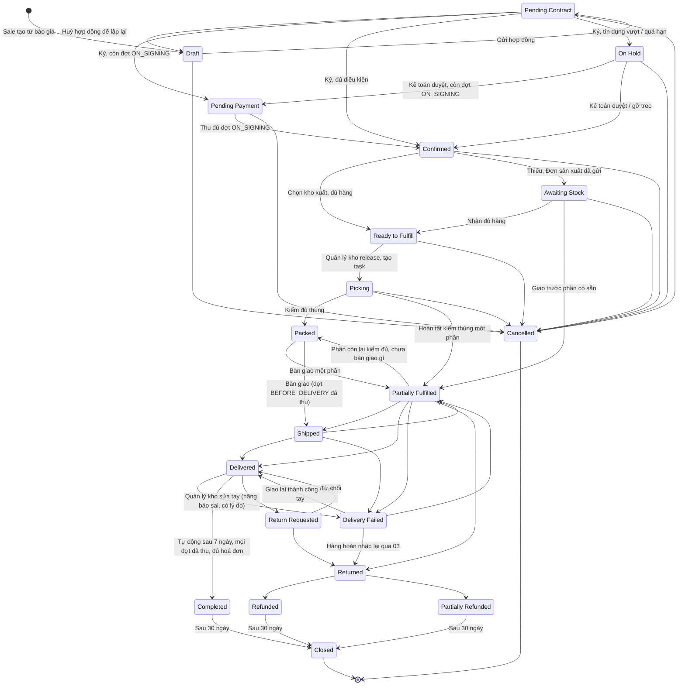
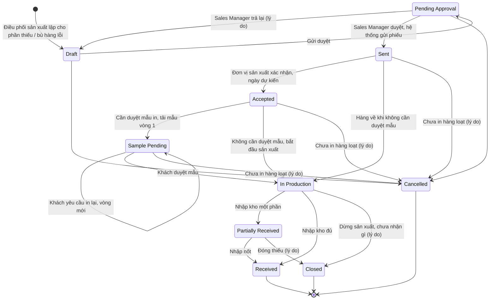
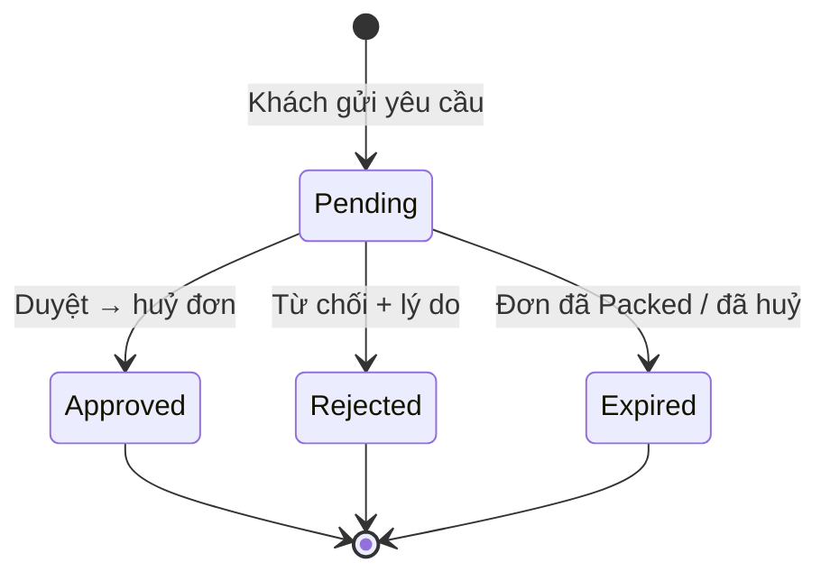

# 17 — Quản lý đơn hàng (Order Management)

> Đã chốt 2026-11-04: **sản xuất nằm ngoài hệ thống** (đơn vị sản xuất). Khi thiếu thành phẩm, Sale lập *(nay: Điều phối sản xuất — 2026-11-07)* **Đơn sản xuất (Production Order)** — chứng từ thuộc module này — và đơn chờ ở `Awaiting Stock` cho tới khi hàng nhập kho. Đơn chỉ được giữ hàng và xử lý xuất kho sau khi **Hợp đồng mua bán** đã ký và đủ điều kiện thanh toán theo hợp đồng ([14](../14-cart-and-order/README.md), [15](../15-payment/README.md)).
>
> Đã chốt 2026-11-04 (bổ sung): **không còn hàng trơn** — mọi dòng đơn là **SKU thành phẩm riêng của khách**. **Đơn sản xuất chỉ phát sinh từ đơn bán** (lập cho phần thiếu). Thành phẩm về kho đã được đơn vị sản xuất **đóng thùng sẵn (LPN)** và **chỉ xuất nguyên thùng**: không mở thùng, không lấy lẻ; thùng thành phẩm chính là kiện giao ([08 · Kiểm thùng & Dán nhãn giao hàng](../../warehouse/08-packing/README.md)).
>
> Đã chốt 2026-11-05: dòng đơn và dòng Đơn sản xuất tính bằng **số thùng** ([14](../14-cart-and-order/README.md) BR-08). **Mọi thùng đúng số cái chuẩn** của SKU — thùng lệch số chuẩn không được nhận vào kho ([03](../../warehouse/03-receipt/README.md)). Giữ hàng / phân bổ cho một dòng = **chọn đủ N thùng** của SKU (ưu tiên **FIFO** theo ngày nhập); thiếu thùng thì phần thiếu (tính theo thùng) đi Đơn sản xuất ([open-questions C32](../../open-questions/README.md)).
>
> Đã chốt 2026-11-05 (bổ sung):
> - "Yêu cầu sản xuất" đổi tên thành **Đơn sản xuất (Production Order)** — **một chứng từ chung** cho xưởng của công ty và đối tác ngoài, gửi theo **kênh kết nối** của đơn vị sản xuất; **Sale lập** *(nay: Điều phối sản xuất — 2026-11-07)*, **Quản lý kinh doanh (Sales Manager) duyệt và gửi**; có bước **khách duyệt mẫu in** (§4.3).
> - Bỏ hai role Điều phối đơn hàng và Inventory Planner: việc phía khách / sản xuất chuyển cho **Sale**, việc trong kho (release, task lấy hàng, khu chờ xuất, kết quả giao) chuyển cho **Quản lý kho** của kho xuất (§2). *(Cập nhật 2026-11-07: việc Đơn sản xuất chuyển sang role mới Điều phối sản xuất.)*
> - **Mỗi đơn bán có đúng một kho xuất**; mọi Đơn sản xuất của đơn giao về kho đó; không tách giao từ hai kho, không chuyển kho (module chuyển kho đã bỏ).
> - Ly / bao bì **không có hạn dùng**: phân bổ thùng theo **FIFO**; lô = lô sản xuất (gắn Đơn sản xuất) để truy vết.
> - Hàng trả / hàng hoàn nhập lại qua [03](../../warehouse/03-receipt/README.md) bằng **phiếu nhập loại Hàng hoàn** vào khu `QUARANTINE`.
>
> ✅ Đã chốt 2026-11-05 (khách tự thiết kế): **khách tự thiết kế trên app**, Quản lý kinh doanh duyệt; khi duyệt, **hệ thống tự xuất file in PDF/X** và chốt design snapshot ([12](../12-product-design/README.md)). Đơn sản xuất đính kèm **file in PDF/X của snapshot** — luồng Đơn sản xuất không đổi. Khách muốn sửa thiết kế sau khi chốt đơn thì **tự tạo bản sửa** trên app; bản sửa được duyệt sinh SKU riêng mới, Sale đổi SKU dòng đơn (§4.7).
>
> ✅ Đã chốt 2026-11-05 (giao hàng): **bỏ hình thức gửi kiện qua hãng** — **mọi đơn giao nguyên chuyến** (thuê nguyên xe tải / container của hãng vận chuyển, đi qua kế hoạch xếp xe 3D — [09](../../warehouse/09-shipping/README.md)); **bỏ bước Sale chọn cách giao**. Mỗi xe / chuyến có **mã vận đơn** của hãng (hãng đẩy qua webhook, hoặc kho nhập tay / nhập từ file). Hãng có webhook thì **mốc hành trình** và kết quả giao (`Delivered` / `Delivery Failed` / `Returned`) **tự cập nhật**; Quản lý kho vẫn ghi / sửa tay kèm lý do. Khách xem **tên hãng, mã vận đơn, biển số và các mốc hành trình** trên trang đơn (§5.2).
>
> ✅ Đã chốt 2026-11-07 (góp ý hội đồng — giao theo lịch, sản xuất theo đợt): đơn giao theo **lịch giao** của hợp đồng ([14](../14-cart-and-order/README.md) BR-23) — mỗi **đợt giao** có **cửa sổ giao** (từ ngày – đến ngày). Hàng giữ cho đơn được tính cho **đợt sớm nhất trước**; **Đơn sản xuất gắn đúng một đợt giao**, ngày cần hàng = ngày bắt đầu cửa sổ giao. Xuất kho theo đợt; **không bàn giao trước ngày bắt đầu** cửa sổ giao (BR-29). Sau khi ký, Sale **dời được cửa sổ giao** kèm mã lý do và bằng chứng khách đồng ý (BR-28). Thêm **lịch sản xuất** và **cảnh báo trễ** (§4.12, BR-30). Xem [open-questions D37, B44](../../open-questions/README.md).
>
> ✅ Đã chốt 2026-11-07 (role Điều phối sản xuất): thêm role **Điều phối sản xuất (Production Coordinator)** ([00 §2.1](../../00-system-overview/README.md)). Điều phối sản xuất **lập & gửi duyệt Đơn sản xuất**, ghi nhận nhận đơn / tiến độ / **vòng mẫu in**, **đóng thiếu / huỷ** Đơn sản xuất, khai báo **danh mục đơn vị sản xuất** và **thời gian sản xuất chuẩn**, lập **Đơn sản xuất bù** khi hàng lỗi phát hiện sau nhập kho (§4.13). **Sale** giữ việc với khách: chọn kho xuất, treo đơn, giao một phần, đổi SKU dòng đơn, dời cửa sổ giao, gửi thẻ duyệt mẫu in và báo tiến độ cho khách. **Sales Manager** vẫn duyệt và gửi Đơn sản xuất.

## 1. Mục đích (Purpose)

Trung tâm **theo dõi và điều hành vòng đời đơn hàng**, từ lúc Sale tạo đơn ([14](../14-cart-and-order/README.md)) đến khi hoàn tất / đóng. Module này:

- giám sát trạng thái đơn;
- **chọn kho xuất** (một kho cho mỗi đơn), **kiểm tồn SKU riêng tại kho xuất** (hàng dư từ đơn trước, hàng trả) và giữ hàng **theo số thùng** (nguyên thùng) khi đơn `Confirmed`;
- lập, duyệt, gửi và theo dõi **Đơn sản xuất** cho phần thiếu của **từng đợt giao**, gồm **duyệt mẫu in** với khách; **lịch sản xuất** và **cảnh báo trễ** (§4.12); **Đơn sản xuất bù** khi hàng lỗi phát hiện sau nhập kho (§4.13);
- giao theo **lịch giao** của hợp đồng: xuất kho theo đợt, chặn bàn giao trước cửa sổ giao, **dời cửa sổ giao** khi hai bên đồng ý (§4.5);
- cảnh báo **sức chứa kho** khi lập Đơn sản xuất / chọn kho xuất ([06](../../warehouse/06-warehouse-map-slotting/README.md));
- quyết định dùng **khu chờ xuất (`STAGING`)** cho đơn chưa xuất ngay;
- chuyển đơn cho kho thực hiện [Fulfillment](../../warehouse/07-picking/README.md);
- **treo / gỡ treo đơn**;
- xử lý **huỷ đơn** (yêu cầu huỷ, phí huỷ), **giao một phần** (thiếu hàng trong một đợt giao; mọi đợt từ cùng kho xuất), **đổi / trả hàng**;
- là nguồn thông tin đơn cho khách, Sale, kho, kế toán.

Order Management là **lớp điều hành** (orchestration): nó không tự lấy hàng, kiểm thùng, giao hàng hay sản xuất mà **ra lệnh** cho các module thực thi (và gửi Đơn sản xuất cho đơn vị sản xuất), rồi **hợp nhất trạng thái** từ chúng.

---

## 2. Actor liên quan

| Actor | Vai trò |
|-------|---------|
| **Nhân viên Sale (Sales Staff)** | Tra cứu đơn, CSKH. **Chọn kho xuất** khi đơn `Confirmed` (hệ thống gợi ý). Xem Đơn sản xuất của đơn (chỉ đọc), gửi **thẻ duyệt mẫu in** cho khách trong chat, nhắc khách duyệt, **báo tiến độ sản xuất** cho khách. Theo dõi **lịch sản xuất**, nhận **cảnh báo trễ**; báo khách và **dời cửa sổ giao** (kèm bằng chứng khách đồng ý). **Đổi SKU dòng đơn** khi khách sửa thiết kế (§4.7). **Treo / gỡ treo đơn** (trừ treo tín dụng). **Duyệt / từ chối yêu cầu huỷ** của khách; huỷ đơn thay khách. **Quyết định cho phép giao một phần**; **đóng phần còn lại**. Duyệt / từ chối yêu cầu trả hàng. |
| **Điều phối sản xuất (Production Coordinator)** *(thêm 2026-11-07)* | Phạm vi mọi kho. **Lập, gửi duyệt, theo dõi Đơn sản xuất** cho phần thiếu của từng đợt giao: chọn đơn vị sản xuất, đơn giá gia công, ngày cần hàng, bật / tắt cờ duyệt mẫu in; ghi nhận đơn vị sản xuất `Accepted` và ngày hoàn thành dự kiến, tiến độ, chuyển `In Production`; các **vòng mẫu in** (tải ảnh / video, ngày gửi mẫu vật, mở vòng in lại, phân loại lý do in lại); **đóng thiếu / huỷ** Đơn sản xuất. Theo dõi **lịch sản xuất**, nhận và xử lý **cảnh báo trễ** với đơn vị sản xuất (§4.12). Khai báo **danh mục đơn vị sản xuất** và **thời gian sản xuất chuẩn**. Lập **Đơn sản xuất bù** khi hàng lỗi phát hiện sau nhập kho (§4.13). Không chat với khách. |
| **Quản lý kinh doanh (Sales Manager)** | **Duyệt và gửi Đơn sản xuất** (không phải người lập) hoặc **trả lại** cho Điều phối sản xuất kèm lý do. Quyền "Duyệt Đơn sản xuất" mặc định gán Sales Manager, cấp lại được qua phân quyền. Xem dashboard bán hàng (§4.11), **lịch sản xuất** và nhận **cảnh báo trễ** (§4.12). |
| **Quản lý kho (Warehouse Manager)** *(của kho xuất)* | **Release đơn** cho kho **theo từng đợt giao**, tạo tác vụ lấy hàng & giao người; xem **lịch sản xuất** của kho mình, nhận cảnh báo **đợt giao trễ**; **quyết định giữ hàng ở khu chờ xuất**; **chuyển tác vụ sang khu xuất hàng**. **Ghi nhận kết quả giao** (`Delivered` / `Delivery Failed` / hàng hoàn) khi hãng không có webhook, và **sửa tay kết quả giao kèm lý do** khi hãng báo sai ([09](../../warehouse/09-shipping/README.md)). Quyết định hàng hoàn / hàng trả trong khu `QUARANTINE` ([03](../../warehouse/03-receipt/README.md), [20](../../warehouse/20-inventory-control/README.md)). Theo dõi bảng sức chứa kho và **nhận thông báo** khi Đơn sản xuất được gửi về kho mình ([06](../../warehouse/06-warehouse-map-slotting/README.md) §4.6). Cách ly và ghi giảm thùng lỗi của Đơn sản xuất — hệ thống báo Điều phối sản xuất để lập Đơn sản xuất bù (§4.13). Xem dashboard bán hàng. |
| **Kế toán (Accountant)** | **Duyệt / từ chối đơn treo vì tín dụng** ([15](../15-payment/README.md) §4.3); hoàn tiền; đối soát; **xem chi tiết & lịch sử đơn (chỉ đọc)** *(Quyết định 21/10/2026)* |
| **Nhân viên kho (Warehouse Staff)** | Nhận lệnh xuất; lấy nguyên thùng theo LPN; kiểm đủ thùng & dán nhãn giao hàng; bàn giao; nhập kho thành phẩm (theo thùng) theo Đơn sản xuất và nhập hàng hoàn ([03](../../warehouse/03-receipt/README.md)) |
| **Đơn vị sản xuất** *(ngoài hệ thống — xưởng của công ty hoặc đối tác ngoài)* | Nhận phiếu Đơn sản xuất kèm **file in PDF/X** và bộ file của design snapshot qua kênh kết nối; xác nhận nhận đơn và ngày hoàn thành dự kiến; in **mẫu thử** khi đơn cần duyệt mẫu in; sản xuất, đóng thùng đúng số chuẩn, giao về **đúng kho nhận** |
| **Khách hàng sỉ** | Xem đơn, hợp đồng, các đợt thanh toán, **lịch giao và tình trạng từng đợt giao** trên cổng (trạng thái rút gọn, §5.2); **theo dõi giao hàng** theo từng xe: tên hãng, mã vận đơn, biển số, các mốc hành trình. **Duyệt mẫu in** hoặc **yêu cầu in lại** kèm ghi chú (trên sàn — mục mẫu thiết kế của tôi, [13](../13-catalog/README.md) — hoặc thẻ hành động trong [chat](../16-sales-chat/README.md)). **Gửi yêu cầu huỷ**, gửi yêu cầu trả hàng (trên cổng hoặc qua chat). |
| **Hệ thống** | Hợp nhất trạng thái từ Payment / Đơn sản xuất / Receipt / Picking / Kiểm thùng & Dán nhãn / Shipping — kể cả kết quả giao **tự cập nhật từ webhook của hãng** ([09](../../warehouse/09-shipping/README.md)). **Gợi ý kho xuất** và hiện **còn trống dự kiến** của các kho; **cảnh báo sức chứa**. Kiểm tồn và giữ đủ số thùng của dòng tại kho xuất; **tính thùng đã giữ cho từng đợt giao** (đợt sớm nhất trước) và trạng thái hiển thị của đợt (§5.5). Chặn bàn giao đợt giao chưa tới cửa sổ giao. **Sinh cảnh báo trễ** (§4.12). Khi Đơn sản xuất được duyệt: **xuất phiếu và gửi qua kênh** của đơn vị sản xuất. **Cảnh báo vượt số lần in mẫu miễn phí**. Giữ hàng nhập theo Đơn sản xuất cho đơn liên quan khi cất hàng xong. Đóng yêu cầu huỷ không còn quyết được. Tự hoàn tất và tự đóng đơn mỗi đêm. Thông báo Điều phối sản xuất / Sale / Sales Manager / Quản lý kho. |

---

## 3. Input / Output

### Input

| Nguồn | Dữ liệu |
|-------|---------|
| [14 Quote, Order & Contract](../14-cart-and-order/README.md) | Đơn và hợp đồng (dòng hàng kèm **ngày giao khách yêu cầu** của từng dòng, dòng phí khuôn / bản in, dòng phí vận chuyển, thuế VAT từng dòng, địa chỉ, tổng tiền có thuế, lịch thanh toán (kèm đợt giao gắn kèm, nếu có), **lịch giao** (các đợt, cửa sổ giao, số thùng từng SKU), **số lần in mẫu miễn phí**); đơn chuyển `Confirmed` |
| [15 Payment](../15-payment/README.md) | Trạng thái các đợt thanh toán, huỷ phiếu thu, vị thế tín dụng, số tiền phải hoàn / đã hoàn |
| [20 Inventory Control](../../warehouse/20-inventory-control/README.md) | Tồn khả dụng theo SKU riêng / kho, theo **số thùng** (từng thùng LPN, mỗi thùng đúng số cái chuẩn); kết quả giữ hàng |
| [06 Warehouse Map & Slotting](../../warehouse/06-warehouse-map-slotting/README.md) | **Bảng sức chứa kho** từng kho (m³): sức chứa, đang chiếm, sắp về, **còn trống dự kiến** |
| [01 Product Creation](../../warehouse/01-product-creation/README.md) | Quy cách thùng của SKU (số cái / thùng, kích thước D × R × C → thể tích thùng) |
| Danh mục **Đơn vị sản xuất** (Điều phối sản xuất khai báo) | Tên, mã, liên hệ nhận đơn, **kênh kết nối** (phiếu PDF / email; API là phạm vi sau), **thời gian sản xuất chuẩn** (số ngày — dùng cho cảnh báo, §4.12) |
| [03 Receipt](../../warehouse/03-receipt/README.md) | Số thùng thành phẩm đã nhập theo từng Đơn sản xuất (thùng lệch số chuẩn không nhận); phiếu nhập Hàng hoàn |
| [12 Design Management](../12-product-design/README.md) | Design snapshot của SKU riêng và bộ file hệ thống xuất khi bản thiết kế được duyệt — **file in PDF/X**, ảnh xem trước, đặc tả kỹ thuật — đính kèm Đơn sản xuất |
| [07](../../warehouse/07-picking/README.md)/[08](../../warehouse/08-packing/README.md)/[09](../../warehouse/09-shipping/README.md) | Cập nhật picked / short, packed (đã kiểm đủ thùng & dán nhãn giao hàng), đã bàn giao; theo từng xe / chuyến: **tên hãng, mã vận đơn, biển số, các mốc hành trình** (kèm thời điểm); kết quả giao — từ webhook của hãng hoặc Quản lý kho ghi tay |
| Khách / Sale | Yêu cầu huỷ (kèm mã lý do), yêu cầu trả hàng, đổi địa chỉ, **duyệt mẫu in / yêu cầu in lại** |
| [20 Inventory Control](../../warehouse/20-inventory-control/README.md) — điều chỉnh tồn | Điều chỉnh ghi giảm `DAMAGED` đã duyệt của thùng thuộc lô một Đơn sản xuất — căn cứ lập **Đơn sản xuất bù** (§4.13) |

### Output

| Kết quả | Dùng bởi |
|---------|----------|
| **Trạng thái đơn hợp nhất** + dòng thời gian sự kiện | Khách, Sale, kho, kế toán |
| **Thông tin theo dõi giao hàng cho khách** — theo từng xe: tên hãng, mã vận đơn, biển số, các mốc hành trình kèm thời điểm (§5.2) | Khách (trang đơn trên cổng, thông báo "đã bàn giao vận chuyển") |
| **Kho xuất** của đơn | 20, 07, 03 (kho nhận của Đơn sản xuất), 06 (sắp xuất) |
| **Giữ hàng** theo SKU riêng, theo số thùng (nguyên thùng), tại kho xuất, cho đơn `Confirmed` | [20 Inventory Control](../../warehouse/20-inventory-control/README.md) |
| **Đơn sản xuất** (kèm **đợt giao**, ngày cần hàng; loại thường / **bù** — §4.13) + phiếu Đơn sản xuất (PDF) kèm file in PDF/X của snapshot, gửi qua kênh của đơn vị sản xuất | Đơn vị sản xuất; [03 Receipt](../../warehouse/03-receipt/README.md) (nhập kho theo Đơn sản xuất); [06](../../warehouse/06-warehouse-map-slotting/README.md) (phần "sắp về" của bảng sức chứa) |
| **Mẫu in chờ duyệt** (ảnh / video từng vòng) | Khách ([13](../13-catalog/README.md) mẫu thiết kế của tôi, [16](../16-sales-chat/README.md) thẻ hành động) |
| **Lệnh xuất kho (release)** — danh sách thùng (LPN) đã phân bổ, kèm chỉ định lấy về **khu chờ xuất** (`STAGING`) hay thẳng **khu xuất hàng** (`DISPATCH`) | [07 Picking](../../warehouse/07-picking/README.md) |
| **Yêu cầu huỷ** và quyết định | Khách, Sale |
| **Tiền hoàn / phí huỷ** khi huỷ, đóng phần còn lại hoặc trả hàng | [15 Payment](../15-payment/README.md) |
| **Trả hàng được duyệt hoàn tiền** (thùng bị trả, shipment chứa các thùng đó) — để lập hoá đơn điều chỉnh giảm | [21 E-invoice](../21-e-invoice/README.md) |
| **Dashboard bán hàng** — đơn & doanh thu theo ngày, SKU bán chạy, đơn theo trạng thái (§4.11) | Sales Manager, Kế toán, Quản lý kho, System Admin |
| **Lịch sản xuất** — mọi Đơn sản xuất đang mở theo ngày cần hàng, kèm đơn / đợt giao, ngày hoàn thành dự kiến, cờ trễ (§4.12) | Điều phối sản xuất, Sale, Sales Manager, Quản lý kho (kho của mình) |
| **Cảnh báo trễ** — `AT_RISK`, `PRODUCTION_LATE`, `PO_NEEDED`, `DELIVERY_LATE` (§4.12) | Điều phối sản xuất (trừ `DELIVERY_LATE`), Sale, Sales Manager; Quản lý kho (đợt giao trễ) |
| **Lịch sử dời cửa sổ giao** — đợt, cửa sổ cũ / mới, mã lý do, bằng chứng khách đồng ý, người, thời điểm (BR-28) | Sale, Sales Manager, Kế toán; khách thấy lịch giao hiệu lực |

---

## 4. Luồng nghiệp vụ từng bước (Step-by-step)

### 4.1. Tiếp nhận đơn đã xác nhận

1. Đơn từ [14](../14-cart-and-order/README.md) vào xử lý khi `Confirmed`: hợp đồng `Signed`, mọi đợt `ON_SIGNING` đã thu đủ ([15](../15-payment/README.md)), không bị treo tín dụng. Trước đó (`Draft`, `Pending Contract`, `Pending Payment`) đơn chỉ được theo dõi, chưa chọn kho xuất, chưa giữ hàng.

### 4.2. Chọn kho xuất, kiểm tồn & release

2. **Chọn kho xuất** — mỗi đơn có **đúng một kho xuất** (BR-22). Khi đơn `Confirmed`, hệ thống hiện cho Sale, theo từng kho: **tồn khả dụng** (số thùng) của từng SKU riêng trong đơn và **còn trống dự kiến** (m³) theo bảng sức chứa kho ([06](../../warehouse/06-warehouse-map-slotting/README.md)); hệ thống **gợi ý** theo thứ tự ưu tiên *(✅ Đã chốt 2026-11-05 — [open-questions C3](../../open-questions/README.md))*:
   1. kho **đang có đủ hàng** (tồn khả dụng đủ số thùng) cho các SKU riêng trong đơn;
   2. rồi tới kho **còn chỗ** (còn trống dự kiến) cho phần phải sản xuất.

   **Sale chọn kho xuất.** Chỉ báo còn hàng trên sàn tính theo **mọi kho** ([13](../13-catalog/README.md) BR-07), nên có thể khác hàng có sẵn ở kho xuất được chọn.
   - Thể tích phần phải sản xuất (số thùng thiếu × thể tích thùng) lớn hơn còn trống dự kiến của kho được chọn → **cảnh báo** Sale, không chặn (BR-25).
   - Hàng dư của SKU nằm ở kho khác kho xuất **không dùng cho đơn này**; không có chuyển kho.
   - **Đổi kho xuất** chỉ được khi đơn chưa có hàng giữ và chưa có Đơn sản xuất nào từ `Sent` trở đi; đổi kho thì đổi kho nhận của các Đơn sản xuất chưa gửi (`Draft` / `Pending Approval`).

   > ✅ Đã chốt 2026-11-05: kho xuất chỉ đổi được trước khi có hàng giữ / Đơn sản xuất đã gửi. Xem [open-questions](../../open-questions/README.md).
3. **Kiểm tồn & giữ hàng** — hệ thống kiểm **tồn khả dụng của SKU riêng tại kho xuất** cho từng dòng — có thể còn **hàng dư** từ đơn trước hoặc **hàng trả** đã đưa lại tồn khả dụng — và **giữ phần có sẵn** cho đơn ([20](../../warehouse/20-inventory-control/README.md)). Luôn kiểm tồn trước khi lập Đơn sản xuất.
   - **Giữ theo số thùng** — dòng đơn tính bằng số thùng và mọi thùng đúng số cái chuẩn của SKU, nên giữ hàng cho dòng cần N thùng = **chọn đủ N thùng (LPN)** của SKU tại kho xuất, ưu tiên **FIFO** theo ngày nhập (BR-21). Có sẵn ít hơn N thùng thì giữ hết số thùng có sẵn; phần còn lại (tính theo thùng) là phần thiếu.
   - **Theo đợt giao** *(✅ Đã chốt 2026-11-07)* — thùng đã giữ cho dòng được **tính cho đợt giao sớm nhất trước** (theo thứ tự đợt của lịch giao — [14](../14-cart-and-order/README.md) BR-23); phần thiếu được tính **riêng cho từng đợt**. Hàng nhập về sau (theo Đơn sản xuất, hàng trả) cũng bù vào đợt sớm nhất còn thiếu. Đơn một đợt thì như cũ.
4. **Hình thức giao** — **mọi đơn giao nguyên chuyến**: kho thuê nguyên xe tải / container của hãng vận chuyển và lập **kế hoạch xếp hàng 3D** theo kích thước / khối lượng thùng ([09](../../warehouse/09-shipping/README.md)); một xe có thể chở nhiều đơn của cùng kho. **Không có bước chọn cách giao** (BR-16).
   > ✅ Đã chốt 2026-11-05: bỏ hình thức gửi kiện qua hãng; khách không chọn hình thức giao hay hãng trên cổng khách hàng. Phí vận chuyển do Sale nhập thành **dòng phí vận chuyển** trên báo giá / đơn / hợp đồng ([14](../14-cart-and-order/README.md) BR-20); hệ thống không tự tính.
5. **Kết quả kiểm tồn:**
   - **Đủ hàng** → đơn `Ready to Fulfill`; **Quản lý kho của kho xuất release** đơn: hàng giữ được phân bổ vào **các thùng (LPN) cụ thể** (bin, lô) ([20](../../warehouse/20-inventory-control/README.md)), tạo tác vụ lấy hàng và giao người → [Picking](../../warehouse/07-picking/README.md).
   - **Thiếu hàng** → đợt giao thiếu hiện trong danh sách **đợt giao còn thiếu** của lịch sản xuất (§4.12); **Điều phối sản xuất** lập **Đơn sản xuất** cho phần thiếu (§4.3); khi Đơn sản xuất được duyệt và gửi (`Sent`) → đơn `Awaiting Stock`. Khách không muốn chờ sản xuất thì Sale thoả thuận lại số thùng với khách (theo quy tắc sửa đơn §4.7). Sale báo khách và **dời cửa sổ giao** (§4.5) nếu trễ so với lịch giao.
   - **Đơn nhiều đợt giao** — "đủ hàng / thiếu hàng" ở trên xét cho **đợt giao kế tiếp** (đợt sớm nhất chưa bàn giao): đợt 1 đủ thì đơn `Ready to Fulfill` dù đợt sau còn thiếu. Phần thiếu của các đợt sau được Điều phối sản xuất lập Đơn sản xuất **dần theo từng đợt**; hệ thống nhắc bằng cảnh báo `PO_NEEDED` (§4.12).

### 4.3. Đơn sản xuất (Production Order)

Đơn sản xuất là **một chứng từ chung** cho mọi đơn vị sản xuất (xưởng của công ty hoặc đối tác ngoài); quy trình không phân nhánh theo loại đơn vị, chỉ khác **kênh kết nối** khai báo trong danh mục **Đơn vị sản xuất** (tên, mã, liên hệ nhận đơn, kênh kết nối: phiếu PDF / email ở giai đoạn này; API là phạm vi sau; **thời gian sản xuất chuẩn** — số ngày từ khi gửi đơn tới khi hàng về kho, dùng cho cảnh báo §4.12).

> ⚠️ Giả định: thời gian sản xuất chuẩn mặc định **14 ngày** (cấu hình chung), Điều phối sản xuất chỉnh theo từng đơn vị sản xuất. Xem [open-questions B44](../../open-questions/README.md).

> ✅ Đã chốt 2026-11-05, cập nhật 2026-11-07: danh mục Đơn vị sản xuất do **Điều phối sản xuất** khai báo và duy trì (trước đây Sales Manager). Xem [open-questions](../../open-questions/README.md).

6. **Lập Đơn sản xuất** (`Draft`) — **Điều phối sản xuất lập, chỉ từ đơn bán**, cho phần thiếu của **một đợt giao**: đơn `Confirmed` thiếu thành phẩm sau khi đã kiểm tồn SKU riêng tại kho xuất (bước 3); Điều phối sản xuất chọn đợt giao (từ danh sách đợt giao còn thiếu — §4.12), hệ thống điền sẵn các dòng thiếu của đợt đó. Đơn nhiều đợt thì lập dần cho từng đợt, không cần lập hết khi đơn vừa `Confirmed`. Không có Đơn sản xuất bổ sung tồn; **Đơn sản xuất bù** cho hàng lỗi vẫn gắn đơn bán (§4.13).

   | Phần | Nội dung |
   |------|----------|
   | **Đầu đơn** | Mã; **loại** — thường / **bù** (§4.13; Đơn sản xuất bù kèm tham chiếu Đơn sản xuất gốc và phiếu điều chỉnh ghi giảm); **đơn bán liên quan**; **đợt giao** (đúng một đợt của lịch giao); khách; **đơn vị sản xuất** (chọn từ danh mục); **kho nhận = kho xuất của đơn bán** (không sửa riêng); **ngày cần hàng** — mặc định = **ngày bắt đầu cửa sổ giao** của đợt giao (BR-26); người lập; người duyệt |
   | **Dòng** | **SKU riêng của khách**; **số thùng** = phần thiếu của dòng đơn trong đợt giao đó; số cái / thùng; **tổng số cái** = số thùng × số cái / thùng (để đơn vị sản xuất đóng đúng số chuẩn mỗi thùng); quy cách thùng; **file in PDF/X** và bộ file của design snapshot (hệ thống xuất khi bản thiết kế được duyệt) — link tải có kiểm checksum ([12](../12-product-design/README.md)); yêu cầu đóng thùng / dán nhãn |
   | **Tuỳ chọn** | Đơn giá gia công; ghi chú |
   | **Cờ "cần duyệt mẫu in"** | Điều phối sản xuất bật / tắt theo từng đơn khi lập. **Mặc định bật** khi Đơn sản xuất có SKU **sản xuất lần đầu** (SKU chưa có Đơn sản xuất nào tới `In Production`); tắt khi mặc định bật thì **bắt buộc lý do** |
   | **Vòng mẫu in** | Danh sách các vòng mẫu (bước 9) |

   **Cảnh báo sức chứa** — khi lập, hệ thống hiện **còn trống dự kiến**, **chờ duyệt** và **còn trống nếu duyệt hết** của kho nhận ([06](../../warehouse/06-warehouse-map-slotting/README.md) §4.6); thể tích Đơn sản xuất (Σ số thùng × thể tích thùng D × R × C — [01](../../warehouse/01-product-creation/README.md)) lớn hơn còn trống dự kiến, hoặc lớn hơn còn trống nếu duyệt hết (các Đơn sản xuất khác đang chờ duyệt về cùng kho) → **cảnh báo**, không chặn (BR-25).

   > ✅ Đã chốt 2026-11-05, cập nhật 2026-11-07: **ngày cần hàng** của Đơn sản xuất lấy mặc định từ **ngày bắt đầu cửa sổ giao** của đợt giao (trước đây: ngày giao khách yêu cầu của dòng đơn); Điều phối sản xuất chỉnh được khi Đơn sản xuất còn `Draft` (kể cả sau khi bị trả lại), lịch giao không đổi theo. Xem [open-questions B33](../../open-questions/README.md).
7. **Gửi duyệt & duyệt** — Điều phối sản xuất gửi duyệt → `Pending Approval`. **Sales Manager** (người duyệt ≠ người lập — BR-23) xem lại **bảng sức chứa tính tại thời điểm duyệt** cùng cảnh báo nếu vượt (BR-25, không chặn):
   - **Duyệt** → `Sent`: hệ thống xuất **phiếu Đơn sản xuất (PDF)** kèm file in PDF/X của snapshot và **gửi qua kênh kết nối** của đơn vị sản xuất; đơn bán → `Awaiting Stock`; **thông báo cho Quản lý kho của kho nhận** (số thùng, thể tích, ngày cần hàng), kèm `WARN` nếu lần gửi này làm còn trống dự kiến của kho chuyển sang âm ([06](../../warehouse/06-warehouse-map-slotting/README.md) §4.6).
   - **Trả lại** → `Draft`, bắt buộc lý do; Điều phối sản xuất sửa và gửi duyệt lại.
8. **Đơn vị sản xuất nhận đơn** → `Accepted` — đơn vị sản xuất xác nhận nhận đơn và **ngày hoàn thành dự kiến**; Điều phối sản xuất ghi nhận tay. Ngày hoàn thành dự kiến muộn hơn ngày cần hàng → cảnh báo `AT_RISK` (§4.12).
9. **Duyệt mẫu in** *(chỉ khi bật cờ)* — đơn vị sản xuất in vài **mẫu thử** theo file in PDF/X đã chốt. Điều phối sản xuất tải **ảnh / video** mẫu của vòng 1 lên → `Sample Pending`; Sale gửi **thẻ duyệt mẫu in** cho khách trong chat. Mỗi **vòng mẫu**:
   - Điều phối sản xuất tải ảnh / video mẫu; **mẫu vật tuỳ chọn** — Điều phối sản xuất ghi ngày gửi mẫu vật cho khách.
   - Khách xem trên sàn (mục **mẫu thiết kế của tôi** — [13](../13-catalog/README.md)) hoặc **thẻ hành động trong chat** do Sale gửi ([16](../16-sales-chat/README.md)) và chọn:
     - **Duyệt** → Đơn sản xuất `In Production`; hệ thống gửi **thông báo mẫu đã duyệt** tới đơn vị sản xuất qua kênh kết nối để bắt đầu in hàng loạt, Điều phối sản xuất theo dõi xác nhận (✅ đã chốt 2026-11-05 — xem [open-questions B31](../../open-questions/README.md));
     - **Yêu cầu in lại** kèm ghi chú → Điều phối sản xuất ghi **lý do in lại** và mở **vòng mới** (Đơn sản xuất vẫn `Sample Pending`).
   - Mỗi vòng ghi: **số vòng**, ảnh / video, ngày gửi mẫu vật, kết quả (duyệt / yêu cầu in lại), ghi chú của khách, **lý do in lại**:

     | Mã lý do in lại | Nghĩa | Tính vào số lần in mẫu miễn phí |
     |-----------------|-------|--------------------------------|
     | `PRINT_DEFECT` | Lỗi in của đơn vị sản xuất | Không |
     | `CUSTOMER_CHANGE` | Khách đổi ý (màu, vị trí, chi tiết in…) với cùng file in | Có |

   - **Số lần in mẫu miễn phí** lấy từ điều khoản hợp đồng của đơn bán ([14](../14-cart-and-order/README.md)). Mở vòng mới làm số lần in mẫu tính phí vượt số lần miễn phí → hệ thống **cảnh báo** Điều phối sản xuất và Sale, **không chặn**; phí phát sinh xử lý bằng phụ lục ngoài hệ thống (phạm vi sau).
   - Khách cần **sửa thiết kế** (không phải lỗi in) → khách tự **tạo bản sửa** trên app và gửi duyệt ([12](../12-product-design/README.md)); bản sửa được duyệt sinh SKU mới; Sale đổi SKU của dòng đơn (§4.7 bước 25); Điều phối sản xuất huỷ Đơn sản xuất hiện tại và lập Đơn sản xuất mới với SKU mới.

   > ✅ Đã chốt 2026-11-05: số lần in mẫu tính trên từng Đơn sản xuất, gồm cả vòng đầu; vòng in lại `PRINT_DEFECT` không tính. Khách chỉ ghi chú khi yêu cầu in lại; **Điều phối sản xuất phân loại** lý do `PRINT_DEFECT` / `CUSTOMER_CHANGE` *(cập nhật 2026-11-07; trước đây Sale)*. Xem [open-questions](../../open-questions/README.md).
10. **Sản xuất hàng loạt** → `In Production`:
    - có cờ duyệt mẫu in: hệ thống chuyển khi khách **duyệt mẫu** (bước 9);
    - không có cờ: Điều phối sản xuất chuyển từ `Accepted` khi đơn vị sản xuất báo bắt đầu (có thể cập nhật ngày hoàn thành dự kiến).

    Tiến độ do Điều phối sản xuất ghi nhận tay, Sale xem trên đơn để báo khách; hệ thống không tích hợp hệ thống sản xuất (kênh API là phạm vi sau).
11. **Nhập kho thành phẩm** — đơn vị sản xuất giao hàng **đã đóng thùng sẵn** về **kho nhận** (= kho xuất của đơn bán); kho nhập **theo Đơn sản xuất** ([03](../../warehouse/03-receipt/README.md)) theo **số thùng**: quét / dán nhãn LPN, hệ thống tự gán lô = mã Đơn sản xuất, cất nguyên thùng vào bin. Thùng có số cái khác số chuẩn **không được nhận** (trả lại đơn vị sản xuất; phần đó của Đơn sản xuất vẫn mở). Kho đầy → nhận vào khu tạm `OVERFLOW` ([06](../../warehouse/06-warehouse-map-slotting/README.md)), cất lên bin khi có chỗ. Hệ thống cập nhật số thùng đã nhận từng dòng:
    - nhận một phần → `Partially Received`; nhận đủ mọi dòng → `Received`;
    - Đơn sản xuất **không có cờ duyệt mẫu in** còn ở `Sent` / `Accepted` mà hàng đã về → hệ thống chuyển `In Production` trước rồi mới ghi nhận. Đơn sản xuất **có cờ** mà mẫu chưa được duyệt (`Sent` / `Accepted` / `Sample Pending`) → **không nhập theo đơn này** được;
    - các thùng nhận được **giữ cho đơn liên quan ngay khi cất hàng xong** ([05](../../warehouse/05-putaway/README.md)) — tồn chỉ khả dụng sau Putaway.
12. **Đóng thiếu** — Điều phối sản xuất **đóng** → `Closed` (bắt buộc lý do) khi: Đơn sản xuất `Partially Received` mà đơn vị sản xuất không giao nốt; hoặc `In Production` mà đơn vị sản xuất dừng hẳn khi chưa giao gì. Phần thiếu của đơn được xử lý theo §4.4 bước 16.
13. **Huỷ** — Đơn sản xuất **chưa in hàng loạt** (`Draft` / `Pending Approval` / `Sent` / `Accepted` / `Sample Pending`) huỷ được → `Cancelled` (bắt buộc lý do), ví dụ đơn bán bị huỷ, khách sửa file thiết kế, hoặc hàng đã có (hàng trả về kho xuất). Đơn đã gửi thì Điều phối sản xuất báo đơn vị sản xuất dừng qua kênh kết nối.

> Đã chốt 2026-11-05: phiếu Đơn sản xuất (PDF) gửi qua kênh kết nối của đơn vị sản xuất (email ở giai đoạn này); phản hồi `Accepted`, tiến độ và mẫu in do Điều phối sản xuất ghi nhận tay *(cập nhật 2026-11-07)*; không tích hợp hệ thống sản xuất. Đơn sản xuất `In Production` mà đơn vị sản xuất dừng hẳn khi chưa giao gì thì **đóng** (`Closed`), không huỷ.

### 4.4. Chờ hàng & khu chờ xuất (Staging)

14. **Đích lấy hàng** — mỗi tác vụ lấy hàng (pick task) Quản lý kho release gồm các thùng (LPN) đã phân bổ, lấy nguyên thùng, có **đích** là `DISPATCH` (khu xuất hàng — mặc định) hoặc `STAGING` (khu chờ xuất) ([07](../../warehouse/07-picking/README.md)). **Quản lý kho quyết định** có giữ hàng ở khu chờ xuất hay không. Lấy về `STAGING` chỉ **chuyển vị trí**: khoản phân bổ vẫn `Held`, **chưa trừ tồn**; tác vụ / dòng ở trạng thái `Staged`; hàng được **gom và giữ riêng cho đơn**.

    > ✅ Đã chốt 2026-11-05: tồn ở `STAGING` đã gắn đơn, không khả dụng cho đơn khác. Xem [open-questions](../../open-questions/README.md).
15. **Đơn `Awaiting Stock`** — phần có sẵn tại kho xuất đã được giữ. Chỉ tạo được tác vụ lấy hàng khi **đích là `STAGING`**, hoặc khi Sale **cho phép giao một phần** (§4.5):
    - **Dùng khu chờ xuất** → lấy trước phần có sẵn về `STAGING`.
    - **Không dùng** → phần có sẵn nằm tại bin (đã giữ cho đơn) tới khi đủ hàng.
16. **Đủ hàng** — khi hệ thống đã giữ đủ thùng cho **đợt giao kế tiếp** (đơn một đợt: mọi Đơn sản xuất của đơn đã `Received`) → đơn `Ready to Fulfill` (hoặc, với đợt thứ hai trở đi, đơn vẫn ở `Partially Fulfilled` và đợt chuyển "Sẵn sàng" — §5.5):
    - Đơn đã có tác vụ về `STAGING` → các thùng còn lại được **lấy bổ sung vào cùng tác vụ** về `STAGING`. Khi đủ, Quản lý kho **chuyển cả tác vụ sang khu xuất hàng** một lần: lúc đó mới **trừ tồn**, khoản phân bổ thành `Consumed`, thùng sang khu xuất hàng.
    - Đơn chưa có tác vụ → Quản lý kho release tác vụ đích `DISPATCH` (hoặc `STAGING` nếu chưa xuất ngay).

    Đơn sản xuất bị đóng thiếu (`Closed`) mà đơn vẫn thiếu → Điều phối sản xuất lập Đơn sản xuất mới cho phần còn thiếu, hoặc Sale (nếu cho phép giao một phần) giao phần đã có rồi đóng phần còn lại (§4.8).
17. **Chờ đợt `BEFORE_DELIVERY`** — đơn đủ hàng nhưng khách chưa trả đợt thu trước giao: Quản lý kho có thể cho lấy hàng về `STAGING` chờ rồi mới chuyển sang khu xuất hàng, hoặc vẫn kiểm thùng & dán nhãn — bàn giao vận chuyển bị chặn tới khi đợt `Paid` ([15](../15-payment/README.md) BR-08). Đơn đủ hàng, xuất ngay → lấy thẳng sang khu xuất hàng, không qua `STAGING`.

### 4.5. Giao theo lịch giao & giao một phần

**Giao theo lịch giao** *(✅ Đã chốt 2026-11-07 — góp ý hội đồng)* — lịch giao lấy từ hợp đồng ([14](../14-cart-and-order/README.md) BR-23); đơn một đợt chạy như đơn giao một lần.

- **Xuất kho theo đợt** — Quản lý kho release tác vụ lấy hàng cho **các thùng của đợt giao kế tiếp** khi đợt đó đủ hàng (hoặc về `STAGING` như §4.4). Release, lấy hàng, kiểm thùng làm được **trước** ngày bắt đầu cửa sổ giao để kịp xếp xe.
- **Không bàn giao trước cửa sổ giao** — shipment của một đợt chỉ được ký bàn giao vận chuyển từ **ngày bắt đầu** cửa sổ giao của đợt đó ([09](../../warehouse/09-shipping/README.md) BR-04); khách có quyền không nhận hàng giao trước hạn. Khách đồng ý nhận sớm → Sale **dời cửa sổ giao** (dưới đây). Hàng xong sớm thì giữ tại kho (bin hoặc `STAGING`) (BR-29).
- **Đợt thanh toán gắn đợt giao** — `BEFORE_DELIVERY` gắn đợt *k* chặn bàn giao của đợt *k*; `AFTER_DELIVERY` gắn đợt *k* đến hạn khi đợt *k* giao xong ([15](../15-payment/README.md) §4.1).
- **Trạng thái đơn không thêm mới** — trước khi đợt 1 bàn giao, đơn đi như hiện nay theo đợt 1 (`Confirmed` → `Awaiting Stock` / `Ready to Fulfill` → `Picking` → `Packed`; đợt 1 **hoàn tất kiểm thùng một phần** (giao một phần, bước 18) → `Partially Fulfilled` **ngay lúc hoàn tất** — [08](../../warehouse/08-packing/README.md) §4.4); đợt 1 bàn giao mà còn đợt chưa giao → `Partially Fulfilled`; các đợt sau được lấy hàng, kiểm thùng (kể cả kiểm đủ), bàn giao trong lúc đơn **vẫn ở** `Partially Fulfilled` — không quay về `Packed` *(✅ Đã chốt 2026-11-13)*; đợt cuối bàn giao → `Shipped`; mọi đợt giao thành công → `Delivered`. Tình trạng từng đợt là **trạng thái hiển thị** do hệ thống tính (§5.5).
- **Dời cửa sổ giao** *(BR-28)* — Sale dời cửa sổ giao của một đợt **chưa có thùng nào bàn giao**, khi hai bên đồng ý (khách xin dời, khách đồng ý nhận sớm, hoặc bên bán giao trễ):
  - nhập cửa sổ mới (không ở quá khứ; vẫn giữ thứ tự với các đợt khác — cần thì dời cả các đợt sau);
  - chọn **mã lý do**: `CUSTOMER_REQUEST` (khách xin dời / đồng ý nhận sớm) hoặc `SELLER_DELAY` (bên bán chậm, ví dụ sản xuất trễ); ghi chú bắt buộc;
  - đính **bằng chứng khách đồng ý**: file (email, văn bản xác nhận) hoặc tin nhắn trong [chat](../16-sales-chat/README.md);
  - không đổi SKU, số thùng, số đợt (cần phụ lục — phạm vi sau);
  - hệ thống ghi **lịch sử** (cửa sổ cũ / mới, lý do, bằng chứng, người, thời điểm), cập nhật **lịch giao hiệu lực** hiện cho khách; bản hợp đồng đã ký giữ nguyên ([14](../14-cart-and-order/README.md) BR-14). Đơn sản xuất còn `Draft` của đợt lấy lại ngày cần hàng mặc định; Đơn sản xuất đã gửi không tự đổi — Điều phối sản xuất báo đơn vị sản xuất nếu cần.

  > ⚠️ Giả định: phạt chậm giao (khi `SELLER_DELAY`) xử lý **ngoài hệ thống**; hệ thống chỉ lưu dấu vết qua mã lý do. Xem [open-questions D37](../../open-questions/README.md).

18. **Giao một phần** — áp cho phần **thiếu hàng trong một đợt giao** (giao trước phần có sẵn của đợt, phần còn lại của đợt đi sau); giao nhiều đợt theo lịch giao **không cần** bật quyết định này. Sale quyết định **cho phép giao một phần** theo từng đơn (mặc định tắt; bật / tắt, ghi chú ≤ 500 ký tự; mọi lần quyết định được ghi lại); kho chỉ làm theo *(Quyết định 19/10 và 21/10/2026)*. Mọi đợt giao đều **từ cùng kho xuất** của đơn — **không tách giao từ hai kho** (BR-22).
    - Có cho phép: các thùng có sẵn được kiểm, dán nhãn giao hàng và **bàn giao trước** trong lúc chờ phần thiếu từ Đơn sản xuất; đơn → `Partially Fulfilled` **ngay khi hoàn tất kiểm thùng một phần** ([08](../../warehouse/08-packing/README.md) §4.4), không đợi tới lúc bàn giao. Phần còn lại kiểm đủ: **chưa có thùng nào bàn giao** → `Packed`; đã bàn giao phần trước → đơn **vẫn `Partially Fulfilled`**; bàn giao hết → `Shipped` *(✅ Đã chốt 2026-11-13 — §4.5: đơn ở `Partially Fulfilled` suốt các phần / đợt giao sau)*.

      > ✅ Đã chốt 2026-11-12: theo 08 §4.4 — hoàn tất kiểm thùng một phần thì đơn chuyển `Partially Fulfilled` ngay lúc hoàn tất (trước đây §5.1 chỉ ghi `Partially Fulfilled` khi đã bàn giao một phần).
    - Không cho phép: không được để lại hàng khi bàn giao.
    - Quyết định **khoá** từ khi đơn `Shipped` trở đi, hoặc khi đã có hàng rời kho trên một chuyến xe.
    - Nhiều đơn đi chung một xe: xử lý ở lập kế hoạch chuyến xe ([09](../../warehouse/09-shipping/README.md)); mỗi thùng vẫn thuộc một đơn.

### 4.6. Theo dõi fulfillment & hoàn tất

19. **Theo dõi Fulfillment** — hợp nhất cập nhật: `Picking` → `Packed` → `Shipped` → `Delivered`. Bàn giao bị chặn khi còn đợt `BEFORE_DELIVERY` chưa thu đủ; xe chỉ được ký bàn giao khi đã có **mã vận đơn** ([09](../../warehouse/09-shipping/README.md)). Khi đơn `Shipped`, khách nhận thông báo **"đã bàn giao vận chuyển"** kèm tên hãng, mã vận đơn, biển số của từng xe chở hàng của đơn. Sau `Shipped`:
    - hãng có webhook → **mốc hành trình** (đã lấy hàng, đang giao) được ghi kèm thời điểm, **không đổi trạng thái đơn**; kết quả giao (`Delivered` / `Delivery Failed` / `Returned`) **tự cập nhật** theo sự kiện của hãng;
    - hãng không có webhook (hoặc sự kiện chưa về) → **Quản lý kho** ghi kết quả giao khi hãng báo lại;
    - hãng báo sai → Quản lý kho **sửa tay** kết quả giao, bắt buộc lý do (BR-27).
20. **`Delivered`** — khi hãng báo giao thành công (qua webhook, hoặc Quản lý kho ghi tay). Đơn đã có shipment thì kết quả giao ghi **theo từng shipment** *(Quyết định 19/10/2026)*. Giao xong làm đợt `AFTER_DELIVERY` đến hạn — đợt gắn một đợt giao thì đến hạn khi **đợt giao đó** giao xong ([15](../15-payment/README.md) §4.1). Hãng hoàn hàng về (RTO) → đơn `Returned` (theo sự kiện hoàn hàng của hãng, hoặc Quản lý kho ghi nhận); hàng nhập lại kho xuất qua [03](../../warehouse/03-receipt/README.md) bằng **phiếu nhập Hàng hoàn** vào `QUARANTINE` (BR-18).
21. **Tự hoàn tất** *(Quyết định 21/10/2026)* — mỗi đêm (00:30) hệ thống chuyển `Delivered` → `Completed` khi đủ bốn điều kiện:
    - hết **thời hạn đổi / trả 7 ngày** kể từ khi giao;
    - mọi đợt thanh toán của hợp đồng đã `Paid` (không còn tiền phải thu);
    - không có yêu cầu trả hàng đang mở.
    - **mọi lần giao thành công (shipment `Delivered`) đã có hoá đơn điện tử phát hành**, kể cả hoá đơn phần phí vận chuyển còn lại ([21](../21-e-invoice/README.md)) *(✅ Cập nhật 2026-11-14 — đồng bộ code backend, WF-05)*.

22. **Tự đóng** — `Completed`, `Refunded` hoặc `Partially Refunded` → `Closed` sau **30 ngày**.

### 4.7. Sửa đơn (Order amendment)

23. Yêu cầu từ khách / Sale: đổi số thùng, thêm / bớt dòng, đổi địa chỉ.
24. **Quy tắc theo trạng thái:**

    | Đơn đang ở | Cho phép sửa gì |
    |-----------|-----------------|
    | `Draft` | Sửa tự do ([14](../14-cart-and-order/README.md)) |
    | `Pending Contract` | Sale huỷ hợp đồng đã gửi → đơn về `Draft` để sửa, rồi lập hợp đồng thay thế |
    | `Pending Payment` → `Picking` | Đổi địa chỉ giao (khi chưa dán nhãn giao hàng); **đổi SKU của dòng** khi khách sửa thiết kế (bước 25); đổi dòng / số thùng / giá cần phụ lục hợp đồng — phạm vi sau; hoặc huỷ (§4.8) |
    | `Packed` trở đi | Không sửa, không huỷ; xử lý sau giao qua trả hàng (§4.10) |

25. **Đổi SKU của dòng đã chốt** — khách tự tạo bản sửa của bản thiết kế đã duyệt trên app và bản sửa được Quản lý kinh doanh duyệt ([12](../12-product-design/README.md)) — kể cả khi đang duyệt mẫu in mà cần sửa thiết kế — sinh SKU theo mẫu mới; Sale đổi SKU của dòng đơn sang SKU mới, **giữ số thùng, số cái / thùng và đơn giá / cái** (thành tiền không đổi). Chỉ cho phép khi SKU mới có **cùng số cái / thùng**, **Đơn sản xuất liên quan chưa `In Production`** (Đơn sản xuất `Draft` / `Pending Approval` / `Sent` / `Accepted` / `Sample Pending` được Điều phối sản xuất huỷ và lập lại với SKU mới) và hàng của dòng chưa được lấy. Mỗi lần đổi ghi lịch sử.

    > ⚠️ Giả định: đổi SKU theo mẫu mới (cùng số thùng, cùng số cái / thùng, cùng giá) không cần phụ lục hợp đồng; hợp đồng đã ký giữ nguyên. SKU mới khác số cái / thùng làm đổi thành tiền → cần phụ lục (phạm vi sau). Xem [open-questions](../../open-questions/README.md).

26. Sửa có ảnh hưởng tiền → tạo khoản thu thêm / hoàn tiền tương ứng ([15](../15-payment/README.md)).

### 4.8. Huỷ đơn (Cancellation)

27. **Trước khi ký hợp đồng** (`Draft`, `Pending Contract`) — Sale huỷ đơn (kèm mã lý do); hợp đồng chưa ký bị huỷ theo.
28. **Khách gửi yêu cầu huỷ** — từ `Pending Contract` tới **trước khi thùng đầu tiên của đơn được dán nhãn giao hàng** ([08](../../warehouse/08-packing/README.md) BR-04), khách gửi **yêu cầu huỷ** trên cổng hoặc qua chat:
    - Mỗi đơn chỉ có **một yêu cầu đang chờ**.
    - Hệ thống báo Sale.
    - Sale:
      - **Duyệt** → huỷ đơn ngay, kèm phí nếu có (bước 30);
      - **Từ chối**, bắt buộc ghi lý do.
    - Đơn tiến tới mức không huỷ được nữa (đã có thùng dán nhãn giao hàng, hoặc đã huỷ) trong lúc yêu cầu còn chờ → yêu cầu tự **hết hiệu lực** (`Expired`), kèm ghi chú hướng khách sang trả hàng.

    > ✅ Đã chốt 2026-11-05: khách **không tự huỷ ngay** trên cổng (đơn do Sale chốt và gắn hợp đồng); mọi huỷ từ phía khách đi qua yêu cầu huỷ. Xem [open-questions](../../open-questions/README.md).
29. **Mã lý do huỷ** (BR-13) — khách chỉ chọn 3 lý do đầu *(Quyết định 21/10/2026)*:

    | Mã | Nghĩa | Khách được chọn |
    |----|-------|-----------------|
    | `CUSTOMER_REQUEST` | Khách yêu cầu | ✓ (mặc định) |
    | `DUPLICATE_ORDER` | Đặt trùng | ✓ |
    | `OTHER` | Lý do khác — **bắt buộc ghi chú** | ✓ |
    | `PAYMENT_NOT_RECEIVED` | Không nhận được tiền theo hợp đồng | |
    | `OUT_OF_STOCK` | Không đủ hàng | |
    | `SUSPECTED_FRAUD` | Nghi gian lận | |
    | `CREDIT_REJECTED` | Kế toán từ chối tín dụng | |
    | `PRODUCTION_ISSUE` | Đơn vị sản xuất không đáp ứng được | |

30. **Nhân viên huỷ & phí huỷ** — Sale huỷ đơn (kèm mã lý do) hoặc duyệt yêu cầu huỷ.

    **Chưa có Đơn sản xuất nào của đơn tới `In Production`:** **hoàn toàn bộ**, không được tính phí (BR-11); Đơn sản xuất `Draft` / `Pending Approval` / `Sent` / `Accepted` / `Sample Pending` bị huỷ.

    > ✅ Đã chốt 2026-11-05: huỷ đơn trước khi có Đơn sản xuất tới `In Production` thì hoàn toàn bộ, **kể cả dòng phí khuôn / bản in** ([14](../14-cart-and-order/README.md)) dù mẫu in thử đã làm; giữ lại phí khuôn khi huỷ là phạm vi sau. Xem [open-questions](../../open-questions/README.md).

    **Đơn vị sản xuất đã in hàng loạt** (Đơn sản xuất `In Production` trở đi): chỉ nhân viên huỷ, được tính phí.
    - Phí theo **% số tiền đã thu**, hoặc theo **số tiền thoả thuận** (số nguyên dương, ≤ tổng đơn, kèm lý do ≤ 500 ký tự và chi tiết ≤ 2.000 ký tự).
    - Tiền đã thu **trả phí trước**. Phần thừa thành **số tiền phải hoàn** (Kế toán chuyển ngoài hệ thống rồi ghi nhận đã hoàn — [15](../15-payment/README.md) §4.5). Phần phí còn thiếu thành **khoản phí huỷ** ([15](../15-payment/README.md) §4.6).
    - Đơn sản xuất `In Production` không huỷ được trong hệ thống: Điều phối sản xuất báo đơn vị sản xuất dừng qua kênh kết nối; hàng đã làm nếu giao về vẫn nhập kho theo Đơn sản xuất (BR-07); không giao gì thì Điều phối sản xuất đóng Đơn sản xuất (`Closed`).
31. **Mốc khoá huỷ** *(Quyết định 21/10/2026: đơn `Packed` không huỷ được; 2026-11-04: mốc dời về thùng đầu tiên dán nhãn)* — Khi **một thùng của đơn đã được kiểm và dán nhãn giao hàng** (hoặc đã bàn giao), đơn **không huỷ được nữa**; mọi thay đổi đi qua **trả hàng** (§4.10).
32. **Dừng tác vụ kho khi huỷ** — huỷ pick task, put-back nguyên thùng đã lấy (kể cả thùng ở khu `STAGING`), huỷ nhãn giao hàng / gỡ thùng khỏi kế hoạch xếp hàng, huỷ Đơn sản xuất chưa in hàng loạt, nhả giữ hàng ([20](../../warehouse/20-inventory-control/README.md)).
33. **Đóng phần còn lại** — Đơn `Partially Fulfilled` mà phần còn lại sẽ không giao nữa → Sale **đóng phần còn lại** (kèm mã lý do nội bộ; đơn đang treo thì phải gỡ treo trước; đóng được cả khi phần đã kiểm thùng & dán nhãn **chưa bàn giao** — phần đó không bị đóng, vẫn được xếp xe và bàn giao như thường; chỉ đóng các thùng chưa kiểm thùng — *✅ Đã chốt 2026-11-13*):
    - Mọi thùng chưa giao **và chưa kiểm thùng** bị đóng (thùng đã kiểm & dán nhãn vẫn giao); đơn đi theo trạng thái các chuyến đã giao, không chuyển thẳng `Completed` *(Quyết định 21/10/2026)*.
    - Đơn sản xuất liên quan: chưa in hàng loạt → huỷ; `In Production` / `Partially Received` → đóng (`Closed`).
    - Phí chỉ tính khi phần bị đóng có hàng đơn vị sản xuất đã làm, ≤ giá trị các thùng bị đóng (số thùng × số cái / thùng × đơn giá / cái), kèm lý do và chi tiết.
    - Số phải thu của các đợt được giảm tương ứng; tiền thừa trả phí trước, phần còn lại hoàn; thiếu thì thành khoản phí huỷ ([15](../15-payment/README.md) §4.6).

### 4.9. Treo đơn (On Hold)

34. **Lý do treo:**

    | Lý do | Ai đặt | Ai gỡ |
    |-------|--------|-------|
    | `CREDIT` — tín dụng (vượt hạn mức / quá hạn) | Hệ thống, lúc hợp đồng `Signed` | Kế toán duyệt / từ chối ([15](../15-payment/README.md) §4.3) |
    | `PAYMENT` — thiếu đợt `ON_SIGNING` sau khi huỷ phiếu thu | Kế toán (khi huỷ phiếu thu) hoặc Sale | Sale, **chỉ khi tiền đã đủ lại** |
    | `ADDRESS`, `INVENTORY`, `CUSTOMER`, `FRAUD`, `OTHER` (bắt buộc ghi chú) | Sale | Sale |

35. Sale treo tay được đơn ở `Confirmed`, `Awaiting Stock`, `Ready to Fulfill`, `Picking`, `Partially Fulfilled`, `Packed`. Đơn đang treo thì không treo thêm lần nữa.
36. **Gỡ treo** (bắt buộc ghi chú) → đơn **quay về trạng thái trước khi treo**, rồi cập nhật theo các chuyến hàng đã có *(Quyết định 19/10/2026)*. Khách chỉ thấy lý do công khai ("đang được xem xét"), không thấy mã lý do nội bộ hay ghi chú.

### 4.10. Đổi / Trả hàng & Hoàn tiền (Returns & Refunds)

37. Khách tạo **yêu cầu trả hàng** (trong hạn chính sách) qua cổng khách hàng / chat, nêu lý do → đơn `Return Requested`.
38. Sale duyệt → phát hành **RMA**; hướng dẫn khách gửi hàng về **kho xuất của đơn** (hoặc hẹn lấy). Từ chối → đơn quay về `Delivered`.
39. Kho **nhận hàng trả** qua [03 Receipt](../../warehouse/03-receipt/README.md) bằng **phiếu nhập loại Hàng hoàn**: phiếu tham chiếu yêu cầu trả của đơn; quét LPN từng thùng (chỉ nhận thùng thuộc đơn đó); nhập thẳng vào khu `QUARANTINE`. **Quản lý kho** quyết định ([20](../../warehouse/20-inventory-control/README.md)):
    - **gỡ cách ly**, đưa lại tồn khả dụng (cất về bin qua [05](../../warehouse/05-putaway/README.md)) — hàng này là SKU riêng, chỉ dùng cho đơn sau của chính khách;
    - hoặc **ghi giảm** bằng điều chỉnh tồn có duyệt; lỗi sản xuất thì đổi trả với đơn vị sản xuất (ngoài hệ thống).
40. **Hoàn tiền** ([15](../15-payment/README.md) §4.5) toàn phần / một phần: hệ thống tính số tiền phải hoàn, Kế toán chuyển khoản ngoài hệ thống rồi **ghi nhận đã hoàn**; hoàn đủ → đơn `Returned` → `Refunded` / `Partially Refunded`. Thùng bị trả đã có hoá đơn → hệ thống tạo nháp **hoá đơn điều chỉnh giảm** trên hoá đơn của shipment chứa các thùng đó, Kế toán phát hành ([21](../21-e-invoice/README.md) §4.4 — ⚠️ giả định, [open-questions G13](../../open-questions/README.md)).
41. **Đổi hàng (exchange):** = trả + Sale tạo báo giá / đơn mới (hoặc bù trừ giá trị), tuỳ thoả thuận.
> ✅ Đã chốt 2026-10-06: ly và bao bì in theo thiết kế **chỉ đổi / trả khi lỗi sản xuất**, không đổi / trả vì đổi ý.

### 4.11. Dashboard bán hàng

42. **Ai xem** — Quản lý kinh doanh (Sales Manager), Kế toán, System Admin, Quản lý kho; phạm vi **toàn hệ thống**. Sale **không** xem (chưa có góc nhìn "khách của tôi" cho Sale).
43. **Kỳ báo cáo** — tính theo **lịch Việt Nam** (Asia/Ho_Chi_Minh); mặc định **30 ngày** tính đến hôm nay, tối đa **366 ngày**.
44. **Chỉ số:**

    | Chỉ số | Cách tính |
    |--------|-----------|
    | **Đơn & doanh thu theo ngày** | Mỗi ngày (kể cả ngày không có đơn): số đơn, doanh thu. **Doanh thu = tổng chưa thuế của đơn đã tạo − đơn đã huỷ** (dòng hàng + dòng phí, không gồm tiền thuế VAT — [14](../14-cart-and-order/README.md) BR-09, BR-21; ⚠️ giả định), ghi vào **ngày tạo đơn**. Đơn treo vẫn tính; đơn nháp không tính |
    | **Tổng kỳ** | Số đơn, doanh thu, **giá trị đơn trung bình**, so sánh % với kỳ liền trước cùng độ dài |
    | **SKU bán chạy** | Xếp theo doanh thu (thành tiền dòng, chưa thuế) rồi số thùng; mặc định 10, tối đa 100 |
    | **Đơn theo trạng thái** | Số đơn hiện tại ở từng trạng thái (§5.1), không theo kỳ |

    > ⚠️ Giả định: doanh thu trên dashboard tính **trước thuế** — tổng chưa thuế của đơn (dòng hàng + dòng phí khuôn / bản in, vận chuyển), không gồm tiền thuế VAT; SKU bán chạy xếp theo thành tiền dòng chưa thuế. Xem [open-questions D33](../../open-questions/README.md).

45. Chỉ tính đơn **VND**; chỉ nhóm **theo ngày** (theo tuần / tháng, khách hàng mua nhiều nhất, xuất file: phạm vi sau — [open-questions D18](../../open-questions/README.md)).
46. Người có quyền xuất báo cáo có thể yêu cầu **tính lại** số liệu tổng hợp.

Báo cáo khác: bảng sức chứa kho ([06](../../warehouse/06-warehouse-map-slotting/README.md)), công nợ phải thu ([15](../15-payment/README.md)), danh sách Đơn sản xuất theo trạng thái (§5.3), **lịch sản xuất** (§4.12).

### 4.12. Lịch sản xuất & cảnh báo trễ

*(✅ Đã chốt 2026-11-07 — góp ý hội đồng.)* Sản xuất nằm ngoài hệ thống, nên lịch sản xuất là **màn hình theo dõi** các Đơn sản xuất, không lập kế hoạch năng lực của xưởng.

47. **Lịch sản xuất** — danh sách / dòng thời gian mọi Đơn sản xuất **đang mở** (`Draft` → `Partially Received`), xếp theo **ngày cần hàng**: đơn vị sản xuất, đơn bán và **đợt giao** (cửa sổ giao), khách, kho nhận, số thùng, trạng thái, **ngày hoàn thành dự kiến**, cờ trễ. Lọc theo đơn vị sản xuất, kho nhận, khoảng ngày, chỉ hiện dòng có cảnh báo. Kèm danh sách **đợt giao còn thiếu mà chưa có Đơn sản xuất đủ** — nơi Điều phối sản xuất bắt đầu lập Đơn sản xuất (§4.3 bước 6). Ai xem: Điều phối sản xuất, Sale, Sales Manager; Quản lý kho chỉ thấy kho mình.
48. **Cảnh báo trễ** — hệ thống tính lại khi dữ liệu liên quan đổi (lập / gửi / nhận Đơn sản xuất, ghi ngày hoàn thành dự kiến, dời cửa sổ giao, bàn giao) và **quét mỗi đêm**:

    | Mã | Khi nào | Báo cho |
    |----|---------|---------|
    | `AT_RISK` — nguy cơ trễ | Đơn sản xuất `Accepted` trở đi có **ngày hoàn thành dự kiến muộn hơn ngày cần hàng** | Điều phối sản xuất, Sale, Sales Manager |
    | `PRODUCTION_LATE` — sản xuất trễ | Đã qua **ngày cần hàng** mà Đơn sản xuất chưa `Received` (còn `Sent` → `Partially Received`) | Điều phối sản xuất, Sale, Sales Manager |
    | `PO_NEEDED` — cần lập Đơn sản xuất | Đợt giao còn thiếu thùng chưa được Đơn sản xuất đang mở nào phủ, và số ngày tới **ngày bắt đầu cửa sổ giao** ≤ **thời gian sản xuất chuẩn** (⚠️ mặc định 14 ngày — B44) | Điều phối sản xuất, Sale, Sales Manager |
    | `DELIVERY_LATE` — đợt giao trễ | Đã qua **ngày kết thúc cửa sổ giao** mà đợt chưa bàn giao hết | Sale, Sales Manager, Quản lý kho của kho xuất |

49. Cảnh báo hiện trong **hộp thông báo**, trên **lịch sản xuất** và **trang đơn** (nội bộ); **không chặn** thao tác nào. Cảnh báo **tự đóng** khi điều kiện không còn (Đơn sản xuất đã nhận đủ, ngày dự kiến được cập nhật sớm hơn, Đơn sản xuất đã lập, cửa sổ giao được dời, đợt đã bàn giao).
50. **Xử lý** — Điều phối sản xuất liên hệ đơn vị sản xuất, cập nhật ngày hoàn thành dự kiến, lập Đơn sản xuất khi có `PO_NEEDED`; Sale báo khách qua chat và — nếu khách đồng ý — **dời cửa sổ giao** (§4.5, mã `SELLER_DELAY` khi do bên bán). Khách không thấy cảnh báo nội bộ; khách thấy lịch giao hiệu lực và tình trạng từng đợt (§5.2).

### 4.13. Đơn sản xuất bù (hàng lỗi sau nhập kho)

*(✅ Đã chốt 2026-11-07.)* Thùng nhập theo Đơn sản xuất mà phát hiện lỗi sau khi nhận (khi cất, lấy, kiểm thùng, kiểm kê) được cách ly và ghi giảm ở [20](../../warehouse/20-inventory-control/README.md) §4.8. Phần đơn bán bị thiếu vì thùng lỗi được sản xuất lại bằng **Đơn sản xuất bù** — một Đơn sản xuất loại **bù**, đi cùng vòng đời §5.3.

51. **Báo hàng lỗi** — Quản lý kho cách ly thùng lỗi rồi ghi giảm bằng điều chỉnh `DAMAGED` có duyệt ([20](../../warehouse/20-inventory-control/README.md) §4.3, §4.8). Thùng đang giữ cho đơn phải được nhả trước khi cách ly, nên đợt giao của đơn quay lại thiếu (§5.5). Khi điều chỉnh được duyệt, hệ thống **báo Điều phối sản xuất**: thùng, SKU, lô (= mã Đơn sản xuất gốc), đơn bán đang thiếu (nếu có).

    > ⚠️ Giả định: hệ thống tự gửi thông báo (`WARN`) cho Điều phối sản xuất khi một điều chỉnh `DAMAGED` của thùng có lô là một Đơn sản xuất được duyệt; Quản lý kho không phải nhập thêm gì. Xem [open-questions B45](../../open-questions/README.md).
52. **Lập Đơn sản xuất bù** (`Draft`) — Điều phối sản xuất lập từ Đơn sản xuất gốc; hệ thống điền sẵn đơn bán, đơn vị sản xuất, kho nhận (= kho xuất), SKU và file in của snapshot:
    - đầu đơn ghi **loại = bù**, bắt buộc tham chiếu **Đơn sản xuất gốc** và **phiếu điều chỉnh ghi giảm**;
    - **đợt giao** = đợt sớm nhất còn thiếu của đơn bán; **số thùng** ≤ số thùng đã ghi giảm và ≤ phần thiếu của đợt đó; ngày cần hàng mặc định như bước 6;
    - cờ duyệt mẫu in **mặc định tắt** (SKU đã sản xuất), Điều phối sản xuất vẫn bật được;
    - cảnh báo sức chứa như Đơn sản xuất thường (BR-25).

    > ⚠️ Giả định: **đơn giá gia công** của Đơn sản xuất bù mặc định **0** (đơn vị sản xuất làm bù hàng lỗi); chi phí khác thoả thuận ngoài hệ thống. Xem [open-questions B45](../../open-questions/README.md).
53. **Duyệt, gửi, nhập kho** — như Đơn sản xuất thường (bước 7–13): Sales Manager duyệt (≠ người lập), hệ thống gửi qua kênh kết nối; hàng về nhập theo Đơn sản xuất bù (lô = mã Đơn sản xuất bù) và giữ cho đơn bán liên quan. Truy xuất lô hiện liên kết tới Đơn sản xuất gốc ([20](../../warehouse/20-inventory-control/README.md) §4.7).
54. **Không lập bù** khi thùng lỗi là **hàng dư** (không đơn nào đang cần) hoặc đơn bán đã huỷ / đóng phần còn lại — chỉ ghi giảm. Lịch giao bị ảnh hưởng thì Sale báo khách và dời cửa sổ giao nếu khách đồng ý (§4.5, mã `SELLER_DELAY`).

---

## 5. Trạng thái / Vòng đời (Lifecycle)

### 5.1. Trạng thái đơn (nội bộ)

| Trạng thái | Ý nghĩa | Chuyển tiếp cho phép | Ai thực hiện |
|------------|---------|----------------------|--------------|
| `Draft` | Sale vừa tạo đơn từ báo giá, đang lập hợp đồng | → `Pending Contract`, → `Cancelled` | Sale |
| `Pending Contract` | Hợp đồng đã gửi, chờ ký | → `Pending Payment`, → `Confirmed`, → `On Hold` (tín dụng), → `Draft` (huỷ hợp đồng để lập lại), → `Cancelled` | Sale / Hệ thống |
| `Pending Payment` | Hợp đồng đã ký, chờ đợt `ON_SIGNING` | → `Confirmed`, → `Cancelled` | Hệ thống ([15](../15-payment/README.md)) / Sale |
| `Confirmed` | Hợp đồng đã ký, đủ điều kiện theo hợp đồng; Sale chọn kho xuất, hệ thống kiểm tồn & giữ hàng tại kho xuất; Đơn sản xuất (nếu thiếu) đang lập / chờ duyệt | → `Ready to Fulfill`, → `Awaiting Stock`, → `On Hold`, → `Cancelled` | Sale / Hệ thống |
| `Awaiting Stock` | Thiếu thành phẩm; có Đơn sản xuất đang mở (đã gửi) | → `Ready to Fulfill`, → `Partially Fulfilled` (giao trước phần có sẵn), → `On Hold`, → `Cancelled` | Hệ thống (nhận đủ hàng) / Sale |
| `Ready to Fulfill` | Đủ hàng tại kho xuất, chờ / đã được Quản lý kho release | → `Picking`, → `On Hold`, → `Cancelled` | Hệ thống / Quản lý kho → 07 |
| `Picking` | Kho đang lấy nguyên thùng (về khu chờ xuất hoặc khu xuất hàng) | → `Packed` (hoàn tất kiểm thùng đủ), → `Partially Fulfilled` (hoàn tất kiểm thùng một phần — 08 §4.4), → `On Hold`, → `Cancelled` | 07 / 08 |
| `Packed` | Đã kiểm đủ thùng & dán nhãn giao hàng; **không huỷ được nữa**; bàn giao bị chặn nếu đợt `BEFORE_DELIVERY` chưa thu đủ | → `Shipped`, → `Partially Fulfilled`, → `On Hold` | 08 / 09 |
| `Partially Fulfilled` | Giao một phần: đã **hoàn tất kiểm thùng một phần** (08 §4.4 — kể cả khi phần đã kiểm chưa bàn giao) hoặc đã bàn giao một phần (từ kho xuất); phần còn lại chờ hoặc bị đóng *(✅ Đã chốt 2026-11-12)* | → `Packed` (phần còn lại kiểm đủ khi **chưa có thùng nào bàn giao**), → `Shipped`, → `Delivery Failed`, → `Delivered`, → `Returned`, → `On Hold` | 07 / 08 / 09 |
| `On Hold` | Tạm giữ (§4.9) | → trạng thái trước khi treo; → `Pending Payment` / `Confirmed` (kế toán duyệt tín dụng); → `Cancelled` | Hệ thống / Sale / Kế toán |
| `Shipped` | Đã bàn giao đơn vị vận chuyển (xe đã có mã vận đơn); mốc hành trình từ webhook của hãng được ghi kèm thời điểm, không đổi trạng thái | → `Delivered`, → `Delivery Failed`, → `Partially Fulfilled` | 09 (webhook của hãng / Quản lý kho) |
| `Delivery Failed` | Hãng báo giao không thành công (kèm lý do) | → `Delivered`, → `Returned` (hàng hoàn nhập lại qua 03), → `Partially Fulfilled` | 09 (webhook của hãng / Quản lý kho) |
| `Delivered` | Hãng báo giao thành công | → `Completed` (tự động, §4.6), → `Return Requested`, → `Delivery Failed` (chỉ khi **Quản lý kho sửa tay** kèm lý do vì hãng báo sai, đơn chưa hoàn tất — BR-27, ⚠️ dưới bảng) | 09 (webhook của hãng / Quản lý kho) / khách |
| `Return Requested` | Khách yêu cầu trả | → `Returned`, → `Delivered` (từ chối) | Sale |
| `Returned` | Hàng trả đã về kho (phiếu nhập Hàng hoàn, khu `QUARANTINE`), hoặc hãng báo hoàn hàng (RTO) — kho nhập lại qua phiếu Hàng hoàn | → `Refunded`, → `Partially Refunded` | 03 / 09 (webhook của hãng / Quản lý kho) / 15 |
| `Refunded` / `Partially Refunded` | Đã hoàn tiền | → `Closed` (tự động sau 30 ngày) | 15 |
| `Completed` | Hoàn tất, hết hạn đổi / trả, mọi đợt đã thu, mọi lần giao đã có hoá đơn phát hành | → `Closed` (tự động sau 30 ngày) | Hệ thống |
| `Cancelled` | Huỷ trước khi thùng đầu tiên của đơn được dán nhãn giao hàng | *(cuối)* | Sale / Kế toán (từ chối tín dụng) |
| `Closed` | Đóng hoàn toàn | *(cuối)* | Hệ thống |

> Treo tay được từ `Confirmed`, `Awaiting Stock`, `Ready to Fulfill`, `Picking`, `Partially Fulfilled`, `Packed`. Gỡ treo quay về đúng trạng thái trước đó. Sơ đồ chỉ vẽ nhánh treo tín dụng để dễ đọc.

> ⚠️ Giả định: Quản lý kho sửa tay được `Delivered` → `Delivery Failed` (và ngược lại) khi hãng báo sai và đơn **chưa hoàn tất**, bắt buộc lý do; mốc giao hàng của đợt `AFTER_DELIVERY` ([15](../15-payment/README.md)) tính lại theo kết quả mới ([09](../../warehouse/09-shipping/README.md) §4.3 bước 5, §5.1). Xem [open-questions E17](../../open-questions/README.md).

### 5.2. Trạng thái đơn khách thấy trên cổng

| Khách thấy | Gồm trạng thái nội bộ |
|------------|------------------------|
| Chờ ký hợp đồng | `Pending Contract` |
| Chờ thanh toán | `Pending Payment` |
| Đang xem xét | `On Hold` (hiện "chờ duyệt tín dụng" nếu treo vì tín dụng chưa quyết) |
| Đã xác nhận | `Confirmed` |
| Đang chờ hàng | `Awaiting Stock` |
| Đang chuẩn bị | `Ready to Fulfill`, `Picking`, `Partially Fulfilled`, `Packed` |
| Đang giao | `Shipped`, `Delivery Failed` |
| Đã giao | `Delivered`, `Completed`; `Closed` nếu từng hoàn tất |
| Đã huỷ | `Cancelled` |
| Trả hàng | `Return Requested`, `Returned`, `Refunded`, `Partially Refunded`; `Closed` nếu chưa từng hoàn tất |

Đơn `Draft` không hiện cho khách. Ngoài trạng thái, cổng hiển thị cho khách:

- **hợp đồng** của đơn (bản gửi ký / bản đã ký — [14](../14-cart-and-order/README.md));
- **lịch giao** *(✅ Đã chốt 2026-11-07)* — các đợt giao với **cửa sổ giao hiệu lực** (đánh dấu đợt đã dời kèm cửa sổ ban đầu), số thùng từng SKU, **tình trạng từng đợt** (chờ hàng / sẵn sàng / đang giao / đã giao / đã đóng — §5.5);
- **các đợt thanh toán** và thông tin chuyển khoản từng đợt ([15](../15-payment/README.md));
- **tình trạng giao** của đơn: chưa giao / đang giao / giao một phần / giao thất bại / đã giao / đã trả;
- **theo dõi giao hàng** *(✅ Đã chốt 2026-11-05)* — từ khi đơn `Shipped`, **theo từng xe** chở hàng của đơn (đơn đi nhiều xe thì hiện từng xe): **tên hãng vận chuyển**, **mã vận đơn**, **biển số xe**, và **các mốc hành trình** (đã lấy hàng, đang giao, đã giao) kèm thời điểm. Hãng không có webhook thì chỉ có mốc do Quản lý kho ghi (đã giao / giao thất bại). Khách **không xem file vận đơn / biên bản giao nhận (POD)** — cần thì xin Sale qua [chat](../16-sales-chat/README.md) (BR-27);
- **hoá đơn** *(✅ Đã chốt 2026-11-06)* — các hoá đơn đã phát hành của đơn, mỗi lần giao thành công một hoá đơn, kèm hoá đơn điều chỉnh / thay thế (nếu có): số, ký hiệu, ngày lập, tổng có thuế, tải **XML / PDF** ([21](../21-e-invoice/README.md) §5.2);
- **tình trạng hàng** từng dòng: có sẵn / đang chờ sản xuất / **chờ duyệt mẫu in** / đã nhập kho;
- **các thao tác khách được làm lúc này**: duyệt mẫu in / yêu cầu in lại, gửi yêu cầu huỷ, gửi yêu cầu trả hàng, mở chat với Sale.

### 5.3. Đơn sản xuất (Production Order)

| Trạng thái | Ý nghĩa | Chuyển tiếp cho phép | Ai thực hiện |
|------------|---------|----------------------|--------------|
| `Draft` | Điều phối sản xuất đang lập cho phần thiếu của một đơn `Confirmed` — hoặc Đơn sản xuất bù (§4.13) — hoặc sửa sau khi bị trả lại | → `Pending Approval`, → `Cancelled` | Điều phối sản xuất |
| `Pending Approval` | Chờ Sales Manager duyệt | → `Sent` (duyệt — hệ thống xuất phiếu, gửi qua kênh kết nối), → `Draft` (trả lại, bắt buộc lý do), → `Cancelled` | Sales Manager / Điều phối sản xuất (huỷ) |
| `Sent` | Đã gửi đơn vị sản xuất, chờ xác nhận nhận đơn | → `Accepted`, → `In Production` (hàng về khi không cần duyệt mẫu in), → `Cancelled` | Điều phối sản xuất / Hệ thống (nhập kho) |
| `Accepted` | Đơn vị sản xuất đã xác nhận nhận đơn và ngày hoàn thành dự kiến | → `Sample Pending` (cần duyệt mẫu in — Điều phối sản xuất tải mẫu vòng 1), → `In Production` (không cần duyệt mẫu in), → `Cancelled` | Điều phối sản xuất / Hệ thống (nhập kho) |
| `Sample Pending` | Đang duyệt mẫu in: các vòng mẫu, chờ khách duyệt; chưa in hàng loạt | → `In Production` (khách duyệt mẫu), → `Cancelled` (bắt buộc lý do) | Khách / Điều phối sản xuất (vòng mẫu, huỷ) |
| `In Production` | Đang sản xuất hàng loạt; không huỷ được | → `Partially Received`, → `Received`, → `Closed` (đơn vị sản xuất dừng hẳn khi chưa giao gì) | Điều phối sản xuất / Hệ thống (nhập kho) |
| `Partially Received` | Đã nhập kho một phần (một số thùng) | → `Received`, → `Closed` (đóng thiếu) | Hệ thống (nhập kho) / Điều phối sản xuất (đóng thiếu) |
| `Received` | Đã nhập đủ mọi dòng | *(cuối)* | Hệ thống |
| `Cancelled` | Huỷ trước khi in hàng loạt, bắt buộc lý do | *(cuối)* | Điều phối sản xuất (hệ thống khi huỷ đơn bán / đóng phần còn lại) |
| `Closed` | Đóng thiếu, hoặc dừng khi chưa nhận gì; bắt buộc lý do | *(cuối)* | Điều phối sản xuất (hệ thống khi đóng phần còn lại) |

### 5.4. Yêu cầu huỷ (Cancellation request)

| Trạng thái | Ý nghĩa | Chuyển tiếp cho phép | Ai thực hiện |
|------------|---------|----------------------|--------------|
| `Pending` | Khách đã gửi, chờ quyết | → `Approved`, → `Rejected`, → `Expired` | Khách tạo |
| `Approved` | Đã duyệt; đơn bị huỷ (kèm phí nếu có) | *(cuối)* | Sale |
| `Rejected` | Từ chối, có lý do | *(cuối)* | Sale |
| `Expired` | Đơn đã tới mức không huỷ được, hoặc đã bị huỷ theo đường khác | *(cuối)* | Hệ thống |

### 5.5. Đợt giao (Delivery batch) — trạng thái hiển thị

Đợt giao là một phần của **lịch giao** trong hợp đồng ([14](../14-cart-and-order/README.md) BR-23), **không phải chứng từ riêng**: trạng thái dưới đây do hệ thống **tính ra** từ hàng đã giữ, shipment và kết quả giao, không ai chuyển tay *(✅ Đã chốt 2026-11-07)*.

| Trạng thái | Ý nghĩa | Chuyển tiếp cho phép | Ai thực hiện |
|------------|---------|----------------------|--------------|
| Chờ hàng (`Awaiting Stock`) | Thùng giữ cho đợt chưa đủ (đợt sớm hơn được tính trước) | → Sẵn sàng; → Đã đóng | Hệ thống (giữ hàng, nhập kho theo Đơn sản xuất) |
| Sẵn sàng (`Ready`) | Đã giữ đủ thùng cho đợt, chưa bàn giao thùng nào | → Đang giao; → Chờ hàng (thùng bị loại / hàng giữ bị nhả) | Hệ thống |
| Đang giao (`In Delivery`) | Đã bàn giao ít nhất một thùng của đợt, chưa giao thành công hết | → Đã giao; → Đã đóng (đóng phần còn lại) | Hệ thống (09) |
| Đã giao (`Delivered`) | Mọi thùng của đợt đã giao thành công | *(cuối)* | Hệ thống (09) |
| Đã đóng (`Closed`) | Phần chưa giao của đợt bị đóng (đóng phần còn lại / huỷ đơn) | *(cuối)* | Hệ thống theo thao tác của Sale |

Cờ **Trễ** (`DELIVERY_LATE` — §4.12) gắn thêm cho đợt chưa bàn giao hết khi đã qua ngày kết thúc cửa sổ giao.

---

## 6. Ràng buộc nghiệp vụ (Business Rules) & Edge case

### Business rules

- **BR-01:** Trạng thái đơn là **hợp nhất** từ các module thực thi. Chỉ chuyển theo bảng §5.1 (cả ứng dụng lẫn cơ sở dữ liệu cùng chặn).
- **BR-02:** Đơn chỉ được chọn kho xuất, giữ hàng và chuyển cho kho khi `Confirmed`: hợp đồng `Signed`, mọi đợt `ON_SIGNING` đã thu đủ, không bị treo tín dụng.
- **BR-03:** Không release cho kho khi đơn `On Hold` hoặc chưa giữ đủ thùng cho phần sẽ xuất. Release do Quản lý kho của kho xuất thực hiện.
- **BR-04:** Đơn `Awaiting Stock` phải luôn có ít nhất một **Đơn sản xuất** đang mở đã gửi (`Sent` / `Accepted` / `Sample Pending` / `In Production` / `Partially Received`) cho phần thiếu **của đợt giao kế tiếp**.
- **BR-05:** **Đơn sản xuất chỉ phát sinh từ đơn bán**, do **Điều phối sản xuất lập** (quyền "Lập Đơn sản xuất" — [00 §2.3](../../00-system-overview/README.md)) cho phần thiếu sau khi đã kiểm tồn SKU riêng tại kho xuất (hàng dư, hàng trả). Đầu đơn có đơn bán liên quan, **đúng một đợt giao** của lịch giao (một đợt có thể có nhiều Đơn sản xuất), khách, đơn vị sản xuất (từ danh mục), **kho nhận = kho xuất của đơn bán**, ngày cần hàng, người lập, người duyệt. Dòng là SKU riêng của khách của đơn, **số thùng** nguyên ≥ 1 (kèm số cái / thùng, tổng số cái, quy cách thùng), yêu cầu đóng thùng / dán nhãn, và bắt buộc đính kèm **design snapshot và file in PDF/X** hệ thống xuất khi bản thiết kế được duyệt ([12](../12-product-design/README.md)). Đơn sản xuất **bù** (BR-31) cũng gắn đơn bán và theo cùng quy tắc.
- **BR-06:** Đơn sản xuất chỉ **huỷ** khi chưa in hàng loạt (`Draft` / `Pending Approval` / `Sent` / `Accepted` / `Sample Pending`); chỉ **đóng** từ `In Production` (dừng hẳn, chưa nhận gì) hoặc `Partially Received` (đóng thiếu); cả hai bắt buộc lý do, do Điều phối sản xuất thực hiện (hệ thống tự huỷ / đóng khi đơn bán bị huỷ / đóng phần còn lại). `Received` do hệ thống chuyển khi nhập đủ.
- **BR-07:** Hàng nhập theo Đơn sản xuất được **giữ cho đơn liên quan**. Đơn đó đã huỷ / đóng phần còn lại thì các thùng thành **hàng dư** — tồn khả dụng của SKU riêng tại kho đó, chỉ khách sở hữu được báo giá / đặt.
- **BR-08:** Quản lý kho quyết định dùng **khu chờ xuất** cho đơn; tồn tại `STAGING` đã gắn đơn, không khả dụng cho đơn khác. Lấy về `STAGING` chưa trừ tồn (phân bổ vẫn `Held`); chỉ khi **chuyển cả tác vụ sang khu xuất hàng** mới trừ tồn (`Consumed`). Đơn `Awaiting Stock` chỉ tạo tác vụ lấy hàng đích `STAGING`, hoặc khi được giao một phần.
- **BR-09:** Huỷ đơn sau khi đã có tác vụ kho phải **đảo ngược có kiểm soát** (put-back nguyên thùng kể cả ở `STAGING`, huỷ nhãn giao hàng, huỷ Đơn sản xuất chưa in hàng loạt, nhả giữ hàng), không để tồn / tiền "treo".
- **BR-10:** Mọi thay đổi đơn ảnh hưởng tiền phải sinh dòng tương ứng ở [Payment](../15-payment/README.md); tổng thu − tổng hoàn = giá trị thực nhận của đơn.
- **BR-11:** **Không tính phí huỷ khi đơn vị sản xuất chưa in hàng loạt** (chưa có Đơn sản xuất nào của đơn tới `In Production`): hoàn toàn bộ. Sau đó chỉ **nhân viên** huỷ được, có thể tính phí theo % tiền đã thu, hoặc số tiền thoả thuận ≤ tổng đơn kèm lý do và chi tiết.
- **BR-12:** **Mốc huỷ là thùng đầu tiên dán nhãn giao hàng.** Khách gửi yêu cầu huỷ tới trước mốc này; từ khi một thùng của đơn đã được kiểm & dán nhãn giao hàng (hoặc đã bàn giao) thì không huỷ, chỉ trả hàng — khớp [08](../../warehouse/08-packing/README.md) BR-04, không có ngoại lệ.
- **BR-13:** Huỷ luôn có **mã lý do**. Khách chỉ dùng `CUSTOMER_REQUEST` / `DUPLICATE_ORDER` / `OTHER`. `OTHER` bắt buộc ghi chú.
- **BR-14:** Mỗi đơn chỉ có **một yêu cầu huỷ đang chờ**. Yêu cầu không còn quyết được thì tự `Expired`, không treo vô thời hạn.
- **BR-15:** Đơn chỉ giao **thiếu trong một đợt giao** khi Sale **cho phép giao một phần** cho đơn đó; quyết định khoá từ khi `Shipped`. Giao nhiều đợt theo **lịch giao** của hợp đồng không cần quyết định này (BR-29).
- **BR-16:** **Mọi đơn giao nguyên chuyến** — thuê nguyên xe tải / container của hãng vận chuyển, đi qua kế hoạch xếp hàng 3D ([09](../../warehouse/09-shipping/README.md)); không có bước chọn cách giao, khách không chọn hình thức giao hay hãng. Địa chỉ giao chỉ đổi được tới khi dán nhãn giao hàng cho thùng đầu tiên của đơn ([08](../../warehouse/08-packing/README.md) BR-04) *(✅ Đã chốt 2026-11-05)*.
- **BR-17:** Treo tay bắt buộc mã lý do (`OTHER` kèm ghi chú). Gỡ treo bắt buộc ghi chú. Treo vì tín dụng chỉ gỡ qua kế toán. Treo vì thanh toán chỉ gỡ khi tiền đã đủ lại.
- **BR-18:** Hàng trả và hàng hãng hoàn về (RTO) **luôn** nhập lại kho xuất qua [Receipt](../../warehouse/03-receipt/README.md) bằng **phiếu nhập loại Hàng hoàn** (tham chiếu shipment / yêu cầu trả; chỉ nhận thùng thuộc đơn) vào khu `QUARANTINE` trước khi xử lý / hoàn tiền; Quản lý kho quyết định gỡ cách ly hoặc ghi giảm có duyệt ([20](../../warehouse/20-inventory-control/README.md)). Sản phẩm in theo thiết kế chỉ đổi / trả khi lỗi sản xuất.
- **BR-19:** Đơn `Completed` / `Closed` là bất biến về nội dung; khiếu nại sau đó xử lý bằng chứng từ mới.
- **BR-20:** Tự hoàn tất sau **7 ngày** kể từ giao, khi mọi đợt đã thu đủ và không có yêu cầu trả; tự đóng sau **30 ngày**. Chạy mỗi đêm.
- **BR-21:** **Chỉ xuất nguyên thùng, tính theo số thùng.** Giữ hàng, phân bổ, lấy hàng, put-back đều theo thùng (LPN); không mở thùng, không lấy lẻ. Mọi thùng đúng số cái chuẩn của SKU, nên phân bổ cho dòng đơn N thùng = **chọn đủ N thùng** của SKU tại kho xuất (ưu tiên **FIFO** theo ngày nhập); thiếu thùng thì phần thiếu đi Đơn sản xuất (§4.2).
- **BR-22:** **Mỗi đơn bán có đúng một kho xuất**, Sale chọn khi `Confirmed`; hệ thống gợi ý, **ưu tiên kho đang có đủ hàng** của các SKU trong đơn, rồi tới kho còn chỗ cho phần phải sản xuất *(✅ Đã chốt 2026-11-05)*. Chỉ giữ hàng có sẵn **tại kho xuất**; hàng dư của khách ở kho khác không dùng cho đơn đó. **Mọi Đơn sản xuất của đơn có kho nhận = kho xuất**; đơn vị sản xuất phải giao đúng kho nhận. **Không bao giờ tách giao từ hai kho**; đơn vẫn giao nhiều đợt (giao một phần) từ cùng kho xuất. Kho xuất chỉ đổi được khi đơn chưa có hàng giữ và chưa có Đơn sản xuất từ `Sent` trở đi (✅ đã chốt 2026-11-05, §4.2).
- **BR-23:** Đơn sản xuất chỉ được gửi cho đơn vị sản xuất sau khi **được duyệt**; **người duyệt ≠ người lập**. Quyền "Duyệt Đơn sản xuất" mặc định gán Sales Manager, cấp lại được qua phân quyền. Trả lại bắt buộc lý do. Khi duyệt, hệ thống xuất phiếu và gửi qua kênh kết nối của đơn vị sản xuất.
- **BR-24:** **Duyệt mẫu in.** Cờ "cần duyệt mẫu in" do Điều phối sản xuất bật / tắt theo từng Đơn sản xuất; **mặc định bật** khi có SKU sản xuất lần đầu; tắt khi mặc định bật thì bắt buộc lý do. Có cờ thì Đơn sản xuất chỉ sang `In Production` khi **khách duyệt mẫu**, và chưa nhập kho theo đơn đó được trước khi mẫu được duyệt. Mỗi vòng mẫu ghi số vòng, ảnh / video, ngày gửi mẫu vật, kết quả, lý do in lại (`PRINT_DEFECT` / `CUSTOMER_CHANGE`). Vòng in lại `PRINT_DEFECT` không tính vào **số lần in mẫu miễn phí** của hợp đồng ([14](../14-cart-and-order/README.md)); vượt số lần miễn phí → **cảnh báo** Điều phối sản xuất và Sale, không chặn. Điều phối sản xuất tải mẫu, mở vòng và phân loại lý do; Sale gửi thẻ duyệt mẫu cho khách.
- **BR-25:** **Cảnh báo sức chứa.** Khi Sale chọn kho xuất hoặc Điều phối sản xuất lập Đơn sản xuất, **và khi Sales Manager duyệt** (tính lại tại thời điểm duyệt), hệ thống hiện **còn trống dự kiến**, **chờ duyệt** và **còn trống nếu duyệt hết** của kho ([06](../../warehouse/06-warehouse-map-slotting/README.md) §4.6); thể tích Đơn sản xuất (số thùng × thể tích thùng) vượt → **cảnh báo**, không chặn. Đơn sản xuất được gửi thì thông báo Quản lý kho của kho nhận. Hàng về mà kho đầy → nhận vào khu tạm `OVERFLOW`, cất lên bin khi có chỗ.
- **BR-26:** **Ngày giao khách yêu cầu** của dòng đơn cố định từ lúc đơn được tạo (chép từ báo giá — [14](../14-cart-and-order/README.md) BR-19); hệ thống không có thao tác đổi ngày này trên đơn đã tạo. Khi Điều phối sản xuất lập Đơn sản xuất, **ngày cần hàng** mặc định = **ngày bắt đầu cửa sổ giao** của đợt giao mà Đơn sản xuất gắn (*cập nhật 2026-11-07*). ✅ Đã chốt 2026-11-05: người lập (nay Điều phối sản xuất) chỉnh được ngày cần hàng khi Đơn sản xuất còn `Draft` — xem [open-questions B33](../../open-questions/README.md). Đơn vị sản xuất trễ so với ngày cần hàng → **cảnh báo trễ** (BR-30); Sale báo khách và dời cửa sổ giao nếu khách đồng ý (BR-28) *(Quyết định PROD-DUE 02/11/2026)*.
- **BR-27:** **Kết quả giao & theo dõi giao hàng** *(✅ Đã chốt 2026-11-05)*. `Delivered` / `Delivery Failed` / `Returned` (hoàn hàng) của đơn đến **tự động** từ webhook của hãng vận chuyển, hoặc do **Quản lý kho** ghi tay khi hãng không có webhook / sự kiện chưa về; Quản lý kho **sửa tay** được kết quả giao, bắt buộc lý do. Mốc hành trình (đã lấy hàng, đang giao) chỉ ghi nhận, **không đổi trạng thái đơn**. Quy tắc nhận, ghép và xử lý sự kiện của hãng thuộc [09](../../warehouse/09-shipping/README.md). Khách thấy, theo từng xe, **tên hãng, mã vận đơn, biển số, các mốc hành trình** kèm thời điểm (§5.2) — trên trang đơn và trong thông báo "đã bàn giao vận chuyển"; khách không xem file vận đơn / POD.
- **BR-28:** **Dời cửa sổ giao** *(✅ Đã chốt 2026-11-07)*. Chỉ **Sale**, chỉ cho đợt giao **chưa có thùng nào bàn giao**; cửa sổ mới không ở quá khứ và giữ thứ tự với các đợt khác. Bắt buộc **mã lý do** (`CUSTOMER_REQUEST` / `SELLER_DELAY`), ghi chú và **bằng chứng khách đồng ý** (file hoặc tin nhắn trong chat). Không đổi SKU, số thùng, số đợt. Mỗi lần dời ghi lịch sử; khách thấy lịch giao hiệu lực. Bản hợp đồng đã ký không đổi ([14](../14-cart-and-order/README.md) BR-14, BR-23). Phạt chậm giao xử lý ngoài hệ thống (⚠️ [open-questions D37](../../open-questions/README.md)).
- **BR-29:** **Giao theo lịch giao.** Hàng giữ cho đơn được tính cho đợt giao sớm nhất trước; Quản lý kho release theo đợt; shipment của một đợt **chỉ được bàn giao từ ngày bắt đầu cửa sổ giao** của đợt đó ([09](../../warehouse/09-shipping/README.md) BR-04) — release, lấy hàng, kiểm thùng làm trước được. Khách đồng ý nhận sớm thì dời cửa sổ giao (BR-28). Mọi đợt giao từ cùng kho xuất (BR-22), về cùng địa chỉ ([14](../14-cart-and-order/README.md) BR-23). Trạng thái đơn không thêm mới: giữa đợt đầu và đợt cuối đơn ở `Partially Fulfilled` (§4.5); tình trạng từng đợt là trạng thái hiển thị (§5.5).
- **BR-30:** **Lịch sản xuất & cảnh báo trễ** *(✅ Đã chốt 2026-11-07)*. Hệ thống sinh cảnh báo `AT_RISK`, `PRODUCTION_LATE`, `PO_NEEDED`, `DELIVERY_LATE` theo §4.12 (tính lại khi dữ liệu đổi và quét mỗi đêm), báo Điều phối sản xuất, Sale và Sales Manager (`DELIVERY_LATE` báo Sale, Sales Manager và Quản lý kho của kho xuất — không báo Điều phối sản xuất); cảnh báo **không chặn** thao tác và tự đóng khi điều kiện không còn. `PO_NEEDED` dùng **thời gian sản xuất chuẩn** của danh mục đơn vị sản xuất (⚠️ mặc định 14 ngày — [open-questions B44](../../open-questions/README.md)).
- **BR-31:** **Đơn sản xuất bù** *(✅ Đã chốt 2026-11-07)*. Thùng thuộc lô một Đơn sản xuất bị ghi giảm `DAMAGED` (đã duyệt) sau khi nhập kho → hệ thống báo Điều phối sản xuất. Điều phối sản xuất lập Đơn sản xuất **loại bù** cho **đơn bán còn thiếu do thùng lỗi**: bắt buộc tham chiếu **Đơn sản xuất gốc** và **phiếu điều chỉnh ghi giảm**; cùng đơn bán, SKU, kho nhận; số thùng ≤ số thùng đã ghi giảm và ≤ phần còn thiếu của đợt giao. Duyệt, gửi, nhập kho như Đơn sản xuất thường (BR-23). Không lập bù khi thùng lỗi là hàng dư hoặc đơn bán đã huỷ / đóng phần còn lại (§4.13). ⚠️ Cách báo và đơn giá gia công mặc định là giả định — [open-questions B45](../../open-questions/README.md).

### Edge case

| Tình huống | Hướng xử lý |
|------------|-------------|
| Đơn `Confirmed` thiếu thành phẩm | Giữ phần có sẵn tại kho xuất (nguyên thùng); Điều phối sản xuất lập Đơn sản xuất cho phần thiếu, Sales Manager duyệt & gửi → `Awaiting Stock`; Sale báo khách ngày giao mới nếu trễ hợp đồng |
| SKU riêng còn hàng dư từ đơn trước / hàng trả **tại kho xuất** | Giữ các thùng đó cho đơn trước; Đơn sản xuất chỉ cho phần còn thiếu |
| Hàng dư của SKU nằm ở **kho khác** kho xuất | Không dùng cho đơn này (không chuyển kho); Sale cân nhắc chọn kho đang có hàng dư làm kho xuất (hệ thống gợi ý) trước khi giữ hàng |
| Kho xuất được chọn không đủ chỗ cho hàng sắp về | Hệ thống cảnh báo (không chặn); Sale chọn kho khác (khi còn đổi được) hoặc Điều phối sản xuất vẫn lập; hàng về mà kho đầy thì nhận vào `OVERFLOW` |
| Cần đổi kho xuất sau khi đã giữ hàng / Đơn sản xuất đã gửi | Không đổi được (✅ đã chốt 2026-11-05, §4.2); đơn giao từ kho xuất đã chọn |
| Sales Manager trả lại Đơn sản xuất | Về `Draft` kèm lý do; Điều phối sản xuất sửa và gửi duyệt lại; đơn bán vẫn `Confirmed` |
| Người lập Đơn sản xuất cũng có quyền duyệt | Không tự duyệt được; người khác có quyền duyệt (BR-23) |
| Đơn vị sản xuất không xác nhận nhưng đã giao hàng (không cần duyệt mẫu) | Kho nhập theo Đơn sản xuất; hệ thống chuyển `In Production` trước rồi ghi nhận |
| Đơn sản xuất cần duyệt mẫu mà hàng đã về khi mẫu chưa duyệt | Không nhập theo đơn đó; Điều phối sản xuất liên hệ đơn vị sản xuất, Sale liên hệ khách để chốt mẫu trước |
| Khách yêu cầu in lại nhiều lần | Mỗi lần mở vòng mới; vượt số lần in mẫu miễn phí của hợp đồng (không tính vòng `PRINT_DEFECT`) → cảnh báo Điều phối sản xuất và Sale, không chặn; phí phát sinh xử lý bằng phụ lục ngoài hệ thống (phạm vi sau) |
| Mẫu in bị lỗi do đơn vị sản xuất | Điều phối sản xuất ghi lý do `PRINT_DEFECT`, mở vòng mới; vòng này không tính vào số lần miễn phí |
| Khách muốn sửa thiết kế khi đang duyệt mẫu | Khách tự tạo bản sửa trên app, gửi duyệt ([12](../12-product-design/README.md)); duyệt xong sinh SKU mới; Sale đổi SKU dòng đơn (bước 25); Điều phối sản xuất huỷ Đơn sản xuất `Sample Pending`, lập Đơn sản xuất mới (cờ duyệt mẫu mặc định bật) |
| SKU đặt lại (đã từng sản xuất) | Cờ duyệt mẫu in mặc định tắt; Điều phối sản xuất vẫn bật được nếu cần |
| Đơn vị sản xuất giao về sai kho (không phải kho nhận) | Kho đó không nhập theo Đơn sản xuất này; đơn vị sản xuất giao lại đúng kho nhận |
| Đơn vị sản xuất giao thùng có số cái khác số chuẩn | Kho không nhận thùng đó, trả lại đơn vị sản xuất ([03](../../warehouse/03-receipt/README.md)); phần tương ứng của Đơn sản xuất vẫn mở, đơn tiếp tục chờ hàng |
| Đơn vị sản xuất giao thiếu và không giao nốt | Điều phối sản xuất đóng thiếu Đơn sản xuất (`Closed`), lập Đơn sản xuất mới cho phần còn thiếu; hoặc Sale cho giao phần đã có (nếu được giao một phần) rồi đóng phần còn lại |
| Đơn vị sản xuất trễ so với ngày cần hàng | Hệ thống báo `AT_RISK` (ngày dự kiến muộn) hoặc `PRODUCTION_LATE` (đã qua ngày cần hàng) (BR-30); Điều phối sản xuất cập nhật ngày dự kiến; Sale báo khách qua chat, dời cửa sổ giao với mã `SELLER_DELAY` nếu khách đồng ý (BR-28) |
| Đợt giao sắp tới còn thiếu mà chưa lập Đơn sản xuất | Cảnh báo `PO_NEEDED` khi còn ≤ thời gian sản xuất chuẩn tới ngày bắt đầu cửa sổ giao (BR-30); Điều phối sản xuất lập Đơn sản xuất cho đợt đó |
| Hàng của đợt sau xong sớm, khách chưa muốn nhận | Giữ tại kho (bin hoặc `STAGING`); không bàn giao trước ngày bắt đầu cửa sổ giao (BR-29) |
| Khách đồng ý nhận đợt giao sớm hơn cửa sổ | Sale dời cửa sổ giao, mã `CUSTOMER_REQUEST`, đính bằng chứng khách đồng ý (BR-28); sau đó bàn giao được |
| Khách xin lùi một đợt giao | Sale dời cửa sổ giao (`CUSTOMER_REQUEST`), giữ thứ tự với các đợt sau (dời cả đợt sau nếu cần); hàng đã có giữ tại kho |
| Khách xin dời đợt giao đã bàn giao một phần | Không dời được (BR-28); phần còn lại của đợt đi theo giao một phần nếu được cho phép |
| Đợt giao quá ngày kết thúc cửa sổ mà chưa bàn giao | Cảnh báo `DELIVERY_LATE` cho Sale, Sales Manager, Quản lý kho; Sale xử lý với khách (dời cửa sổ giao `SELLER_DELAY` kèm bằng chứng, phạt chậm giao nếu có xử lý ngoài hệ thống) |
| Khách muốn đổi số thùng giữa các đợt sau khi ký | Không sửa trong hệ thống (phụ lục — phạm vi sau); chỉ dời cửa sổ giao |
| Đóng phần còn lại khi còn nhiều đợt chưa giao | Mọi đợt chưa giao xong → Đã đóng (§5.5); đợt thanh toán gắn các đợt đó được giảm trước ([15](../15-payment/README.md) §4.6) |
| Hàng nhập theo Đơn sản xuất phát hiện lỗi sau khi nhận | Quản lý kho cách ly khu `QUARANTINE`, ghi giảm `DAMAGED` có duyệt ([20](../../warehouse/20-inventory-control/README.md) §4.8); hệ thống báo Điều phối sản xuất → lập **Đơn sản xuất bù** cho phần đơn còn thiếu (§4.13, BR-31); thoả thuận chi phí / đổi trả với đơn vị sản xuất ngoài hệ thống; Sale báo khách nếu lịch giao bị ảnh hưởng |
| Thùng lỗi là hàng dư (không đơn nào đang cần) hoặc đơn bán đã huỷ / đóng phần còn lại | Chỉ ghi giảm; không lập Đơn sản xuất bù (BR-31) |
| Hàng của Đơn sản xuất bù lại bị lỗi | Ghi giảm thùng lỗi; Điều phối sản xuất lập Đơn sản xuất bù mới, tham chiếu Đơn sản xuất bù vừa lỗi làm Đơn sản xuất gốc |
| Khách huỷ khi Đơn sản xuất chưa in hàng loạt (kể cả đang duyệt mẫu) | Huỷ Đơn sản xuất, nhả giữ hàng, **hoàn toàn bộ** (kể cả dòng phí khuôn / bản in — ✅ đã chốt 2026-11-05, §4.8) |
| Khách huỷ khi đơn vị sản xuất đã in hàng loạt | Sale từ chối, hoặc duyệt có phí; hàng làm xong nhập về xử lý theo BR-07 |
| Đơn đủ hàng nhưng đợt `BEFORE_DELIVERY` chưa trả | Lấy hàng về `STAGING` chờ, hoặc kiểm thùng & dán nhãn rồi chờ; bàn giao bị chặn tới khi đợt `Paid` |
| Khách đổi địa chỉ khi đơn đã `Shipped` | CSKH liên hệ hãng (ngoài hệ thống) nhờ chuyển hướng nếu hãng hỗ trợ; nếu không → chờ giao thất bại / RTO rồi gửi lại |
| Hãng hoàn hàng (RTO) | Đơn `Returned` theo sự kiện hoàn hàng của hãng (webhook) hoặc Quản lý kho ghi nhận; nhập lại kho xuất bằng phiếu Hàng hoàn vào `QUARANTINE`; Quản lý kho gỡ cách ly hoặc ghi giảm có duyệt |
| Webhook của hãng báo sai kết quả giao (ví dụ báo giao thành công nhưng khách chưa nhận) | Quản lý kho sửa tay kết quả giao, bắt buộc lý do (BR-27); CSKH xác minh với hãng |
| Hãng không có webhook / sự kiện của hãng chưa về | Trang đơn chỉ hiện hãng, mã vận đơn, biển số (nhập tay hoặc từ file ở [09](../../warehouse/09-shipping/README.md)); Quản lý kho ghi kết quả giao khi hãng báo lại |
| Đơn đi nhiều xe (giao một phần, hoặc một đợt chia nhiều xe) | Trang đơn hiện riêng từng xe: hãng, mã vận đơn, biển số, mốc hành trình; kết quả giao ghi theo từng shipment |
| Short pick → chỉ giao được một phần | Theo [07](../../warehouse/07-picking/README.md); nếu phần còn lại không giao nữa → **đóng phần còn lại** (§4.8) |
| Khách gửi yêu cầu huỷ rồi đơn kịp `Packed` | Yêu cầu tự `Expired`; khách đi luồng trả hàng |
| Giao `Delivered` nhưng khách khiếu nại không nhận | CSKH xác minh với hãng (ngoài hệ thống); đơn không tự hoàn tất khi còn yêu cầu trả hàng mở |
| Hàng trả về không nguyên vẹn | Nhập `QUARANTINE` qua phiếu Hàng hoàn; hoàn một phần / từ chối hoàn theo chính sách; ghi hồ sơ khách |
| Trùng đơn | Huỷ một đơn với lý do `DUPLICATE_ORDER` + hoàn tiền nếu đã thu |
| Nghi gian lận sau khi đã ship | Không thu hồi giữa đường; đánh dấu rủi ro; phối hợp [Payment](../15-payment/README.md) & hãng vận chuyển |
| Đơn đã giao nhưng khách chưa trả đợt `AFTER_DELIVERY` | Đơn `Delivered`, chưa tự hoàn tất; theo dõi công nợ ([15](../15-payment/README.md)); quá hạn → đơn mới có đợt trả sau bị treo tín dụng khi ký |

---

## 7. Liên kết với các module khác

| Module | Quan hệ |
|--------|---------|
| [14 · Quote, Order & Contract](../14-cart-and-order/README.md) | Nguồn đơn và hợp đồng; đơn `Confirmed` khi hợp đồng ký và đủ đợt `ON_SIGNING`; dòng phí khuôn / bản in và **số lần in mẫu miễn phí** của hợp đồng dùng cho duyệt mẫu in; **lịch giao** (đợt giao, cửa sổ giao) điều khiển giữ hàng, Đơn sản xuất (ngày cần hàng = ngày bắt đầu cửa sổ giao) và xuất kho theo đợt; dời cửa sổ giao không đổi bản hợp đồng đã ký |
| [15 · Payment](../15-payment/README.md) | Trạng thái các đợt; đợt `BEFORE_DELIVERY` chặn bàn giao (theo đợt giao gắn kèm, nếu có); đợt `AFTER_DELIVERY` gắn đợt giao đến hạn khi đợt đó giao xong; duyệt tín dụng; treo vì thanh toán; tiền hoàn và phí huỷ |
| [20 · Inventory Control](../../warehouse/20-inventory-control/README.md) | Kiểm tồn & giữ hàng tại kho xuất theo số thùng (chọn đủ N thùng, FIFO) khi `Confirmed`; phân bổ thùng (LPN) khi release; nhả giữ khi huỷ; khu `QUARANTINE`, gỡ cách ly / ghi giảm có duyệt; ghi giảm `DAMAGED` thùng của Đơn sản xuất → **Đơn sản xuất bù** (§4.13) |
| [03 · Receipt](../../warehouse/03-receipt/README.md) | Nhập kho thành phẩm theo Đơn sản xuất tại kho nhận (LPN; thùng lệch số chuẩn không nhận); **phiếu nhập Hàng hoàn** cho hàng trả / RTO vào `QUARANTINE` |
| [05 · Putaway](../../warehouse/05-putaway/README.md) | Thùng nhập theo Đơn sản xuất được giữ cho đơn liên quan khi cất xong; hàng hoàn gỡ cách ly cất về bin |
| [06 · Warehouse Map & Slotting](../../warehouse/06-warehouse-map-slotting/README.md) | **Bảng sức chứa kho** (còn trống dự kiến — gồm phần sắp về của Đơn sản xuất) dùng khi chọn kho xuất / lập Đơn sản xuất; khu `STAGING`, `DISPATCH`, `QUARANTINE`, `OVERFLOW` |
| [01 · Product Creation](../../warehouse/01-product-creation/README.md) | Quy cách thùng (số cái / thùng, thể tích thùng) để lập dòng Đơn sản xuất và tính thể tích |
| [12 · Design Management](../12-product-design/README.md) | Design snapshot và **file in PDF/X** (hệ thống xuất khi bản thiết kế được duyệt) đính kèm Đơn sản xuất; khách tự tạo bản sửa khi cần sửa thiết kế (kể cả lúc duyệt mẫu) → bản sửa được duyệt sinh SKU mới |
| [13 · Catalog](../13-catalog/README.md) | Mục **mẫu thiết kế của tôi** hiện mẫu in chờ duyệt để khách Duyệt / Yêu cầu in lại; đơn cũ để khách mở chat "đặt lại" (trang đơn và theo dõi giao hàng của khách thuộc module này — §5.2) |
| [07 Picking](../../warehouse/07-picking/README.md) / [08 Kiểm thùng & Dán nhãn giao hàng](../../warehouse/08-packing/README.md) / [09 Shipping](../../warehouse/09-shipping/README.md) | Quản lý kho release lệnh xuất nguyên thùng **theo đợt giao** (về khu chờ xuất hoặc khu xuất hàng); 09 chặn bàn giao đợt giao chưa tới ngày bắt đầu cửa sổ giao; đẩy cập nhật fulfillment về; `Packed` (đã kiểm đủ thùng & dán nhãn) là mốc hết huỷ và khoá địa chỉ giao; mọi đơn giao nguyên chuyến; 09 cung cấp tên hãng, mã vận đơn, biển số, mốc hành trình theo từng xe và kết quả giao (webhook của hãng hoặc Quản lý kho ghi / sửa tay) |
| [16 · Sales Chat](../16-sales-chat/README.md) | Kênh tiếp nhận yêu cầu huỷ / trả hàng, báo trễ và thoả thuận **dời cửa sổ giao** (tin nhắn khách đồng ý dùng làm bằng chứng); **thẻ hành động duyệt mẫu in** (Sale gửi) |
| [18 · Customer Information](../18-customer-information/README.md) | Lịch sử đơn gắn hồ sơ khách |
| [21 · E-invoice](../21-e-invoice/README.md) | Hoá đơn theo từng lần giao thành công hiển thị trên trang đơn của khách (§5.2); trả hàng được duyệt hoàn tiền → nháp hoá đơn điều chỉnh giảm |
| [00 · System Overview](../../00-system-overview/README.md) | Order Management điều hành luồng Fulfillment; vai trò Sale, Điều phối sản xuất, Sales Manager, Quản lý kho |
