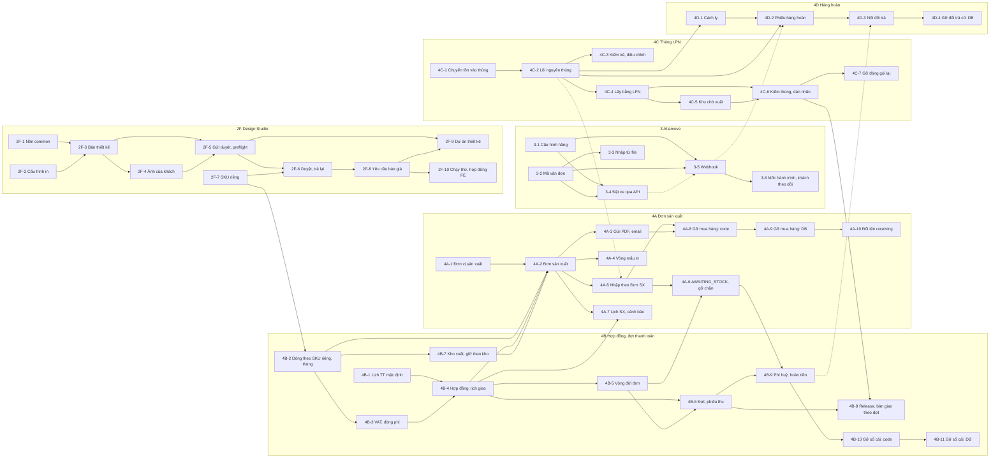

# Kế hoạch chia việc cho nhóm: hoàn thiện backend theo phạm vi mới (08/11/2026)

- **Viết cho:** 5 thành viên nhóm GFA26SE03. Người đọc biết dự án nhưng không làm các đợt 1–2e; đọc xong phải nhận được một gói và làm được mà không cần hỏi người làm đợt trước.
- **Nguồn đã đọc:**
  - `01-production.md` … `10-execution-plan.md` trong thư mục này (phân tích từng mảng, danh sách file, migration, ghi chú các đợt đã làm);
  - `../2026-11-06-design-studio.md` (8 pha, quyết định D1–D8) và `../2026-11-07-rescope-cleanup.md` (nguyên tắc DB §6, role §8, quyết định §9);
  - tài liệu nghiệp vụ kltn-docs `origin/main` @ `e17b6cc` (07/11): 00, 01, 03, 05, 06, 07, 08, 09, 11, 12, 13, 14, 15, 17, 20, open-questions;
  - code nhánh `refactor/rescope-02e-packing` (đã gồm đợt 1 → 2e; migration mới nhất `V20261108000500`).
- **Quy ước:**
  - "09 BR-18" = chương 09 của kltn-docs, quy tắc BR-18. "17 §4.3" = chương 17, mục 4.3.
  - "B44", "E24"… = mã câu hỏi trong `open-questions`. "QD-x" = quyết định mở của kế hoạch này (§1.6).
  - **Ngày công** = một người làm một ngày (có trợ lý AI), đã gồm viết test, migration, sửa sau review. Sai số ±30%.
  - **Ưu tiên:** P0 = cần cho luồng chính để demo bảo vệ (thiết kế → báo giá → hợp đồng → Đơn sản xuất → nhập → lấy → kiểm thùng → giao); P1 = tài liệu yêu cầu, nên có; P2 = dọn cho khớp tài liệu, làm khi còn thời gian.
- **Không phải cam kết:** số ngày là ước lượng; quyết định nào không ai phản đối thì làm theo mặc định đã ghi.

---

## 0. Đọc nhanh

| | |
|---|---|
| Mục tiêu | Backend khớp tài liệu nghiệp vụ 04–07/11: kho thành phẩm + bán sỉ B2B; khách tự thiết kế, Sales Manager duyệt; báo giá → đơn → hợp đồng + đợt thanh toán (chuyển khoản); Đơn sản xuất gửi đơn vị sản xuất ngoài hệ thống; nhập / xuất nguyên thùng LPN; mọi đơn giao nguyên chuyến, có tích hợp Ahamove |
| Đã xong, không lập kế hoạch lại | Đợt 1, 2a, 2b, 2c, 2d, 2e (PR #257 → #262, xếp chồng, **chưa merge**) |
| Việc đầu tiên | Gói **0-1**: review và merge lần lượt #257 → #262 vào `develop`. Mọi gói khác tách nhánh từ `develop` sau đó |
| Số gói | 62 gói (2 gói chuẩn bị + 60 gói BE: 2F 10, 3 6, 4A 10, 4B 11, 4C 7, 4D 4, 5 12), mỗi gói 1–5 ngày công, chia 7 nhóm: 2F, 3, 4A, 4B, 4C, 4D, 5 |
| Tổng công | **~199 ngày công BE + ~65 ngày công FE**. 5 người × ~4 ngày làm thật / tuần ≈ 20 ngày công / tuần → **~10 tuần BE**, **~13 tuần cả FE** |
| Nếu thiếu thời gian | Làm hết **P0** trước: ~126 ngày công BE (~6,5 tuần), cộng FE của các gói P0 ~46 ngày công. P1, P2 làm sau (§4) |
| Song song | 5 luồng chạy cùng lúc ngay sau 0-1 (§1.3). Điểm nghẽn: SKU riêng của khách (**2F-7**) và dòng báo giá / đơn theo SKU riêng (**4B-2**) — làm hai gói này sớm nhất |

---

## 1. Tổng quan

### 1.1 Phạm vi

Bảy nhóm việc, đúng như chủ dự án giao:

| Nhóm | Nội dung | Thay cho |
|---|---|---|
| **2F** | Design Studio: khách tự thiết kế → preflight phía server → Sales Manager duyệt → duyệt = xuất bộ file + snapshot + SKU riêng của khách; yêu cầu báo giá từ bản thiết kế; **dự án thiết kế** | Luồng cũ: nhân viên thiết kế, khách xác nhận, yêu cầu sửa, duyệt kỹ thuật theo người được gán |
| **3** | Tích hợp hãng: cấu hình kết nối (`WEBHOOK_LOAD` / `MANUAL` / `API_BOOKING`), mã vận đơn, đặt xe qua API Ahamove, nhận webhook, mốc hành trình | Ghi tay đặt xe và kết quả giao |
| **4A** | Đơn sản xuất (gồm vòng mẫu in, nhập kho theo Đơn sản xuất), rồi gỡ PO + nhà cung cấp + hoá đơn NCC + gia công ngoài; gỡ chặn release `ORDER_PRINT_GOODS_NOT_RECEIVED` | PO (`procurement`) — hiện là nguồn duy nhất của phiếu nhập |
| **4B** | Báo giá / đơn theo SKU riêng + số thùng + VAT + dòng phí; hợp đồng + lịch giao; đợt thanh toán + phiếu thu; chọn kho xuất; release / bàn giao theo đợt giao; phí huỷ + hoàn tiền; rồi gỡ sổ cái tiền | Sổ cái tiền cũ (chuyển khoản, phân bổ, credit, COD hãng, refund cũ, `payment.payment`), điều khoản thanh toán theo đơn |
| **4C** | Chuyển tồn lẻ vào thùng LPN, chỉ lấy nguyên thùng (xác nhận bằng LPN, khu chờ xuất, cất lại theo thùng), dựng lại đóng gói thành "kiểm thùng & dán nhãn" | Lấy lẻ, thùng mở, trạm đóng gói lại |
| **4D** | Phiếu nhập hàng hoàn (theo LPN, vào khu cách ly), thao tác cách ly / gỡ cách ly | Đổi trả cũ: QC hàng trả, đơn thay thế miễn phí, credit khách, khu `QUALITY_CONTROL` |
| **5** | Phần còn lại: cảnh báo tồn / hạn dùng / FEFO; bề mặt khách tự đặt; giá trên sàn; lớp lưu trữ; chính sách tồn; báo hỏng từng cái; 3 role còn lại; mọi sản phẩm `CUSTOMIZABLE`; seed; tài liệu | — |

Ngoài 7 nhóm này, tài liệu còn đòi vài mảng **chưa ai được giao** (hoá đơn điện tử, chat, bảng sức chứa…). Chúng ở §5, kèm cỡ việc, để nhóm quyết định với giảng viên.

### 1.2 Trước khi làm gì: merge 6 PR xếp chồng

Sáu PR đang xếp chồng: PR sau lấy nhánh của PR trước làm base.

| PR | Nhánh | Base hiện tại | Nội dung |
|---|---|---|---|
| #257 | `refactor/rescope-01-lock` | `develop` | Tắt email khách, xoá code chết, đổi `ECOMMERCE_ADMIN` → `SALES_MANAGER`, `verify.py` tự lấy danh sách module |
| #258 | `refactor/rescope-02a-production` | `…-01-lock` | Xoá sản xuất nội bộ (`V20261108000100`) |
| #259 | `refactor/rescope-02b-qc` | `…-02a-production` | Xoá QC nhận hàng; quyền duyệt thiết kế sang Sales Manager (`V20261108000200`) |
| #260 | `refactor/rescope-02c-transfer` | `…-02b-qc` | Xoá chuyển kho (`V20261108000300`) |
| #261 | `refactor/rescope-02d-parcel` | `…-02c-transfer` | Xoá gửi kiện, chọn cách giao, COD (`V20261108000400`) |
| #262 | `refactor/rescope-02e-packing` | `…-02d-parcel` | Xoá kiểm thiết kế khi đóng gói (`V20261108000500`) |

Mỗi đợt đã chạy toàn bộ test (4.920–5.468 test, 0 lỗi) và có review độc lập (`10-execution-plan.md`, bảng Tiến độ). Cách merge ở gói 0-1.

**Những gì các đợt trước cố ý để lại cho các gói sau** (đọc kỹ, đừng tưởng là sót):

| Đợt | Để lại | Gói xử lý |
|---|---|---|
| 2a | Gia công ngoài (PO loại `SUBCONTRACT`, `procurement.subcontract_settlement`, cờ nhà in gia công trên NCC, `warehouse.subcontractor_site`) | 4A-8, 4A-9 |
| 2a, 2c | Seed `tools/db/seed` (đã không nạp được trên `develop` từ trước: lỗi `ck_supplier_invoices_status`; còn PO, sản xuất, chuyển kho, tồn lẻ) | 5-10 |
| 2a | Release chặn mọi đơn có dòng in (`ORDER_PRINT_GOODS_NOT_RECEIVED`); đơn có dòng in đứng ở `CONFIRMED` tới khi có Đơn sản xuất | 4A-6 |
| 2b | Loại khu `QUALITY_CONTROL` (luồng trả hàng cũ còn nhận hàng vào đó); ảnh QC đã chụp (chỉ đọc); hoá đơn NCC sửa tối thiểu | 4D-4; 4A-9 |
| 2d | Phía sổ cái tiền của hãng (`Collector.CARRIER`, nộp tiền thu hộ, `payment.cod_remittance*`) để trả nốt khoản hãng đã thu; `packing_started_at` | 4B-10, 4B-11; 4C-6 |
| 2e | Trạm "kiểm thùng & dán nhãn" (08): chỉ dựng được sau khi bỏ lấy lẻ; dòng in của đơn (`designSnapshotId`, `printLine`) chỉ để hiển thị | 4C-6; 4B-2 |

### 1.3 Thứ tự và 5 luồng song song

Mỗi luồng giao cho một người. Thứ tự trong luồng là thứ tự nên làm. Mũi tên giữa các luồng xem sơ đồ §1.4.

| Luồng | Gói theo thứ tự | Tổng BE | Hồ sơ phù hợp |
|---|---|---|---|
| **L1 — Thiết kế** | 2F-1, 2F-2, 2F-3, 2F-4, 2F-5, 2F-6, 2F-8, 2F-9, 2F-10, 5-2, 5-3, 5-9 | ~38 | Thích hình học / JSON, làm được S3 + PDFBox, đọc được code FE storefront |
| **L2 — Bán hàng & tiền** | 2F-7, 4B-1, 4B-2, 4B-3, 4B-4, 4B-5, 4B-6, 4B-9, 4B-10, 4B-11 | ~35 | Mô hình miền, máy trạng thái, tiền tệ, cẩn thận với transaction và event sau commit |
| **L3 — Kho thùng & hàng hoàn** | 4C-1, 4C-2, 4C-3, 4C-4, 4C-5, 4C-6, 4C-7, 4D-1, 4D-2, 4D-3, 4D-4 | ~37 | Hiểu inventory, thứ tự khoá, viết được SQL chuyển dữ liệu |
| **L4 — Giao hàng & đợt giao** | 3-1, 3-2, 3-4, 3-5, 3-6, 3-3, 4B-7, 4B-8, 5-4, 5-6, 5-7 | ~37 | Tích hợp HTTP, bảo mật endpoint không đăng nhập, idempotency, fulfillment |
| **L5 — Đơn sản xuất & dọn mua hàng** | 5-1, 5-5, 4A-1, 4A-2, 4A-3, 4A-4, 4A-5, 4A-6, 4A-7, 4A-8, 4A-9, 5-8 | ~39 | Mô hình miền + sinh tài liệu (PDF, email) + migration archive diện rộng |
| **Chung, cuối kỳ** | 0-1, 0-2 (đầu kỳ); 4A-10; 5-10, 5-11, 5-12 | ~13 | Cả nhóm; 5-10 mỗi luồng viết phần seed của mình |

Gợi ý theo tài liệu sẵn có (không phải phân công): CLAUDE.md §7 ghi **Tú** là chủ schema → hợp với các gói nặng migration (4C-1, 4A-9, 4B-11) và nên duyệt mọi migration; kế hoạch Design Studio §4 ghi `product` do **Phương** phụ trách → 2F-2, 2F-7 nên báo trước hoặc giao cho Phương.

**L5 chờ ở tuần 3–4:** 4A-2 cần bảng đợt giao (4B-4) và kho xuất trên đơn (4B-7). Để không chờ: 4B-4 đẩy migration tạo bảng `delivery_batch` lên **ngày đầu** (mở rộng trước), 4B-7 thống nhất trường `shipping_warehouse_id` sớm; L5 viết domain + migration của 4A-2 dựa trên đó, ghép khi hai gói kia merge.

### 1.4 Sơ đồ phụ thuộc

Mọi gói phụ thuộc 0-1 (không vẽ). Mũi tên liền = phải xong trước; nét đứt = nên xong trước, có thể làm song song nếu thống nhất giao diện.



Nhóm 5 không vẽ cho gọn: 5-1, 5-2, 5-3, 5-4 chỉ cần 0-1; 5-5 ← 5-1; 5-6 ← 4D-1, 4C-7; 5-7 ← 5-1; 5-8 ← 4A-9, 5-7; 5-9 ← 2F-7, 4B-10; 5-10 ← các gói P0; 5-11 ← 5-10; 5-12 cuối cùng.

### 1.5 Đường găng

`0-1 → 2F-7 → 4B-2 → 4B-3 → 4B-4 → 4A-2 → 4A-5 → 4A-6 → 4B-9 → 4B-10 → 4B-11` ≈ 2 + 3 + 5 + 3 + 4 + 5 + 5 + 3 + 3 + 4 + 3 = **40 ngày công nối tiếp** (~10 tuần nếu một người làm liền). Cách rút ngắn:

1. Làm 2F-7 **trước** Design Studio: 4B-2 chỉ cần API cấp SKU riêng, không cần cả luồng duyệt (2F-7 gọi được với snapshot cũ).
2. Mở rộng trước: 4B-4 merge migration bảng `sales_contract` / `delivery_batch` sớm; 4A-2 dựng trên đó.
3. 4B-7 (L4) làm song song 4B-3/4B-4 (L2) ngay sau 4B-2.
4. 4A-1, 4A-3, 4A-4, 4A-7 không nằm trên đường găng: L5 làm khi chờ.

### 1.6 Quyết định cần chốt sớm

Họp ở gói 0-2. Không ai phản đối thì làm theo cột "Mặc định".

| QD | Câu hỏi | Mặc định | Ai chốt | Gói |
|---|---|---|---|---|
| QD-1 | Dữ liệu trên VPS (`develop` tự deploy, profile `prod`): reset rồi nạp seed mới, hay chuyển đổi dữ liệu cũ? (cleanup Q2) | **Reset** (chỉ là dữ liệu test). Migration vẫn viết đủ bước kiểm điều kiện + chuyển đổi + archive để môi trường nào cũng chạy an toàn | Chủ repo | 0-1, mọi migration |
| QD-2 | Cách merge 6 PR xếp chồng | **Create a merge commit** (không squash) | Chủ repo | 0-1 |
| QD-3 | Đơn sản xuất đặt ở module nào (cleanup Q3; 01-production §1.2) | **`order`**: tránh vòng phụ thuộc với đơn bán; nhiều quy tắc đơn cần dữ kiện Đơn sản xuất dưới khoá dòng đơn | Nhóm | 4A |
| QD-4 | Giữ hàng khi `Confirmed`: theo SKU (20 §5.6) hay chọn ngay N thùng LPN (17 §4.2 bước 3)? **Tài liệu mâu thuẫn** (cleanup P3) | Theo **20 §5.6**: giữ theo SKU tại kho xuất, không hạn; LPN chọn khi release. Báo người viết tài liệu sửa 17 | Chủ nghiệp vụ | 4B-7 |
| QD-5 | Khi gom tồn lẻ vào thùng, phần dư không đủ một thùng xử lý thế nào? | Ghi giảm bằng điều chỉnh `DATA_CORRECTION` do hệ thống lập, archive dòng gốc, liệt kê trong NOTICE của migration. Dòng không lô → lô `UNTRACED` (C45) | Chủ nghiệp vụ | 4C-1 |
| QD-6 | Tiền tố mã Đơn sản xuất (mã cũng là lô — 03 BR-03; 01-production Q7) | Tiền tố mới `PRD-yyyyMMdd-nnnn` qua `platform.document_sequence`, không dùng lại `LSX` của sản xuất cũ | Nhóm | 4A-2 |
| QD-7 | Gửi Đơn sản xuất qua email: dùng lại máy gửi email PO? (cleanup P7) | Dùng lại phần chung (transport, nhật ký gửi, retry); xoá phần riêng của PO ở 4A-8 | Nhóm | 4A-3, 4A-8 |
| QD-8 | Module chat (16) chưa có: thẻ yêu cầu báo giá, thẻ duyệt mẫu in đặt đâu? | Lưu yêu cầu ở module nguồn (`design`, `order`), báo Sale qua hộp thông báo in-app; thẻ chat làm khi có module chat (§5) | Chủ nghiệp vụ | 2F-8, 2F-9, 4A-4 |
| QD-9 | Thuế suất theo nhóm thuế (D31, D35 còn mở) | Bảng cấu hình: `STANDARD` 10%, `REDUCED` 5%, `EXEMPT` 0%; dòng phí vận chuyển dùng `STANDARD` (D31) | Chủ nghiệp vụ / Kế toán | 4B-3 |
| QD-10 | Tài khoản Ahamove staging và URL webhook HTTPS | Chủ repo đăng ký **ngay** (số điện thoại + `api_key`), gửi Ahamove URL webhook của VPS. Không có thì 3-4/3-5 chỉ test bằng giả lập | Chủ repo | 3-4, 3-5 |
| QD-11 | Xác thực webhook kiểu `WEBHOOK_LOAD` khi chưa có hãng thật (E15) | HMAC-SHA256 trên body, header `X-Signature`, theo mẫu `WebhookSignature` của notification (webhook Resend) | Nhóm | 3-5 |
| QD-12 | Tách `sales-orders:APPROVE` (cleanup §8.2) | Quyền mới `sales-order-releases` (Quản lý kho, theo kho) và `sales-order-holds` (Sale). Không cấp nguyên `sales-orders:APPROVE` cho cả hai | Nhóm | 4B-8, 5-7 |
| QD-13 | Người đang mang role bị bỏ (cleanup §8.1) | `dieuphoi` → Sales Staff; `kehoach` → Warehouse Manager + gán kho; `muahang1`, `muahang2` → vô hiệu hoá kèm lý do | Chủ repo | 5-7, 5-8 |
| QD-14 | Thông tin pháp lý của khách cho hợp đồng (18: người đại diện, địa chỉ đăng ký kinh doanh) chưa có trong code | Thêm 2 trường vào hồ sơ khách trong 4B-4; phần còn lại của 18 để sau (§5) | Nhóm | 4B-4 |
| QD-15 | Đổi tên module `procurement` → `receiving` (cleanup P10) | Làm cuối nếu còn thời gian (4A-10); giữ mã quyền `procurement-goods-receipts` để khỏi chuyển quyền | Nhóm | 4A-10 |
| QD-16 | Dòng báo giá / đơn cũ (phôi + snapshot) khi chuyển sang SKU riêng | Giữ nguyên làm lịch sử, chỉ đọc; chặn release vẫn áp cho dòng cũ; dòng mới bắt buộc là SKU riêng | Nhóm | 4B-2, 4A-6 |
| QD-17 | Định dạng file nhập mã vận đơn (09 §4.4 chỉ nói "mẫu của hệ thống") | CSV UTF-8 có BOM (mở được bằng Excel), không thêm thư viện. Cần `.xlsx` thì thêm `poi-ooxml` với phiên bản cố định | Nhóm | 3-3 |
| QD-18 | Hoá đơn điện tử (21), chat (16), bảng sức chứa (06 §4.6) có làm trong đợt này không | Chưa có gói (§5); chủ dự án chốt với giảng viên | Chủ dự án | — |

---

## 2. Các gói việc

Mẫu mỗi gói: **Nghiệp vụ** (mục tiêu + quy tắc), **Hiện trạng** (code bây giờ), **BE** (việc cụ thể), **Test**, **FE**, rồi một dòng **Phụ thuộc · Công · Hồ sơ · Ưu tiên**, và **Quyết định mở** nếu có.

### Gói 0 — Chuẩn bị

#### 0-1 — Review và merge 6 PR xếp chồng (#257 → #262)
- **Mục tiêu:** đưa đợt 1–2e vào `develop` để mọi gói sau có chung một gốc.
- **Việc:**
  1. Chốt QD-1 **trước khi merge #258**: `develop` tự deploy lên VPS, migration chạy ngay trên dữ liệu ở đó (2a chuyển đơn `IN_PRODUCTION` sang `READY_TO_FULFILL`; 2b cho phiếu đang QC đi cất hàng và chuyển user QC thành nhân viên kho; 2c lưu trữ rồi xoá mọi phiếu chuyển kho…).
  2. Mỗi PR: một người **không làm đợt đó** đọc diff + mô tả PR (nhất là migration và mục "giữ lại có chủ đích" trong `10-execution-plan.md`), CI xanh, merge bằng merge commit (QD-2).
  3. Merge xong một PR, kiểm PR kế tiếp đã đổi base về `develop` (GitHub tự đổi khi nhánh base bị xoá); chưa đổi thì đổi tay. Lỡ squash thì `git rebase --onto develop <nhánh đợt trước> <nhánh đợt này>` rồi force-push nhánh đó — cần chủ repo đồng ý.
  4. Sau #262: chạy `mvn verify` trên `develop`; xem log deploy VPS (Flyway tới `V20261108000500`, ứng dụng khởi động, không lỗi đọc `event_publication`).
  5. Ghi kết quả vào bảng §4 của file này.
- **FE:** FE trỏ `develop` sẽ mất các endpoint đã bỏ ở 2a–2e (sản xuất, QC, chuyển kho, gửi kiện, kiểm thiết kế ở kho). Báo người làm FE, danh sách ở `07-frontend.md` B1/B2.
- **Phụ thuộc:** không · **Công:** 2 (hai người review) · **Hồ sơ:** nắm cả hệ thống; chủ repo bấm merge · **P0**

#### 0-2 — Chốt quyết định và chuẩn bị chung
- Họp 30–60 phút chốt QD-1 … QD-18, ghi kết quả vào §1.6.
- Chia **khe số migration** cho 5 người (§3.3).
- Chủ repo gửi yêu cầu tài khoản Ahamove staging (QD-10) ngay: chờ vài ngày.
- Thống nhất người duyệt migration (§3.3) và người review chéo cho từng luồng.
- **Phụ thuộc:** không · **Công:** 0,5 · **P0**

### Nhóm 2F — Design Studio

Nguồn chính: `../2026-11-06-design-studio.md` (8 pha, D1–D8; chủ dự án đã đồng ý — `09-removal-summary.md` dòng 18) và kltn-docs 12 (bản 05/11 + dự án thiết kế 06/11), 13, 01 §4.10. Các gói dưới đây chia lại 8 pha thành phần một người làm được.

Khác kế hoạch gốc, cần biết:
- Quyền `design-designs:APPROVE` **đã chuyển** sang Sales Manager ở đợt 2b (`V20261108000200`); không làm lại.
- D5 (báo giá / đơn / Đơn sản xuất dùng SKU riêng) nay là gói **4B-2** và **4A-2**.
- Kế hoạch gốc lập **trước** khi tài liệu thêm **dự án thiết kế** (12 §4.9–§4.11, chốt 06/11) → thêm gói **2F-9**.
- Migration đánh số sau migration mới nhất trên `develop` (sau 0-1 là `V20261108000500`), không phải sau `V20261106000100` như kế hoạch gốc ghi.

Bẫy đã biết (kế hoạch gốc §1): `design-designs` **chưa khai báo `Action.CREATE`** trong `@PermissionResource` → thêm `@RequiresPermission(CREATE)` mà không khai báo thì ứng dụng không khởi động; **đổi công thức `manifestChecksum`** làm hỏng việc kiểm 17 snapshot trong seed và `ConfirmedDesigns` trong test; mọi thay đổi `role_permission` phải tăng `app_role.version`.

#### 2F-1 — Nền móng dùng chung trong `common`
- **Nghiệp vụ:** checksum bố cục phải giống nhau giữa trình duyệt và server (12 BR-08, BR-10); đo ảnh của khách; giới hạn kích thước bố cục.
- **Hiện trạng:** chưa có `CanonicalJson`; `ImageRenditions` có hàm `orientation` nhưng private; `FileCategory` chưa có loại cho ảnh của khách hay khuôn tham khảo; `IdempotencyFilter` đọc hết body, không giới hạn.
- **BE:**
  - `CanonicalJson` theo RFC 8785: sắp key theo đơn vị UTF-16, số theo ECMAScript, escape như `JSON.stringify`, từ chối key trùng.
  - `ImageDimensions`: kích thước sau xoay EXIF (orientation 5–8 đổi rộng / cao), không giải mã cả ảnh, từ chối ảnh > 40 MP.
  - `FileCategory.DESIGN_ASSET` (`design-assets`, PNG / JPEG / WebP, ≤ 50 MB, private) và `PRINT_TEMPLATE` (PDF / PNG; SVG chỉ khi có bộ lọc an toàn).
  - Giới hạn 1.000.000 byte cho `PUT /designs/{id}/document` → 413, chặn ở `IdempotencyFilter` và một `RequestBodyLimit` trước Jackson.
- **Test:** vector của RFC 8785 + vector do Node `JSON.stringify` sinh; ảnh EXIF xoay; 413; cập nhật `StoredFileReferencesIntegrationTest`, `UploadInspection`, `PdfContentPolicy`.
- **FE:** không; FE phải tính checksum đúng RFC 8785 (ghi vào hợp đồng ở 2F-10).
- **Phụ thuộc:** 0-1 · **Công:** 2,5 · **Hồ sơ:** Java thuần, đọc chuẩn kỹ, không cần DB · **P0**

#### 2F-2 — Cấu hình in theo quy cách (module `product`) + API cho trình thiết kế (P2)
- **Nghiệp vụ:** Sales Manager khai báo khuôn 2D, vùng in, lề an toàn, lề tràn, model, ràng buộc file cho từng quy cách (01 §4.10, BR-21); chỉ thiết kế được trên quy cách có khuôn in (12 BR-02, 13 BR-14); bản chưa duyệt theo cấu hình hiện hành (B39).
- **Hiện trạng:** bảng `product.customization_templates`, `product.print_areas` đã có (cột, CHECK, trigger "chỉ trên sản phẩm CUSTOMIZABLE") nhưng **không có Java**; quyền `product-customization-templates` chỉ có trong DB; seed dùng mã vùng `WRAP`, định dạng `PDF` / `AI` / `PNG` thay vì MIME, `shape_json` / `uv_mapping_json` NULL; demo / test không có sản phẩm CUSTOMIZABLE.
- **BE:**
  - Migration: `model_params_json JSONB` + CHECK `kind IN ('parametric-cup','parametric-bag')`; template active bắt buộc có model; `min_dpi` default 300 (D8, B34); `template_2d_url` → khoá file S3 tuỳ chọn; CHECK định dạng là MIME; mã vùng ∈ {`BODY`, `FRONT`, `BACK`, `LEFT`, `RIGHT`}. Dòng cũ (mã `WRAP`, định dạng không MIME) chuyển đổi trong cùng migration.
  - Domain `PrintConfig`, `PrintArea`, `CupModel`, `BagModel`; `CupGeometry` (port `cupSector`, `isCylindricalCup` của FE); luật "ly có 1 vùng `BODY` hình quạt, túi có 4 vùng chữ nhật". Hình quạt do server tính từ thông số ly, không nhận từ client.
  - `product :: api`: `PrintConfigs` (`activeOfProduct`, `ofVariant`, `byId`); `ProductService.findBySlug`, `variantOf(sku)`.
  - API nội bộ `GET/POST /products/{p}/variants/{v}/customization-templates`, `PUT /{templateId}`, `POST /{templateId}/activation`, `/deactivation`, upload khuôn tham khảo (`@Auditable`); quyền `product-customization-templates` cho Sales Manager + System Admin, tăng `version`.
  - P2: `GET /catalog/products/{slug}/customization` (`no-store`, 404 slug lạ / chưa xuất bản, 409 `PRODUCT_NOT_CUSTOMIZABLE`).
  - Fixture test `ReferenceRows.customizableProduct`.
- **Test:** `CupGeometry` với số liệu trong đề xuất FE (230.04 / 327.05 / 0.84894); luật vùng in; integration API + `PermissionMatrixTest`; upgrade test cho dòng template cũ.
- **FE:** backoffice màn "Cấu hình in" theo quy cách (mới); storefront đọc P2 thay mock.
- **Phụ thuộc:** 0-1 · **Công:** 4 · **Hồ sơ:** domain + hình học đơn giản; module `product` · **P0**
- **Quyết định mở:** "model" ở đây là model tham số ly / túi, dùng cho cả khuôn 2D; khác model 3D glTF của B36 (glTF để sau, khách vẫn thiết kế 2D được).

#### 2F-3 — Bản thiết kế của khách: tạo, lưu bố cục, đổi tên, xoá nháp, bản sửa (P1, P3, P6)
- **Nghiệp vụ:** 12 §4.1, §4.2, §4.7, §5.1; BR-01 (một khách, một sản phẩm, một quy cách; chỉ khách tạo), BR-03 + D7 (ai thấy gì), BR-07, BR-11 (phiên bản), BR-12, BR-16 (chỉ `Draft` xoá được); tối đa 50 bản nháp (B37); nhân viên không xem `Draft` (B38).
- **Hiện trạng:** `DesignStatus { DRAFT, SUBMITTED, APPROVED, REJECTED }`; `DesignWorkflowController` theo luồng nhân viên (`POST /designs`, `/assignment`, `/specification`, `/technical-reviews`, `/confirmation-requests`, `/change-requests`, `/confirmations`, `/confirmation-withdrawals`, `/revisions`); `design_draft` chưa có SKU / template / bố cục. Có sẵn và dùng lại: upload artifact qua S3 + ClamAV, snapshot bất biến, lịch sử quyết định append-only, fork.
- **BE:**
  - Migration: `design_draft` thêm `variant_id`, `sku`, `template_id`, `template_code`, `review_requested_at`, `reviewed_at`, `archived_at`; trạng thái theo D1 (`DRAFT`, `PENDING_REVIEW`, `APPROVED`, `ARCHIVED`; dữ liệu cũ `SUBMITTED` → `PENDING_REVIEW`, `REJECTED` → `DRAFT`, archive giá trị cũ).
  - Bảng `design_document` (`draft_id` PK, `document` TEXT là JSON chuẩn, `checksum` CHAR(64); CHECK checksum = sha256 của document; CHECK ≤ 1.000.000 byte) và `design_asset` (PK `(draft_id, id)`, append-only bằng trigger, `uk (draft_id, upload_key)`); index cho bộ đếm 50.
  - Lịch sử quyết định thành enum 12 §5.3 (`CREATED`, `DERIVED_FROM_SNAPSHOT`, `PREFLIGHT_FAILED`, `SUBMITTED_FOR_REVIEW`, `RETURNED`, `APPROVED`, `ARCHIVED`, `QUOTE_REQUESTED`); chuỗi cũ vẫn đọc được, CHECK cho dòng mới.
  - `DesignDraft` thành aggregate thật: `startFor`, `rename`, `saveDocument`, `archive`, `deriveFrom`, `requireOwner`.
  - Endpoint: `POST /designs/mine`, `GET /designs?status=`, `GET /designs/{id}` (thêm `productSlug`, `sku`, `templateCode`, `reviewRequestedAt`, `customerSkuCode`…), `GET /designs/{id}/template`, `PUT /designs/{id}/name`, `GET|PUT /designs/{id}/document`, `POST /designs/{id}/archive`, `POST /designs/{id}/revisions` (chép bố cục từ snapshot + ảnh cùng id; ghi `DERIVED_FROM_SNAPSHOT`).
  - Khoá advisory theo khách khi đếm 50 (hai tab cùng tạo); khai báo `Action.CREATE`.
- **Test:** unit aggregate; integration từng endpoint (chỉ chủ sở hữu, 409 sai version, 409 `DESIGN_DRAFT_LIMIT_REACHED`); `PermissionMatrixTest` với thân request tấn công cho mọi handler mới; **`DesignStatusMigrationUpgradeTest`** (bản `SUBMITTED` / `REJECTED` cũ → trạng thái mới, archive còn giá trị cũ); QA SQL cho CHECK checksum / kích thước.
- **FE:** storefront `designStatusSchema` 4 trạng thái, đổi tên, xoá nháp, mở bản đã duyệt bằng `GET /designs/{id}/template`; bỏ tab "Chờ bạn xác nhận".
- **Phụ thuộc:** 2F-1, 2F-2 · **Công:** 4 · **Hồ sơ:** JPA, aggregate, migration chuyển dữ liệu · **P0**

#### 2F-4 — Ảnh của khách trong bản thiết kế (P4)
- **Nghiệp vụ:** 12 BR-04 (đúng định dạng, dung lượng theo quy cách, qua quét mã độc; chỉ bản `Draft` nhận file); ≤ 100 ảnh / bản.
- **Hiện trạng:** mẫu `PreparedFiles` (đọc ngắn → chuẩn bị ngoài transaction → khoá ngắn + `adopt`), `StagedUploads`, `OrphanedFileSweeper` có sẵn từ nhánh S3.
- **BE:** `POST /designs/{id}/assets` (multipart); `POST /designs/{id}/assets/uploads` + `POST /designs/{id}/assets` (upload thẳng S3); `GET /designs/{id}/assets`; `GET /designs/{id}/assets/{assetId}/download-url`. MIME ∩ ràng buộc của template, ≤ `max_file_size_mb`, kích thước px sau EXIF (2F-1); idempotency theo người dùng; không đổi version bản thiết kế; `DesignAssetFileReferences` cho bộ quét file mồ côi.
- **Test:** multipart + upload thẳng với MinIO (Testcontainers); ảnh > 40 MP; bản `PENDING_REVIEW` từ chối; sweep không xoá ảnh đang dùng.
- **FE:** storefront nối upload ảnh với API thật; CORS cho link presigned (2F-10).
- **Phụ thuộc:** 2F-3 · **Công:** 2 · **Hồ sơ:** S3 / MinIO · **P0**

#### 2F-5 — Gửi duyệt + preflight phía server + hàng chờ duyệt (P5)
- **Nghiệp vụ:** 12 §4.3, BR-05 (chặn cứng, không có mức Warning — B18; quy cách phải có quy cách thùng — B25), BR-07 (khoá sửa khi chờ duyệt); D6 (khung bao của chữ **không** kiểm được ở server — để FE preflight và Sales Manager nhìn bằng mắt; nói rõ giới hạn này).
- **Hiện trạng:** `DesignPreflight` chỉ kiểm PDF với 150 dpi cố định; `design` chưa phát event nào cho `notification`.
- **BE:**
  - `DesignPreflightCheck` thuần (không Spring): port `toFlat`, `contains(bleed|trim|safe)`, `inSeam` của ly / túi; khung bao ảnh và nét vẽ (`strokeReachMm`); DPI theo `min_dpi` của template; font được phép; định dạng, dung lượng; quy cách / sản phẩm / khuôn còn dùng được.
  - Cột `design_artifact.document_checksum` + tham số `documentChecksum` khi upload artifact.
  - `POST /designs/{id}/technical-review-requests` `{version, quoteRequest?}`: đọc ngắn → preflight ngoài transaction → không đạt: ghi `PREFLIGHT_FAILED` (transaction riêng, không đổi version) + 422 `DESIGN_PREFLIGHT_FAILED` kèm `{surfaceCode, elementId, rule, message}`; đạt: khoá, kiểm lại version → `PENDING_REVIEW` + `SUBMITTED_FOR_REVIEW`. 409 `DESIGN_FILES_OUTDATED` khi ba file `CUSTOMER_PREVIEW`, `PRINT_READY`, `TECHNICAL_SPEC` không khớp checksum bố cục hiện hành.
  - Event `DesignSubmittedForReview` (`contracts`) → `notification` báo người giữ `design-designs:APPROVE`; `design` không gọi thẳng `notification`.
  - `GET /designs/review-queue` (cũ nhất trước).
- **Test:** unit preflight với vector lấy từ test FE; integration 422 / 409 / 200; listener; `verify.py` (allow-list event mới, check 16 dữ liệu cá nhân); `ModularityTest`.
- **FE:** storefront "Gửi duyệt": upload 3 file kèm `documentChecksum`, hiện lỗi 422 theo phần tử (bấm lỗi chọn đúng phần tử); preflight FE: `CROSSES_SAFE_AREA` thành Fail, bỏ Warning DPI, min 300. Backoffice: hàng chờ duyệt (mới).
- **Phụ thuộc:** 2F-3, 2F-4 · **Công:** 4 · **Hồ sơ:** hình học, transaction ngắn · **P0**

#### 2F-6 — Sales Manager duyệt / trả lại; chốt bộ file, snapshot, SKU riêng; bỏ luồng cũ
- **Nghiệp vụ:** 12 §4.4, §4.5, BR-06, BR-08, BR-09 (duyệt = xuất bộ file + snapshot + SKU riêng **trong một bước**; hỏng thì ở lại `PENDING_REVIEW`), BR-10, BR-13; D2, D3 (PDF/X-4 chỉ "ghi nhận dạng" tới khi có profile ICC của nhà in — B35).
- **Hiện trạng:** duyệt theo người được gán (`DesignWorkflowService` kiểm reviewer ≠ chủ / người thiết kế); snapshot có ba mức kiểm checksum; endpoint luồng cũ còn đủ.
- **BE:**
  - `POST /designs/{id}/reviews` `{version, approved, notes}`; trả lại bắt buộc lý do ≤ 2.000 ký tự → `DRAFT`, `RETURNED`.
  - Duyệt — **ngoài transaction:** kiểm byte các file; đóng dấu PDF/X (TrimBox / BleedBox, `GTS_PDFXVersion`, XMP, `Trapped`); sinh `PRODUCTION_INSTRUCTION` từ quy cách thùng (PDFBox + Noto Sans có sẵn); chuẩn bị file bằng `PreparedFiles`. **Trong transaction ngắn:** khoá, kiểm lại version; gắn file; snapshot thêm bố cục + checksum bố cục + danh sách ảnh + template đóng băng; Object Lock file và ảnh; gọi `CustomerSkus.issue` (2F-7); → `APPROVED` (ghi mã snapshot, SKU, checksum).
  - Checksum snapshot: chỉ thêm dòng `DESIGN_DOCUMENT:<checksum>`, `DESIGN_ASSET:<id>:<checksum>` khi snapshot có bố cục → snapshot cũ tính đúng như trước. Cập nhật `DesignServiceImpl.inspect` (kiểm cả ảnh), `ConfirmedDesigns`.
  - Event → báo khách (in-app); báo Sale nếu bản có yêu cầu báo giá.
  - **Bỏ** `POST /designs` (nhân viên tạo), `/assignment`, `/specification`, `/technical-reviews`, `/confirmation-requests`, `/change-requests`, `/confirmations`, `/confirmation-withdrawals`, và quyền `design-administration`: migration xoá `role_permission` trước (RETURNING role_id), tăng `version` các role đó, rồi xoá `permission`. Cột người gán / người thiết kế cũ: archive rồi drop nếu không còn dùng.
  - Bản cũ do nhân viên tạo (không bố cục) chỉ xem được; gửi duyệt sẽ báo "chưa có bố cục".
- **Test:** duyệt thành công; sinh SKU lỗi → vẫn `PENDING_REVIEW`; snapshot cũ vẫn kiểm qua; `PermissionMatrixTest` bỏ handler cũ; upgrade test cho migration xoá quyền + cột.
- **FE:** storefront bỏ `finalize-dialog`, `use-finalize`, `change-request-dialog`, `workflow-card`, thêm "Chờ duyệt" / "Bị trả lại (lý do)", hiện mã SKU riêng. Backoffice màn duyệt: xem bố cục 2D / 3D, ảnh gốc, kết quả preflight, Duyệt / Trả lại; bỏ gán người duyệt.
- **Phụ thuộc:** 2F-5, 2F-7 · **Công:** 4 · **Hồ sơ:** PDFBox, S3 Object Lock, transaction · **P0**

#### 2F-7 — SKU riêng của khách (module `product`)
- **Nghiệp vụ:** 01 BR-03 (quy cách thùng kế thừa từ quy cách), BR-07 (một biến thể = một Inventory Item), BR-20 (gắn đúng một khách và một snapshot, không đổi được); 13 BR-02 (khách khác coi như không tồn tại); D4 (mã `MÃSP-MÃKH-NN` ≤ 64 ký tự, `ACTIVE`).
- **Hiện trạng:** `product.variants` không có chủ sở hữu; không có `CustomerSkus`; catalog liệt kê mọi biến thể.
- **Vì sao tách khỏi 2F-6 và làm ngay:** 4B-2 (báo giá / đơn theo SKU riêng) chỉ cần API này. API gọi được với snapshot cũ (seed có 17 snapshot), nên không phải chờ cả Design Studio.
- **BE:** migration `product.variants` thêm `owner_customer_id`, `design_snapshot_id`, `source_variant_id` + CHECK "có chủ thì có snapshot và quy cách gốc" + unique mã + bộ đếm số thứ tự theo (sản phẩm, khách). `product :: api` `CustomerSkus.issue(snapshotId, customerId, sourceVariantId)` chạy trong transaction của người gọi: sinh biến thể + Inventory Item chép quy cách thùng và logistics qua `inventory :: api`; từ chối khi sản phẩm / quy cách đã ngừng. Thêm `ownerOf(sku)`, `ownedBy(customerId)`. Catalog và mọi danh sách biến thể công khai lọc bỏ SKU riêng của người khác. Fixture test `ReferenceRows.customerSku(customer)`.
- **Test:** bản sửa sinh SKU mới, SKU cũ vẫn `ACTIVE` (12 BR-12); khách khác không thấy SKU ở list / search / gợi ý / chi tiết; quy cách ngừng → từ chối; `ModularityTest`.
- **FE:** storefront hiện SKU riêng trong "Mẫu thiết kế của tôi"; backoffice tra SKU theo khách.
- **Phụ thuộc:** 0-1 · **Công:** 3 · **Hồ sơ:** `product` + `inventory :: api` · **P0** (đường găng)

#### 2F-8 — Yêu cầu báo giá từ bản thiết kế
- **Nghiệp vụ:** 12 §4.8, BR-15 (không phải đơn hàng); 13 BR-16; 14 BR-22 (Sale chỉ lập báo giá khi bản `APPROVED`); B40 (bị trả lại thì yêu cầu vẫn mở; bị xoá thì đóng).
- **Hiện trạng:** module `chat` là khung rỗng (`ChatController` không endpoint, `ChatService` rỗng).
- **BE:** bảng `design.quote_request` (bản, số thùng ≥ 1, ngày giao mong muốn ≥ hôm nay, trạng thái); `POST /designs/{id}/quote-requests` từ bản `APPROVED`, và đi kèm "Gửi duyệt" (2F-5); ghi `QUOTE_REQUESTED`; event `DesignQuoteRequested` → `notification` báo Sale phụ trách (QD-8); `GET /design-quote-requests` cho Sale (lọc theo khách, trạng thái); Sale xem được bản `PENDING_REVIEW` có yêu cầu gắn với mình (D7). Nút "Lập báo giá" chỉ bật khi `APPROVED`; điền sẵn báo giá ở 4B-2.
- **Test:** integration tạo / đóng theo trạng thái bản; quyền Sale xem bản chờ duyệt; bản bị trả lại giữ yêu cầu.
- **FE:** storefront hộp "Yêu cầu báo giá" và "Gửi duyệt và yêu cầu báo giá"; backoffice danh sách yêu cầu báo giá.
- **Phụ thuộc:** 2F-6 · **Công:** 2 · **Hồ sơ:** CRUD + event · **P0**

#### 2F-9 — Dự án thiết kế (mới, không có trong kế hoạch Design Studio)
- **Nghiệp vụ:** 12 §4.9–§4.11, §5.4, BR-17…BR-22 (chốt 06/11); B42 (≤ 20 bản / dự án, `Archived` không mở lại), B43 (thư viện ≤ 30 file).
- **Hiện trạng:** chưa có gì.
- **BE:** bảng `design.design_project`, `design_project_asset`, cột `design_draft.project_id`, bảng lượt duyệt `design_review_round`. Endpoint: tạo / đổi tên / đóng dự án (chỉ khi không còn bản `PENDING_REVIEW` — BR-22); thêm / gỡ bản (không gỡ bản `PENDING_REVIEW`; bản `Archived` không thêm); thư viện tài nguyên (tải một lần; đặt lên bản = **sao chép** file vào bản và kiểm lại theo ràng buộc quy cách của bản đó — BR-18); "Gửi duyệt cả bộ" (≥ 2 bản `Draft`, preflight từng bản, **tất cả hoặc không** — BR-19); lượt duyệt hiện là **một mục** trong hàng chờ, duyệt từng bản, tự đóng khi mọi bản có quyết định (BR-20); yêu cầu báo giá cả dự án (chỉ bản `APPROVED`, một ngày giao chung — BR-21). Lịch sử `PROJECT_*`, `ADDED_TO_PROJECT` / `REMOVED_FROM_PROJECT`. Bản sửa từ bản thuộc dự án đã đóng không thuộc dự án nào.
- **Test:** unit tất-cả-hoặc-không; integration lượt duyệt tự đóng; giới hạn 20 / 30; chỉ chủ sở hữu thao tác.
- **FE:** storefront màn dự án (bản cạnh nhau, thư viện, gửi cả bộ, báo giá cả dự án); backoffice hàng chờ hiện lượt duyệt dự án.
- **Phụ thuộc:** 2F-5, 2F-8 · **Công:** 4 · **Hồ sơ:** như 2F-3 · **P1**

#### 2F-10 — Chạy thử từ A tới Z và hợp đồng API cho FE
- Chạy thật trên Postgres + MinIO (docker compose), theo kịch bản: tạo template → P2 → tạo bản → lưu bố cục → upload ảnh (cả upload thẳng S3) → dựng file → Gửi duyệt (một lần không đạt, một lần đạt) → Trả lại → Gửi lại → Duyệt (snapshot + SKU) → tạo bản sửa → yêu cầu báo giá → kiểm checksum khi tải file.
- Thử cùng FE storefront (`USE_MOCK=false`) trên trình duyệt; CORS cho link presigned `GET` / `HEAD` từ origin storefront (MinIO + script bucket AWS).
- Viết `docs/design-studio-fe-contract.md` (tiếng Anh, commit trong repo): hợp đồng chính thức + danh sách việc FE phải sửa (kế hoạch Design Studio §5).
- **Phụ thuộc:** 2F-8 (2F-9 nếu kịp) · **Công:** 2 · **Hồ sơ:** nắm FE storefront · **P0**

### Nhóm 3 — Tích hợp hãng vận chuyển, Ahamove

Nguồn: 09 §3 (dữ liệu tối thiểu), §4.1–§4.5, §5.2, BR-02, BR-16, BR-18, BR-21…BR-29; open-questions E1, E4, E15–E26; kế hoạch API ở `09-removal-summary.md` mục H (Ahamove API v3, staging `partner-apistg.ahamove.com`: `POST /v3/accounts/token`, `GET /v3/services?city_id=…&delivery_type=TRUCK`, `POST /v3/orders`, `DELETE /v3/orders/{id}`, `GET /v3/orders/{id}`; webhook xác thực bằng header, **không có chữ ký**; payload **không có biển số xe**).

Hiện trạng chung: đợt 2d đã bỏ gửi kiện, nên mọi chuyến là một xe của kế hoạch xếp xe đã xác nhận — đúng nền để làm nhóm này. `CarrierJpaEntity` chỉ có `code`, `name`, `contact_name`, `contact_phone`, `status`. `DispatchLoadJpaEntity` có `carrier_id`, `vehicle_plate`, `driver_name`, `driver_phone`, chưa có mã vận đơn. Có `POST /fulfillment/loads/{id}/booking` và `/booking-cancellation` (ghi tay), `POST /fulfillment/shipments/{id}/delivery-outcome` (ghi tay). Mẫu dùng lại: `common/http/RestClientFactory` (timeout, correlation id, log); webhook Resend (`ResendWebhookController`, `WebhookSignature`, route `permitAll` trong `ResourceServerSecurityConfig`). Kiểm thử HTTP dùng `MockRestServiceServer` (spring-test có sẵn; pom không có WireMock).

#### 3-1 — Cấu hình kết nối hãng
- **Nghiệp vụ:** 09 §4.1 bước 1–2, BR-21; `Carrier.connection_type` (`WEBHOOK_LOAD` / `MANUAL` / `API_BOOKING`), `webhook_enabled`, `webhook_secret`, `webhook_auth_header`, `api_environment`, `api_key`, `failure_reason_map`; `VehicleType.carrier_service_codes` (mã dịch vụ theo thành phố); bí mật không hiển thị lại sau khi lưu.
- **BE:**
  - Migration `fulfillment.carrier` thêm các cột trên; bí mật lưu **mã hoá** (ví dụ AES-GCM của `spring-security-crypto` `Encryptors`, khoá lấy từ biến môi trường); CHECK theo kiểu kết nối (`WEBHOOK_LOAD` bắt buộc secret; `API_BOOKING` bắt buộc api_key + header xác thực).
  - Bảng `fulfillment.carrier_service_code` (hãng, loại xe, thành phố, mã dịch vụ).
  - Mở rộng `PUT /fulfillment/carriers/{id}`: bí mật chỉ ghi, response trả cờ `apiKeyConfigured`; bảng ánh xạ lý do thất bại → `DeliveryFailureReason` (lý do lạ → `OTHER` + lý do gốc — E22).
  - `GET /fulfillment/carriers/{id}/services?cityId=` (trước 3-4 trả danh sách đã lưu; sau 3-4 gọi Ahamove).
  - 4 hãng gửi kiện seed bởi `V20261021000400` (GHN, GHTK, VTP, JTE) vẫn đang `ACTIVE` — đợt 2d không tắt (đã kiểm: không migration nào sau đó sửa `fulfillment.carrier`). Migration này chuyển chúng `INACTIVE` (không xoá: shipment cũ còn trỏ tới).
- **Test:** unit mã hoá / giải mã; integration không lộ bí mật trong response và log (`verify.py` check 16, `RequestLoggingFilter`); QA SQL cho CHECK theo kiểu kết nối; `PermissionMatrixTest`.
- **FE:** backoffice form hãng: kiểu kết nối, ô bí mật chỉ ghi, mã dịch vụ theo loại xe + thành phố, bảng ánh xạ lý do.
- **Phụ thuộc:** 0-1 · **Công:** 2,5 · **Hồ sơ:** bảo mật, JPA · **P0**

#### 3-2 — Mã vận đơn theo chuyến (nhập tay), lịch sử, chặn bàn giao
- **Nghiệp vụ:** 09 §4.4; BR-23 (bắt buộc trước khi ký bàn giao; không trùng trong cùng hãng, chuyến `Cancelled` không tính — E19); BR-24 (trước khi rời kho: Dispatch Staff / Quản lý kho sửa; sau khi rời kho chỉ Quản lý kho, bắt buộc lý do; mọi lần đổi lưu lịch sử); BR-28 (file vận đơn tuỳ chọn); BR-18 (bàn giao tất cả hoặc không).
- **BE:** migration `dispatch_load` thêm `waybill_no` + unique partial index `(carrier_id, waybill_no) WHERE status <> 'CANCELLED'`; bảng `fulfillment.waybill_change` (cũ, mới, nguồn `WEBHOOK` / `FILE` / `MANUAL` / `API`, người, thời điểm, lý do); file vận đơn trên S3; `PUT /fulfillment/loads/{id}/waybill`; quyền mới `fulfillment-waybill-corrections` (Quản lý kho + System Admin, tăng `version`) cho sửa sau rời kho; `DispatchService` từ chối ký bàn giao khi chuyến thiếu mã vận đơn (mã lỗi mới, dịch đủ hai bundle).
- **Test:** unit; integration trùng trong cùng hãng / khác hãng / chuyến đã huỷ; sửa sau rời kho không có quyền; QA SQL cho unique partial.
- **FE:** màn chuyến: ô mã vận đơn + lịch sử; lỗi bàn giao thiếu mã.
- **Phụ thuộc:** 0-1 · **Công:** 2 · **Hồ sơ:** fulfillment · **P0**

#### 3-3 — Nhập mã vận đơn hàng loạt từ file
- **Nghiệp vụ:** 09 §4.4 "Nhập hàng loạt", BR-25; E18 (áp dụng một phần các dòng hợp lệ); QD-17.
- **BE:** `GET /fulfillment/waybill-imports/template` (cột: mã chuyến, mã vận đơn, biển số, tên tài xế, điện thoại); `POST /fulfillment/waybill-imports/preview` (kiểm từng dòng: chuyến tồn tại, thuộc kho người nhập được gán, đã đặt xe, chưa rời kho, chưa huỷ, không trùng trong hãng **kể cả giữa các dòng trong file**; dòng hợp lệ đã có mã thì báo "sẽ ghi đè"); `POST /fulfillment/waybill-imports` áp dòng hợp lệ, lưu file làm file vận đơn của các chuyến được áp; bảng `fulfillment.waybill_import`; quyền mới `fulfillment-waybill-imports`.
- **Test:** đọc file có BOM, dòng lỗi, trùng giữa các dòng; integration preview → apply.
- **FE:** màn "Nhập mã vận đơn": tải mẫu, xem trước, xác nhận.
- **Phụ thuộc:** 3-2 · **Công:** 2,5 · **Hồ sơ:** fulfillment · **P1**

#### 3-4 — Đặt / huỷ xe qua API Ahamove
- **Nghiệp vụ:** 09 §4.2 bước 6, BR-29 (mỗi chuyến = một đơn ở hãng; điểm lấy = kho xuất; mỗi shipment = một điểm giao; mã đơn hãng = mã vận đơn); E24 (chỉ nội thành theo thành phố, xe ~500 kg–2 tấn; ngoài phạm vi chọn hãng khác); E26 (tạo đơn khi ghi nhận đặt xe; Dispatch Staff xác nhận thứ tự điểm giao).
- **BE:**
  - Port `CarrierBookingGateway` trong `fulfillment` (`book`, `cancel`, `services(city)`); adapter `AhamoveGateway` dùng `RestClientFactory`: cache token theo `POST /v3/accounts/token`; `POST /v3/orders` với `path[0]` = kho xuất, `path[k]` = địa chỉ shipment k, `tracking_number` = mã shipment, `service_id` theo loại xe + thành phố, `order_time` = giờ hẹn lấy, ghi chú = mã chuyến nội bộ.
  - Bảng `fulfillment.carrier_booking` (chuyến, hãng, `carrier_order_id`, `stops` jsonb, `order_time`, trạng thái, `last_error`) + nhật ký gọi API (đã che bí mật).
  - `POST /fulfillment/loads/{id}/booking` với hãng `API_BOOKING`: **không giữ transaction khi gọi HTTP** (đọc ngắn → gọi → khoá ngắn ghi kết quả) → chuyến `VEHICLE_BOOKED` + mã vận đơn (nguồn `API`) + `shared_link`; lỗi → chuyến giữ `PLANNED`, 422 kèm lý do; kiểm kho và mọi điểm giao cùng thành phố của mã dịch vụ.
  - Huỷ đặt xe / mở lại kế hoạch / huỷ có kiểm soát → `DELETE /v3/orders/{id}`; Ahamove từ chối (tài xế đã lấy hàng) → báo lỗi, không đổi trạng thái.
  - Idempotency theo `Idempotency-Key`.
- **Test:** `MockRestServiceServer` cho token / tạo / huỷ / 4xx / 5xx / timeout; test chứng minh không giữ transaction khi gọi HTTP; test tay trên staging bằng app AhaDriver STG (ghi kết quả vào PR).
- **FE:** nút đặt xe hiện lỗi của hãng; chuyến hiện mã vận đơn + link theo dõi.
- **Phụ thuộc:** 3-1, 3-2, QD-10 · **Công:** 4 · **Hồ sơ:** tích hợp HTTP, transaction · **P0**

#### 3-5 — Nhận webhook, nhật ký sự kiện, danh sách lỗi
- **Nghiệp vụ:** 09 §4.5, BR-22, BR-26, BR-27; E15, E20, E21, E22, E25 (điểm giao hoàn tất = giao thành công; thời điểm hoàn tất = ngày lập hoá đơn sau này), E17 (sau khi sửa tay, sự kiện kế tiếp của shipment vào `NEEDS_REVIEW`).
- **BE:**
  - `POST /api/v1/fulfillment/carrier-webhooks/{carrierCode}`: `permitAll` trong `ResourceServerSecurityConfig` và `PermissiveSecurityConfig`, thêm vào danh sách không guard của `PermissionMatrixTest`; rate limit theo IP.
  - Xác thực: `API_BOOKING` theo header đã cấu hình (so sánh thời gian hằng); `WEBHOOK_LOAD` theo HMAC (QD-11). Sai → vẫn lưu, kết quả `INVALID_SIGNATURE`.
  - Bảng `fulfillment.carrier_event` (payload, `carrier_reported_at`, `received_at`, `signature_valid`, kết quả `APPLIED` / `DUPLICATE` / `STALE` / `UNMATCHED` / `INVALID_SIGNATURE` / `NEEDS_REVIEW`, người / thời điểm / ghi chú xử lý). Lưu **mọi** sự kiện trước khi xử lý.
  - Ghép chuyến (mã chuyến nội bộ, hoặc mã đơn hãng với `API_BOOKING`; chuyến `Cancelled` không nhận); ghép shipment theo `{order_id}-{k}` / mã shipment; trùng ghi một lần; cũ hơn bỏ qua.
  - Áp dụng theo bảng ánh xạ Ahamove (mục H): `ACCEPTED` → tài xế vào chuyến; `ACCEPTED` → `ASSIGNING` → xoá tài xế (giữ lịch sử); `IN PROCESS` → mốc "đã lấy hàng" (chỉ khi chuyến `Dispatched`); điểm `COMPLETED` → shipment `Delivered`; điểm `FAILED` → `Delivery Failed` + lý do ánh xạ; hoàn hàng → `Delivery Failed(OTHER)` rồi `Returned` trong cùng lần xử lý (E21); `CANCELLED` trước khi lấy hàng → chuyến về `Planned`, xoá đặt xe, báo Dispatch Staff. Sự kiện không hợp lệ với trạng thái → `NEEDS_REVIEW`.
  - `GET /fulfillment/carrier-events?result=` + `POST /fulfillment/carrier-events/{id}/resolution` (Quản lý kho, ghi chú). Sự kiện lỗi không bao giờ tự áp lại.
- **Test:** unit bộ ánh xạ với payload mẫu Ahamove; integration header sai, trùng, cũ, một xe nhiều đơn, chuyến chưa `Dispatched`; request không đăng nhập không làm hỏng `CorrelationIdFilter` / idempotency filter.
- **FE:** màn "Sự kiện hãng" (lọc lỗi, đánh dấu đã xử lý).
- **Phụ thuộc:** 3-1, 3-2 (3-4 cho ánh xạ `API_BOOKING`) · **Công:** 4,5 · **Hồ sơ:** bảo mật endpoint công khai, idempotency · **P0**

#### 3-6 — Mốc hành trình, khách theo dõi theo xe, sửa tay kết quả giao
- **Nghiệp vụ:** 09 §4.3 bước 2 và 5 (sửa tay kèm lý do — E17), §4.5 bước 9, BR-05, BR-28 (POD tuỳ chọn); 17 BR-27 (khách thấy tên hãng, mã vận đơn, biển số, mốc hành trình **theo từng xe**); 00 §6 "Đơn đã bàn giao vận chuyển" (in-app cho khách, không email — E23).
- **BE:** bảng `fulfillment.tracking_milestone` (chuyến, shipment?, `PICKED_UP` / `IN_TRANSIT` / `DELIVERED`, `carrier_reported_at`, nguồn); event bàn giao theo xe (`contracts`, **không** chứa tên / số điện thoại tài xế — check 16); `notification` gửi in-app cho tài khoản khách của đơn — `notification/api/CustomerContact` hiện chỉ có `(customerId, name, email)`, phải thêm id tài khoản cổng (do `customer` cài, vì `customer` phụ thuộc `notification` chứ không ngược lại — 06-platform §3b); portal `GET /orders/me/{id}` thêm khối vận chuyển theo xe; `POST /fulfillment/shipments/{id}/delivery-outcome-correction` (Quản lý kho, lý do bắt buộc, `Delivered` ↔ `Delivery Failed` khi đơn chưa hoàn tất, đánh dấu để webhook sau vào `NEEDS_REVIEW`); upload POD tuỳ chọn. Biển số: Ahamove không gửi → Dispatch Staff nhập khi xe tới kho (mục H).
- **Test:** portal chỉ thấy đơn mình; mỗi xe một thông báo; sửa tay rồi webhook → `NEEDS_REVIEW`; `verify.py` check 16.
- **FE:** storefront trang đơn: khối vận chuyển theo xe + mốc; hộp thông báo khách. Backoffice dialog sửa kết quả giao.
- **Phụ thuộc:** 3-5 · **Công:** 3 · **Hồ sơ:** fulfillment + notification · **P1**

### Nhóm 4A — Đơn sản xuất, rồi gỡ mua hàng

Nguồn: 17 §4.2 bước 5, §4.3, §4.4, §4.12, §5.3, BR-04…BR-07, BR-11, BR-22…BR-26, BR-30; 03 §4.1, BR-01…BR-03, BR-10, BR-12, BR-13, BR-15; `01-production.md` §1.1–§1.3 (so từng trường với `production_order` cũ, khuyến nghị dựng mới trong `order`), `02-procurement-receiving.md`.

Hiện trạng chung: đợt 2a đã xoá sản xuất nội bộ; PO (`procurement`, 206 file / 18.379 dòng) là **nguồn duy nhất** của phiếu nhập; release chặn mọi đơn có dòng in (`OrderReleaseService`, `ORDER_PRINT_GOODS_NOT_RECEIVED`). Thứ tự bắt buộc: dựng Đơn sản xuất + nhập theo nó (4A-1…4A-6) **rồi** mới gỡ PO (4A-8, 4A-9) — gỡ trước thì kho không nhập được hàng (09-removal mục A). **Không dùng lại** mã quyền `production-*` cũ (đã xoá ở 2a): tạo mã mới.

#### 4A-1 — Danh mục đơn vị sản xuất
- **Nghiệp vụ:** 17 §4.3 (tên, mã, liên hệ nhận đơn, kênh PDF / email; API là phạm vi sau; thời gian sản xuất chuẩn mặc định 14 ngày — B44); Sales Manager khai báo.
- **Hiện trạng:** chưa có; nhà in gia công cũ là cờ `is_print_subcontractor` trên `procurement.suppliers` (bỏ ở 4A-9).
- **BE:** bảng `ordering.producer` (mã unique, tên, liên hệ, email, kênh `EMAIL`, `standard_lead_days` default 14, trạng thái); CRUD `/api/v1/producers`; quyền mới `sales-producers` (Sales Manager quản lý, Sale đọc; cấp System Admin; tăng `version`); `@Auditable`.
- **Test:** integration + `PermissionMatrixTest` + `MessageBundleTest`.
- **FE:** backoffice màn "Đơn vị sản xuất".
- **Phụ thuộc:** 0-1 · **Công:** 2 · **Hồ sơ:** CRUD chuẩn, hợp với người mới vào luồng · **P0**

#### 4A-2 — Đơn sản xuất: lập, gửi duyệt, duyệt / trả lại, huỷ, đóng
- **Nghiệp vụ:** 17 §4.3 bước 6–7, 12–13, §5.3 (10 trạng thái), BR-05 (chỉ từ đơn bán, do Sale lập, **đúng một đợt giao**, kho nhận = kho xuất của đơn), BR-06, BR-23 (người duyệt ≠ người lập; trả lại bắt buộc lý do), BR-24 (cờ "cần duyệt mẫu in" mặc định bật cho SKU sản xuất lần đầu; tắt phải có lý do), BR-25 (cảnh báo sức chứa, không chặn), BR-26 (ngày cần hàng mặc định = ngày bắt đầu cửa sổ giao, sửa được khi `Draft` — B33).
- **BE (module `order`, QD-3):**
  - Aggregate `ProductionOrder`: đầu đơn (đơn bán, đợt giao, khách, đơn vị sản xuất, kho nhận, ngày cần hàng, người lập, người duyệt) + dòng (SKU riêng, số thùng, số cái / thùng, tổng số cái, quy cách thùng, link file PDF/X của snapshot + checksum, yêu cầu đóng thùng / dán nhãn) + tuỳ chọn (đơn giá gia công, ghi chú).
  - Bảng `ordering.production_order`, `production_order_line`, `production_order_status_history` (append-only), `production_order_status_transition`; CHECK cho mọi bất biến (người duyệt ≠ người lập; lý do khi tắt cờ / trả lại / huỷ / đóng).
  - Mã theo QD-6. "SKU sản xuất lần đầu" = chưa có Đơn sản xuất nào của SKU tới `In Production`.
  - Lập từ đơn `Confirmed` + một đợt giao: điền sẵn các dòng thiếu của đợt (sau khi đã kiểm tồn SKU riêng tại kho xuất).
  - `/api/v1/production-orders`: list (lọc kho, trạng thái, đơn vị, đơn bán), chi tiết, tạo, sửa `Draft`, gửi duyệt, duyệt, trả lại, huỷ, đóng. Quyền mới `production-orders` (Sale: tạo / sửa / huỷ / đóng; Sales Manager: duyệt; Quản lý kho: đọc theo kho).
  - Trước khi duyệt gửi: kiểm file in của snapshot bằng `DesignService.verifyForPrinting`.
  - Cảnh báo sức chứa: trả "chưa tính" cho tới khi có bảng sức chứa (§5).
- **Test:** unit máy trạng thái (mọi cạnh được / không được); integration lập từ đơn thiếu hàng, người duyệt = người lập bị từ chối, huỷ sau `In Production` bị từ chối; test "enum = bảng chuyển trạng thái" (như `OrderLifecycle`); QA SQL cho CHECK.
- **FE:** backoffice danh sách / chi tiết / lập từ đơn (chọn đợt giao) / duyệt / trả lại.
- **Phụ thuộc:** 4A-1, 4B-2, 4B-4, 4B-7 · **Công:** 5 · **Hồ sơ:** mô hình miền, máy trạng thái, migration · **P0**

#### 4A-3 — Gửi Đơn sản xuất cho đơn vị sản xuất; thông báo kho nhận
- **Nghiệp vụ:** 17 §4.3 bước 7 (duyệt → xuất phiếu PDF kèm file PDF/X, gửi qua kênh), bước 10 / B31 (gửi "mẫu đã duyệt" để in hàng loạt), bước 13 (đã gửi mà huỷ → báo dừng); 00 §6 (INFO cho Quản lý kho kho nhận; WARN khi còn trống dự kiến chuyển sang âm — C42).
- **BE:** `ProductionOrderSlip` (PDFBox + Noto Sans; dùng lại `common/label` — `LabelDrawing`, `CodeLabelSheet` — như `StockPackageLabels` đang làm), lưu `FileCategory.DOCUMENT`; email qua phần chung của máy gửi email PO (QD-7: transport, nhật ký gửi, retry `@Scheduled` + `@SchedulerLock`) — **tách phần chung ra trước** để 4A-8 xoá phần PO mà không mất nó; link file in có hạn + kiểm checksum khi tải; event `ProductionOrderSent` (`contracts`) → `notification` in-app cho Quản lý kho kho nhận; "mẫu đã duyệt" và "dừng / huỷ" đi cùng kênh. WARN sức chứa làm khi có bảng sức chứa.
- **Test:** PDF đủ trường; mỗi lần duyệt gửi một email (retry không gửi trùng); listener; `verify.py` check 13 (job có lock).
- **FE:** xem phiếu PDF; trạng thái gửi email.
- **Phụ thuộc:** 4A-2 · **Công:** 3 · **Hồ sơ:** PDF, email, event · **P0**

#### 4A-4 — Vòng mẫu in
- **Nghiệp vụ:** 17 §4.3 bước 8–10, BR-24; 13 BR-13 (khách duyệt trên sàn, chỉ chủ sở hữu, chỉ khi `Sample Pending`); 14 BR-18 (số lần in mẫu miễn phí trên hợp đồng, mặc định 2; vòng `PRINT_DEFECT` không tính; vượt → cảnh báo, không chặn).
- **BE:** bảng `ordering.production_order_sample_round` (số vòng, ảnh / video trên S3, ngày gửi mẫu vật, kết quả, ghi chú khách, lý do in lại `PRINT_DEFECT` / `CUSTOMER_CHANGE` do Sale phân loại); Sale: ghi `Accepted` + ngày hoàn thành dự kiến, tải mẫu vòng 1 → `Sample Pending`, mở vòng mới, chuyển `Accepted` → `In Production` khi không có cờ; khách: `GET /customer/production-samples`, `POST …/{roundId}/approval`, `…/reprint-request` (chỉ chủ sở hữu, trả lời một lần) → duyệt: `In Production` + gửi "mẫu đã duyệt" (4A-3); cảnh báo vượt số lần miễn phí (đọc từ hợp đồng 4B-4).
- **Test:** khách khác → 404; trả lời hai lần; đếm vòng miễn phí loại `PRINT_DEFECT`.
- **FE:** backoffice tab vòng mẫu; storefront "Mẫu in chờ duyệt" (bỏ trang "Mẫu thử" cũ).
- **Phụ thuộc:** 4A-2 (4B-4 cho số lần miễn phí) · **Công:** 3 · **Hồ sơ:** S3 + quyền chủ sở hữu · **P0** (có thể dời P1 nếu thiếu giờ: Sale tắt cờ kèm lý do)
- **Quyết định mở:** QD-8 (thẻ duyệt mẫu trong chat để sau).

#### 4A-5 — Nhập kho theo Đơn sản xuất
- **Nghiệp vụ:** 03 §4.1, BR-01 (một phiếu = một Đơn sản xuất, đúng kho nhận), BR-02 (luỹ kế số thùng ≤ dòng, tính cả phiếu nháp, kiểm khi đếm và khi xác nhận, chặn cứng), BR-03 (lô = mã Đơn sản xuất; mọi phiếu của một Đơn sản xuất cùng lô), BR-10, BR-12, BR-13, BR-15 (nhận khi `In Production` / `Partially Received`; không cờ mà còn `Sent` / `Accepted` → tự chuyển `In Production` lúc xác nhận; có cờ mà chưa duyệt mẫu → chặn — B30); 17 §4.3 bước 11 (thùng nhận được giữ cho đơn ngay khi cất xong), §4.4 bước 16.
- **Hiện trạng:** `GoodsReceiptServiceImpl` lấy nguồn qua port `ReceivingPurchaseOrders` (`ReceivingPurchaseOrderAdapter` đọc entity PO + NCC); lô một dòng mỗi phiếu (`uk_stock_lot_receipt`), nguồn lô là PO / NCC (`ReceiptOrigin`); `PutawayCompletedListener` đóng phiếu.
- **BE:**
  - `order :: api` thêm `ProductionOrderReceiving`: tra Đơn sản xuất nhận được theo kho; dòng + số thùng đã nhận; `recordReceipt(poId, receiptId, cartonsByLine)` idempotent theo phiếu; đăng ký / bỏ phiếu nháp để chặn huỷ / đóng Đơn sản xuất khi còn phiếu nháp (03 edge case).
  - `procurement`: adapter mới; `goods_receipts.production_order_id`, `receipt_type = 'PRODUCTION'`, `goods_receipt_lines.production_order_line_id` (giữ cột PO tới 4A-9); chặn vượt dưới khoá Đơn sản xuất.
  - Lô: một dòng `stock_lot` cho mỗi (Đơn sản xuất, SKU) qua nhiều phiếu; nguồn `PRODUCTION_ORDER`; đổi `uk_stock_lot_receipt`.
  - Cất xong: thùng được giữ cho đơn bán bằng phân bổ thường (không phải "production hold" cũ) → kiểm lại `Awaiting Stock` → `Ready to Fulfill` (4A-6).
- **Test:** nhận thiếu / đủ / vượt (kể cả có phiếu nháp khác); cờ mẫu chưa duyệt bị chặn; tự chuyển `In Production`; một lô qua hai phiếu; cất xong → đơn đủ hàng; upgrade test cho đổi unique của lô.
- **FE:** backoffice tạo phiếu từ Đơn sản xuất (thay `PoSelect`, `PoLinesPreview`, `ReferencedPoCard`); cột số thùng đặt / nhận / thiếu.
- **Phụ thuộc:** 4A-2; phối hợp 4C-2 (chữ ký `InventoryService.receive` / `countReceivingPackages` chỉ nhận nguyên thùng) · **Công:** 5 · **Hồ sơ:** luồng nhập–cất hiện có, khoá · **P0**

#### 4A-6 — Phía đơn bán: `AWAITING_STOCK`, gỡ chặn dòng in, huỷ dây chuyền
- **Nghiệp vụ:** 17 §5.1 (`Awaiting Stock`), BR-04 (đơn chờ hàng luôn có Đơn sản xuất đã gửi cho đợt kế tiếp), BR-07 (hàng dư), BR-09 (huỷ đơn: huỷ Đơn sản xuất chưa in hàng loạt), BR-11 (phí huỷ chỉ sau khi có Đơn sản xuất `In Production`).
- **Hiện trạng:** `OrderStatus` còn `IN_PRODUCTION` (legacy, không đơn nào vào); chưa có `AWAITING_STOCK`; `printing_started_at` chỉ sản xuất cũ ghi; release chặn dòng in.
- **BE:** thêm `AWAITING_STOCK` (vào khi Đơn sản xuất đầu tiên `Sent`; ra `Ready to Fulfill` khi giữ đủ thùng cho đợt kế tiếp); migration `ck_order_status` + `ordering.order_status_transition`; `printing_started_at` = lúc Đơn sản xuất đầu tiên của đơn sang `In Production` (giữ `ck_order_fee_after_printing`); gỡ `ORDER_PRINT_GOODS_NOT_RECEIVED` cho dòng SKU riêng (QD-16: dòng cũ vẫn chặn), bỏ `Order.printLines()` / `isMadeToOrder` khỏi luồng lấy hàng; `OrderCancelled` → huỷ Đơn sản xuất chưa in hàng loạt, đóng cái đã `In Production`; nếu sổ cái chưa bỏ thì cập nhật chuỗi `OrderAllocator.PAYABLE` (đổi tên trạng thái vẫn compile nhưng tiền ngừng phân bổ — cleanup §2 điểm 2).
- **Test:** unit `Order`; integration đơn thiếu → lập Đơn sản xuất → gửi → `AWAITING_STOCK` → nhận + cất → `READY_TO_FULFILL`; huỷ đơn huỷ Đơn sản xuất; `OrderLifecycleMigrationUpgradeTest` cập nhật.
- **FE:** nhãn "Chờ hàng" thay "In Production" (backoffice + storefront); bỏ thông báo chặn dòng in.
- **Phụ thuộc:** 4A-2, 4A-5, 4B-5 · **Công:** 3 · **Hồ sơ:** `Order` (2.500 dòng) — đọc kỹ · **P0**

#### 4A-7 — Lịch sản xuất và 4 cảnh báo trễ
- **Nghiệp vụ:** 17 §4.12, BR-30 (`AT_RISK`, `PRODUCTION_LATE`, `PO_NEEDED`, `DELIVERY_LATE`; tính lại khi dữ liệu đổi + quét mỗi đêm; không chặn; tự đóng); B44.
- **BE:** `GET /api/v1/production-schedule` (Đơn sản xuất đang mở xếp theo ngày cần hàng, lọc đơn vị / kho / ngày / chỉ dòng có cảnh báo; đợt giao thiếu chưa được phủ); bảng `ordering.delay_alert` (loại, đối tượng, mở / đóng); `DelayAlertEvaluator` thuần; job đêm `@Scheduled` + `@SchedulerLock`; tính lại sau các thao tác liên quan (listener sau commit); thông báo in-app Sale, Sales Manager (+ Quản lý kho kho xuất cho `DELIVERY_LATE`) theo người giữ quyền (cleanup P8).
- **Test:** unit từng mã; integration tự đóng; `verify.py` check job có lock.
- **FE:** màn "Lịch sản xuất"; cờ trễ trên trang đơn.
- **Phụ thuộc:** 4A-2, 4B-4 · **Công:** 3 · **P1**

#### 4A-8 — Gỡ mua hàng khỏi code (PO, NCC, hoá đơn NCC, gia công ngoài)
- **Nghiệp vụ:** 00 (04/11) "bỏ PO"; `09-removal-summary.md` dòng 2, 22 (bỏ tài liệu PO, hoá đơn NCC, ảnh QC; **giữ ảnh nhận hàng** — mục E).
- **Hiện trạng (đếm ngày 08/11):** `procurement` còn 206 file / 18.379 dòng, trong đó ~142 file không thuộc phiếu nhập / cất hàng; 52 endpoint PO / NCC / hoá đơn (`PurchaseOrderController` 20, `SupplierInvoiceController` 11, `SupplierController` 6, `PurchaseOrderAttachmentController` 5, `SupplierItemController` 5, `PurchaseOrderHistoryController` 3, `PurchaseOrderDeliveryController` 2). Báo cáo `02-procurement-receiving.md` §2 (183 file, 67 endpoint) đếm trước khi 2b xoá QC. Gia công: PO loại `SUBCONTRACT`, `SubcontractPurchasingImpl`, `SubcontractAmendments`, `procurement.subcontract_settlement`, `warehouse.subcontractor_site` + `WarehouseService.subcontractorLocation` (52 file nhắc "subcontract").
- **BE:** xoá PO (controller / service / domain / entity / repo + 52 endpoint kể trên; `GoodsReceiptController`, `GoodsReceiptPhotoController` giữ), NCC + catalog NCC + hiệu suất NCC, hoá đơn NCC + đối chiếu 3 chiều, gia công, `PurchaseOrderNotificationListener` / `PurchaseOrderNotificationRetry` / phần PO của `NotificationSender` (giữ phần chung đã tách ở 4A-3), `contracts.PurchaseOrderSent`, `product` `SkuPurchasing*` + `SupplierProbe`, `inventory` `ItemPurchasing*`, `CommercialTerms`, `FileCategory.SUPPLIER_INVOICE`, ~63 mã lỗi + bản dịch, `stockflow.procurement.*`, biến `PO_BUYER_*` đang **bắt buộc** trong `deploy/docker-compose.yml` + `deploy/.env.example`; cảnh báo ngừng kinh doanh (01 BR-14) đổi nguồn "dòng PO đang mở" → "dòng Đơn sản xuất đang mở"; giữ hằng enum lịch sử (`ProductChangeType.PURCHASING`); viết lại 11 test inventory / warehouse đang dựng phiếu bằng SQL PO; sửa `FulfillmentModuleTest`, `OrderModuleTest` (dùng `ProcurementService` làm bean vắng), `ProcurementModuleTest`, `DesignModuleTest` (mock `ItemPurchasingService`); allow-list của `verify.py`.
- **Test:** toàn bộ suite; `ModularityTest`, `ArchitectureTest`, `MessageBundleTest`, `PermissionMatrixTest`; ứng dụng khởi động (bảng còn mà entity bỏ map là được với `ddl-auto: validate`).
- **FE:** backoffice xoá ~267 file mua hàng (purchase-order, supplier, invoice, replenishment; `07-frontend.md` B1). Chuyển helper mock dùng chung ra khỏi `mock-routes-purchase-orders-store.ts` **trước**.
- **Phụ thuộc:** 4A-5, 4A-3 · **Công:** 4 · **Hồ sơ:** xoá diện rộng cẩn thận, đọc test · **P1**

#### 4A-9 — Migration bỏ mua hàng (archive rồi drop)
- **BE:** một migration theo thứ tự §3.4:
  - kiểm điều kiện (PO còn mở, phiếu nháp theo PO, quyết toán gia công dở);
  - archive 21 bảng `procurement.*` (theo migration ngày 08/11 còn 24 bảng sống; giữ `goods_receipts`, `goods_receipt_lines`, `goods_receipt_photos`; drop PO + dòng / bản sửa / duyệt / sự kiện / đính kèm, `po_delivery_decision`, `po_number_sequence`, `approval_limits`, NCC + liên hệ / địa chỉ / catalog / giá, hoá đơn NCC + dòng / chênh lệch, `replenishment_proposals` + dòng, `subcontract_settlement`), `notification.po_delivery_control`, `po_retry_cursor`, `warehouse.subcontractor_site`, và cột bị drop của `goods_receipts`, `goods_receipt_lines`, `inventory_items`, `stock_lot`;
  - dọn `event_publication` (`PurchaseOrderSent`, listener PO);
  - **viết lại** `inventory.item_in_use`, `inventory.unit_in_use`, `guard_item_sku_rename`, `warehouse.check_storage_location_owned` (đọc `subcontractor_site`, chạy **mỗi lần tạo bin / khu**), `check_goods_receipt*`; bỏ trigger dung sai đọc `suppliers.over_receipt_tolerance`;
  - drop FK (`inventory_items.default_supplier_id`, `stock_lot.purchase_order_id` / `supplier_id`, `stock_damage_disposition.supplier_id` nếu 5-6 chưa bỏ), drop cột, drop bảng con trước, không `CASCADE`;
  - `goods_receipt_lines.uom_conversion_id`, `lot_number` NOT NULL; archive ảnh giai đoạn QC, giữ ảnh `RECEIPT`;
  - xoá mọi dòng quyền `procurement-*` trừ `procurement-goods-receipts` (báo cáo 02 đếm 35 dòng trước khi 2b xoá `procurement-qc-tasks`; đếm lại bằng SQL khi viết): xoá `role_permission` trước (`RETURNING role_id`), tăng `version` đúng các role được trả về (dự kiến WAREHOUSE_STAFF, WAREHOUSE_MANAGER, ACCOUNTANT, SALES_MANAGER, PROCUREMENT_STAFF, INVENTORY_PLANNER, SYSTEM_ADMIN), rồi mới xoá `permission`;
  - demo `V20260928009000`, `V20261010000510` **không sửa** — migration demo mới vô hiệu NCC / PO demo.
- **Test:** **`PurchasingRemovalMigrationUpgradeTest`** (PO đủ trạng thái, hoá đơn, gia công, NCC, phiếu theo PO đã đóng → archive đủ; `item_in_use()` chạy; tạo bin mới commit được; quyền + version); sửa `InventoryCatalogMigrationUpgradeTest` (đang replay qua một dòng `delivery_log` của PO) nếu vỡ; QA: xoá `02_procurement.sql`, sửa `15_stock_packages.sql`, `03_inventory_ops.sql`, `10_outbound.sql`, `orphan_check.sql`; sinh lại `schema.dbml`.
- **Phụ thuộc:** 4A-8 · **Công:** 4 · **Hồ sơ:** SQL / PLpgSQL, Flyway (hợp với Tú) · **P1**

#### 4A-10 — (Tuỳ chọn) Đổi tên `procurement` → `receiving`
- Package, schema `receiving`, viết lại hàm SQL có `procurement.`, nhóm springdoc, `verify.py`, id listener trong `event_publication`, route FE `/procurement/goods-receipts`. Giữ mã quyền `procurement-goods-receipts` (QD-15).
- **Phụ thuộc:** 4A-9, 4D-4 · **Công:** 2 · **P2**

### Nhóm 4B — Hợp đồng, đợt thanh toán, thay sổ cái tiền

Nguồn: 14 §4.1–§4.3, §5.2, BR-01…BR-23; 15 toàn chương (rút gọn 06/11); 17 §4.1, §4.2, §4.5, §4.8, §5.1, §5.5, BR-02, BR-10…BR-15, BR-20…BR-22, BR-28, BR-29; 18; `04-sales-payment.md`.

Hiện trạng chung: báo giá theo phôi + snapshot + quy cách in (`QuoteService` 778 dòng); đơn có `payment_term`, `deposit_*`, `balance_policy`; sổ cái tiền (`CustomerTransferController`, `MoneyLedgerService`, `OrderAllocator`, `ReceivableService`, `ReturnSettlementService`, phía hãng `payment.cod_remittance*` còn lại từ 2d); **không có** hợp đồng, đợt thanh toán, phiếu thu, lịch giao (`grep` không ra `sales_contract`, `installment`, `delivery_batch`); giữ hàng lúc checkout có hạn 30 phút (`ReservationSweeper`); kho chọn lúc release. Nguyên tắc nhóm C: **mở rộng trước, gỡ sau** — 4B-1 … 4B-9 thêm cái mới chạy song song cái cũ; chỉ 4B-10, 4B-11 gỡ sổ cái.

#### 4B-1 — Hạn mức, kỳ hạn công nợ và lịch thanh toán mặc định của khách
- **Nghiệp vụ:** 18 (hạn mức + kỳ hạn do Kế toán duyệt, ghi người và thời điểm); 14 §4.3 bước 12 (mẫu lịch mặc định theo khách), BR-13 (`AFTER_DELIVERY` chỉ khi hạn mức > 0); 15 BR-12.
- **Hiện trạng:** `CreditProfile` có `allow_prepaid` / `allow_deposit` / `allow_credit`, `default_payment_term`, `deposit_percent`, `deposit_balance_policy`.
- **BE (chỉ thêm, chưa xoá):** bảng `customer.default_payment_schedule` (đợt: % hoặc số tiền, mốc `ON_SIGNING` / `BEFORE_DELIVERY` / `AFTER_DELIVERY`, + N ngày; tổng 100%); API Kế toán duyệt; `customer :: api` trả lịch mặc định + hạn mức + kỳ hạn.
- **Test:** tổng ≠ 100% bị từ chối; `AFTER_DELIVERY` khi hạn mức 0 bị từ chối; quyền Kế toán.
- **FE:** backoffice hồ sơ tín dụng: thay `PaymentTermSection` bằng trình sửa lịch mặc định.
- **Phụ thuộc:** 0-1 · **Công:** 2 · **Hồ sơ:** module `customer` · **P0**

#### 4B-2 — Báo giá và đơn theo SKU riêng, tính bằng thùng (D5 của kế hoạch Design Studio)
- **Nghiệp vụ:** 14 BR-04 (chỉ SKU riêng của đúng khách; kiểm ở mọi bước), BR-05, BR-06, BR-07 (MOQ theo thùng; bậc giá theo tổng số thùng của SKU trên mọi dòng), BR-08 (đặt theo thùng, giá theo cái, chốt số cái / thùng vào dòng), BR-22 (báo giá từ yêu cầu báo giá); 13 BR-05, BR-06, BR-10 (giá nội bộ 1–20 bậc theo thùng, chỉ nhân viên xem); 17 BR-21.
- **Hiện trạng:** `QuoteLine` = phôi + snapshot + quy cách in, số lượng theo cái; `customer_price_tier.min_quantity` theo cái; đơn tạo từ báo giá đi qua `placeOrder`.
- **BE:** dòng báo giá / đơn có `sku` (SKU riêng), `cartons`, `units_per_carton` (chốt), đơn giá / cái, thành tiền; kiểm chủ sở hữu (`CustomerSkus.ownerOf`) khi lập / sửa / gửi / chấp nhận / tạo đơn; bậc giá và MOQ theo thùng; `CustomerPrice` theo thùng, chỉ SKU khách sở hữu; tạo báo giá điền sẵn từ yêu cầu báo giá (2F-8, bỏ qua nếu chưa có); dòng cũ phôi + snapshot giữ nguyên chỉ đọc (QD-16); bỏ phần cổng mẫu còn sót (`Quotes.SampleGate` nếu còn).
- **Test:** unit `Quote` / `QuoteLine`; SKU của khách khác bị từ chối ở từng bước; bậc giá theo tổng thùng; upgrade test cho cột mới (dòng cũ giữ nguyên); viết lại `QuoteIntegrationTest`, `QuoteServiceTest` với `ReferenceRows.customerSku`.
- **FE:** backoffice form báo giá (chọn SKU riêng của khách, số thùng, hiện số cái); portal báo giá hiện thùng / cái.
- **Phụ thuộc:** 2F-7 · **Công:** 5 · **Hồ sơ:** domain bán hàng; nhiều test phải viết lại · **P0** (đường găng)

#### 4B-3 — Thuế VAT từng dòng, dòng phí khuôn và phí vận chuyển, tổng tiền
- **Nghiệp vụ:** 14 BR-09 (tổng có thuế = dòng hàng + phí khuôn + phí vận chuyển + thuế), BR-17 (phí khuôn cho SKU sản xuất lần đầu), BR-20 (tối đa một dòng phí vận chuyển, Sale nhập), BR-21 (thuế suất theo nhóm thuế, Sale không sửa, chốt cùng giá, làm tròn tới đồng); 17 §4.11 + D33 (doanh thu dashboard trước thuế, gồm dòng phí; SKU bán chạy theo doanh thu rồi số thùng).
- **Hiện trạng:** `product/api/TaxClass` có, chưa có bảng thuế suất; chưa có dòng phí; `TopProductResponse.quantitySold` đếm cái.
- **BE:** bảng cấu hình thuế suất theo `TaxClass` (QD-9); dòng phí `PLATE_FEE`, `SHIPPING_FEE` trên báo giá và đơn; tổng chưa thuế / tiền thuế / tổng có thuế; `reporting` đổi công thức doanh thu và xếp hạng SKU.
- **Test:** làm tròn; phí khuôn chỉ cho SKU lần đầu; báo cáo; upgrade test nếu đổi cột tổng của đơn cũ.
- **FE:** dòng phí + thuế + 3 tổng trên báo giá / đơn (backoffice + portal); dashboard.
- **Phụ thuộc:** 4B-2 · **Công:** 3 · **P0**

#### 4B-4 — Hợp đồng mua bán và lịch giao
- **Nghiệp vụ:** 14 §4.3 bước 11–17, §5.2 (`Draft` / `Sent` / `Signed` / `Completed` / `Cancelled`), BR-12 (một hợp đồng còn hiệu lực / đơn; dòng, giá, phí, tổng luôn bằng của đơn), BR-13 (lịch thanh toán: tổng = tổng có thuế; đợt gắn tối đa một đợt giao, số tiền gợi ý = giá trị hàng của đợt), BR-14 (`Signed` cần file đã ký + ngày ký; bất biến, trừ dời cửa sổ giao), BR-18 (số lần in mẫu miễn phí, mặc định 2), BR-23 (lịch giao ≥ 1 đợt; cửa sổ giao; với mỗi SKU tổng thùng qua các đợt = dòng đơn; đợt sau không bắt đầu sớm hơn đợt trước; một địa chỉ — D38).
- **BE:**
  - **Ngày đầu:** merge migration tạo bảng `ordering.sales_contract`, `delivery_batch`, `delivery_batch_line`, `contract_payment_plan` (bản nháp lịch thanh toán; thành đợt thật ở 4B-6) để 4A-2 dựng trên đó.
  - Aggregate `SalesContract`: lập cho đơn `Draft`; điền bên bán, bên mua (QD-14: thêm người đại diện, địa chỉ ĐKKD vào hồ sơ khách); dòng / phí / thuế / tổng copy từ đơn; lịch giao mặc định một đợt = ngày giao khách yêu cầu; lịch thanh toán mặc định từ 4B-1; kiểm ràng buộc khi lưu và khi gửi.
  - Xuất PDF (PDFBox); tải file đã ký (`FileCategory.DOCUMENT`, Object Lock); huỷ (lý do) để lập lại; `Completed` khi đơn hoàn tất và mọi đợt đã thu (nối ở 4B-8).
  - Endpoint `/api/v1/orders/{id}/contract…`; quyền mới `sales-contracts` (Sale; Kế toán và Sales Manager đọc).
- **Test:** unit ràng buộc lịch giao và lịch thanh toán (tổng thùng, thứ tự đợt, tổng tiền, % làm tròn dồn đợt cuối); integration gửi / ký / huỷ / lập lại; ký thiếu file bị từ chối; `PermissionMatrixTest`.
- **FE:** backoffice tab hợp đồng trên đơn (soạn, trình sửa lịch giao, trình sửa lịch thanh toán, xuất PDF, tải file đã ký); portal xem hợp đồng PDF.
- **Phụ thuộc:** 4B-1, 4B-3 · **Công:** 4 · **Hồ sơ:** domain + PDF · **P0**

#### 4B-5 — Vòng đời đơn qua hợp đồng
- **Nghiệp vụ:** 14 §4.2 (tạo đơn `Draft` từ báo giá `Accepted`: không giữ hàng, không điều khoản, không kiểm tín dụng; BR-02 tạo lại trả cùng đơn), §4.3 bước 13–16, BR-15; 15 BR-07, BR-10 (dư nợ), BR-11 (kiểm tín dụng: gửi → cảnh báo; ký → `On Hold` lý do tín dụng nếu `OVERDUE` / `OVER_LIMIT`; chỉ Kế toán duyệt / từ chối); 17 §5.1, §4.8 (khách chỉ gửi yêu cầu huỷ).
- **BE:** `OrderStatus` thêm `PENDING_CONTRACT`; migration `ck_order_status` + `order_status_transition` theo 17 §5.1; viết lại chuyển báo giá → đơn trong `QuoteService` / `OrderServiceImpl` (đường checkout cũ để tới 4B-10); `CreditHoldService` kiểm lúc gửi / ký theo dư nợ mới; Kế toán từ chối → huỷ `CREDIT_REJECTED`; `Order.customerMayCancelDirectly` → luôn false.
- **Test:** `OrderLifecycleMigrationUpgradeTest` cập nhật; integration báo giá → đơn → gửi → ký → `PENDING_PAYMENT` / `CONFIRMED` / `ON_HOLD`; tạo lại trả cùng đơn.
- **FE:** trạng thái mới ở backoffice + portal (nhóm trạng thái khách thấy — 17 §5.2).
- **Phụ thuộc:** 4B-4 · **Công:** 3 · **P0**

#### 4B-6 — Đợt thanh toán, phiếu thu, công nợ phải thu
- **Nghiệp vụ:** 15 §4.1–§4.4, §5.1–§5.3, BR-01…BR-13; 17 §4.5 (đợt gắn đợt giao).
- **BE (module `payment`; không phụ thuộc `order :: api` — đi qua event / port như `OrderPayables` hiện nay):**
  - `payment.installment`: sinh khi hợp đồng `Signed` (event `SalesContractSigned`); trạng thái `Not Due` / `Due` / `Partially Paid` / `Paid` / `Overdue` / `Cancelled`; tới mốc: ký + N; `BEFORE_DELIVERY` khi đợt giao sẵn sàng xuất; `AFTER_DELIVERY` khi giao xong (của đơn hoặc đợt gắn) + N.
  - `payment.payment_receipt` + dòng: mã sao kê dùng cho **một** phiếu còn hiệu lực (BR-03); nhiều dòng; mỗi dòng ≤ số còn phải thu; không có tiền dư (BR-05, BR-06). Huỷ phiếu thu (lý do, giữ nội dung); làm thiếu `ON_SIGNING` của đơn đã xác nhận → treo đơn lý do thanh toán (BR-13).
  - Job đêm `Overdue` (`@SchedulerLock`, dùng lại khung `ReceivableOverdueJob`); trạng thái thanh toán của đơn tính ra (§5.2).
  - Event đợt `ON_SIGNING` đủ → `order` chuyển `CONFIRMED`.
  - Hướng dẫn chuyển khoản theo đợt (dùng lại `CompanyBankProperties`, `TransferInstructionsService`); công nợ phải thu tính trên đợt `AFTER_DELIVERY` + phí huỷ.
- **Test:** unit máy trạng thái đợt; integration ký → sinh đợt; phiếu thu nhiều dòng; trùng mã sao kê; huỷ phiếu → treo đơn; quá hạn; `verify.py` (event mới, job có lock); `PermissionMatrixTest` (Kế toán).
- **FE:** backoffice Kế toán: đợt đến hạn, lập / huỷ phiếu thu, công nợ; portal: đợt thanh toán + hướng dẫn chuyển khoản theo đợt.
- **Phụ thuộc:** 4B-4, 4B-5 · **Công:** 5 · **Hồ sơ:** tiền, máy trạng thái, event sau commit · **P0**

#### 4B-7 — Chọn kho xuất khi `Confirmed`, giữ hàng theo kho, không hết hạn
- **Nghiệp vụ:** 17 §4.2 bước 2–3, BR-21, BR-22 (đúng một kho xuất; gợi ý kho đủ hàng rồi kho còn chỗ — C3; đổi kho chỉ khi chưa giữ hàng và chưa có Đơn sản xuất từ `Sent`); 20 §5.6, BR-01, BR-17 (giữ theo SKU tại kho xuất, theo số thùng, không hạn); QD-4.
- **Hiện trạng:** giữ hàng theo SKU toàn hệ thống lúc checkout, hạn 30 phút + `ReservationSweeper` / pin; kho chọn lúc release; `ReserveStockCommand` không có kho.
- **BE:** `PUT /orders/{id}/shipping-warehouse` (Sale; trả tồn khả dụng theo kho cho từng SKU riêng — số thùng; còn trống dự kiến "chưa tính" tới khi có bảng sức chứa); `ReserveStockCommand` thêm `warehouseId`; ATP theo kho; giữ phần có sẵn (k < N thùng); phần thiếu ghi theo đợt giao, đợt sớm nhất trước (17 §4.2 bước 3); hàng nhập về sau bù đợt sớm nhất còn thiếu; bỏ hạn giữ hàng cho đơn (bỏ hẳn `ReservationSweeper` khi checkout đã gỡ ở 5-2 / 4B-10).
- **Test:** chọn kho → giữ k < N; đổi kho bị chặn khi đã giữ; ATP theo kho; sửa `SkuReservationAllocationIntegrationTest`; upgrade test nếu thêm `warehouse_id` cho khoản giữ cũ.
- **FE:** dialog chọn kho xuất (tồn theo kho, gợi ý).
- **Phụ thuộc:** 4B-2 (4B-5 để có `CONFIRMED` mới; có thể làm song song) · **Công:** 4 · **Hồ sơ:** inventory reservation, khoá SKU advisory · **P0**

#### 4B-8 — Release và bàn giao theo đợt giao
- **Nghiệp vụ:** 17 §4.5, §5.5, BR-03 (Quản lý kho của kho xuất release), BR-20 (tự hoàn tất khi mọi đợt đã thu), BR-28 (dời cửa sổ giao: mã lý do, ghi chú, bằng chứng khách đồng ý, lịch sử), BR-29; 07 BR-07 (nay: mỗi đợt giao một task); 09 BR-04, BR-18 (chặn ký bàn giao khi đợt `BEFORE_DELIVERY` của đợt đó chưa `Paid` hoặc chưa tới ngày bắt đầu cửa sổ giao; cả xe bị từ chối kèm danh sách đơn + số tiền); 08 BR-11 (chỉ cảnh báo khi hoàn tất kiểm thùng); 15 BR-08.
- **BE:** release theo đợt với quyền mới `sales-order-releases` theo kho (QD-12), thay `sales-orders:APPROVE` ở `OrderReleaseController`; `fulfillment.pick` thêm `delivery_batch_id`, thay `uk_fulfillment_pick_order` bằng `(order_id, delivery_batch_id)`; `DispatchService` thay chặn cấp đơn (`ORDER_BALANCE_NOT_PAID`) bằng kiểm theo đợt (đọc qua port / event từ `payment`, không tạo vòng); cảnh báo khi bắt đầu xếp xe; `POST /orders/{id}/delivery-batches/{batchId}/window-change` (Sale, bằng chứng file hoặc tin nhắn); trạng thái hiển thị đợt (§5.5) tính ra; `OrderSettlementService` chỉ hoàn tất khi mọi đợt `Paid`; hợp đồng → `Completed`.
- **Test:** đơn hai đợt: đợt 1 bàn giao → `PARTIALLY_FULFILLED`, đợt 2 → `SHIPPED`; chặn bàn giao (chưa thu / chưa tới cửa sổ); dời cửa sổ; upgrade test cho unique pick mới.
- **FE:** release theo đợt, lịch giao hiệu lực, dialog dời cửa sổ, lỗi bàn giao kèm danh sách.
- **Phụ thuộc:** 4B-6, 4C-6 (đợi luồng lấy / kiểm thùng ổn định, tránh sửa chồng `fulfillment.pick`) · **Công:** 4 · **Hồ sơ:** fulfillment + order · **P0**

#### 4B-9 — Phí huỷ, số tiền phải hoàn, ghi nhận đã hoàn
- **Nghiệp vụ:** 15 §4.5, §4.6, BR-14…BR-16; 17 §4.8, BR-11 (không phí khi chưa in hàng loạt), BR-12…BR-14; D30, D32.
- **BE:** khoản phí huỷ (cùng vòng đời đợt, bắt đầu `Due`); huỷ: tiền đã thu trả phí trước, thừa → phải hoàn, thiếu → khoản phí; đợt chưa trả → `Cancelled`; đóng phần còn lại không làm khách trả hơn giá trị hàng đã nhận + phí; `payment.refund_record` (Kế toán ghi đã hoàn: số tiền, ngày, mã sao kê; tổng ≤ phải hoàn) → đơn `Refunded` / `Partially Refunded`; yêu cầu huỷ của khách giữ `CancellationRequestService` (một yêu cầu đang chờ; tự `Expired`).
- **Test:** unit tính tiền (kịch bản D30, D32); integration huỷ trước / sau `In Production`.
- **FE:** huỷ đơn (phí), Kế toán ghi đã hoàn; portal trạng thái hoàn tiền.
- **Phụ thuộc:** 4B-6, 4A-6 · **Công:** 3 · **P1**

#### 4B-10 — Gỡ sổ cái tiền và điều khoản theo đơn khỏi code
- **Nghiệp vụ:** 15 (06/11): phiếu thu theo đợt thay sổ cái; `09-removal-summary.md` dòng 10, mục B.
- **BE:**
  - Xoá `CustomerTransferController` + DTO, `CustomerTransfer`, `MoneyLedgerService`, `OrderAllocator` (cùng chuỗi `PAYABLE`), `OrderPayables` / `PayableOrder` / `OrderLedger`, phía hãng (`Collector.CARRIER`, carrier-remittances của `ReceivableController`, `TransferChannel.CARRIER_REMITTANCE`), vòng đời refund cũ, `Payment` / `PaymentMethod` (CARD / E_WALLET / COD / DEPOSIT), `PaymentTerm`, `BalancePolicy`, `CommercialTerm`, `DepositBalancePolicy`, cổng `ORDER_DEPOSIT_NOT_RECEIVED`, `SWITCH_TO_PREPAID` / `DEPOSIT` của `CreditHoldService`, `GET /orders/payment-terms`, `contracts.PaymentCaptured` / `PaymentReversed` (thay bằng event của 4B-6).
  - Bỏ map các cột cũ ở `OrderJpaEntity` (phải cùng PR với migration nếu default của cột vi phạm CHECK — §3.4).
  - **Fixture mới "đơn đã xác nhận"** (báo giá → hợp đồng ký → đợt `ON_SIGNING` đã thu) thay `placeOrder` cho 26 file test (đếm ngày 08/11: 13 order, 8 fulfillment, 3 payment, 1 reporting, `InventoryCatalogIntegrationTest`); rồi xoá `placeOrder`, checkout `POST /orders`, `DuplicateOrders`.
  - Giữ hằng enum lịch sử (`CancellationReasonCode.PAYMENT_FAILED`, `REPLACEMENT_WITHDRAWN`, `ReleaseReason.PAYMENT_FAILED`) ở dạng chỉ đọc.
- **Test:** toàn bộ suite; `NoRoleNameAccessTest`; `verify.py`.
- **FE:** backoffice bỏ `OrderFinanceCard` (điều khoản / cọc / COD), màn chuyển khoản khách; storefront bỏ `lib/payment-terms` (thẻ tín dụng đọc hạn mức mới).
- **Phụ thuộc:** 4B-6, 4B-9 · **Công:** 4 · **Hồ sơ:** xoá diện rộng, viết lại fixture test · **P1**

#### 4B-11 — Migration bỏ sổ cái tiền
- **BE:** archive rồi drop `payment.customer_transfer`, `transfer_allocation`, `receivable` (cũ), `payment`, `refund`, `cod_remittance`, `cod_remittance_line`, `ordering.order_payment`; gỡ FK từ `ordering.return_request` (`refund_id`, `credit_transfer_id`, `withdrawal_credit_transfer_id`) sau khi archive giá trị; drop cột `customer_order.payment_term`, `deposit_*`, `paid_*`, `credit_term_days`, `balance_policy`, `billed_amount`, `receivable_paid_amount`, `remainder_fee_*`, `remainder_refund_amount` (+ CHECK), `quote.payment_term`, `deposit_percent`, cột điều khoản cũ của `customer.credit_profile`; drop `payment.credit_refund_outcome()` + trigger; dọn `event_publication` (`PaymentCaptured`, `PaymentReversed`); xoá quyền `payment-customer-transfers`, `payment-cod-remittances`, `payment-payments`, `payment-refunds`, `payment-settlements` (+ `version`). Đơn `CONFIRMED` cũ không có hợp đồng: giữ làm lịch sử, không sinh đợt (QD-1).
- **Test:** **`MoneyLedgerRemovalMigrationUpgradeTest`** (chuyển khoản + phân bổ + COD hãng còn nợ + refund → archive đủ, FK gỡ, quyền + version); QA: xoá `16_money_ledger.sql`, viết lại `07_credit_terms.sql`, `08_receivables.sql`; sinh lại `schema.dbml`.
- **Phụ thuộc:** 4B-10 · **Công:** 3 · **Hồ sơ:** SQL migration · **P1**

### Nhóm 4C — Thùng LPN: chuyển tồn, chỉ lấy nguyên thùng, kiểm thùng & dán nhãn

Nguồn: 20 §4.6, §4.9, §5.5, BR-01, BR-14, BR-18, BR-20, BR-22; 07 BR-02…BR-12; 08 toàn chương; 05 BR-08, BR-13; 06 BR-11, BR-18, BR-22; 11 BR-04, BR-09; `03-inventory-warehouse.md` §2J, §3b; `05-fulfillment.md` §2D, §3b.

Vì sao thứ tự này (09-removal mục C; 10 ghi chú 2e): dữ liệu tồn gần như toàn hàng lẻ (seed: 226/228 dòng lẻ, 212 dòng không lô) — xoá đường lấy lẻ trước khi gom vào thùng thì hàng không lấy / kiểm kê được; trạm kiểm thùng chỉ dựng được khi mọi thứ lấy cho đơn là nguyên thùng (08: **thùng LPN chính là kiện giao**).

Hiện trạng chung: `ConfirmPickRequest(locationCode, scannedCode, quantity)` — quét vị trí, rồi SKU / mã vạch, rồi số lượng (dòng carton đã buộc LPN qua `tg_pick_line_carton`); `StockAllocator` có nhánh lẻ / thùng mở; `StockPackage.open` / `contentsTaken` / `unopened`; cất lại không nạp lại thùng, trigger cấm `CONSUMED → IN_STOCK`; trạm đóng gói lại ở `PackingController` (mở kiện, kit, quét, seal, reopen, void, nhãn n/N); chưa có loại khu `STAGING`, vẫn có khu `PACKING`.

#### 4C-1 — Chuyển tồn lẻ hiện có vào thùng LPN
- **Nghiệp vụ:** 20 BR-14 (mọi tồn nằm trong thùng), BR-18, BR-22 (lô bắt buộc); 01 BR-03 (mỗi SKU đúng một quy cách thùng); C45 (tồn đầu kỳ lô `UNTRACED`); QD-5.
- **BE:** migration: kiểm điều kiện (SKU có tồn mà không có đơn vị thùng → dừng, nêu danh sách); gom tồn lẻ theo (vị trí, SKU, lô, trạng thái) thành thùng đủ số chuẩn (tạo `stock_package` với LPN theo dạng của `LpnSequence`, một dòng `stock_item` mỗi thùng, dòng sổ chuyển đổi); thùng đã mở đủ số coi như thùng, thiếu thì như phần dư; phần dư theo QD-5; dòng không lô → lô `UNTRACED`; khoản giữ / phân bổ đang mở chuyển sang thùng mới, không ánh xạ được thì dừng và nêu tên; archive dòng gốc.
- **Test:** **`LooseStockToCartonsMigrationUpgradeTest`** (tồn đủ / không đủ thùng, không lô, có khoản giữ, thùng mở → kết quả + archive + sổ cân); QA SQL "không còn tồn ngoài thùng"; **chạy thử trên DB có dữ liệu trước khi chạy test** (bài học 2d, 2e).
- **FE:** không.
- **Phụ thuộc:** 0-1 · **Công:** 4 · **Hồ sơ:** SQL chuyển dữ liệu (hợp với Tú) · **P0**

#### 4C-2 — Lõi tồn kho chỉ nguyên thùng (phân bổ, di chuyển, cất, nhận, cất lại)
- **Nghiệp vụ:** 07 BR-03 (phân bổ nguyên thùng, FIFO theo ngày nhập, k < N khi thiếu), BR-05; 05 BR-08; 11 BR-04, BR-05 (thùng đang giữ không di chuyển tay); 03 BR-12, BR-13 (chỉ nhận thùng đúng số chuẩn); 20 §4.6 bước 5–6 (cất lại và hàng hoàn quay về `In Stock`).
- **BE:** `StockAllocator` bỏ ứng viên lẻ / thùng mở (giữ FIFO); bỏ `move` / `relocate` / `moveLayer` lẻ, `putAwayLoose`, phần dư lẻ khi `receive`, nhiệm vụ cất lẻ của `PutawayTaskCreator`; bỏ `CountReceivingPackagesCommand.PackageCount.quantity` (= hệ số đơn vị thùng); endpoint di chuyển nhận danh sách LPN + một đích, tất cả hoặc không; cho phép `CONSUMED → IN_STOCK` (cất lại, hàng hoàn) trong domain + sửa trigger `check_stock_package_transition`; bỏ `StockPackage.open` / `contentsTaken`; giữ hằng enum lịch sử.
- **Test:** viết lại `StockAllocatorTest`, `CartonAllocationIntegrationTest`, `PutawayConfirmationIntegrationTest`, `StockPackage*IntegrationTest`; phân bổ k < N; upgrade test cho trigger.
- **FE:** backoffice di chuyển chỉ quét LPN; bỏ số lượng lẻ ở màn tồn.
- **Phụ thuộc:** 4C-1 · **Công:** 4 · **Hồ sơ:** inventory, thứ tự khoá (SKU advisory → `stock_package FOR UPDATE` → dòng tồn theo id) · **P0**

#### 4C-3 — Kiểm kê và điều chỉnh theo thùng; siết ràng buộc
- **Nghiệp vụ:** 20 §4.2, §4.3, BR-04 (lý do `DAMAGED`, `LOST`, `FOUND`, `DATA_CORRECTION`, `OTHER`, `COUNT_VARIANCE`), BR-09, BR-10, BR-12 (≤ 500 thùng / phiếu).
- **BE:** bỏ dòng đếm lẻ (`CountSlot` lẻ, `countedQty`, phần chia lẻ của `CountVariance`); điều chỉnh chỉ theo LPN; migration: `stock_item.stock_package_id`, `lot_id`, `lot_number` NOT NULL, thay index lớp bằng `UNIQUE(stock_package_id)`; `stock_package` bỏ `unopened`, `received_qty` = chuẩn; viết lại view `stock_package_balance`; `enforce_sku_policy` → lô NOT NULL.
- **Test:** viết lại `CycleCountIntegrationTest` và test điều chỉnh; **upgrade test** cho NOT NULL + view; QA `15_stock_packages.sql`, `03_inventory_ops.sql`.
- **FE:** kiểm kê theo thùng; điều chỉnh theo LPN.
- **Phụ thuộc:** 4C-2 · **Công:** 3 · **P0**

#### 4C-4 — Lấy hàng chỉ bằng LPN; cất lại nguyên thùng
- **Nghiệp vụ:** 07 BR-04 (mỗi dòng một thùng, không sửa số lượng), BR-09 (báo thiếu treo đơn + mở kiểm kê mù), BR-10 (chỉ LPN của chính thùng; SKU, mã vạch, LPN khác đều bị từ chối), BR-12 (cất lại phải vừa bin, không thì `OVERFLOW` — phần "vừa bin" làm ở 5-4).
- **BE:** `ConfirmPickRequest` chỉ còn `lpn`; `PickList.confirm` bỏ quét vị trí / SKU / số lượng; `pick_line.lpn` NOT NULL; báo thiếu theo thùng kèm lý do; bỏ `PickStatus.SHORT` nếu không còn dùng; cất lại: dòng `PICKED` → thùng `IN_STOCK` (chuyển trạng thái của 4C-2), sổ `PUT_BACK`.
- **Test:** `PickListTest`, `PickListServiceTest`, `PickConfirmationIntegrationTest`; quét SKU / LPN khác bị từ chối; upgrade test cho NOT NULL (dòng cũ không LPN → archive / huỷ).
- **FE:** màn lấy hàng một ô quét LPN; cất lại theo thùng.
- **Phụ thuộc:** 4C-2 · **Công:** 3 · **P0**

#### 4C-5 — Khu chờ xuất (`STAGING`) và đích lấy hàng
- **Nghiệp vụ:** 17 §4.4, BR-08; 07 BR-06, BR-07 (lấy bổ sung thêm dòng vào cùng task), BR-08 (đổi người / đổi đích chỉ khi `Pending`), BR-11; 20 §4.9, BR-20; 06 BR-11, BR-18, BR-22 (khu `PACKING` gộp vào `DISPATCH`); 11 BR-09.
- **BE:** migration `ck_area_type` thêm `STAGING`; khu `PACKING` cũ → `DISPATCH` hoặc `INACTIVE` (không xoá được: FK sổ cái); `StorageLocationView.AreaType.STAGING`; task có `destination` (`DISPATCH` mặc định / `STAGING`), sửa khi `Pending`; lấy về `STAGING`: chỉ chuyển vị trí, khoản phân bổ vẫn `Held`, dòng `STAGED`; Quản lý kho "chuyển cả tác vụ sang khu xuất hàng" → lúc đó mới trừ tồn (`Consumed`); lấy bổ sung thêm dòng vào task (bỏ chặn ở `PickList.plan`); `PickJpaEntity.assign` chỉ khi `PENDING`; tồn ở `STAGING` không vào ATP, không di chuyển tay; `inventory :: consumption` thêm `stage`, `consumeStaged`, `unstage`.
- **Test:** đơn `AWAITING_STOCK` lấy trước về `STAGING`, bổ sung, chuyển cả task; ATP loại `STAGING`; `InventoryConsumptionBoundaryTest`; upgrade test cho CHECK khu + khu `PACKING` cũ.
- **FE:** chọn đích khi giao task; trạng thái "Đã về khu chờ"; nút chuyển sang khu xuất hàng; bản đồ kho thêm `STAGING`, bỏ `PACKING`.
- **Phụ thuộc:** 4C-4 · **Công:** 3 · **P0**

#### 4C-6 — Trạm kiểm thùng & dán nhãn (dựng lại đóng gói)
- **Nghiệp vụ:** 08 §4.1–§4.4, §5.1, §5.2, BR-01…BR-11; 17 BR-12, BR-16 (thùng đầu tiên dán nhãn khoá huỷ đơn và đổi địa chỉ giao).
- **Hiện trạng:** `PackingService` + `PackingSession` (1.070 dòng) theo trạm đóng gói lại; `packing_started_at` (2d giữ cho khoá khi dán nhãn).
- **BE:**
  - Phiên kiểm thùng theo đơn: `Pending` / `In Progress` / `Completed` / `Cancelled`; chỉ người bắt đầu hoặc Quản lý kho thao tác.
  - Thùng giao `TO_CHECK` → `CHECKED` → `LABELED` / `REMOVED`. Mặc định dùng lại bảng `fulfillment.package` làm thùng giao (gắn LPN + `pick_line_id`), theo `05-fulfillment.md` §5; nếu thấy bảng mới gọn hơn thì ghi lý do trong PR.
  - Quét LPN: chỉ thùng đã lấy cho chính task; quét lại không ghi thêm.
  - Kích thước, khối lượng, cờ xoay từ quy cách thùng (`InventoryControlService.logistics()`); khối lượng quy đổi D × R × C / 6000 (hệ số cấu hình — BR-09); thiếu quy cách thì không in nhãn (BR-07).
  - Nhãn giao hàng PDF từng thùng; in lại vô hiệu nhãn cũ.
  - Thùng **đầu tiên** `LABELED` → khoá đơn (cột / sự kiện mới thay `packing_started_at`): chặn huỷ và đổi địa chỉ.
  - Loại thùng hư → `REMOVED` → hàng chờ cất lại → `QUARANTINE` (4D-1).
  - Hoàn tất theo thứ tự kiểm ở 08 §4.4 bước 8 → một shipment `Ready to Dispatch` mỗi lần hoàn tất; cảnh báo đợt `BEFORE_DELIVERY` chưa thu (đọc từ 4B-6 nếu đã có; không chặn).
- **Test:** unit phiên + thùng; quét thùng của đơn khác bị từ chối; hoàn tất thiếu chỉ khi đơn cho giao một phần; huỷ sau nhãn đầu bị chặn; viết lại `PackingStationIntegrationTest`.
- **FE:** backoffice trạm kiểm thùng mới (thay ~58 file đóng gói cũ), in nhãn, in lại.
- **Phụ thuộc:** 4C-4, 4C-5 · **Công:** 4 · **Hồ sơ:** fulfillment + PDF nhãn · **P0**

#### 4C-7 — Gỡ trạm đóng gói lại
- **BE:** xoá endpoint mở kiện / kit / quét / bỏ dòng / seal / reopen / void (`PackingController` :107–201), `KitPart`, `KitConstraints`, `PackageType`, `PackageLineJpaEntity`, `PackageScanJpaEntity`, nhãn n/N, label-outdated (`LeftBehindParcels`, `ErrorCode.LABEL_OUTDATED`), cờ fragile override; migration archive rồi drop `fulfillment.package_line`, `package_scan` (+ trigger / hàm `check_package_line*`, `check_kit_part_line`), cột kit / loại kiện / fragile / `tracking_number` / `label_outdated_at` của `package`; viết lại `guard_package_in_load_plan`, `check_load_*` nếu đọc cột bị drop; drop `packing_started_at` sau khi 4C-6 dùng cột mới.
- **Test:** **`RepackRemovalMigrationUpgradeTest`** (kiện mở / đã seal / kit → archive; phiên dở chuyển sang phiên kiểm thùng hoặc huỷ); toàn bộ suite.
- **FE:** xoá màn đóng gói cũ, kit, nhãn kiện.
- **Phụ thuộc:** 4C-6 · **Công:** 3 · **P1**

### Nhóm 4D — Phiếu nhập hàng hoàn thay đổi trả cũ

Nguồn: 03 §4.2, BR-14; 17 §4.10, BR-18; 20 §4.4, §4.8, BR-15, BR-21; 05 BR-01, BR-14; 09 §4.3 bước 4, BR-06. Hiện trạng: `ReturnRequestService.receive` → `InventoryService.receiveReturn` (SKU + lô + số lượng, hàng lẻ); QC hàng trả (`ReturnInspectionController`, quyền `sales-rma-inspections`); đơn thay thế miễn phí (`ReplacementOrders`); credit khách; loại khu `QUALITY_CONTROL` giữ lại ở 2b chỉ cho luồng này. Thứ tự: dựng phiếu hàng hoàn trước, rồi mới gỡ luồng cũ (09-removal mục D).

#### 4D-1 — Cách ly và gỡ cách ly nguyên thùng
- **Nghiệp vụ:** 20 §4.8, BR-21 (chỉ Quản lý kho; chỉ thùng tự do; nguyên thùng; hàng cách ly chỉ rời kho qua điều chỉnh đã duyệt); 05 BR-01 (nguồn nhiệm vụ cất: phiếu theo Đơn sản xuất + gỡ cách ly), BR-14; 08 §4.2 bước 4.
- **BE:** `POST /inventory/stock-packages/{lpn}/quarantine` (Quản lý kho, lý do, sổ `STATUS_CHANGE`, không bốn mắt); `POST …/quarantine-release` → nhiệm vụ cất nguồn `QUARANTINE_RELEASE` (thùng ở `QUARANTINE` tới khi cất xong); ghi giảm qua điều chỉnh `DAMAGED` hiện có; `warehouse.putaway_task` thêm `source` (`RECEIPT` / `QUARANTINE_RELEASE`), `goods_receipt_line_id` thành tuỳ chọn, viết lại `ck_putaway_task_source` (bỏ nguồn chuyển kho / hàng trả cũ); thùng `REMOVED` ở 4C-6 đi đường này.
- **Test:** cách ly thùng đang giữ bị từ chối; gỡ cách ly → cất → `Available`; upgrade test cho CHECK nguồn.
- **FE:** danh sách thùng cách ly; nút gỡ cách ly / ghi giảm.
- **Phụ thuộc:** 4C-2 · **Công:** 3 · **P0**

#### 4D-2 — Phiếu nhập loại Hàng hoàn
- **Nghiệp vụ:** 03 BR-14 (tham chiếu **một** shipment hoàn về hoặc **một** RMA; chỉ nhận thùng của shipment / đơn đó; giữ LPN và lô gốc; thẳng vào `QUARANTINE`, không qua `RECEIVING`, không mở nhiệm vụ cất), §5 (`Draft` → `Closed`); 17 BR-18; 09 BR-06; giữ ảnh nhận hàng (09-removal mục E).
- **BE:** `goods_receipts.receipt_type` (`PRODUCTION` / `RETURN`), `return_shipment_id` xor `return_request_id`; `fulfillment :: api` thêm truy vấn "thùng của shipment" (`procurement` → `fulfillment :: api` không tạo vòng — kiểm bằng `ModularityTest`); quét LPN; xác nhận → thùng `CONSUMED → IN_STOCK` ở khu `QUARANTINE`, trạng thái `QUARANTINE`, lô gốc, sổ `RECEIPT`; phiếu `CLOSED`; event `ReturnedGoodsReceived` (`contracts`) → `order` (`Returned`) và `payment` (số phải hoàn — 4B-9).
- **Test:** thùng của shipment khác bị từ chối; lô giữ nguyên; hàng không vào ATP; RTO từ webhook (3-5) → lập phiếu.
- **FE:** tạo phiếu hàng hoàn từ shipment / RMA, quét LPN, ảnh tình trạng thùng.
- **Phụ thuộc:** 4C-2, 4D-1 · **Công:** 4 · **P0**

#### 4D-3 — Nối đổi trả của đơn vào phiếu hàng hoàn; bỏ phần thừa
- **Nghiệp vụ:** 17 §4.10 (Sale duyệt → RMA; kho nhận qua phiếu Hàng hoàn; Quản lý kho quyết định; hoàn tiền; đổi hàng = báo giá mới); 15 BR-05 (không credit khách).
- **BE:** `ReturnRequestService.receive` thay bằng listener `ReturnedGoodsReceived`; bỏ QC hàng trả (`ReturnInspectionController`, handler evidence, quyền `sales-rma-inspections`), đơn thay thế (`ReplacementOrders`, phần thay thế của `Order`, `ReturnResolution.REPLACEMENT`, `contracts.ReturnReplacementWithdrawn`), credit (`ReturnResolution.CREDIT_NOTE`); số phải hoàn đi 4B-9 (nếu 4B-9 chưa xong thì tạm giữ `ReturnSettlementService`); `reporting` bỏ nhánh thay thế.
- **Test:** viết lại `ReturnRequestTest`, `ReturnRequestIntegrationTest`, `ReturnRequestHttpTest`; `SalesRollupIntegrationTest`.
- **FE:** bỏ màn kiểm hàng trả, đơn thay thế, credit; RMA giữ.
- **Phụ thuộc:** 4D-2 (4B-9 nên xong trước) · **Công:** 3 · **P1**

#### 4D-4 — Migration bỏ đổi trả cũ và khu `QUALITY_CONTROL`
- **BE:** archive rồi drop cột `ordering.return_request` (`replacement_order_id`, `withdrawal_*`, cột kiểm định QC), thu hẹp tập `resolution` / `money_mode`; khu `QUALITY_CONTROL` → `QUARANTINE` / `INACTIVE` (không xoá — FK sổ cái), rồi thu hẹp `ck_area_type`; migration demo mới cho khu QC của `V20261010000110` (không sửa file cũ); xoá quyền `sales-rma-inspections` (+ `version`); dọn `event_publication` (`ReturnReplacementWithdrawn`).
- **Test:** **`LegacyReturnsRemovalMigrationUpgradeTest`**; `DemoDataIntegrationTest`; QA.
- **Phụ thuộc:** 4D-3 · **Công:** 3 · **P1**

### Nhóm 5 — Phần còn lại

#### 5-1 — Bỏ cảnh báo tồn, hạn dùng và FEFO
- **Nghiệp vụ:** 20 BR-13 (không cảnh báo tồn); 03 BR-06; 01 BR-17 (FIFO, không hạn dùng); 09-removal dòng 5, 6.
- **Hiện trạng:** `StockAlert*`, `AlertDirtyDrainJob` (30 giây), `AlertReconcileJob` (01:30), `ExpirySweepJob` (02:00), `StockAlertController` (5 endpoint), `InventoryAlertNotificationListener`, `ProductReplenishmentEligibility`, `contracts.InventoryAlertsRaised`, `SkuInventoryControlChanged`; `StockAllocator.FEFO`.
- **BE:** xoá các phần trên + `InventoryService.lowStockBatch`, cấu hình trong `application.yml` / `application-test.yml`; `StockAllocator` chỉ FIFO; bỏ trường hạn dùng ở `HoldView`, `StockAvailability`, `ReceiveStockCommand`, `LotTrace.Summary`, `StockPackageBalance`; migration archive rồi drop `inventory.stock_alert`, `stock_alert_dirty` + trigger `trg_stock_item_dirty_*` + `mark_stock_alert_dirty`, cột hạn dùng / ngưỡng (`stock_item.expiry_date`, `inventory_items.expiry_tracked`, `max_shelf_life_days`, `reorder_point`, `safety_stock`, `max_qty`); xoá quyền `inventory-alerts` (+ `version`); dọn `event_publication`; giữ `StockStatus.EXPIRED`, `AdjustmentReason.EXPIRED` chỉ đọc.
- **Test:** **`StockAlertExpiryRemovalMigrationUpgradeTest`**; `NotificationRecipientsIntegrationTest`, `NoRoleNameAccessTest` (dòng 81–86 allow-list), `MessageBundleTest`; QA `03_inventory_ops.sql`.
- **FE:** xoá màn cảnh báo tồn, cột hạn dùng, widget dashboard.
- **Phụ thuộc:** 0-1 · **Công:** 3,5 · **P2**

#### 5-2 — Bỏ bề mặt khách tự đặt hàng
- **Nghiệp vụ:** 13 BR-08; 14 BR-01, BR-02 (khách không tự tạo đơn; "Đặt lại" mở chat); 09-removal dòng 8.
- **BE:** endpoint checkout `POST /orders` (giữ `placeOrder` làm fixture tới 4B-10); `DuplicateOrders`, `DuplicateOrderService`, `stockflow.order.duplicate-window`; `POST /orders/{id}/reorder` + `CustomerActedOnQuote.REORDER_REQUESTED` + i18n; `CatalogService.listings` / `SkuListing`; `checkoutPrices` (báo giá dùng `ProductService.lockedPurchasability`); tự huỷ khi hết hạn giữ hàng + chuyển tiếp (`InventoryEventListener`, `OrderCancellationReferred`, `OrderReferralNotificationListener`); bảng `ordering.cart`, `cart_line` + quyền `sales-carts`; thu hồi `sales-orders:CREATE` của CUSTOMER (+ `version`); dọn `event_publication`.
- **Test:** `PermissionMatrixTest`, `QuoteIntegrationTest`, `CustomerOrderPortalIntegrationTest`, `QuoteNotificationListenerTest`; upgrade test (bảng giỏ + quyền).
- **FE:** storefront xoá giỏ / checkout (~4,4 nghìn dòng; `use-cart-store` dính `session.ts`, `customer-session.ts`); "Đặt lại" mở chat.
- **Phụ thuộc:** 0-1 · **Công:** 3 · **P1**

#### 5-3 — Bỏ giá trên sàn, giá gốc, giá nhóm
- **Nghiệp vụ:** 13 BR-04 (sàn không hiện giá), BR-07 (chỉ báo còn hàng, không số ATP), BR-12 (theo thùng); D14 (một nguồn giá: bảng giá riêng theo khách).
- **BE:** `GET /catalog/products/prices` + `StorefrontPriceService`; giá gốc (4 handler ở `CatalogManagementController`, `SetBasePriceRequest`); giá nhóm (`SegmentPrice*`, quyền `catalog-segment-prices`); stub khuyến mãi / luật giá; projection catalog không giá; còn hàng tính theo thùng (ngưỡng 5); `R__demo_catalog_selling_prices.sql` thành thân rỗng (repeatable, không xoá); migration archive rồi drop `catalog.pricing_rule`, `catalog.promotion`, cột `catalog_entry.price` / `currency`.
- **Test:** `CustomerPricingIntegrationTest`, `CustomerSegmentIntegrationTest`, `InventoryCatalogIntegrationTest`, hai `CatalogProjection*StartupIntegrationTest`; upgrade test.
- **FE:** storefront bỏ giá, bậc giá, MOQ (`price-tiers`, `price-display`); backoffice bỏ giá gốc, giá nhóm.
- **Phụ thuộc:** 0-1 (giá nội bộ theo thùng làm ở 4B-2) · **Công:** 2,5 · **P1**

#### 5-4 — Lớp lưu trữ → sức chứa m³ tự tính, thùng vừa bin, khu `OVERFLOW`
- **Nghiệp vụ:** 06 BR-01, BR-19 (sức chứa = m³ tự tính + kg), "bỏ hẳn lớp lưu trữ" (06, 05/11); 05 BR-03, BR-04, BR-13; 07 BR-12; 11 BR-10.
- **Hiện trạng:** `StorageClass` ở 42 file (inventory api, warehouse, putaway, cờ fragile của fulfillment); sức chứa theo số cái (`PutawayRanker.Bin.capacityUnits`); cất vào khu bị chặn bởi `PUTAWAY_TARGET_NOT_BIN`.
- **BE:** xoá `StorageClass` (+ tham số `putawayCandidates`, `ItemLogistics.storageClass`, `requiresAdultSignature`, `shippingRestrictionNote`); `capacity_volume_m3` tính = rộng × dài bin × chiều cao lọt của tầng; kiểm "thùng vừa bin theo từng chiều" (được xoay ngang) khi cất, cất lại, di chuyển; không bin hợp lệ → cho hoàn tất vào `OVERFLOW`; khối lượng theo thùng đầy; migration drop `storage_location.storage_class`, `shelf.default_storage_class`, `bin.storage_class_override`, `inventory_items.storage_class`, `capacity_units` → thể tích.
- **Test:** unit kiểm vừa bin; `PutawayCandidatesIntegrationTest`, `LayoutReadIntegrationTest`, `ShelfControllerHttpTest`; upgrade test.
- **FE:** bản đồ kho bỏ lớp lưu trữ và ô sức chứa theo cái; item bỏ storage class.
- **Phụ thuộc:** 0-1 (nên sau 4C-2 để khỏi sửa chồng file) · **Công:** 4 · **P1**

#### 5-5 — Bỏ chính sách tồn cấu hình được
- **Nghiệp vụ:** 01 BR-17 (luôn theo lô, không serial, FIFO).
- **BE:** `PUT /inventory/items/{id}/policy`, `TrackingMode`, `RemovalStrategy`, `InventoryPolicy`, `StockPolicy`, `UpdateItemPolicyRequest`, serial; mã lỗi `INVENTORY_POLICY_*`; migration drop `lot_tracked`, `serial_tracked`, `removal_strategy`, `policy_configured`, `stock_item.serial_number`; `InventoryPolicyRepository` chỉ giữ khoá SKU advisory + `skusInUse`.
- **Test:** `InventoryItemsIntegrationTest`, `StockPolicyTest`; upgrade test.
- **FE:** bỏ form chính sách tồn (`ItemPolicyCard`, `ItemPolicyForm`).
- **Phụ thuộc:** 5-1 · **Công:** 2,5 · **P2**

#### 5-6 — Bỏ báo hỏng từng cái
- **Nghiệp vụ:** 07 §4.4 (báo thiếu kèm lý do); 08 §4.2 bước 4 (loại thùng); 20 §4.8, BR-21 (cách ly / ghi giảm nguyên thùng); 09-removal dòng 12.
- **Hiện trạng:** `StockDamageService` (1.053 dòng), `DamageReportController` (10 endpoint, có trả NCC), `inventory :: consumption` `PickDamageReporting` / `DamagePhoto` / `StockDamageReason`, endpoint báo hỏng ở `FulfillmentController` và `PackingController`, `StockDamageNotificationListener`, `contracts.StockDamageReported` / `StockDamageDisposed`.
- **BE:** xoá các phần trên; migration archive rồi drop `inventory.stock_damage_report`, `_photo`, `_disposition`, `_supplier_shipment` + hàm / trigger, `fulfillment.pick_line.damage_report_id` (FK deferrable), `damaged_qty`, `packing_damaged_qty`, viết lại CHECK liên quan; quyền `inventory-damage-reports` (+ `version`); ghi cách dọn file `qc-evidence/` trên S3 (ngoài Flyway); bỏ `FileCategory.QC_EVIDENCE` nếu không còn ai dùng.
- **Test:** upgrade test; `PickListServiceTest`, `InventoryConsumptionBoundaryTest`.
- **FE:** bỏ dialog báo hỏng khi lấy / đóng gói, màn báo hỏng.
- **Phụ thuộc:** 4D-1 (có đường thay thế), 4C-7 (đỡ sửa chồng `PackingController`) · **Công:** 3,5 · **P2**

#### 5-7 — Bỏ role `ORDER_COORDINATOR` và `INVENTORY_PLANNER`; chuyển quyền
- **Nghiệp vụ:** 00 §2 (7 role), §2.3 (quyền mặc định); cleanup §8.1–§8.3; QD-12, QD-13.
- **BE:** migration identity theo thứ tự bắt buộc (cleanup §8.3): cấp quyền mới `ON CONFLICT DO NOTHING RETURNING role_id` + tăng `version` (`sales-order-releases` + `fulfillment-delivery-outcomes:APPROVE` → Warehouse Manager; `sales-order-holds`, giao một phần, huỷ, RMA, chuyển báo giá → Sales Staff; `fulfillment-load-estimates` → Sales Staff; mọi quyền mới cũng cấp System Admin); gán lại người đang mang role (QD-13); huỷ phiên (`revoked_reason = 'ROLE_CHANGED'`); xoá `role_permission` rồi role; sửa mô tả role ở DB + enum (WAREHOUSE_MANAGER còn "…transfers", ACCOUNTANT còn "Supplier invoices…", SALES_STAFF còn "assisted orders"); xoá ~15 dòng quyền chỉ còn trong DB (`warehouse-replenishment`, `inventory-allocations`, `fulfillment-return-shipments`, các `product-*` trùng; **giữ** `product-customization-templates`, `chat-conversations`); `Role`, `Roles`, `TestUsers` và 63 file test đang nhắc 3 role còn lại (đếm ngày 08/11).
- **Test:** `PermissionMatrixTest`, `NoRoleNameAccessTest`, `SystemAdminRoleIntegrationTest` (`everyRoleInTheEnumIsSeededAndViceVersa`, `holdsEveryPermissionRowInTheDatabase`), `UserAndRoleManagementIntegrationTest`; **`RoleRetirementMigrationUpgradeTest`**.
- **FE:** `lib/auth/roles.ts`, mock role / grant (FE kiểm theo mã quyền nên ít ảnh hưởng).
- **Phụ thuộc:** 5-1 (listener của planner); nếu làm trước 4B-8 thì 4B-8 dùng lại quyền `sales-order-releases` đã tạo ở đây · **Công:** 3 · **P1**

#### 5-8 — Bỏ role `PROCUREMENT_STAFF`
- Như 5-7 cho role còn lại; người mang → vô hiệu hoá kèm lý do (QD-13).
- **Phụ thuộc:** 4A-9, 5-7 · **Công:** 1 · **P1**

#### 5-9 — Mọi sản phẩm là `CUSTOMIZABLE`
- **Nghiệp vụ:** 01 BR-19; cleanup Q8 (làm sau khi có SKU riêng; 78 file test — đếm ngày 08/11, cleanup ghi 94 trước các đợt xoá — dựa trên 2 sản phẩm demo `STANDARD`: `SOFA-3S-GREY`, `TABLE-OAK-160`).
- **BE:** mặc định `Product.kind`, bỏ nhận trường từ client (`CreateProductRequest`), CHECK chỉ `CUSTOMIZABLE`, migration chuyển dòng `STANDARD` + migration demo mới (không sửa demo cũ); viết lại test dùng SKU demo `STANDARD` sang `ReferenceRows.customerSku`.
- **Test:** toàn bộ suite; upgrade test.
- **FE:** bỏ chọn loại sản phẩm (`ProductMasterFields`, wizard).
- **Phụ thuộc:** 2F-7, 4B-10 (fixture mới thay `placeOrder`) · **Công:** 4 · **P1**

#### 5-10 — Sinh lại dữ liệu test (`tools/db/seed`)
- **Hiện trạng:** `seed_test_data.sql` không nạp được trên `develop` từ trước; còn PO, sản xuất, chuyển kho, tồn lẻ, 12 role.
- **BE:** viết lại `gen_seed_test_data.py` theo schema cuối: 7 role + người dùng; kho có `STAGING` / `DISPATCH` / `QUARANTINE` / `OVERFLOW`; sản phẩm `CUSTOMIZABLE` + cấu hình in; khách + bản thiết kế đã duyệt + SKU riêng + dự án; báo giá → đơn → hợp đồng → đợt + phiếu thu ở mọi trạng thái; Đơn sản xuất mọi trạng thái + vòng mẫu; phiếu nhập theo Đơn sản xuất (lô = mã); tồn trong thùng; task lấy hàng, phiên kiểm thùng, kế hoạch xe, chuyến có mã vận đơn, sự kiện hãng (cả lỗi); hàng hoàn trong cách ly; hãng Ahamove `API_BOOKING` (khoá staging lấy từ biến môi trường, **không commit**); sinh lại `.sql`; `DemoDataIntegrationTest` + nạp tay `psql -f`.
- **Cách chia:** mỗi luồng viết một section của generator cho bảng của mình; người giữ gói ghép và chạy.
- **Phụ thuộc:** các gói P0 đã merge · **Công:** 4 · **P0** (cần cho demo bảo vệ)

#### 5-11 — Script QA và kiểm mồ côi
- Xoá `02_procurement.sql`, `16_money_ledger.sql` nếu gói trước chưa xoá; viết lại `03`, `04`, `07`, `08`, `10`, `12`, `13`, `15_*` theo schema mới; thêm script cho bảng mới (hợp đồng / đợt, Đơn sản xuất, sự kiện hãng, thùng giao); `orphan_check.sql`; `tools/db/qa/run.sh` chạy sạch trên DB có seed mới.
- **Phụ thuộc:** 5-10 · **Công:** 2 · **P1**

#### 5-12 — Tài liệu trong repo
- `CLAUDE.md`: §1 (bảng "đã kiểm" — test đã chạy được, ~4.900 test), §2 bảng module, §4 viết lại các luồng (checkout → báo giá / hợp đồng; bỏ FEFO / expiry sweep; nhập theo Đơn sản xuất + hàng hoàn; putaway; lấy chỉ bằng LPN + khu chờ xuất; kiểm thùng & dán nhãn; Ahamove; bỏ "Issuing blanks by carton", "Purchase orders by carton"), §7 quy tắc migration theo thực tế (§3.3); `README.md`; ADR mới ghi đợt đổi phạm vi (ADR-0005 đang lấy checkout làm lý do); `docs/adding-a-module.md` (đang lấy procurement làm ví dụ); đánh dấu `docs/business-design/**` "đã thay thế bởi kltn-docs"; `schema.dbml` sinh lại từ DB cuối.
- **Phụ thuộc:** cuối cùng · **Công:** 2,5 · **P1**

---

## 3. Cách làm việc (giữ chất lượng như các đợt 2a–2e)

### 3.1 Quy tắc của `CLAUDE.md` phải giữ
- Module chỉ import package `api` (named interface) của module khác; chạy `ModularityTest` sau **mọi** thay đổi package, `allowedDependencies`, `@NamedInterface`. Không tạo vòng: `warehouse → order`, `inventory → order`, `order → e-invoice` là cấm (cleanup §8.4).
- Không trả JPA entity từ controller, không đặt entity trong `api`. `api` chỉ chứa interface service + đúng các kiểu xuất hiện trong chữ ký.
- Mỗi bất biến nêu **hai lần**: trong aggregate và bằng `CHECK`. `EnumType.STRING` luôn luôn. Khoá chính `Identifiers.newId()` (UUIDv7).
- Bẫy proxy: handler / `@Scheduled` / `@ApplicationModuleListener` phải `public`; `@RequiresPermission` chỉ trên method; không gọi tự thân để lấy transaction; job định kỳ có `@SchedulerLock`.
- Javadoc giải thích **vì sao**; đổi hành vi thì sửa javadoc từng biện minh hành vi cũ. Code, identifier, javadoc bằng tiếng Anh; tài liệu kế hoạch và `docs/business-design` bằng tiếng Việt.
- Fitness function sai thì sửa nó và ghi lý do (javadoc hoặc ADR). **Không bao giờ** làm yếu / tắt / skip một test để build xanh.
- **Không `git commit` / `git push` khi chủ repo chưa đồng ý.**

### 3.2 Nhánh và PR
- Một gói = một nhánh tách từ `develop` **sau 0-1**: `feature/<id>-<tên-ngắn>` cho gói thêm mới, `refactor/<id>-<tên-ngắn>` cho gói gỡ bỏ (ví dụ `feature/4a-2-production-order`). Gói phụ thuộc gói chưa merge: tách từ nhánh gói đó, đặt base PR là nhánh đó (như cách đợt 2a–2e xếp chồng), và rebase khi gói trước merge.
- Trước khi 0-1 xong, ai muốn bắt đầu sớm thì tách từ `refactor/rescope-02e-packing` rồi rebase lên `develop` sau.
- Mô tả PR: mục tiêu + tham chiếu kltn-docs; migration làm gì với dữ liệu cũ (mục "Data" như header của `V20261108000500`); những gì **giữ lại có chủ đích**; số test chạy / lỗi; lỗi review tìm được và cách sửa; việc FE kéo theo.
- PR nhỏ; rebase thường xuyên lên `develop`.

### 3.3 Đánh số và người duyệt migration
- Chỉ **thêm** migration mới; không sửa / xoá migration đã có (Flyway `validate-on-migrate: true`, có manifest checksum, `develop` tự deploy lên VPS). Không sửa migration demo (`src/main/resources/db/demo`, test có nạp) — viết migration demo mới để đổi / vô hiệu dòng cũ.
- Version phải **mới hơn migration mới nhất trên `develop` lúc merge**. Dạng `VyyyyMMddNNNNNN__<schema>_<việc>.sql`. Để 5 người không trùng số trong cùng ngày, chia khe 4 số cuối: L1 `…0100–0199`, L2 `…0200–0299`, L3 `…0300–0399`, L4 `…0400–0499`, L5 `…0500–0599`, chung `…0900–0999`. Nhánh cũ có số nhỏ hơn `develop` thì đổi tên trước khi merge. `verify.py` bắt trùng version.
- `CLAUDE.md` §7 ghi chỉ Tú thêm migration; thực tế các đợt 2a–2e đã thêm migration với sự đồng ý của chủ repo. Đề xuất: **người làm gói viết migration, Tú duyệt mọi migration** trước khi merge; ghi lại quy tắc này ở 5-12.
- `ddl-auto: validate`: bỏ map một cột ở entity phải đi **cùng PR** với migration của cột đó nếu default của cột vi phạm CHECK mới (bài học 2d: `delivery_mode` default `PARCEL` vs CHECK đòi `FULL_TRUCKLOAD`).

### 3.4 Viết migration: thứ tự bắt buộc (cleanup §6)
1. **Header comment** như `V20261108000500`: vì sao, giữ lại có chủ đích, dữ liệu cũ xử lý thế nào, thứ tự các bước.
2. **Kiểm điều kiện** dữ liệu dở dang (`DO $$ … RAISE`), nêu tên bảng + số dòng — hoặc chuyển đổi chúng.
3. **Archive** vào `platform.legacy_archive (source_table, row_id, row_data)`: mọi bảng sắp drop, và mọi dòng của bảng giữ lại nhưng mất cột / đổi giá trị. Bảng không có khoá `id` thì `row_id` NULL.
4. **Dọn `event_publication`** cho event / listener bị xoá (`republish-outstanding-events-on-restart: true` → event dở của class đã xoá làm lỗi mỗi lần khởi động). Archive bản cũ trước. **Không sửa payload qua `jsonb`** (đổi text, registry không đánh dấu hoàn tất được — bài học 2d): cắt chuỗi giữ đúng định dạng Jackson.
5. **Viết lại hàm SQL** có nhắc bảng / cột sắp drop trong **cùng** migration (Postgres không theo dõi phụ thuộc trong thân hàm: `DROP` chạy qua rồi lỗi lúc chạy). Đã biết: `inventory.item_in_use`, `unit_in_use`, `guard_item_sku_rename`, `warehouse.check_storage_location_owned`, `fulfillment.check_load_*`, `check_goods_receipt*`.
6. Drop FK / CHECK / trigger; drop cột; drop bảng **con trước**, không `CASCADE`.
7. **Tạo lại CHECK nhiều cột** mà `DROP COLUMN` âm thầm xoá theo (ví dụ `ck_stock_reservation_owner` / `_kind`).
8. **Quyền:** xoá `role_permission` trước (`RETURNING role_id`) → tăng `identity.app_role.version` của các role đó → rồi mới xoá `permission` (FK `role_permission → permission` là `CASCADE`: xoá `permission` trước thì mất quyền mà không tăng version, người đang đăng nhập giữ quyền cũ trong cache tới 1 giờ). Quyền mới nào cũng cấp System Admin trong cùng file. Đổi role thì huỷ phiên đang sống.
9. Hằng enum mà dữ liệu lịch sử còn mang: **giữ** ở dạng chỉ đọc (`@Deprecated`), không ghi mới; đọc chuỗi trạng thái lịch sử bằng ánh xạ chịu lỗi (`statusOrNull`), không `valueOf`.

### 3.5 Test bắt buộc
- **Unit** cho domain thuần (aggregate, máy trạng thái, tính tiền, hình học, ánh xạ webhook).
- **Integration** cho mọi endpoint mới (Testcontainers Postgres + Redis; MinIO khi đụng S3). Mọi handler mới có mặt trong `PermissionMatrixTest` (kèm thân request tấn công); endpoint công khai nằm trong danh sách không guard. Mọi `ErrorCode` mới có bản dịch ở **cả hai** bundle (`MessageBundleTest`).
- **Upgrade test** cho **mọi** migration chuyển dữ liệu, theo mẫu `DesignCheckRemovalMigrationUpgradeTest`: migrate tới `BEFORE`, ghi dữ liệu cũ với `SET session_replication_role = replica`, migrate tiếp, khẳng định archive đủ, dữ liệu đã chuyển đúng, CHECK mới đứng vững, `version` của role đã tăng. Có 20 lớp `*MigrationUpgradeTest` để tham khảo.
- **QA SQL** trong `tools/db/qa` cho ràng buộc DB mới (mỗi script tự rollback; dòng bắt đầu bằng `FAIL` là vi phạm); `orphan_check.sql` khi thêm FK.
- **Chạy thử migration trên DB có dữ liệu** (local postgres với demo / seed cũ) trước khi chạy test: 2d và 2e đều bắt được lỗi theo cách này.

### 3.6 Kiểm trước khi mở PR
```bash
python -X utf8 tools/verify.py              # nhanh, không cần Maven
mvn test -Dtest=ModularityTest
mvn test -Dtest=ArchitectureTest
mvn test -Dtest='<các test liên quan>'
mvn verify                                  # toàn bộ: Testcontainers, DB mới + demo, JaCoCo (cần Docker)
tools/db/qa/run.sh <db>                     # khi gói có migration
tools/db/gen_dbml.py <db> docs/business-design/db-design/schema.dbml   # khi gói có migration
```
Các đợt trước chạy 4.920–5.468 test mỗi lần, 0 lỗi. Câu "`mvn test` chưa từng chạy" ở `CLAUDE.md` §1 đã lỗi thời (sửa ở 5-12).

### 3.7 Review độc lập
- Một người **không viết** gói đọc diff để **tìm lỗi** (không chỉ đọc lướt), nhất là migration, khoá, transaction, quyền. Lỗi nào đúng thì sửa, chạy lại test liên quan, ghi vào PR. 2c và 2d đều có lỗi thật do review bắt (migration dừng vì FK `RESTRICT`; COD đổi sang nợ khách khi đơn đang giao).
- Migration được Tú duyệt (§3.3).

### 3.8 Commit
Ba phần, theo đúng mẫu đợt 2a–2e (`git log`: `refactor: remove …` → `feat(db): drop …` → `docs: describe …`):
1. **Code:** `feat(<module>): …` hoặc `refactor: …` — code + test của code.
2. **`feat(db): …`** — migration + upgrade test + QA SQL.
3. **`docs: …`** — `CLAUDE.md` / tài liệu + `schema.dbml` sinh lại bằng `tools/db/gen_dbml.py`.

Không ghi dòng công cụ AI / `Co-Authored-By` (xem skill `git-commits`). Commit và push chỉ khi chủ repo đồng ý.

### 3.9 Điểm nóng dễ xung đột
`ErrorCode.java` + `messages*.properties`, `PermissionMatrixTest`, `Role` / `Roles`, `application.yml`, allow-list của `tools/verify.py`, `support/ReferenceRows` / `DemoData`, `Order.java`, `OrderServiceImpl`, `PackingService`, `DispatchService`, `StockOperationsServiceImpl`, `gen_seed_test_data.py`. Khi hai gói cùng đụng: báo nhau trong nhóm, gói nào merge trước thì gói sau rebase, không sửa đè.

---

## 4. Bảng tổng hợp

"Bắt đầu ngay" = chỉ cần 0-1 (làm được ngay khi 6 PR đã merge; có thể soạn trước trên `refactor/rescope-02e-packing`). Cột "Trạng thái" để nhóm cập nhật.

| ID | Gói | Phụ thuộc | BE | FE | Ưu tiên | Bắt đầu ngay | Luồng | Trạng thái |
|---|---|---|---|---|---|---|---|---|
| 0-1 | Merge 6 PR xếp chồng | — | 2 | 0 | P0 | Có | Chung | |
| 0-2 | Chốt quyết định, chia khe migration | — | 0,5 | 0 | P0 | Có | Chung | |
| 2F-1 | Nền `common` (RFC 8785, ảnh, loại file, giới hạn body) | 0-1 | 2,5 | 0 | P0 | Có | L1 | |
| 2F-2 | Cấu hình in + P2 | 0-1 | 4 | 2 | P0 | Có | L1 | |
| 2F-3 | Bản thiết kế của khách | 2F-1, 2F-2 | 4 | 2 | P0 | Không | L1 | |
| 2F-4 | Ảnh của khách | 2F-3 | 2 | 1 | P0 | Không | L1 | |
| 2F-5 | Gửi duyệt + preflight server + hàng chờ | 2F-3, 2F-4 | 4 | 2,5 | P0 | Không | L1 | |
| 2F-6 | Duyệt / trả lại, bộ file, snapshot; bỏ luồng cũ | 2F-5, 2F-7 | 4 | 3 | P0 | Không | L1 | |
| 2F-7 | SKU riêng của khách | 0-1 | 3 | 0,5 | P0 | Có | L2 | |
| 2F-8 | Yêu cầu báo giá từ bản thiết kế | 2F-6 | 2 | 1 | P0 | Không | L1 | |
| 2F-9 | Dự án thiết kế | 2F-5, 2F-8 | 4 | 3 | P1 | Không | L1 | |
| 2F-10 | Chạy thử A–Z + hợp đồng FE | 2F-8 | 2 | 1 | P0 | Không | L1 | |
| 3-1 | Cấu hình kết nối hãng | 0-1 | 2,5 | 1 | P0 | Có | L4 | |
| 3-2 | Mã vận đơn (tay) + lịch sử + chặn bàn giao | 0-1 | 2 | 1 | P0 | Có | L4 | |
| 3-3 | Nhập mã vận đơn từ file | 3-2 | 2,5 | 1 | P1 | Không | L4 | |
| 3-4 | Đặt / huỷ xe qua API Ahamove | 3-1, 3-2, QD-10 | 4 | 0,5 | P0 | Không | L4 | |
| 3-5 | Webhook + nhật ký + danh sách lỗi | 3-1, 3-2 (3-4) | 4,5 | 1 | P0 | Không | L4 | |
| 3-6 | Mốc hành trình, khách theo dõi, sửa tay | 3-5 | 3 | 1,5 | P1 | Không | L4 | |
| 4A-1 | Danh mục đơn vị sản xuất | 0-1 | 2 | 0,5 | P0 | Có | L5 | |
| 4A-2 | Đơn sản xuất: lập, duyệt, huỷ, đóng | 4A-1, 4B-2, 4B-4, 4B-7 | 5 | 2,5 | P0 | Không | L5 | |
| 4A-3 | Gửi PDF / email, thông báo kho nhận | 4A-2 | 3 | 0,5 | P0 | Không | L5 | |
| 4A-4 | Vòng mẫu in | 4A-2 (4B-4) | 3 | 2 | P0 | Không | L5 | |
| 4A-5 | Nhập kho theo Đơn sản xuất | 4A-2 (phối hợp 4C-2) | 5 | 1,5 | P0 | Không | L5 | |
| 4A-6 | `AWAITING_STOCK`, gỡ chặn dòng in, huỷ dây chuyền | 4A-2, 4A-5, 4B-5 | 3 | 0,5 | P0 | Không | L5 | |
| 4A-7 | Lịch sản xuất + 4 cảnh báo trễ | 4A-2, 4B-4 | 3 | 1 | P1 | Không | L5 | |
| 4A-8 | Gỡ mua hàng: code (gồm gia công ngoài) | 4A-5, 4A-3 | 4 | 1,5 | P1 | Không | L5 | |
| 4A-9 | Gỡ mua hàng: migration | 4A-8 | 4 | 0 | P1 | Không | L5 | |
| 4A-10 | Đổi tên `procurement` → `receiving` | 4A-9, 4D-4 | 2 | 0,5 | P2 | Không | Chung | |
| 4B-1 | Hạn mức, kỳ hạn, lịch thanh toán mặc định | 0-1 | 2 | 1 | P0 | Có | L2 | |
| 4B-2 | Báo giá / đơn theo SKU riêng, theo thùng | 2F-7 | 5 | 2 | P0 | Không | L2 | |
| 4B-3 | VAT từng dòng, dòng phí, tổng tiền | 4B-2 | 3 | 1 | P0 | Không | L2 | |
| 4B-4 | Hợp đồng mua bán + lịch giao | 4B-1, 4B-3 | 4 | 3 | P0 | Không | L2 | |
| 4B-5 | Vòng đời đơn qua hợp đồng | 4B-4 | 3 | 0,5 | P0 | Không | L2 | |
| 4B-6 | Đợt thanh toán, phiếu thu, công nợ | 4B-4, 4B-5 | 5 | 2,5 | P0 | Không | L2 | |
| 4B-7 | Chọn kho xuất, giữ theo kho, không hạn | 4B-2 | 4 | 1 | P0 | Không | L4 | |
| 4B-8 | Release và bàn giao theo đợt giao | 4B-6, 4C-6 | 4 | 1 | P0 | Không | L4 | |
| 4B-9 | Phí huỷ, phải hoàn, đã hoàn | 4B-6, 4A-6 | 3 | 1 | P1 | Không | L2 | |
| 4B-10 | Gỡ sổ cái tiền: code + fixture mới | 4B-6, 4B-9 | 4 | 1 | P1 | Không | L2 | |
| 4B-11 | Gỡ sổ cái tiền: migration | 4B-10 | 3 | 0 | P1 | Không | L2 | |
| 4C-1 | Chuyển tồn lẻ vào thùng LPN | 0-1 | 4 | 0 | P0 | Có | L3 | |
| 4C-2 | Lõi tồn kho nguyên thùng | 4C-1 | 4 | 1 | P0 | Không | L3 | |
| 4C-3 | Kiểm kê / điều chỉnh theo thùng; siết ràng buộc | 4C-2 | 3 | 1 | P0 | Không | L3 | |
| 4C-4 | Lấy hàng chỉ bằng LPN; cất lại theo thùng | 4C-2 | 3 | 1 | P0 | Không | L3 | |
| 4C-5 | Khu chờ xuất `STAGING` + đích lấy hàng | 4C-4 | 3 | 1,5 | P0 | Không | L3 | |
| 4C-6 | Trạm kiểm thùng & dán nhãn | 4C-4, 4C-5 | 4 | 3 | P0 | Không | L3 | |
| 4C-7 | Gỡ trạm đóng gói lại | 4C-6 | 3 | 1 | P1 | Không | L3 | |
| 4D-1 | Cách ly / gỡ cách ly nguyên thùng | 4C-2 | 3 | 1 | P0 | Không | L3 | |
| 4D-2 | Phiếu nhập loại Hàng hoàn | 4C-2, 4D-1 | 4 | 1,5 | P0 | Không | L3 | |
| 4D-3 | Nối đổi trả vào phiếu hàng hoàn; bỏ phần thừa | 4D-2 (4B-9) | 3 | 1 | P1 | Không | L3 | |
| 4D-4 | Gỡ đổi trả cũ + khu `QUALITY_CONTROL`: migration | 4D-3 | 3 | 0 | P1 | Không | L3 | |
| 5-1 | Bỏ cảnh báo tồn, hạn dùng, FEFO | 0-1 | 3,5 | 0,5 | P2 | Có | L5 | |
| 5-2 | Bỏ bề mặt khách tự đặt | 0-1 | 3 | 2 | P1 | Có | L1 | |
| 5-3 | Bỏ giá trên sàn, giá gốc, giá nhóm | 0-1 | 2,5 | 1 | P1 | Có | L1 | |
| 5-4 | Lớp lưu trữ → m³, vừa bin, `OVERFLOW` | 0-1 (sau 4C-2) | 4 | 1 | P1 | Có | L4 | |
| 5-5 | Bỏ chính sách tồn cấu hình được | 5-1 | 2,5 | 0,5 | P2 | Không | L5 | |
| 5-6 | Bỏ báo hỏng từng cái | 4D-1, 4C-7 | 3,5 | 0,5 | P2 | Không | L4 | |
| 5-7 | Bỏ role Order Coordinator, Inventory Planner | 5-1 | 3 | 0,5 | P1 | Không | L4 | |
| 5-8 | Bỏ role Procurement Staff | 4A-9, 5-7 | 1 | 0 | P1 | Không | L5 | |
| 5-9 | Mọi sản phẩm `CUSTOMIZABLE` | 2F-7, 4B-10 | 4 | 0,5 | P1 | Không | L1 | |
| 5-10 | Sinh lại seed | các gói P0 | 4 | 0 | P0 | Không | Chung | |
| 5-11 | Script QA + kiểm mồ côi | 5-10 | 2 | 0 | P1 | Không | Chung | |
| 5-12 | Tài liệu trong repo | cuối | 2,5 | 0 | P1 | Không | Chung | |
| | **Tổng** | | **~199** | **~65** | P0 ~126 · P1 ~61,5 · P2 ~11,5 | 14 gói | | |

---

## 5. Khoảng trống chưa có gói và những điều chưa xác định được

### 5.1 Tài liệu yêu cầu nhưng chưa ai được giao (QD-18)

| Mảng | Tài liệu | Hiện trạng code | Cỡ ước lượng BE | Ảnh hưởng nếu không làm |
|---|---|---|---|---|
| **Hoá đơn điện tử** theo lần giao (nháp khi `Delivered`, phát hành qua nhà cung cấp, điều chỉnh / thay thế, thông báo Kế toán) | 21; 00 §6; 09 §4.3 bước 2, 5; G10–G13 | Chưa có gì | 10–12 ngày công | Hội đồng chấm theo tài liệu: thiếu một chương |
| **Chat với Sale** + thẻ yêu cầu báo giá / duyệt mẫu in / bằng chứng dời cửa sổ giao | 16; 12 §4.8; 17 §4.3 bước 9, BR-28 | `chat` là khung rỗng | 8–10 ngày công | 2F-8, 2F-9, 4A-4, 4B-8 dùng hộp thông báo thay thế (QD-8) |
| **Bảng sức chứa kho** (còn trống dự kiến, chờ duyệt, cảnh báo khi chọn kho / lập / duyệt Đơn sản xuất) | 06 §4.6, BR-20, BR-21; 17 BR-25; C40–C43 | Không có; sức chứa đang theo số cái | 4–5 ngày công (sau 5-4) | 4A-2, 4A-3, 4B-7 hiện "chưa tính" |
| **Thông tin pháp lý, email nhận hoá đơn, tài khoản ngân hàng của khách** | 18 | Chỉ có tên, mã số thuế, địa chỉ | 2 ngày công | 4B-4 chỉ thêm 2 trường tối thiểu (QD-14) |
| **Duyệt giảm giá vượt hạn mức** của Sale | 14 BR-10 | Không có (javadoc ghi "no discount limit") | 2 ngày công | Sale nhập giá tuỳ ý |
| **Sửa đơn**: đổi SKU khi khách sửa thiết kế | 17 §4.7 bước 25 | Không có | 2–3 ngày công | Khách sửa thiết kế giữa chừng phải huỷ đơn |
| Thông báo khác ở 00 §6 (ngoài những gói đã ghi) | 00 §6 | Một phần | rải trong các gói | — |

### 5.2 Những điều chưa xác định được khi lập kế hoạch
- **Ngày bảo vệ** không có trong các nguồn đã đọc; vì thế kế hoạch chỉ chia mức P0 / P1 / P2, không vẽ lịch theo tuần.
- **Dữ liệu trên VPS** có cần giữ không (QD-1) — ảnh hưởng độ khó của 4C-1, 4B-11, 4A-9.
- **Mâu thuẫn tài liệu** 17 §4.2 bước 3 với 20 §5.6 về giữ hàng (QD-4) — cần người viết tài liệu sửa.
- **Ahamove:** chưa có tài khoản staging; payload không có biển số; kích thước lòng xe không có trong tài liệu API (E24) — Quản lý kho tự khai báo loại xe.
- **PDF/X-4 đạt chuẩn thật** cần profile ICC của nhà in và công cụ kiểm (B35); hiện chỉ ghi nhận dạng (D3).
- **Khung bao của chữ** không kiểm được ở server (D6); preflight server có giới hạn đã biết.
- **Hành vi Spring Modulith 1.4** khi `event_publication` còn dòng của class đã xoá chưa được kiểm độc lập (cleanup §11) — các đợt trước chủ động dọn trong migration; tiếp tục làm vậy.
- **Ước lượng ngày công** dựa trên khối lượng code trong các báo cáo 01–07 và tốc độ các đợt 2a–2e (làm với trợ lý AI); review và test không rút ngắn được nhiều — nên giữ sai số ±30%.
